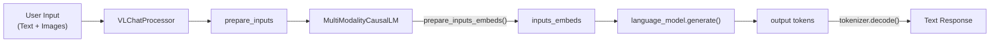
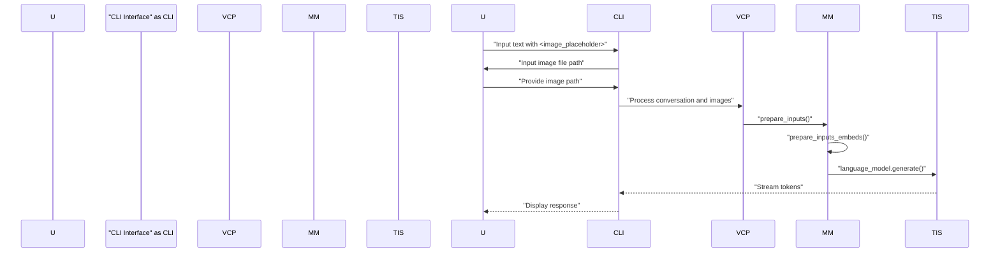
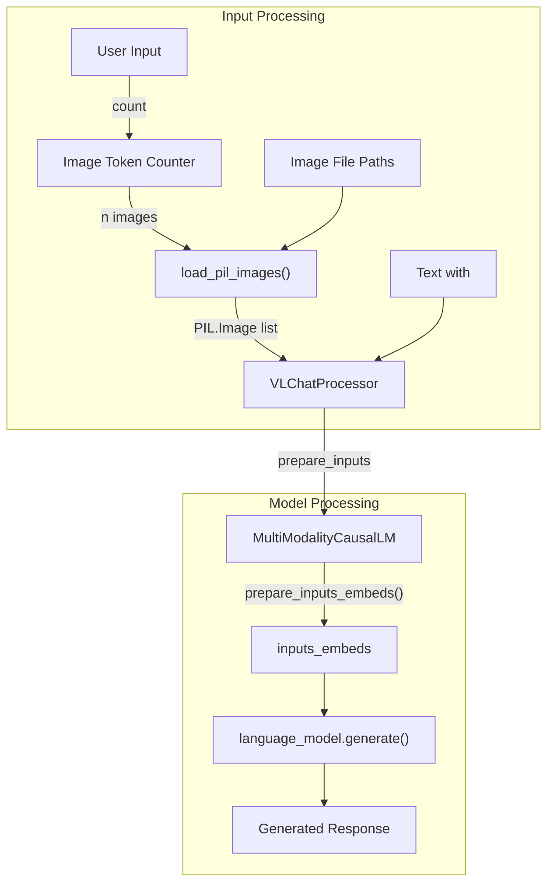
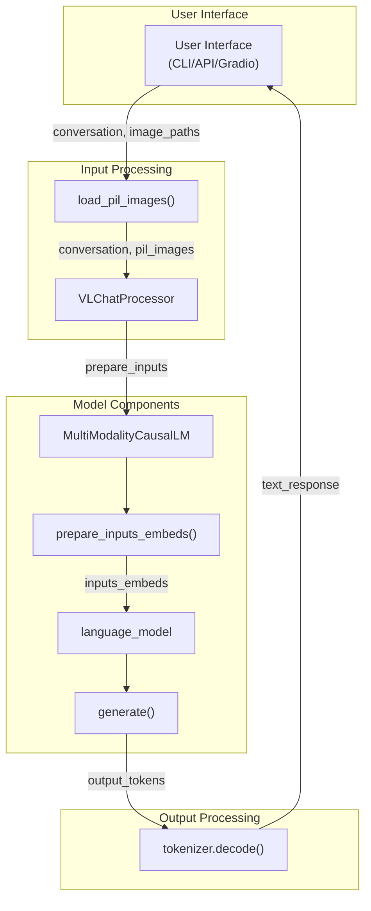

<!-- source: DeepWiki mcp.deepwiki.com · repo deepseek-ai/DeepSeek-VL · page 2.2 Quick Usage Examples · fetched 2026-10-30 -->

# Quick Usage Examples

<details>
<summary>Relevant source files</summary>

The following files were used as context for generating this wiki page:

- [README.md](README.md)
- [cli_chat.py](cli_chat.py)
- [inference.py](inference.py)

</details>


This page provides concise examples for utilizing DeepSeek-VL models in your vision-language applications. These examples demonstrate key usage patterns for quick implementation. For installation instructions, see [Installation](#2.1).

## Basic Inference Pipeline

The DeepSeek-VL inference pipeline follows a straightforward flow from input to output. The basic pattern involves loading a model, preparing a conversation with images, and generating a response.



Sources: [inference.py:26-86](), [README.md:119-187]()

### Simple Inference Example

The example below demonstrates basic inference with a single image:

```python
# Load processor and model
model_path = "deepseek-ai/deepseek-vl-7b-chat"
vl_chat_processor = VLChatProcessor.from_pretrained(model_path)
tokenizer = vl_chat_processor.tokenizer
vl_gpt = AutoModelForCausalLM.from_pretrained(model_path, trust_remote_code=True)
vl_gpt = vl_gpt.to(torch.bfloat16).cuda().eval()

# Define conversation with image
conversation = [
    {
        "role": "User",
        "content": "<image_placeholder>Describe each stage of this image.",
        "images": ["./images/training_pipelines.jpg"],
    },
    {"role": "Assistant", "content": ""},
]

# Process inputs and generate response
pil_images = load_pil_images(conversation)
prepare_inputs = vl_chat_processor(
    conversations=conversation, 
    images=pil_images, 
    force_batchify=True
).to(vl_gpt.device)
inputs_embeds = vl_gpt.prepare_inputs_embeds(**prepare_inputs)
outputs = vl_gpt.language_model.generate(
    inputs_embeds=inputs_embeds,
    attention_mask=prepare_inputs.attention_mask,
    pad_token_id=tokenizer.eos_token_id,
    bos_token_id=tokenizer.bos_token_id,
    eos_token_id=tokenizer.eos_token_id,
    max_new_tokens=512,
    do_sample=False,
    use_cache=True
)
answer = tokenizer.decode(outputs[0].cpu().tolist(), skip_special_tokens=True)
```

Sources: [inference.py:26-86](), [README.md:119-187]()

## CLI Chat Interface

DeepSeek-VL provides a command-line interface for interactive conversations with images through the `cli_chat.py` script.



Sources: [cli_chat.py:94-184](), [README.md:190-196]()

### Running the CLI Chat

To start a chat session:

```bash
python cli_chat.py --model_path "deepseek-ai/deepseek-vl-7b-chat"
```

Available command-line arguments:

| Argument | Default | Description |
|----------|---------|-------------|
| `--model_path` | "deepseek-ai/deepseek-vl-7b-chat" | HuggingFace model name or local path |
| `--temperature` | 0.2 | Controls randomness (0 for deterministic) |
| `--top_p` | 0.95 | Controls diversity of generated text |
| `--repetition_penalty` | 1.1 | Penalizes repetition in generated text |
| `--max_gen_len` | 512 | Maximum number of tokens to generate |

During the chat session, use these special commands:
- `exit`: Quit the program
- `help`: Show help message
- `new`: Start a new conversation

Sources: [cli_chat.py:94-184](), [cli_chat.py:212-224]()

## Multi-Image Conversations

DeepSeek-VL can process multiple images in a single conversation, enabling complex visual reasoning tasks.



Sources: [cli_chat.py:125-162](), [inference.py:46-62]()

### Multiple Images Example

```python
conversation = [
    {
        "role": "User",
        "content": "<image_placeholder>A dog wearing nothing, "
                   "<image_placeholder>a dog wearing a santa hat, "
                   "<image_placeholder>a dog wearing a wizard outfit, and "
                   "<image_placeholder>what's the dog wearing?",
        "images": [
            "images/dog_a.png",
            "images/dog_b.png",
            "images/dog_c.png",
            "images/dog_d.png",
        ],
    },
    {"role": "Assistant", "content": ""}
]
```

Sources: [inference.py:46-62](), [README.md:146-161]()

## Model Variants

DeepSeek-VL offers different model sizes and variants to accommodate various needs:

| Model | Parameters | Context Length | Purpose |
|-------|------------|----------------|---------|
| DeepSeek-VL-1.3B-base | 1.3 billion | 4096 | Foundation model for fine-tuning |
| DeepSeek-VL-1.3B-chat | 1.3 billion | 4096 | Optimized for conversation |
| DeepSeek-VL-7B-base | 7 billion | 4096 | Larger foundation model |
| DeepSeek-VL-7B-chat | 7 billion | 4096 | Larger conversation model |

- **Base models**: Better for fine-tuning or specialized applications
- **Chat models**: Ready for conversational applications
- **1.3B models**: Lower resource requirements, faster inference
- **7B models**: Higher capabilities, more resource-intensive

Sources: [README.md:91-104]()

## Gradio Web Interface

For a graphical interface, DeepSeek-VL provides a Gradio-based web UI:

```bash
pip install -e .[gradio]
python deepseek_vl/serve/app_deepseek.py
```

This launches a local web server with an interactive interface for uploading images and chatting with the model.

Sources: [README.md:198-204]()

## Inference Flow Details

The following diagram provides a detailed view of the internal processing flow during inference:



Sources: [inference.py:65-86](), [cli_chat.py:56-77]()

This detailed view shows how the components work together during inference:

1. The user interface collects conversation and image paths
2. `load_pil_images()` converts paths to PIL Image objects
3. `VLChatProcessor` prepares inputs from conversation and images
4. `MultiModalityCausalLM.prepare_inputs_embeds()` creates embeddings
5. `language_model.generate()` produces token outputs
6. `tokenizer.decode()` converts tokens to text
7. The response is returned to the user interface

---

