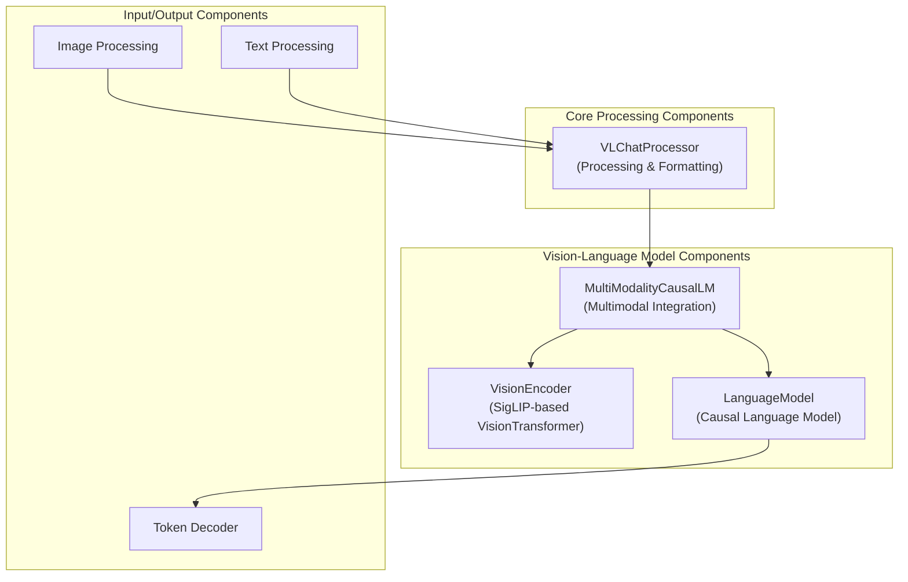
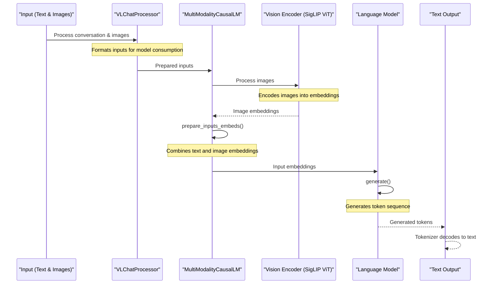
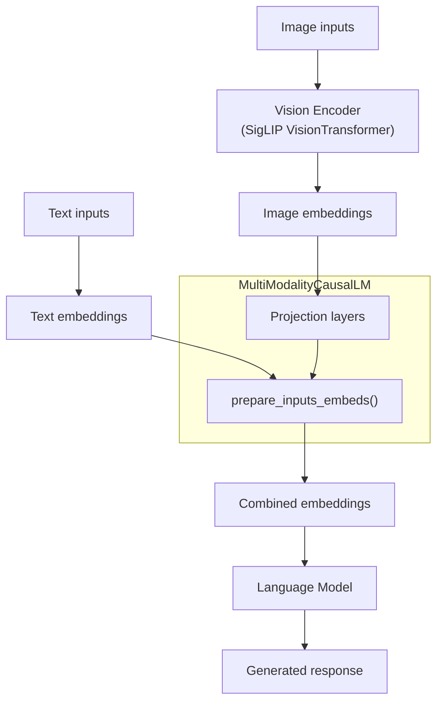
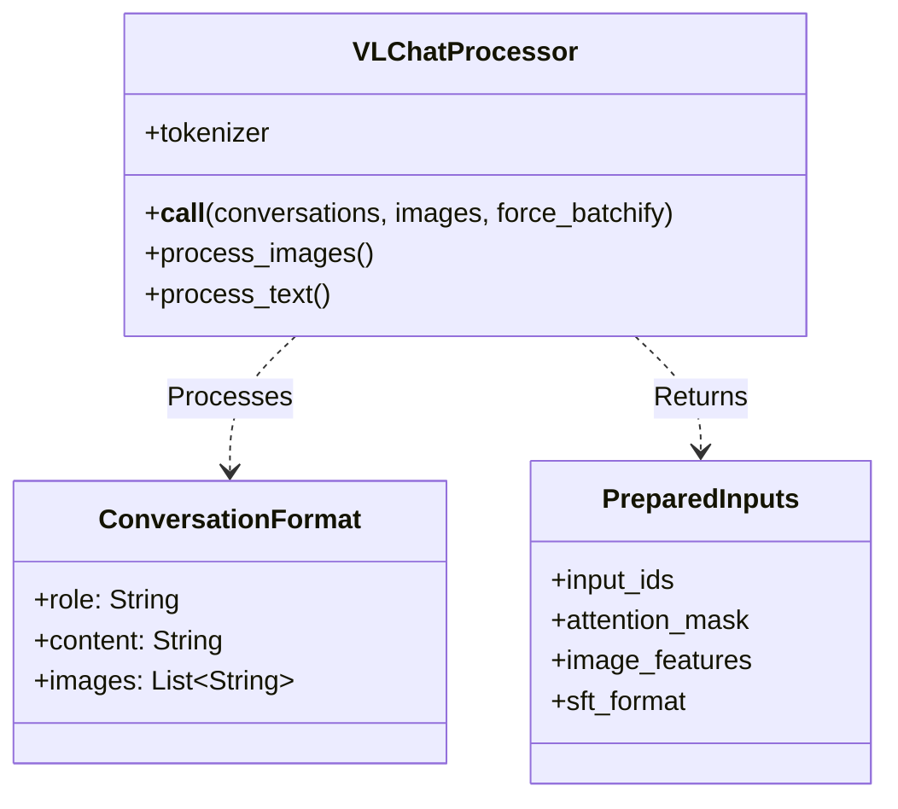
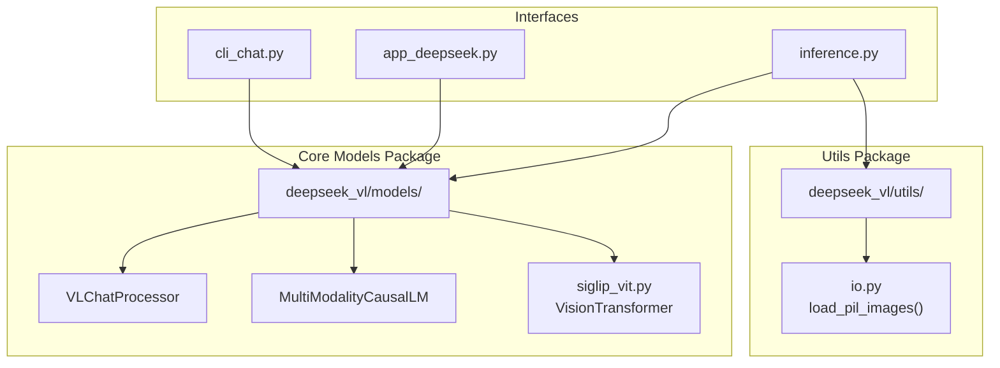

<!-- source: DeepWiki mcp.deepwiki.com · repo deepseek-ai/DeepSeek-VL · page 3 Components · fetched 2026-10-30 -->

# Components

<details>
<summary>Relevant source files</summary>

The following files were used as context for generating this wiki page:

- [README.md](README.md)
- [deepseek_vl/__init__.py](deepseek_vl/__init__.py)
- [deepseek_vl/models/siglip_vit.py](deepseek_vl/models/siglip_vit.py)
- [inference.py](inference.py)

</details>


This page provides a comprehensive overview of the main components that make up the DeepSeek-VL system. DeepSeek-VL is a vision-language model designed to process and understand both visual and textual information, generating cohesive natural language responses. For information about model architecture specifics, see [Model Architecture](#1.1). For details on installation and usage, see [Getting Started](#2).

## Core Components Overview

DeepSeek-VL is composed of several key components that work together to enable multimodal understanding. These components can be categorized into three main subsystems:



Sources: [README.md:60-68](), [inference.py:20-37]()

## Component Interaction Flow

The following diagram illustrates how these components interact during the inference process:



Sources: [inference.py:64-86]()

## Vision Processing Component

The vision component of DeepSeek-VL is based on a SigLIP (Simple Gated CLIP) Vision Transformer architecture.

### Vision Transformer

```mermaid
classDiagram
    class VisionTransformer {
        +forward_features(x)
        +forward_head(x)
        +forward(x)
    }
    
    class PatchEmbed {
        +Converts images to patch embeddings
    }
    
    class Block {
        +Transformer block
        +Self-attention mechanism
        +MLP layer
    }
    
    class Attention {
        +Multi-head self-attention
    }
    
    VisionTransformer --> PatchEmbed : Contains
    VisionTransformer --> Block : Contains sequence of
    Block --> Attention : Contains
    Block --> "MLP" : Contains
```

The VisionTransformer processes images through the following steps:
1. Images are divided into patches using the PatchEmbed component
2. Positional embeddings are added to provide spatial information
3. The embedded patches are processed through a series of transformer blocks
4. Each block contains self-attention mechanisms and MLP layers
5. The output is a sequence of token embeddings representing the visual content

The primary implementation is in the `VisionTransformer` class, with different configurations available based on model size:

- SigLIP SO400M patch14 (384px)
- SigLIP SO400M patch14 (224px)
- SigLIP Large patch16 (384px)

Sources: [deepseek_vl/models/siglip_vit.py:259-589](), [deepseek_vl/models/siglip_vit.py:606-626]()

## Language Processing Component

The language model component is a decoder-only transformer architecture that processes tokenized text and generates responses. It works with the embeddings provided by the multimodal integration component.

The language model:
1. Takes combined visual and textual embeddings as input
2. Uses the causal attention mechanism to generate tokens sequentially
3. Processes through transformer blocks with self-attention and feed-forward layers
4. Outputs probability distributions over vocabulary tokens

The generation process is controlled by parameters such as:
- `max_new_tokens`: Maximum length of the generated response
- `do_sample`: Whether to use sampling techniques for generation
- `use_cache`: Enables faster generation by caching key/value pairs

Sources: [inference.py:73-84]()

## Multimodal Integration Component

The `MultiModalityCausalLM` is the core component that bridges vision and language processing, implemented as a class that inherits from `AutoModelForCausalLM`.



The `MultiModalityCausalLM` performs these key functions:
1. Processes images through the vision encoder
2. Projects image embeddings to the language model's dimension space
3. Combines image and text embeddings in the proper sequence
4. Passes the combined embeddings to the language model for generation
5. The crucial method `prepare_inputs_embeds()` handles the fusion of modalities

Sources: [inference.py:31-32](), [inference.py:70-71]()

## Processing Pipeline Components

### VLChatProcessor

The `VLChatProcessor` is responsible for preparing inputs for the model by handling both text and images:



The VLChatProcessor handles:
1. Loading and preprocessing images from file paths
2. Converting conversation format to model-compatible format
3. Handling image placeholders in text
4. Tokenizing text content
5. Creating attention masks
6. Packaging all inputs in a format expected by the model

Sources: [inference.py:23-24](), [inference.py:65-68]()

### Image Processing

Image processing in DeepSeek-VL involves:
1. Loading images using PIL
2. Resizing and normalizing images
3. Preparing images for the vision encoder

The `load_pil_images` utility function handles converting image paths to PIL Image objects for processing.

Sources: [inference.py:65](), [README.md:164]()

### Text Processing

Text processing involves:
1. Tokenization of text inputs
2. Handling special tokens like image placeholders
3. Creating attention masks for the transformer model
4. Handling the conversation format with roles (User/Assistant)

The tokenizer is a core component used for both encoding inputs and decoding generated outputs.

Sources: [inference.py:23-29](), [inference.py:85-86]()

## Component Implementation Details

### Model Variants

DeepSeek-VL components are available in different configurations:

| Model Variant | Parameter Size | Vision Encoder | Language Model |
|---------------|----------------|----------------|----------------|
| DeepSeek-VL-1.3B-base | 1.3 Billion | SigLIP-based VisionTransformer | 1.3B LM |
| DeepSeek-VL-1.3B-chat | 1.3 Billion | SigLIP-based VisionTransformer | 1.3B LM (chat-tuned) |
| DeepSeek-VL-7B-base | 7 Billion | SigLIP-based VisionTransformer | 7B LM |
| DeepSeek-VL-7B-chat | 7 Billion | SigLIP-based VisionTransformer | 7B LM (chat-tuned) |

All variants share the same component architecture but differ in the size and capabilities of individual components.

Sources: [README.md:91-103]()

### Loading Components

Components are typically loaded and initialized as follows:

1. Load the VLChatProcessor from the model path
2. Extract the tokenizer from the processor
3. Load the MultiModalityCausalLM model
4. Convert model to appropriate precision (e.g., bfloat16)
5. Move model to appropriate device (e.g., CUDA)

This pattern is consistent across different interfaces (CLI, Gradio, Python API).

Sources: [inference.py:27-34](), [README.md:129-133]()

## Component Relationships in Codebase

The following diagram shows how the components are structured in the codebase:



Sources: [README.md:192-203](), [inference.py:20-24]()

The DeepSeek-VL component architecture is designed to be modular and flexible, allowing for different model sizes and applications while maintaining a consistent interface for developers.

---

