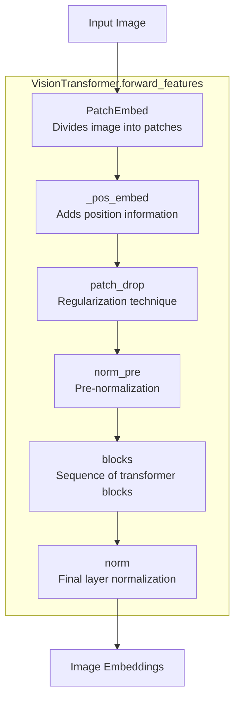
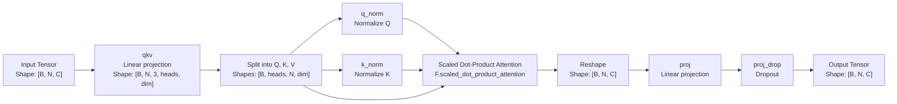
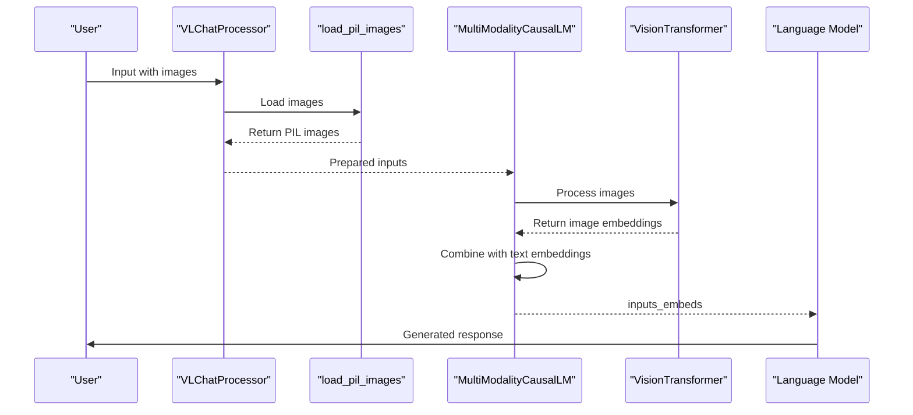
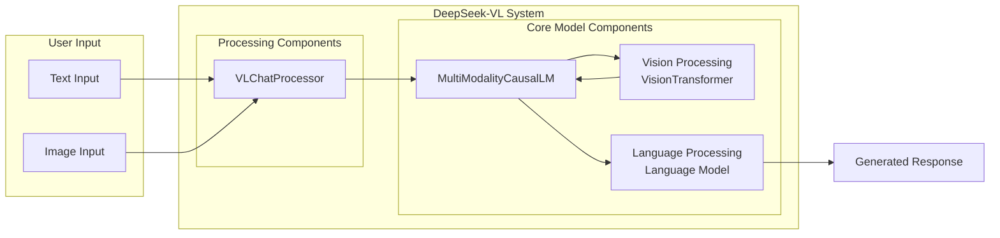

<!-- source: DeepWiki mcp.deepwiki.com · repo deepseek-ai/DeepSeek-VL · page 3.1 Vision Processing · fetched 2026-10-30 -->

# Vision Processing

<details>
<summary>Relevant source files</summary>

The following files were used as context for generating this wiki page:

- [deepseek_vl/__init__.py](deepseek_vl/__init__.py)
- [deepseek_vl/models/siglip_vit.py](deepseek_vl/models/siglip_vit.py)
- [inference.py](inference.py)

</details>


This document details the Vision Processing component in DeepSeek-VL, which is responsible for encoding images into a format that can be processed alongside text inputs. For information about how these visual encodings are combined with text representations, see [Multimodal Integration](#3.3).

## Overview

The Vision Processing component uses a SigLIP-based Vision Transformer (ViT) to convert images into embedded representations. This component is the first stage in processing visual data within the DeepSeek-VL architecture, transforming raw pixel data into meaningful feature vectors that the language model can utilize.

The vision processing pipeline consists of several key steps:
1. Dividing images into patches
2. Embedding these patches into a continuous vector space
3. Adding positional information
4. Processing through transformer layers
5. Generating the final image embeddings

Sources:
- [deepseek_vl/models/siglip_vit.py:259-589]()
- [inference.py:70-71]()

## Vision Transformer Architecture

The DeepSeek-VL system implements a SigLIP (Sigmoid Loss for Image Processing) based Vision Transformer architecture. This implementation follows the design introduced in "An Image is Worth 16x16 Words: Transformers for Image Recognition at Scale" but with specific modifications for multimodal integration.



Sources:
- [deepseek_vl/models/siglip_vit.py:562-572]()
- [deepseek_vl/models/siglip_vit.py:359-368]() - Patch embedding
- [deepseek_vl/models/siglip_vit.py:476-507]() - Position embedding

### Transformer Block Structure

Each transformer block in the vision encoder contains self-attention mechanisms and feed-forward neural networks, following the standard transformer architecture:


Sources:
- [deepseek_vl/models/siglip_vit.py:209-256]() - Block implementation
- [deepseek_vl/models/siglip_vit.py:253-256]() - Block forward method

### Self-Attention Mechanism

The core of each transformer block is the self-attention mechanism, which allows the model to focus on relevant parts of the image:



Sources:
- [deepseek_vl/models/siglip_vit.py:136-191]() - Attention class
- [deepseek_vl/models/siglip_vit.py:164-190]() - Attention forward method

## Model Configurations

DeepSeek-VL provides multiple SigLIP Vision Transformer configurations for different use cases:

| Model Name | Image Size | Patch Size | Width | Layers | Heads | MLP Ratio |
|------------|------------|------------|-------|--------|-------|-----------|
| siglip_so400m_patch14_384 | 336 | 14 | 1152 | 27 | 16 | 3.7362 |
| siglip_so400m_patch14_224 | 224 | 14 | 1152 | 27 | 16 | 3.7362 |
| siglip_large_patch16_384 | 384 | 16 | 1024 | 24 | 16 | 4 |

The configurations are instantiated through the `create_siglip_vit` function, which initializes a `VisionTransformer` with the appropriate parameters based on the model name.

Sources:
- [deepseek_vl/models/siglip_vit.py:606-637]() - SigLIP_MODEL_CONFIG dictionary
- [deepseek_vl/models/siglip_vit.py:640-681]() - create_siglip_vit function

## Integration in the Inference Pipeline

The vision processing component integrates into the overall DeepSeek-VL inference pipeline as follows:



The specific steps in the inference process are:

1. **Image Loading**: Images are loaded using `load_pil_images` utility
2. **Input Processing**: `VLChatProcessor` prepares the multimodal inputs
3. **Embedding Generation**: `prepare_inputs_embeds` method in `MultiModalityCausalLM` calls the vision encoder
4. **Vision Processing**: The `VisionTransformer` processes images through its layers
5. **Integration**: Image embeddings are combined with text embeddings
6. **Language Model**: The combined embeddings are passed to the language model for response generation

Sources:
- [inference.py:65-75]() - Input preparation and embedding generation
- [inference.py:74-85]() - Language model generation

## Usage Example

Here's a simplified example of how the vision processing component is used in practice:

```python
# Load processor and model
model_path = "deepseek-ai/deepseek-vl-7b-chat"
vl_chat_processor = VLChatProcessor.from_pretrained(model_path)
tokenizer = vl_chat_processor.tokenizer
vl_gpt = AutoModelForCausalLM.from_pretrained(model_path, trust_remote_code=True)

# Prepare conversation with image
conversation = [
    {
        "role": "User",
        "content": "<image_placeholder>Describe this image.",
        "images": ["path/to/image.jpg"],
    },
    {"role": "Assistant", "content": ""},
]

# Process inputs
pil_images = load_pil_images(conversation)
prepare_inputs = vl_chat_processor(
    conversations=conversation, images=pil_images, force_batchify=True
).to(vl_gpt.device)

# Generate vision embeddings and run language model
inputs_embeds = vl_gpt.prepare_inputs_embeds(**prepare_inputs)
outputs = vl_gpt.language_model.generate(
    inputs_embeds=inputs_embeds,
    attention_mask=prepare_inputs.attention_mask,
    max_new_tokens=512,
)
```

Sources:
- [inference.py:27-86]() - Complete example

## Performance Considerations

The Vision Transformer architecture includes several optimizations for better performance:

1. **Gradient Checkpointing**: Can be enabled via `set_grad_checkpointing` to reduce memory usage during training
2. **Fused Attention**: Uses PyTorch's optimized `scaled_dot_product_attention` for efficient attention computation
3. **LayerScale**: Optional scaling mechanism that helps with training stability, especially for deeper models
4. **DropPath (Stochastic Depth)**: Randomly drops layers during training to improve generalization

Sources:
- [deepseek_vl/models/siglip_vit.py:454-455]() - Gradient checkpointing
- [deepseek_vl/models/siglip_vit.py:174-186]() - Fused attention implementation
- [deepseek_vl/models/siglip_vit.py:194-206]() - LayerScale implementation

## Relationship to the Overall Architecture

The Vision Processing component is part of the broader DeepSeek-VL architecture:



The Vision Processing component (highlighted in this document) is responsible for the critical task of transforming visual inputs into representations that can be processed by the language model, enabling DeepSeek-VL's multimodal capabilities.

Sources:
- [inference.py:70-85]() - Integration in the inference pipeline
- [deepseek_vl/models/siglip_vit.py:259-589]() - VisionTransformer implementation

---

