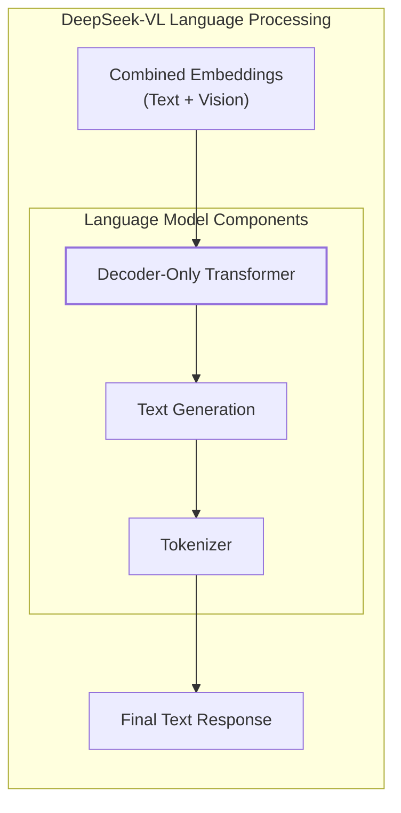
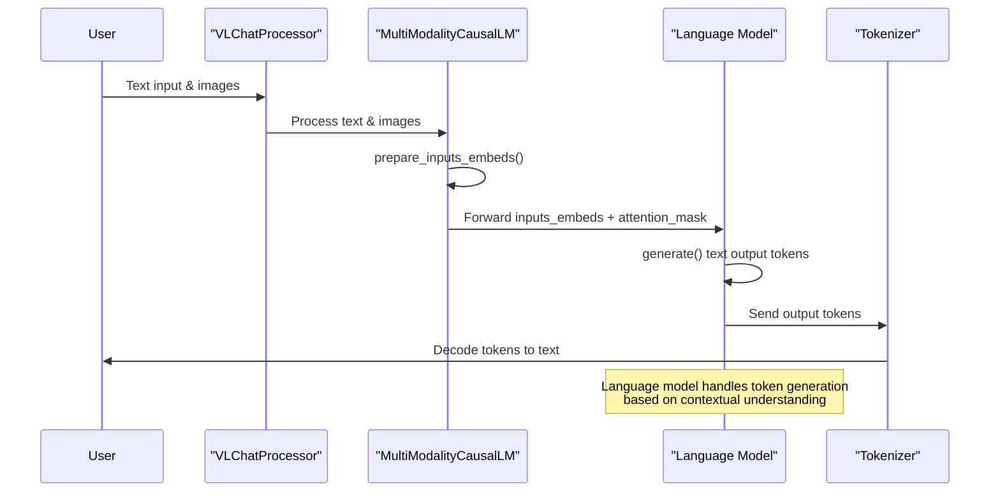
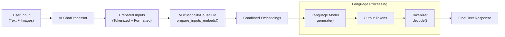

<!-- source: DeepWiki mcp.deepwiki.com · repo deepseek-ai/DeepSeek-VL · page 3.2 Language Processing · fetched 2026-10-30 -->

# Language Processing

<details>
<summary>Relevant source files</summary>

The following files were used as context for generating this wiki page:

- [README.md](README.md)
- [inference.py](inference.py)

</details>


This document details the language processing component of the DeepSeek-VL system, focusing on how textual information is processed and generated in response to multimodal inputs. The language model is a key component that works alongside the vision processing system (see [Vision Processing](#3.1)) and forms part of the multimodal integration architecture (see [Multimodal Integration](#3.3)).

## Overview of Language Processing in DeepSeek-VL

The DeepSeek-VL language processing component is built upon a transformer-based language model that handles token generation based on combined text and image representations. It serves as the reasoning and output generation engine of the multimodal system.

Sources: [README.md:60-62](), [inference.py:74-83]()

## Language Model Architecture

DeepSeek-VL incorporates a causal language model that follows a decoder-only transformer architecture. This language model receives embedded representations from both text inputs and processed image features to generate contextually relevant responses.



Sources: [inference.py:70-86]()

### Model Variants

DeepSeek-VL provides language models in two parameter sizes, each with base and chat-optimized variants:

| Model Variant | Parameters | Context Length | Primary Use Case |
|---------------|------------|----------------|------------------|
| DeepSeek-VL-1.3B-base | 1.3 billion | 4096 tokens | Foundational language understanding |
| DeepSeek-VL-1.3B-chat | 1.3 billion | 4096 tokens | Conversational applications |
| DeepSeek-VL-7B-base | 7 billion | 4096 tokens | Enhanced language understanding |
| DeepSeek-VL-7B-chat | 7 billion | 4096 tokens | Advanced conversational applications |

Sources: [README.md:91-103]()

## Language Processing Pipeline

The language processing component operates within a broader multimodal pipeline. Understanding this workflow is essential to grasp how the language model functions in context.



Sources: [inference.py:64-86]()

### Input Processing

The language model receives preprocessed inputs from the multimodal integration layer:

1. Text is tokenized into token IDs
2. Vision features are projected into the same embedding space as text
3. Combined embeddings are provided to the language model

Sources: [inference.py:65-71]()

### Text Generation

The generation process is controlled by several parameters that can be tuned for different applications:

```python
# Key generation parameters
outputs = vl_gpt.language_model.generate(
    inputs_embeds=inputs_embeds,
    attention_mask=prepare_inputs.attention_mask,
    pad_token_id=tokenizer.eos_token_id,
    bos_token_id=tokenizer.bos_token_id,
    eos_token_id=tokenizer.eos_token_id,
    max_new_tokens=512,
    do_sample=False,
    use_cache=True
)
```

Sources: [inference.py:74-83]()

## Code Structure and Implementation

The language processing functionality is implemented through several key classes and methods:

```mermaid
classDiagram
    class "MultiModalityCausalLM" {
        +language_model
        +prepare_inputs_embeds()
    }
    
    class "LanguageModel" {
        +generate()
        +forward()
    }
    
    class "VLChatProcessor" {
        +tokenizer
        +__call__()
    }
    
    class "Tokenizer" {
        +encode()
        +decode()
    }
    
    MultiModalityCausalLM --> LanguageModel : contains
    VLChatProcessor --> Tokenizer : contains
    MultiModalityCausalLM ..> VLChatProcessor : uses
```

Sources: [inference.py:20-34]()

### Key Classes

1. **MultiModalityCausalLM**: The top-level model class that integrates vision and language components
   - Contains the language model as a component
   - Provides the `prepare_inputs_embeds()` method to combine text and image representations

2. **Language Model**: Handles the actual text generation based on combined embeddings
   - Implements the `generate()` method for token generation
   - Processes the inputs through transformer layers

3. **VLChatProcessor**: Processes raw inputs (text and images) into a format suitable for the model
   - Contains the tokenizer for text processing
   - Formats conversations in a specific structure expected by the model

4. **Tokenizer**: Handles conversion between text and token IDs
   - Encodes text to token IDs for model input
   - Decodes token IDs to text for final output

Sources: [inference.py:25-34](), [inference.py:65-86]()

## Inference Process

The complete inference process that highlights the language processing component works as follows:



Sources: [inference.py:65-86]()

### Loading the Model

The language model is loaded as part of the MultiModalityCausalLM:

```python
vl_gpt: MultiModalityCausalLM = AutoModelForCausalLM.from_pretrained(
    model_path, trust_remote_code=True
)
vl_gpt = vl_gpt.to(torch.bfloat16).cuda().eval()
```

Sources: [inference.py:31-34]()

### Preparing Inputs

Inputs are prepared using the VLChatProcessor, which processes both text and images:

```python
pil_images = load_pil_images(conversation)
prepare_inputs = vl_chat_processor(
    conversations=conversation, images=pil_images, force_batchify=True
).to(vl_gpt.device)
```

Sources: [inference.py:65-68]()

### Generating Text

The actual text generation is performed by the language model:

```python
outputs = vl_gpt.language_model.generate(
    inputs_embeds=inputs_embeds,
    attention_mask=prepare_inputs.attention_mask,
    # Additional parameters...
)
```

Sources: [inference.py:74-83]()

## Practical Usage

The language processing component is seamlessly integrated into the overall multimodal architecture, with the full inference pipeline abstracted for end users. When using DeepSeek-VL, the language processing component automatically handles text generation based on the provided inputs:

```python
# After preparing inputs
inputs_embeds = vl_gpt.prepare_inputs_embeds(**prepare_inputs)
outputs = vl_gpt.language_model.generate(...)
answer = tokenizer.decode(outputs[0].cpu().tolist(), skip_special_tokens=True)
```

Sources: [inference.py:70-86]()

## Capabilities and Use Cases

The language model component enables DeepSeek-VL to handle various text generation tasks:

1. **Image Description**: Generating detailed descriptions of images
2. **Visual Question Answering**: Responding to questions about visual content
3. **Multi-image Reasoning**: Processing multiple images and responding with contextual understanding
4. **Document Understanding**: Comprehending text within images like diagrams, web pages, and formulas

Sources: [README.md:62-63]()

## Integration with Other Components

The language model works in conjunction with other DeepSeek-VL components:

1. **Vision Encoder**: Provides image features that are combined with text representations
2. **MultiModalityCausalLM**: Integrates vision and language components
3. **VLChatProcessor**: Prepares inputs for the language model

For more details on how these components interact, see [Multimodal Integration](#3.3).

Sources: [inference.py:20-34](), [inference.py:70-86]()

---

