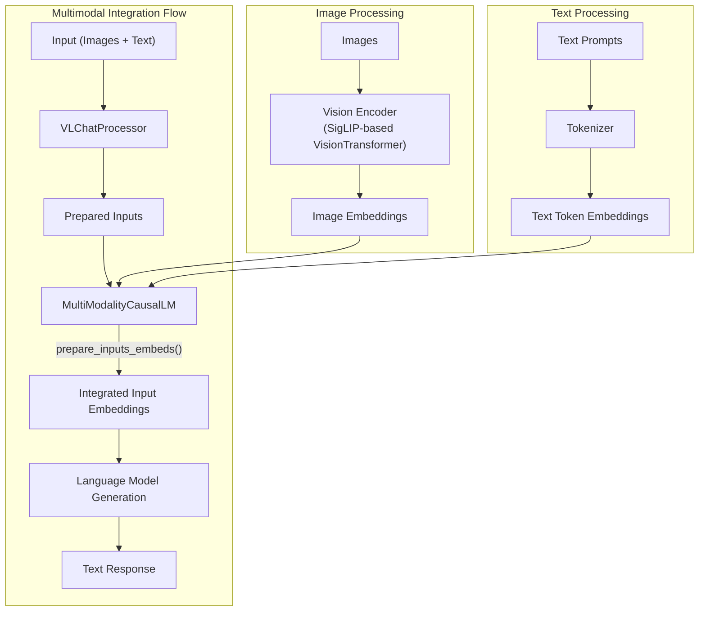
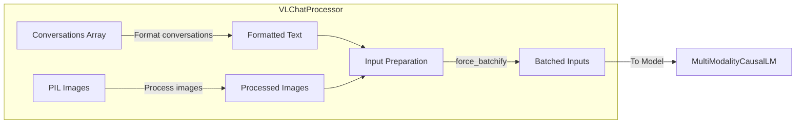
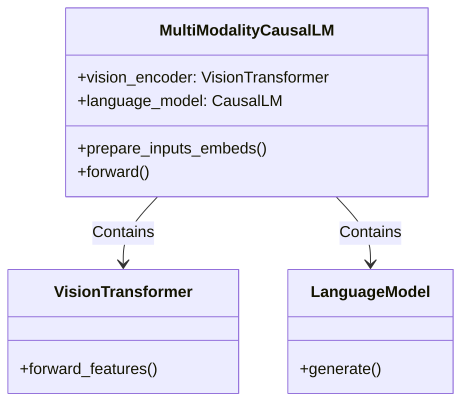
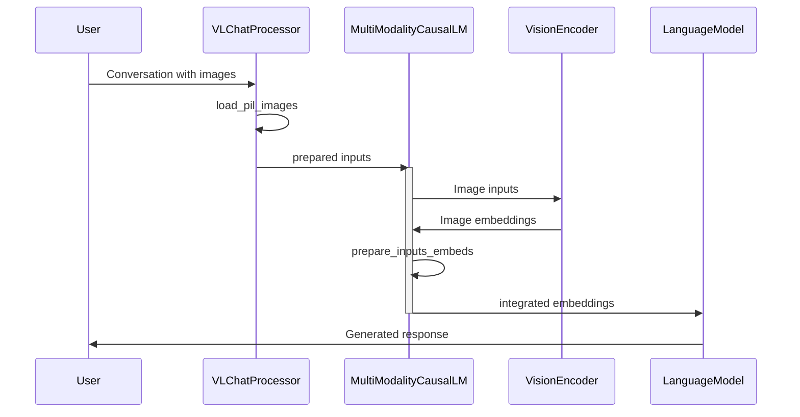
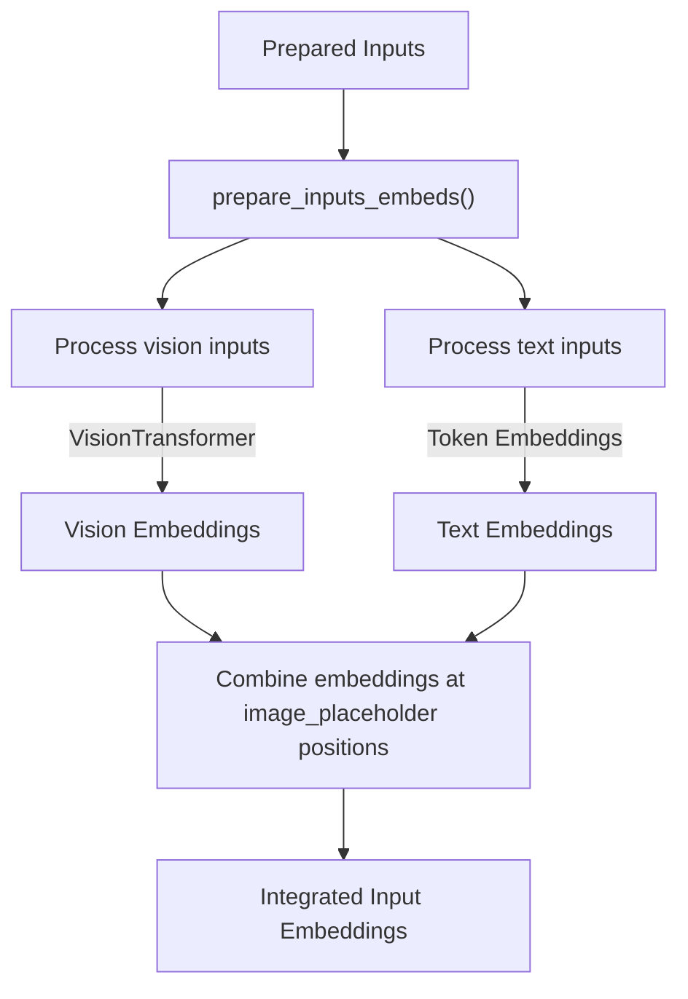
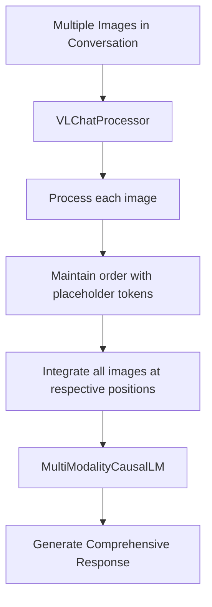
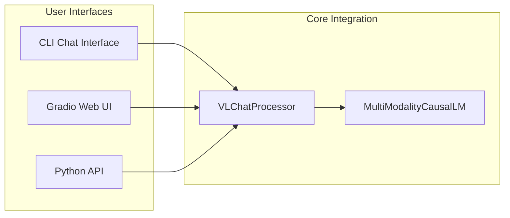

<!-- source: DeepWiki mcp.deepwiki.com · repo deepseek-ai/DeepSeek-VL · page 3.3 Multimodal Integration · fetched 2026-10-30 -->

# Multimodal Integration

<details>
<summary>Relevant source files</summary>

The following files were used as context for generating this wiki page:

- [README.md](README.md)
- [deepseek_vl/__init__.py](deepseek_vl/__init__.py)
- [deepseek_vl/models/siglip_vit.py](deepseek_vl/models/siglip_vit.py)
- [inference.py](inference.py)

</details>


This document explains the multimodal integration architecture in DeepSeek-VL, specifically focusing on how vision and language modalities are combined to enable comprehensive understanding capabilities. For information about the specific vision processing components, see [Vision Processing](#3.1), and for details on language processing, see [Language Processing](#3.2).

## Overview

DeepSeek-VL uses a carefully designed architecture to integrate visual and textual information. This integration allows the model to process images and text together, enabling it to understand and respond to inputs that contain both modalities.



Sources: [README.md:60-69](), [inference.py:20-36]()

## Key Components

The multimodal integration in DeepSeek-VL is primarily handled by two key components:

1. **VLChatProcessor**: Prepares and formats the multimodal inputs
2. **MultiModalityCausalLM**: Integrates vision and language representations

### VLChatProcessor

The `VLChatProcessor` handles the initial processing of both text and images, preparing them for integration.



Sources: [inference.py:65-68]()

The processor accepts:
- A conversation history in a structured format with "role" and "content" fields
- Images referenced within the conversation using `<image_placeholder>` tokens
- Additional parameters for controlling batch processing

It outputs prepared inputs that are properly formatted for the MultiModalityCausalLM model.

### MultiModalityCausalLM

The `MultiModalityCausalLM` class is the core component responsible for integrating visual and language representations. It contains both the vision encoder (based on SigLIP) and the language model.



Sources: [inference.py:31-33](), [README.md:122-134]()

## Integration Process

The integration of vision and language modalities in DeepSeek-VL follows a specific process:

### 1. Input Preparation

Conversations with both text and images are structured in a specific format:

```
[
    {
        "role": "User",
        "content": "<image_placeholder>Question about the image",
        "images": ["path/to/image.jpg"]
    },
    {"role": "Assistant", "content": ""}
]
```

The `<image_placeholder>` token indicates where in the text the image should be referenced.

Sources: [inference.py:36-43](), [README.md:135-142]()

### 2. Processing and Embedding Generation



Sources: [inference.py:64-73](), [README.md:170-173]()

The key steps in this process are:

1. **Image Loading**: Images are loaded and processed using `load_pil_images` and prepared for the vision encoder
2. **Input Preparation**: The `VLChatProcessor` creates a structured input format with both text and image information
3. **Embedding Generation**: The vision encoder processes images to generate visual embeddings
4. **Multimodal Integration**: The `prepare_inputs_embeds` method combines visual and textual embeddings
5. **Response Generation**: The language model generates a response based on the integrated embeddings

### 3. The `prepare_inputs_embeds` Method

The `prepare_inputs_embeds` method in the `MultiModalityCausalLM` class is the critical integration point where vision and language representations are combined:



Sources: [inference.py:72](), [README.md:172]()

This method:
1. Processes the vision inputs through the vision encoder
2. Identifies where image embeddings should be inserted based on `<image_placeholder>` tokens
3. Combines the vision embeddings with the text embeddings at the appropriate positions
4. Returns a unified embedding representation that incorporates both modalities

## Vision-Language Understanding

The integration of vision and language enables DeepSeek-VL to perform a variety of multimodal tasks:

| Capability | Description |
|------------|-------------|
| Logical Diagrams | Understanding flowcharts, architectural diagrams, and other structured visual information |
| Web Pages | Processing and understanding web content including text and visual elements |
| Formula Recognition | Recognizing and understanding mathematical formulas in images |
| Scientific Literature | Comprehending scientific papers with figures, graphs, and tables |
| Natural Images | Understanding everyday photographs and their content |
| Embodied Intelligence | Supporting applications that require understanding the physical world |

Sources: [README.md:62]()

## Multi-Image Support

DeepSeek-VL natively supports integration of multiple images within a single conversation context:



Sources: [README.md:146-161](), [inference.py:46-62]()

This capability enables:
1. In-context learning with multiple examples
2. Comparative analysis across different images
3. Sequential reasoning through a series of visual inputs
4. Complex multimodal conversations with multiple visual references

## Technical Implementation Details

The integration architecture builds upon several specific technical choices:

1. **SigLIP Vision Transformer**: The vision component uses a SigLIP-based VisionTransformer for high-quality image embedding generation

2. **Placeholder Token Approach**: Rather than having separate inputs for text and images, DeepSeek-VL uses placeholder tokens to indicate where images should be integrated within the text

3. **Unified Embedding Space**: Both vision and language share a compatible embedding space, allowing the language model to process the combined embeddings meaningfully

4. **Batched Processing**: The architecture supports batched processing for efficient handling of multiple inputs

Sources: [deepseek_vl/models/siglip_vit.py:638-681](), [inference.py:66-68]()

## Integration with User Interfaces

The multimodal integration capabilities are exposed through several interfaces:



Sources: [README.md:190-204]()

Each interface provides access to the same underlying multimodal integration capabilities while offering different ways to interact with the model.

---

