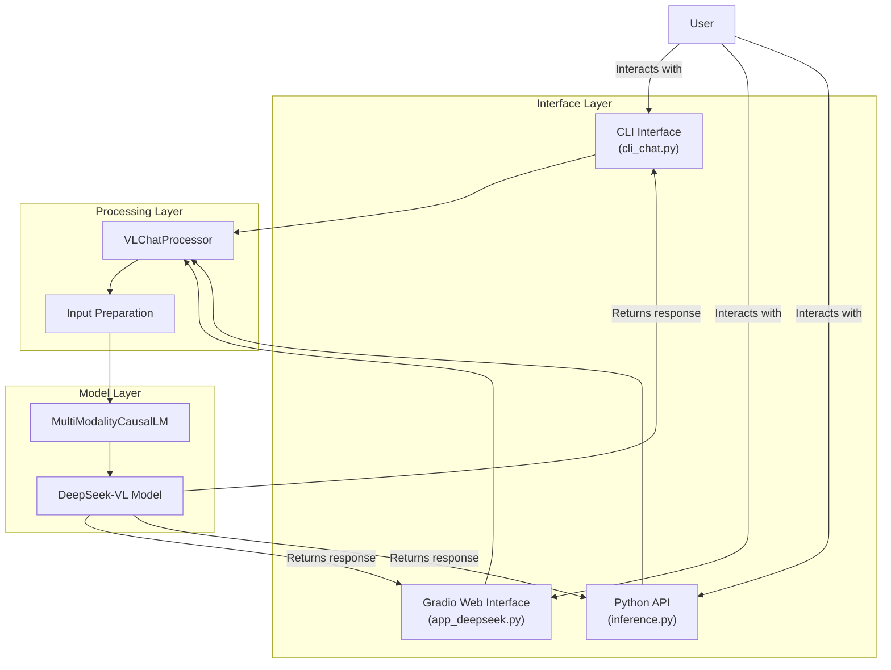
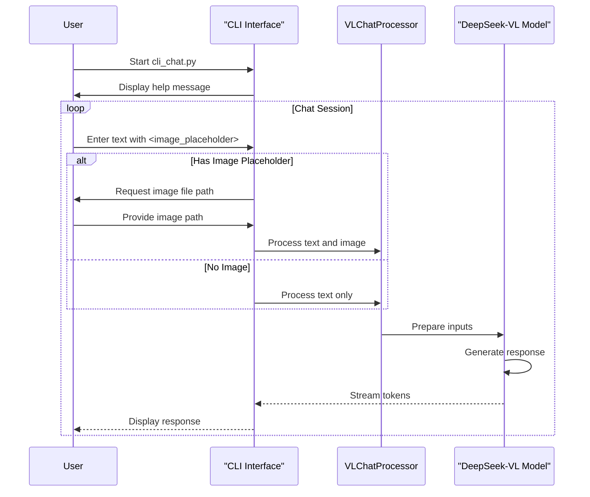
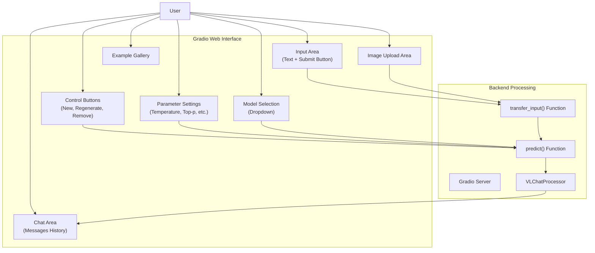
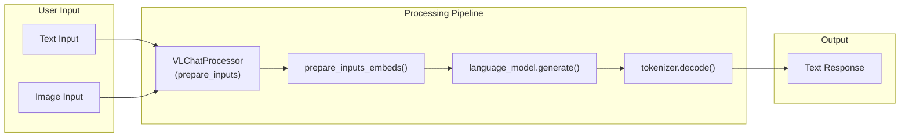

<!-- source: DeepWiki mcp.deepwiki.com · repo deepseek-ai/DeepSeek-VL · page 4 Interfaces · fetched 2026-10-30 -->

# Interfaces

<details>
<summary>Relevant source files</summary>

The following files were used as context for generating this wiki page:

- [README.md](README.md)
- [cli_chat.py](cli_chat.py)
- [deepseek_vl/serve/app_deepseek.py](deepseek_vl/serve/app_deepseek.py)

</details>


This page documents the available interfaces for interacting with the DeepSeek-VL model. It covers how users can access and utilize the model's capabilities through different interaction methods. For information about the model's architecture and capabilities, see [Overview](#1) and [Model Architecture](#1.1).

## 1. Interface Overview

DeepSeek-VL provides three primary interfaces for users to interact with the model:

1. **Command Line Interface (CLI)** - For terminal-based interactions
2. **Web Interface (Gradio)** - For browser-based interactions with a graphical user interface
3. **Python API** - For programmatic interactions within Python applications

These interfaces allow users to send text and image inputs to the model and receive generated responses based on the multimodal understanding of DeepSeek-VL.



Sources: [README.md:60-62](), [README.md:106-116]()

## 2. Command Line Interface (CLI)

The Command Line Interface provides a terminal-based way to interact with DeepSeek-VL through a chat-like experience.

### 2.1 CLI Features

- Interactive chat with the model
- Support for image input through file paths
- Multiple image handling in a single conversation
- Conversation management (new conversations, help, exit)
- Configurable generation parameters

### 2.2 CLI Usage

```
python cli_chat.py --model_path "deepseek-ai/deepseek-vl-7b-chat"
```

Parameters:
- `--model_path`: Model identifier or local path (default: "deepseek-ai/deepseek-vl-7b-chat")
- `--temperature`: Controls randomness in generation (default: 0.2)
- `--top_p`: Controls diversity via nucleus sampling (default: 0.95)
- `--repetition_penalty`: Penalizes repetition (default: 1.1)
- `--max_gen_len`: Maximum tokens to generate (default: 512)

### 2.3 CLI Interaction Flow



Sources: [cli_chat.py:94-184](), [cli_chat.py:210-224]()

### 2.4 CLI Commands

Within the CLI interface, users can use these special commands:

- `exit`: Quit the chat program
- `help`: Display help message
- `new`: Start a new conversation (clears history)
- `<image_placeholder>`: Indicates an image insertion point in the text

Sources: [cli_chat.py:33-54](), [cli_chat.py:94-133]()

## 3. Gradio Web Interface

The Gradio-based web interface provides a graphical user interface for interacting with DeepSeek-VL through a web browser.

### 3.1 Web Interface Features

- Chat-like conversation interface
- Image upload capability
- Model parameter adjustment panel
- Example showcases
- Conversation controls (regenerate, new conversation, remove last turn)
- Response streaming for real-time feedback

### 3.2 Web Interface Setup

To start the Gradio web interface:

```bash
pip install -e .[gradio]
python deepseek_vl/serve/app_deepseek.py
```

The server will start on `http://0.0.0.0:8122` by default.

### 3.3 Web Interface Components



Sources: [deepseek_vl/serve/app_deepseek.py:318-500]()

### 3.4 Web Interface Interaction Flow

The web interface follows this interaction pattern:

1. User enters text and/or uploads an image
2. User clicks "Send" or presses Enter
3. Interface prepares the input (combining text and image)
4. Model processes the input and generates a response
5. Response is streamed back to the interface in real-time
6. User can continue the conversation or start a new one

Sources: [deepseek_vl/serve/app_deepseek.py:196-279](), [deepseek_vl/serve/app_deepseek.py:482-498]()

## 4. Python API

The Python API allows developers to integrate DeepSeek-VL directly into their Python applications.

### 4.1 API Overview

The Python API provides programmatic access to:
- Load and initialize the model
- Process text and image inputs
- Generate responses
- Configure generation parameters

### 4.2 API Usage Example

```python
import torch
from transformers import AutoModelForCausalLM
from deepseek_vl.models import VLChatProcessor, MultiModalityCausalLM
from deepseek_vl.utils.io import load_pil_images

# Specify model path
model_path = "deepseek-ai/deepseek-vl-7b-chat"

# Load processor and model
vl_chat_processor = VLChatProcessor.from_pretrained(model_path)
tokenizer = vl_chat_processor.tokenizer
vl_gpt = AutoModelForCausalLM.from_pretrained(model_path, trust_remote_code=True)
vl_gpt = vl_gpt.to(torch.bfloat16).cuda().eval()

# Prepare conversation
conversation = [
    {
        "role": "User",
        "content": "<image_placeholder>Describe this image.",
        "images": ["path/to/image.jpg"],
    },
    {"role": "Assistant", "content": ""},
]

# Load images and prepare inputs
pil_images = load_pil_images(conversation)
prepare_inputs = vl_chat_processor(
    conversations=conversation,
    images=pil_images,
    force_batchify=True
).to(vl_gpt.device)

# Generate embeddings and response
inputs_embeds = vl_gpt.prepare_inputs_embeds(**prepare_inputs)
outputs = vl_gpt.language_model.generate(
    inputs_embeds=inputs_embeds,
    attention_mask=prepare_inputs.attention_mask,
    pad_token_id=tokenizer.eos_token_id,
    bos_token_id=tokenizer.bos_token_id,
    eos_token_id=tokenizer.eos_token_id,
    max_new_tokens=512,
    do_sample=False,
    use_cache=True
)

# Decode and display response
answer = tokenizer.decode(outputs[0].cpu().tolist(), skip_special_tokens=True)
print(answer)
```

Sources: [README.md:117-187]()

### 4.3 API Core Components

The main components used in the Python API are:

| Component | Description | Purpose |
|-----------|-------------|---------|
| `VLChatProcessor` | Processes conversations and images | Prepares inputs for the model |
| `MultiModalityCausalLM` | Core model class | Handles vision-language processing |
| `prepare_inputs_embeds()` | Method of MultiModalityCausalLM | Creates input embeddings |
| `generate()` | Method of language model | Generates text responses |
| `load_pil_images()` | Utility function | Loads and prepares images |

Sources: [README.md:120-123](), [README.md:127-133](), [README.md:165-172](), [README.md:175-186]()

## 5. Interaction Flow Between Components

The following diagram illustrates how user inputs flow through the DeepSeek-VL system, regardless of which interface is used:



Sources: [README.md:165-187](), [cli_chat.py:55-77](), [deepseek_vl/serve/app_deepseek.py:250-268]()

## 6. Example Images

DeepSeek-VL includes several example images that showcase the model's capabilities across different types of visual content:

| Example Image | Description | Path |
|---------------|-------------|------|
| Training Pipeline | Diagram of training process | `./images/training_pipelines.jpg` |
| App Screenshot | UI screenshot | `deepseek_vl/serve/examples/app.png` |
| Rap Image | Image for rap generation | `deepseek_vl/serve/examples/rap.jpeg` |
| Pipeline Diagram | Technical pipeline | `deepseek_vl/serve/examples/pipeline.png` |
| Chart | Data visualization | `deepseek_vl/serve/examples/chart.png` |
| Mirror Image | Optical illusion | `deepseek_vl/serve/examples/mirror.png` |
| Puzzle Image | Puzzle pieces | `deepseek_vl/serve/examples/puzzle.png` |

These examples can be used with any of the interfaces to test the model's multimodal understanding.

Sources: [deepseek_vl/serve/app_deepseek.py:414-439](), [README.md:135-142]()

## 7. Interface Selection Guide

| Interface | Best For | Technical Requirements | Startup Time |
|-----------|----------|------------------------|--------------|
| CLI | Terminal users, batch processing, scripting | Python environment | Fast |
| Web UI | Visual interaction, parameter tuning, demonstrations | Python + browser | Medium |
| Python API | Integration into applications, custom workflows | Python development skills | N/A (embedded) |

Choose the interface that best fits your use case and technical environment.

Sources: [README.md:106-116](), [README.md:118-187](), [README.md:189-196](), [README.md:198-204]()

---

