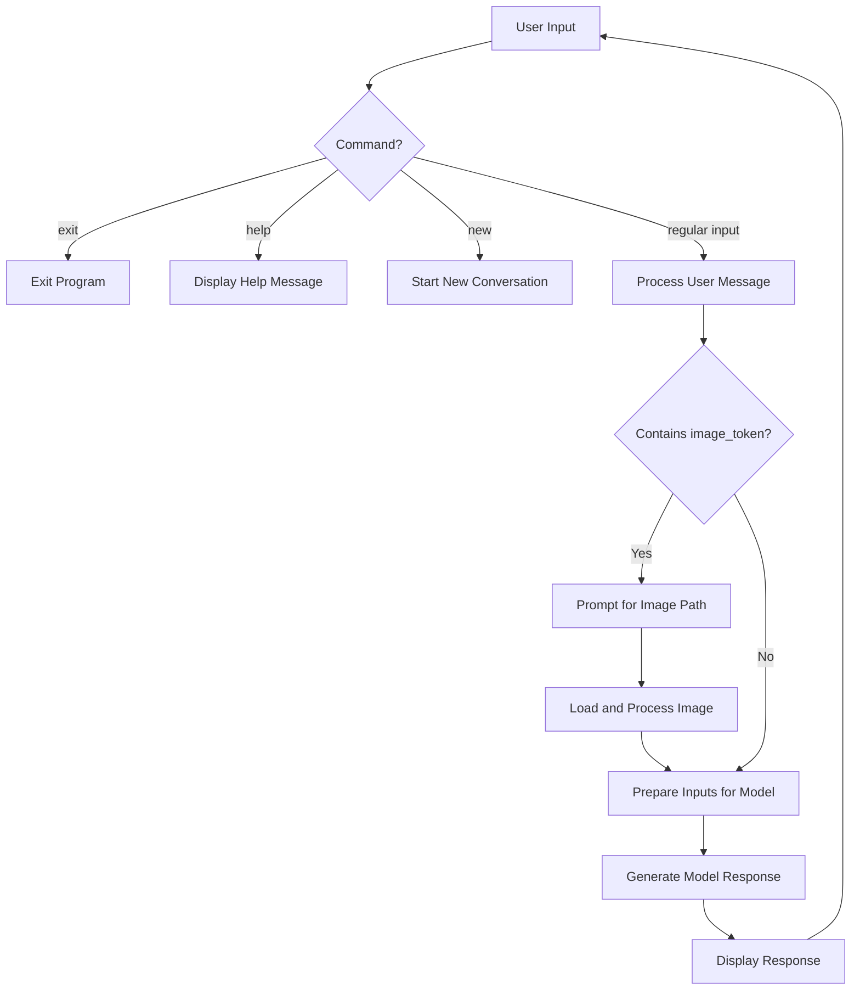
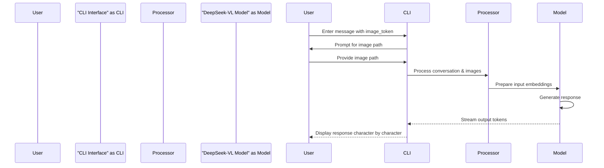
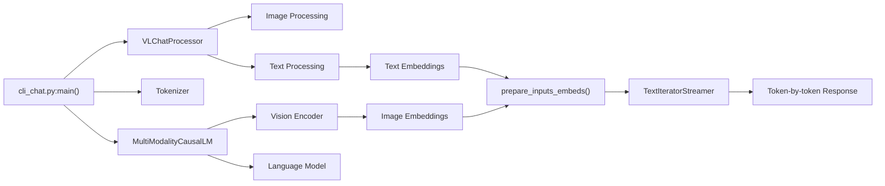

<!-- source: DeepWiki mcp.deepwiki.com · repo deepseek-ai/DeepSeek-VL · page 4.1 CLI Interface · fetched 2026-10-30 -->

# CLI Interface

<details>
<summary>Relevant source files</summary>

The following files were used as context for generating this wiki page:

- [README.md](README.md)
- [cli_chat.py](cli_chat.py)

</details>


The CLI (Command Line Interface) provides a terminal-based way to interact with DeepSeek-VL, allowing users to have conversations with the model and analyze images directly from the command line. This interface enables both text-only and multimodal interactions without requiring a graphical interface. For web-based interactions, see the [Gradio Web Interface](#4.2).

## Basic Usage

To use the CLI interface, first install the necessary dependencies:

```bash
pip install -e .
```

Then launch the CLI chat interface with:

```bash
python cli_chat.py --model_path "deepseek-ai/deepseek-vl-7b-chat"
```

You can also use a local model path if you've downloaded the model:

```bash
python cli_chat.py --model_path "/path/to/local/model"
```

Sources: [README.md:189-196](), [cli_chat.py:211-224]()

## Command Line Arguments

The CLI interface accepts several arguments to customize its behavior:

| Argument | Type | Default | Description |
|----------|------|---------|-------------|
| `--model_path` | string | "deepseek-ai/deepseek-vl-7b-chat" | Hugging Face model name or local path |
| `--temperature` | float | 0.2 | Controls randomness (0 for deterministic output) |
| `--top_p` | float | 0.95 | Nucleus sampling parameter |
| `--repetition_penalty` | float | 1.1 | Penalizes repetition in generated text |
| `--max_gen_len` | int | 512 | Maximum number of tokens to generate |

Sources: [cli_chat.py:212-222]()

## Interface Workflow

CLI Interface Control Flow



Sources: [cli_chat.py:94-185]()

## Special Commands

The CLI interface supports several special commands:

| Command | Description |
|---------|-------------|
| `exit` | Terminates the CLI program |
| `help` | Displays a help message explaining usage |
| `new` | Clears the current conversation and starts a new one |

When launching the CLI, a help message automatically displays, explaining these commands and basic usage instructions.

Sources: [cli_chat.py:39-52](), [cli_chat.py:94-124]()

## Working with Images

The CLI interface can process both text and images in conversation. To include images:

1. Use the `<image_placeholder>` token in your message where an image should be placed
2. When prompted, enter the path to the image file
3. Multiple images can be included in a single message by using the token multiple times

Example:
```
User [<image_placeholder> indicates an image]: <image_placeholder>Describe this image.
(1/1) Input the image file path: /path/to/image.jpg
```

Sources: [cli_chat.py:125-162]()

## Interaction Flow

User-Model Interaction Sequence



Sources: [cli_chat.py:54-77](), [cli_chat.py:163-184]()

## Technical Components

Key Components of the CLI Interface



The CLI interface integrates several key components:

1. **VLChatProcessor**: Processes both text and images for model input
2. **MultiModalityCausalLM (vl_gpt)**: The core DeepSeek-VL model
3. **TextIteratorStreamer**: Enables streaming output token-by-token
4. **Threading**: Allows response generation to run asynchronously while streaming results

Sources: [cli_chat.py:186-208](), [cli_chat.py:54-77]()

## Response Generation Process

The response generation flow consists of these steps:

1. User message and images are processed by `vl_chat_processor`
2. Input embeddings are prepared with `vl_gpt.prepare_inputs_embeds()`
3. A `TextIteratorStreamer` is configured to stream output tokens
4. Generation runs in a separate thread to allow streaming
5. Tokens are streamed and displayed in real-time as they're generated

This approach provides immediate feedback as the model generates its response.

Sources: [cli_chat.py:54-77](), [cli_chat.py:163-184]()

## Example Usage

Here's a sample interaction with the CLI interface:

```
DeepSeek-VL-Chat is a chatbot that can answer questions based on the given image. Enjoy it!
Usage:
    1. type `exit` to quit.
    2. type `<image_placeholder>` to indicate there is an image.
    3. type `help` to get the help messages.
    4. type `new` to start a new conversation.
    Here is an example, you can type: '<image_placeholder>Describe the image.'

User [<image_placeholder> indicates an image]: <image_placeholder>What can you see in this image?
(1/1) Input the image file path: ./images/training_pipelines.jpg
Assistant: The image shows a detailed illustration of DeepSeek-VL's training pipeline. It is divided 
into three main stages:

Stage 1: Pre-training
- This stage involves pre-training on a large corpus of image-text pairs
[...]
```

Sources: [README.md:134-143]()

## Troubleshooting

Common issues when using the CLI interface:

1. **Image file not found**: The CLI will show an error message and prompt for a valid path
2. **Memory issues with large models**: 
   - Use a machine with more GPU memory
   - Try the smaller 1.3B parameter model
   - Use the `new` command between conversations to clear cache
3. **Keyboard interrupts**: The CLI handles these gracefully, allowing you to cancel operations without exiting

Sources: [cli_chat.py:125-162](), [cli_chat.py:79-94]()

## Implementation Details

The CLI implementation consists of several key functions:

- `main()`: Entry point that sets up model and generation configuration
- `chat()`: Main loop for user interaction
- `response()`: Generates responses using the model
- `get_user_input()`: Handles user input with error handling
- `load_image()`: Processes image files for model input

The code uses Python's threading module to run generation in the background while streaming tokens to the user interface.

Sources: [cli_chat.py:20-224]()

---

