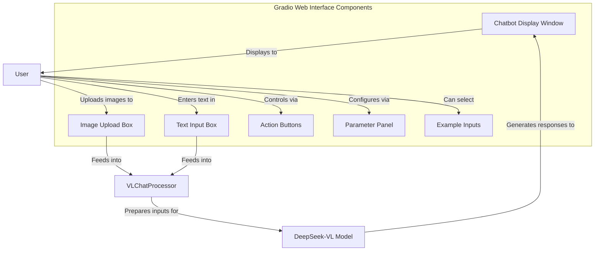
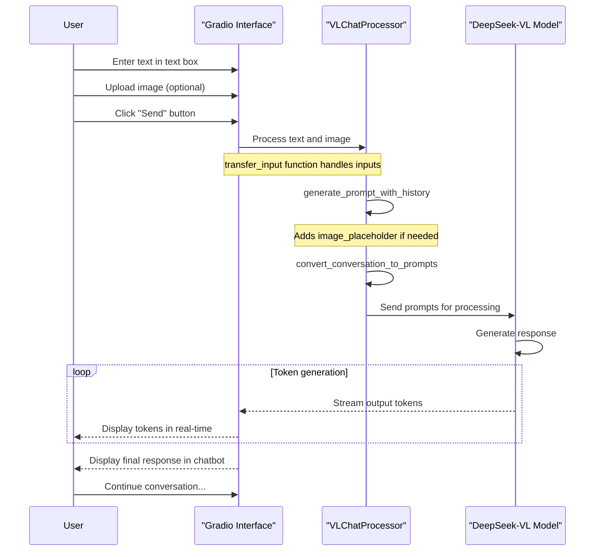
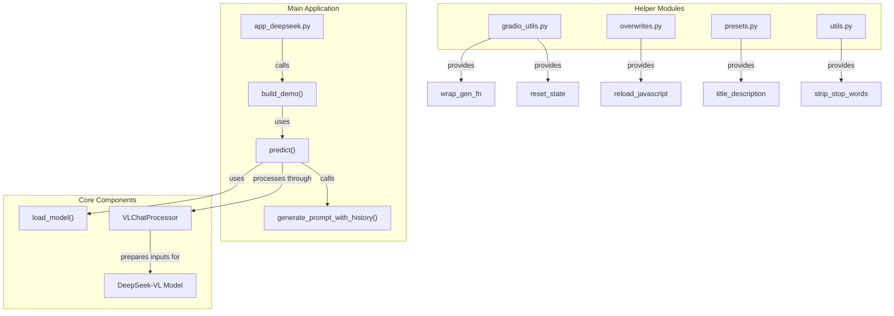
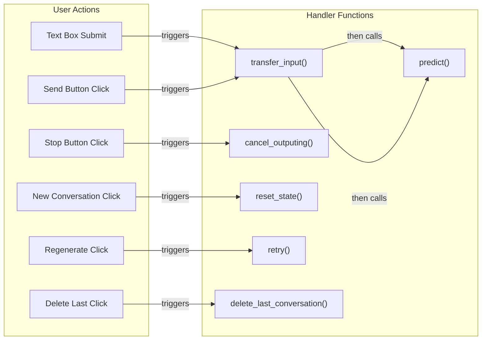

<!-- source: DeepWiki mcp.deepwiki.com · repo deepseek-ai/DeepSeek-VL · page 4.2 Gradio Web Interface · fetched 2026-10-30 -->

# Gradio Web Interface

<details>
<summary>Relevant source files</summary>

The following files were used as context for generating this wiki page:

- [README.md](README.md)
- [deepseek_vl/serve/app_deepseek.py](deepseek_vl/serve/app_deepseek.py)
- [deepseek_vl/serve/app_modules/gradio_utils.py](deepseek_vl/serve/app_modules/gradio_utils.py)
- [deepseek_vl/serve/app_modules/overwrites.py](deepseek_vl/serve/app_modules/overwrites.py)
- [deepseek_vl/serve/app_modules/presets.py](deepseek_vl/serve/app_modules/presets.py)
- [deepseek_vl/serve/app_modules/utils.py](deepseek_vl/serve/app_modules/utils.py)

</details>


This document details the Gradio web interface implementation for DeepSeek-VL, which provides an accessible way for users to interact with the DeepSeek-VL vision-language models through a browser-based UI. For information about other interfaces, see the CLI Interface [CLI Interface](#4.1) or the Python API [Python API](#4.3).

## Overview

The DeepSeek-VL Gradio web interface offers a user-friendly environment for interacting with DeepSeek-VL models, allowing users to upload images, enter text prompts, and engage in multi-turn conversations. The interface features parameter adjustment options, example inputs, and real-time streaming responses.



Sources: [deepseek_vl/serve/app_deepseek.py:322-440](). [README.md:203-206]()

## Installation and Usage

### Requirements

To use the Gradio web interface, you must first install the necessary dependencies:

```bash
pip install -e .[gradio]
```

This installs both DeepSeek-VL core dependencies and additional Gradio-specific requirements.

### Launching the Interface

Start the web interface with:

```bash
python deepseek_vl/serve/app_deepseek.py
```

By default, the interface runs on `http://0.0.0.0:8122` and loads the DeepSeek-VL 7B chat model.

Sources: [README.md:200-203](). [deepseek_vl/serve/app_deepseek.py:503-514]()

## Interface Components

### Main UI Elements

The Gradio interface includes these primary components:

| Component | Description | Implementation Reference |
|-----------|-------------|--------------------------|
| Chatbot Window | Displays conversation history between user and model | [app_deepseek.py:335-341]() |
| Text Input | Text field for entering prompts | [app_deepseek.py:344-346]() |
| Image Upload | Area for uploading images | [app_deepseek.py:363]() |
| Send Button | Submits text and image inputs | [app_deepseek.py:350]() |
| Stop Button | Halts generation | [app_deepseek.py:354]() |
| New Conversation | Clears conversation history | [app_deepseek.py:356-358]() |
| Regenerate | Regenerates response for last input | [app_deepseek.py:359]() |
| Remove Last Turn | Deletes the last conversation turn | [app_deepseek.py:360]() |
| Parameter Settings | Controls for generation parameters | [app_deepseek.py:365-405]() |
| Examples | Predefined example inputs | [app_deepseek.py:414-440]() |

Sources: [deepseek_vl/serve/app_deepseek.py:322-440]()

### Parameter Configuration

The interface provides several adjustable parameters:

| Parameter | Default | Description |
|-----------|---------|-------------|
| Top-p | 0.95 | Controls diversity of generated text |
| Temperature | 0.1 | Controls randomness of outputs |
| Repetition Penalty | 1.1 | Discourages repetitive text |
| Max Generation Tokens | 2048 | Limits response length |
| Max History Tokens | 4096 | Limits conversation context length |
| Model Selection | DeepSeek-VL 7B | Allows choosing different DeepSeek-VL models |

Sources: [deepseek_vl/serve/app_deepseek.py:366-412]()

## Interaction Flow



Sources: [deepseek_vl/serve/app_deepseek.py:196-279](). [deepseek_vl/serve/app_deepseek.py:483-486]()

## Implementation Architecture

The Gradio web interface implementation consists of several interconnected components:



Sources: [deepseek_vl/serve/app_deepseek.py:47-60](). [deepseek_vl/serve/app_deepseek.py:318-500]()

## Key Functions

### Core Processing Functions

The interface implementation includes several key functions:

1. **load_models()** [app_deepseek.py:47-55](): Loads DeepSeek-VL models and returns them as a dictionary.

2. **generate_prompt_with_history()** [app_deepseek.py:63-130](): Prepares the conversation prompt with history for the model.
   - Handles image placeholders
   - Manages conversation context
   - Truncates history if needed to fit within token limits

3. **predict()** [app_deepseek.py:196-279](): Main function that processes user input and returns model responses.
   - Processes text and image inputs
   - Converts conversation to model prompts
   - Streams response tokens in real-time

4. **build_demo()** [app_deepseek.py:318-500](): Constructs the Gradio interface components.
   - Defines UI elements
   - Configures event handlers
   - Sets up example inputs

### Utility Functions

Several helper functions support the main interface functionality:

1. **to_gradio_chatbot()** [app_deepseek.py:133-166](): Converts internal conversation format to Gradio's chatbot format.
   - Handles image formatting for display
   - Organizes messages into user/assistant pairs

2. **to_gradio_history()** [app_deepseek.py:169-171](): Extracts conversation history for state management.

3. **get_prompt()** [app_deepseek.py:174-192](): Generates the complete prompt for the model.

Sources: [deepseek_vl/serve/app_deepseek.py:47-192](). [deepseek_vl/serve/app_modules/gradio_utils.py:25-94]()

## Event Handling

The interface uses Gradio's event handling system to manage user interactions:



Sources: [deepseek_vl/serve/app_deepseek.py:483-498](). [deepseek_vl/serve/app_modules/gradio_utils.py:25-94]()

## Examples and Use Cases

The interface comes with several predefined examples demonstrating different capabilities:

1. **Creative content generation**: Generate rap songs based on images
2. **Application analysis**: Describe the purpose of application screenshots
3. **Code generation**: Create Python code from diagrams or flowcharts
4. **Image recreation**: Generate code to reproduce charts or visualizations
5. **Visual reasoning**: Answer questions requiring reasoning about visual content
6. **Spatial understanding**: Analyze spatial relationships between objects

These examples are defined in [app_deepseek.py:414-440]() and provide quick demonstrations of the model's capabilities.

Sources: [deepseek_vl/serve/app_deepseek.py:414-440]()

## Customizing the Interface

You can customize various aspects of the interface by modifying:

1. **Port and host**: Change the server settings in [app_deepseek.py:507-514]()
2. **Model list**: Add more models to the `models` dictionary in [app_deepseek.py:48-50]()
3. **Examples**: Modify the `examples_list` in [app_deepseek.py:414-440]()
4. **UI appearance**: Adjust the CSS in `deepseek_vl/serve/assets/custom.css`
5. **Default parameters**: Change default values in [app_deepseek.py:366-405]()

Sources: [deepseek_vl/serve/app_deepseek.py:47-55](). [deepseek_vl/serve/app_deepseek.py:503-514]()

## Additional Resources

The Gradio interface is also available as a hosted demo on Hugging Face Spaces:
- [https://huggingface.co/spaces/deepseek-ai/DeepSeek-VL-7B](https://huggingface.co/spaces/deepseek-ai/DeepSeek-VL-7B)

For more details on processing image and text data directly, see the Python API documentation [Python API](#4.3).

---

