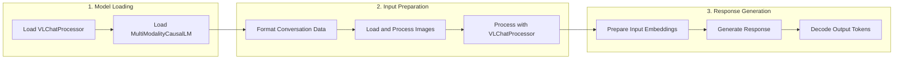
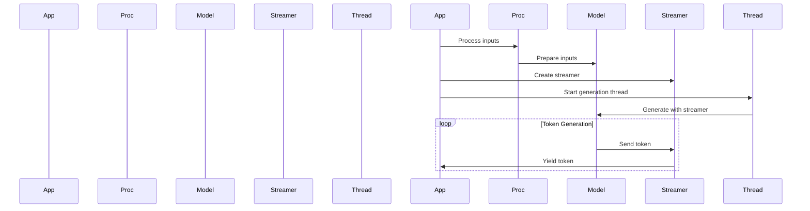

<!-- source: DeepWiki mcp.deepwiki.com · repo deepseek-ai/DeepSeek-VL · page 4.3 Python API · fetched 2026-10-30 -->

# Python API

<details>
<summary>Relevant source files</summary>

The following files were used as context for generating this wiki page:

- [README.md](README.md)
- [deepseek_vl/serve/inference.py](deepseek_vl/serve/inference.py)
- [inference.py](inference.py)

</details>


The DeepSeek-VL Python API provides programmatic access to the DeepSeek-VL vision-language model, allowing developers to integrate multimodal capabilities into their applications. This document covers how to use the API for processing both text and images to generate coherent natural language responses.

For information about the command-line interface, see [CLI Interface](#4.1). For information about the web-based interface, see [Gradio Web Interface](#4.2).

## Installation and Setup

Before using the Python API, you need to install the DeepSeek-VL package and its dependencies:

```bash
pip install -e .
```

For basic inference with the DeepSeek-VL model, you'll need to import the following key components:

```python
import torch
from transformers import AutoModelForCausalLM
from deepseek_vl.models import VLChatProcessor, MultiModalityCausalLM
from deepseek_vl.utils.io import load_pil_images
```

Sources: [README.md:110-115](), [inference.py:20-24]()

## Core Components

The DeepSeek-VL Python API consists of several key components that work together to provide multimodal understanding capabilities:

```mermaid
classDiagram
    class "VLChatProcessor" {
        +from_pretrained(model_path)
        +__call__(conversations, images, force_batchify)
    }
    
    class "MultiModalityCausalLM" {
        +prepare_inputs_embeds()
        +language_model
    }
    
    class "Utilities" {
        +load_pil_images()
        +convert_conversation_to_prompts()
    }
    
    "VLChatProcessor" --> "MultiModalityCausalLM" : processes inputs for
    "Utilities" --> "VLChatProcessor" : supports
    "MultiModalityCausalLM" --> "generate()" : performs
```

### VLChatProcessor

The `VLChatProcessor` is responsible for processing both conversation text and images, preparing them for the model. It handles tokenization of text and formatting of the overall input structure.

### MultiModalityCausalLM

The `MultiModalityCausalLM` is the main model class that combines vision and language processing. It includes methods for preparing input embeddings and generating responses through its language model component.

### Utility Functions

Several utility functions are provided to support the API:
- `load_pil_images()`: Loads and processes images from file paths
- `convert_conversation_to_prompts()`: Formats conversation data into the required prompt structure

Sources: [inference.py:23-24](), [deepseek_vl/serve/inference.py:32-33](), [deepseek_vl/serve/inference.py:46-63]()

## Basic Usage Flow

The typical workflow for using the DeepSeek-VL Python API involves loading the model, preparing inputs, and generating responses:



Sources: [inference.py:26-86](), [deepseek_vl/serve/inference.py:36-170]()

## Loading the Model

To load the DeepSeek-VL model:

```python
# Specify the model path (either HuggingFace model ID or local path)
model_path = "deepseek-ai/deepseek-vl-7b-chat"

# Load the processor, tokenizer, and model
vl_chat_processor = VLChatProcessor.from_pretrained(model_path)
tokenizer = vl_chat_processor.tokenizer

vl_gpt = AutoModelForCausalLM.from_pretrained(
    model_path, trust_remote_code=True
)
vl_gpt = vl_gpt.to(torch.bfloat16).cuda().eval()
```

Alternatively, you can use the helper function from the serve module:

```python
from deepseek_vl.serve.inference import load_model

tokenizer, vl_gpt, vl_chat_processor = load_model(model_path)
```

Sources: [inference.py:26-34](), [deepseek_vl/serve/inference.py:36-43]()

## Preparing Conversations

Conversations are structured as a list of dictionaries, where each dictionary represents a message in the conversation. The model expects a specific format:

```python
conversation = [
    {
        "role": "User",
        "content": "<image_placeholder>Describe this image.",
        "images": ["path/to/image.jpg"],
    },
    {"role": "Assistant", "content": ""},  # Empty content for model to fill
]
```

Key points about the conversation format:
- Use `<image_placeholder>` in the content to indicate where an image should be referenced
- The `images` field contains a list of paths to image files
- For multiple images, include multiple `<image_placeholder>` markers in the content, each corresponding to an image in the `images` list

Sources: [inference.py:36-44](), [README.md:135-142]()

## Processing Images and Generating Responses

Once you have prepared your conversation structure, you need to load the images, process the inputs, and generate a response:

```python
# Load images from the conversation
pil_images = load_pil_images(conversation)

# Process the conversation and images
prepare_inputs = vl_chat_processor(
    conversations=conversation, 
    images=pil_images, 
    force_batchify=True
).to(vl_gpt.device)

# Generate input embeddings
inputs_embeds = vl_gpt.prepare_inputs_embeds(**prepare_inputs)

# Generate a response
outputs = vl_gpt.language_model.generate(
    inputs_embeds=inputs_embeds,
    attention_mask=prepare_inputs.attention_mask,
    pad_token_id=tokenizer.eos_token_id,
    bos_token_id=tokenizer.bos_token_id,
    eos_token_id=tokenizer.eos_token_id,
    max_new_tokens=512,
    do_sample=False,
    use_cache=True
)

# Decode the response
answer = tokenizer.decode(outputs[0].cpu().tolist(), skip_special_tokens=True)
print(answer)
```

Sources: [inference.py:65-86](), [README.md:165-187]()

## Advanced Usage: Response Streaming

For applications that require streaming responses (producing tokens incrementally as they are generated), the API provides streaming capabilities:



Implementation using the `generate` function from `deepseek_vl.serve.inference`:

```python
from deepseek_vl.serve.inference import generate

# After preparing inputs as in the basic example
for token in generate(
    vl_gpt,
    tokenizer,
    prepare_inputs,
    max_gen_len=256,
    temperature=0.7,
    repetition_penalty=1.1,
    top_p=0.95,
    stop_words=["User:", "Human:"]
):
    print(token, end="", flush=True)
```

Sources: [deepseek_vl/serve/inference.py:119-170]()

## Generation Parameters

When generating responses, you can customize various parameters to control the output:

| Parameter | Description | Default |
|-----------|-------------|---------|
| `max_gen_len` or `max_new_tokens` | Maximum number of tokens to generate | 512 |
| `temperature` | Controls randomness (0 = deterministic, higher = more random) | 0 |
| `top_p` | Controls diversity via nucleus sampling | 0.95 |
| `repetition_penalty` | Penalizes repetition | 1.1 |
| `stop_words` | List of strings that will stop generation when encountered | [] |
| `do_sample` | Whether to use sampling (True) or greedy decoding (False) | False |

Sources: [deepseek_vl/serve/inference.py:84-165](), [inference.py:74-83]()

## Working with Multiple Images

The API supports multiple images in a single conversation turn. Each image should have a corresponding `<image_placeholder>` in the content:

```python
conversation = [
    {
        "role": "User",
        "content": "<image_placeholder>Image A shows... <image_placeholder>Image B shows... Compare these two images.",
        "images": ["path/to/image_a.jpg", "path/to/image_b.jpg"],
    },
    {"role": "Assistant", "content": ""},
]
```

This is particularly useful for tasks that involve comparing multiple images or for in-context learning with visual examples.

Sources: [inference.py:46-62](), [README.md:146-161]()

## Complete Example

Here's a complete example showing how to use the Python API with a single image:

```python
import torch
from transformers import AutoModelForCausalLM
from deepseek_vl.models import VLChatProcessor, MultiModalityCausalLM
from deepseek_vl.utils.io import load_pil_images

# Load model
model_path = "deepseek-ai/deepseek-vl-7b-chat"
vl_chat_processor = VLChatProcessor.from_pretrained(model_path)
tokenizer = vl_chat_processor.tokenizer
vl_gpt = AutoModelForCausalLM.from_pretrained(model_path, trust_remote_code=True)
vl_gpt = vl_gpt.to(torch.bfloat16).cuda().eval()

# Prepare conversation
conversation = [
    {
        "role": "User",
        "content": "<image_placeholder>Describe this image in detail.",
        "images": ["./path/to/your/image.jpg"],
    },
    {"role": "Assistant", "content": ""},
]

# Process inputs
pil_images = load_pil_images(conversation)
prepare_inputs = vl_chat_processor(
    conversations=conversation, images=pil_images, force_batchify=True
).to(vl_gpt.device)

# Generate response
inputs_embeds = vl_gpt.prepare_inputs_embeds(**prepare_inputs)
outputs = vl_gpt.language_model.generate(
    inputs_embeds=inputs_embeds,
    attention_mask=prepare_inputs.attention_mask,
    pad_token_id=tokenizer.eos_token_id,
    bos_token_id=tokenizer.bos_token_id,
    eos_token_id=tokenizer.eos_token_id,
    max_new_tokens=512,
    do_sample=True,
    temperature=0.7,
    top_p=0.9,
    use_cache=True
)

# Output result
answer = tokenizer.decode(outputs[0].cpu().tolist(), skip_special_tokens=True)
print(answer)
```

Sources: [inference.py:20-86](), [README.md:119-187]()

## Integration with Web Applications

When integrating DeepSeek-VL into web applications, you'll typically want to use the streaming capabilities to provide a responsive user experience. For a complete example of how this is implemented in the Gradio web interface, refer to the Gradio Web Interface documentation ([Gradio Web Interface](#4.2)).

Sources: [deepseek_vl/serve/inference.py:119-170]()

---

