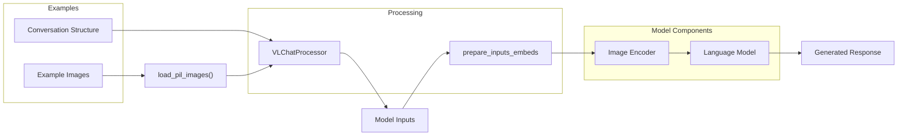
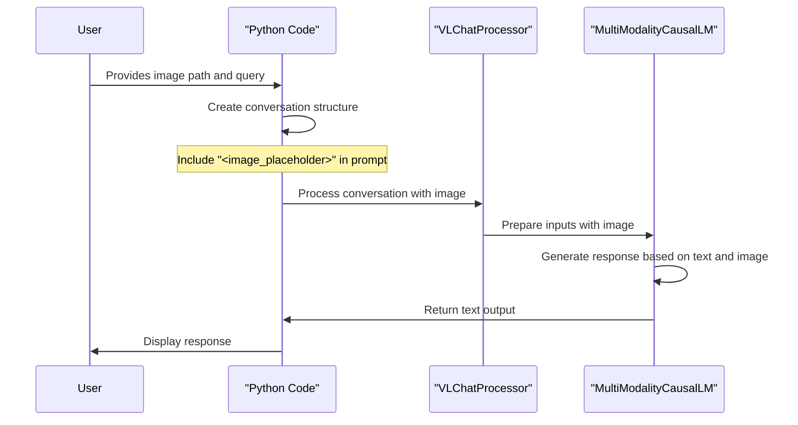
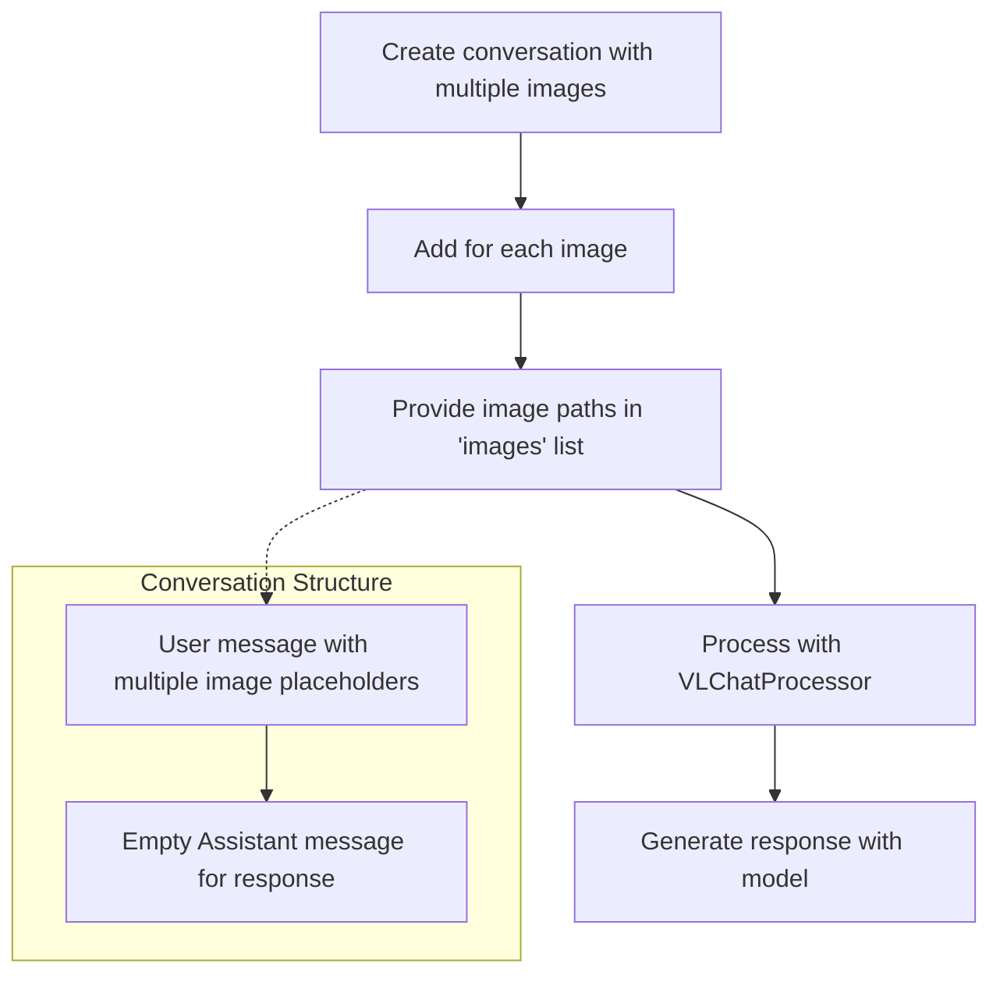
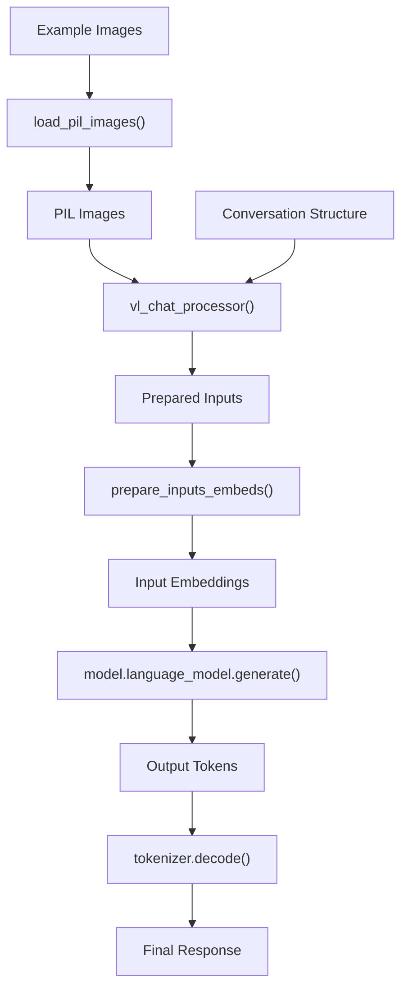

<!-- source: DeepWiki mcp.deepwiki.com · repo deepseek-ai/DeepSeek-VL · page 4.4 Example Images · fetched 2026-10-30 -->

# Example Images

<details>
<summary>Relevant source files</summary>

The following files were used as context for generating this wiki page:

- [images/dog_a.png](images/dog_a.png)
- [images/dog_b.png](images/dog_b.png)
- [images/dog_c.png](images/dog_c.png)
- [images/dog_d.png](images/dog_d.png)
- [inference.py](inference.py)

</details>


This page provides information about the example images included in the DeepSeek-VL repository and how to use them with the model. The example images serve as practical demonstrations for testing and understanding the model's capabilities. For information on the interfaces themselves, see [CLI Interface](#4.1), [Gradio Web Interface](#4.2), and [Python API](#4.3).

## Image Collection Overview

The DeepSeek-VL repository includes several example images that showcase different use cases and capabilities of the model. These images are located in the `images/` directory and are designed to demonstrate various visual tasks such as:

- Understanding diagrams and flowcharts 
- Analyzing multiple related images
- Describing visual content

### Example Images Included

The repository contains several example images:

| Image Filename | Description | Purpose |
|---------------|-------------|---------|
| `training_pipelines.jpg` | Diagram showing training pipelines | Demonstrates diagram understanding |
| `dog_a.png` | Dog with no accessories | Base image for comparison |
| `dog_b.png` | Dog wearing a santa hat | Shows clothing/accessory recognition |
| `dog_c.png` | Dog wearing a wizard outfit | Shows clothing/accessory recognition |
| `dog_d.png` | Dog with different accessories | Tests model's ability to identify differences |

Sources: [inference.py:37-42](), [inference.py:47-62]()

## Using Example Images

The example images can be used with DeepSeek-VL through the provided inference mechanisms. Below is the diagram showing how example images are used in the inference pipeline:



Sources: [inference.py:20-25](), [inference.py:65-86]()

## Single Image Example

DeepSeek-VL supports using a single image within a conversation. This is useful for tasks like image captioning, visual question answering, or detailed scene description.

### Single Image Usage Pattern



Sources: [inference.py:36-44]()

The single image example from the inference.py file demonstrates asking the model to describe a diagram:

```python
# Single image conversation example
conversation = [
    {
        "role": "User",
        "content": "<image_placeholder>Describe each stage of this image.",
        "images": ["./images/training_pipelines.jpg"],
    },
    {"role": "Assistant", "content": ""},
]
```

Key points for using single images:
- The conversation is structured as a list of dictionaries
- The image placeholder tag `<image_placeholder>` is inserted where you want the image to appear
- The actual image path is provided in the "images" list
- An empty "Assistant" entry is required for the response

Sources: [inference.py:36-44]()

## Multiple Image Example

DeepSeek-VL can also work with multiple images in a single conversation, enabling in-context learning and comparison between images.

### Multiple Image Usage Pattern



Sources: [inference.py:47-62]()

The commented example in inference.py shows how to use multiple dog images in a sequence:

```python
# Multiple images (or in-context learning) conversation example
# conversation = [
#     {
#         "role": "User",
#         "content": "<image_placeholder>A dog wearing nothing in the foreground, "
#                    "<image_placeholder>a dog wearing a santa hat, "
#                    "<image_placeholder>a dog wearing a wizard outfit, and "
#                    "<image_placeholder>what's the dog wearing?",
#         "images": [
#             "images/dog_a.png",
#             "images/dog_b.png",
#             "images/dog_c.png",
#             "images/dog_d.png",
#         ],
#     },
#     {"role": "Assistant", "content": ""}
# ]
```

Key points for using multiple images:
- Each image needs its own `<image_placeholder>` tag in the content
- The order of images in the "images" list corresponds to the order of placeholders
- This approach can be used for comparative analysis or to demonstrate patterns to the model

Sources: [inference.py:47-62]()

## Processing Images for Inference

The inference pipeline for working with example images involves several key steps, as illustrated in the following diagram:



Sources: [inference.py:65-86]()

The complete inference process involves:

1. **Loading Images**: Images are loaded using the `load_pil_images` function
   ```python
   pil_images = load_pil_images(conversation)
   ```

2. **Preparing Inputs**: The conversation structure and images are processed
   ```python
   prepare_inputs = vl_chat_processor(
       conversations=conversation, images=pil_images, force_batchify=True
   ).to(vl_gpt.device)
   ```

3. **Generating Embeddings**: The image encoder processes the images
   ```python
   inputs_embeds = vl_gpt.prepare_inputs_embeds(**prepare_inputs)
   ```

4. **Running the Model**: The language model generates a response
   ```python
   outputs = vl_gpt.language_model.generate(
       inputs_embeds=inputs_embeds,
       attention_mask=prepare_inputs.attention_mask,
       pad_token_id=tokenizer.eos_token_id,
       bos_token_id=tokenizer.bos_token_id,
       eos_token_id=tokenizer.eos_token_id,
       max_new_tokens=512,
       do_sample=False,
       use_cache=True,
   )
   ```

5. **Decoding the Response**: The output tokens are decoded to text
   ```python
   answer = tokenizer.decode(outputs[0].cpu().tolist(), skip_special_tokens=True)
   ```

Sources: [inference.py:65-86]()

## Best Practices for Using Example Images

When using the example images or your own images with DeepSeek-VL, consider the following best practices:

1. **Image Formatting**: The model works with common image formats like JPG and PNG
2. **Image Resolution**: While there's no strict requirement, the model works best with clear, well-framed images
3. **Placeholder Positioning**: Place `<image_placeholder>` tags strategically in your prompt to naturally reference images
4. **In-context Learning**: When using multiple images, consider their sequence to build a context that helps the model understand your question
5. **Prompt Clarity**: Be specific in your prompts about what you want the model to analyze in the images

Sources: [inference.py:36-44](), [inference.py:47-62]()

## Customizing with Your Own Images

You can easily substitute the example images with your own images by changing the file paths in the "images" list. The model follows the same processing pipeline regardless of which images are used.

To use your own images:

1. Place your images in an accessible directory
2. Update the file paths in the "images" list of your conversation structure
3. Follow the same inference steps as demonstrated with the example images

Sources: [inference.py:37-42](), [inference.py:54-59]()

---

