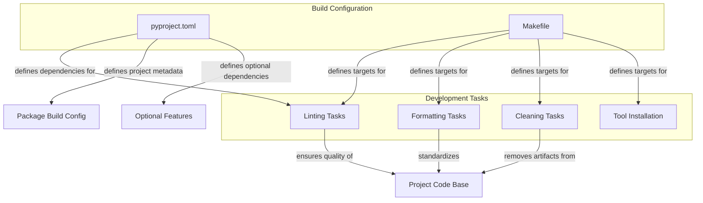
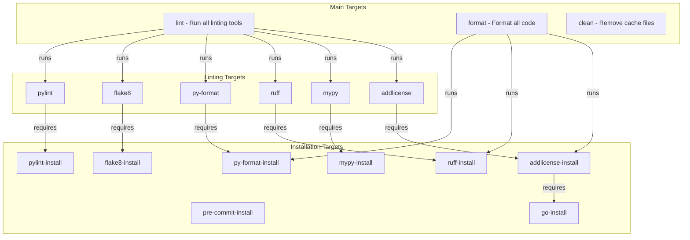
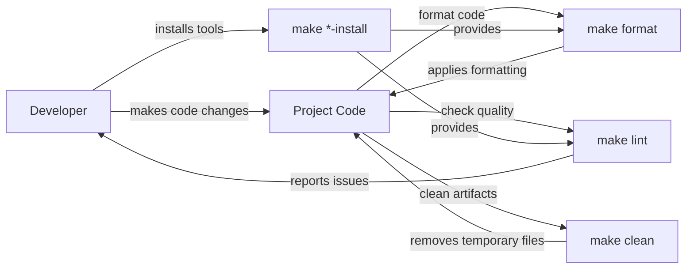

<!-- source: DeepWiki mcp.deepwiki.com · repo deepseek-ai/DeepSeek-VL · page 5.1 Build System · fetched 2026-10-30 -->

# Build System

<details>
<summary>Relevant source files</summary>

The following files were used as context for generating this wiki page:

- [Makefile](Makefile)
- [pyproject.toml](pyproject.toml)

</details>


This document explains the build system used in the DeepSeek-VL repository. It covers the configuration files, development tools, and utilities that facilitate code development, quality control, and project maintenance. For information about overall project configuration and dependencies, see [Project Configuration](#5.3).

## Overview

The DeepSeek-VL build system is primarily composed of two key files:

1. **pyproject.toml** - Defines project metadata, dependencies, and build requirements
2. **Makefile** - Provides a collection of commands for development, linting, and maintenance tasks

These files work together to provide a comprehensive development environment for the DeepSeek-VL project.

Sources: [pyproject.toml:1-54](), [Makefile:1-100]()

## Build System Architecture



Sources: [pyproject.toml:1-54](), [Makefile:1-100]()

## Project Configuration (pyproject.toml)

The `pyproject.toml` file defines the project's metadata, build requirements, and dependencies according to the Python packaging standards (PEP 517/518).

### Build System Requirements

```
[build-system]
requires = ["setuptools>=40.6.0", "wheel"]
build-backend = "setuptools.build_meta"
```

The project uses `setuptools` as its build backend with a minimum version requirement of 40.6.0.

### Project Metadata and Dependencies

The project file defines:

- Basic metadata (name, version, description, authors)
- License information (MIT license for code)
- Core dependencies including PyTorch, Transformers, and other libraries
- Optional dependency groups for specific features:
  - `gradio`: Dependencies for the web interface
  - `lint`: Tools for code quality and linting

### Package Discovery

```
[tool.setuptools]
packages = {find = {exclude = ["images"]}}
```

The configuration uses `setuptools.find_packages` to automatically discover Python packages, excluding the `images` directory.

Sources: [pyproject.toml:1-54]()

## Development Workflow (Makefile)

The Makefile defines various commands for development and quality control. The primary targets are organized into several categories:



Sources: [Makefile:13-100]()

### Tool Installation

The Makefile includes targets for installing all required development tools, using a helper function that checks if a tool is installed and installs it if necessary:

```
check_pip_install = $(PYTHON) -m pip show $(1) &>/dev/null || (cd && $(PYTHON) -m pip install $(1) --upgrade)
check_pip_install_extra = $(PYTHON) -m pip show $(1) &>/dev/null || (cd && $(PYTHON) -m pip install $(2) --upgrade)
```

Installation targets include:
- `pylint-install`: Installs pylint with spelling support
- `flake8-install`: Installs flake8 and its extensions
- `py-format-install`: Installs isort and black formatters
- `ruff-install`: Installs the ruff linter
- `mypy-install`: Installs the mypy type checker
- `pre-commit-install`: Installs and configures pre-commit hooks
- `go-install`: Installs Go (required for addlicense)
- `addlicense-install`: Installs the addlicense tool

Sources: [Makefile:16-55]()

### Code Quality Tools

The build system integrates several code quality tools:

| Tool | Purpose | Configuration | Make Target |
|------|---------|--------------|-------------|
| pylint | Static code analysis | N/A | `pylint` |
| flake8 | Style guide enforcement | N/A | `flake8` |
| black | Code formatting | N/A | `black-format` |
| isort | Import sorting | Project-specific settings | `py-format` |
| ruff | Fast Python linter | N/A | `ruff` |
| mypy | Static type checking | N/A | `mypy` |
| pre-commit | Git hooks for quality checks | N/A | `pre-commit` |
| addlicense | License header management | MIT license | `addlicense` |

The combined target `lint` runs all linting tools in succession.

Sources: [Makefile:58-86]()

### Formatting and License Management

The build system provides targets for automatically formatting code:

- `format`: Runs isort to organize imports, black to format code, and addlicense to add license headers
- `ruff-fix`: Automatically fixes issues found by ruff

The license management ensures all source files include proper MIT license headers with copyright information.

Sources: [Makefile:88-92]()

### Cleaning and Maintenance

Cleaning targets remove temporary files:

- `clean-py`: Removes Python compiled files, `__pycache__` directories, and linter caches
- `clean`: Runs all cleaning targets

Sources: [Makefile:93-99]()

## Workflow Usage Patterns



Sources: [Makefile:13-100]()

## Project Paths and File Management

The Makefile defines several important variables that control which files are processed:

```
PROJECT_NAME   = DeepSeek-VL
COPYRIGHT      = "DeepSeek."
PROJECT_PATH   = deepseek_vl
SOURCE_FOLDERS = deepseek_vl
PYTHON_FILES   = $(shell find $(SOURCE_FOLDERS) -type f -name "*.py" -o -name "*.pyi") cli_chat.py inference.py
```

These variables ensure that:
1. The correct project name is used in various tools
2. The proper copyright notice is applied to source files
3. All Python files in the project are linted and formatted

Sources: [Makefile:1-8]()

## Conclusion

The DeepSeek-VL build system provides a comprehensive set of tools for development and quality control. Using the Makefile commands, developers can:

1. Install required development tools with a single command
2. Format code to meet project standards
3. Check code quality with various linters
4. Ensure proper license headers are present
5. Clean up temporary files

This system helps maintain consistent code quality across the DeepSeek-VL codebase and simplifies the development workflow.

---

