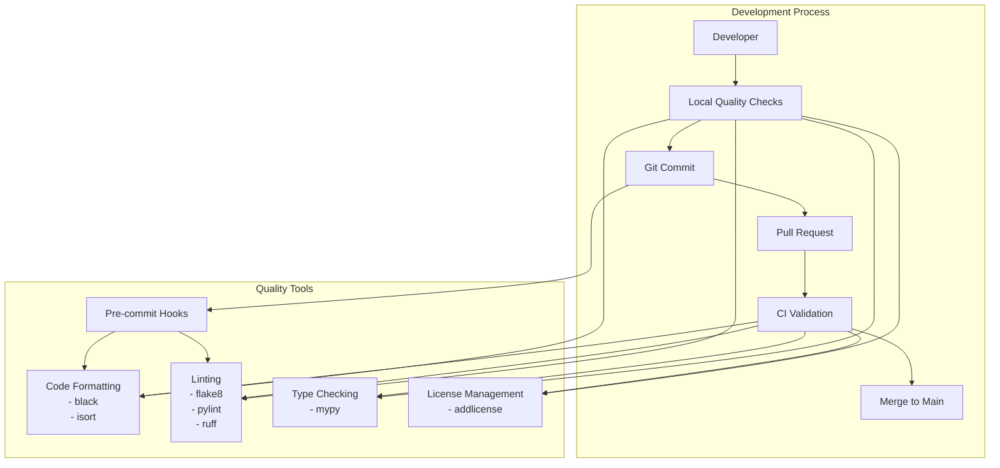
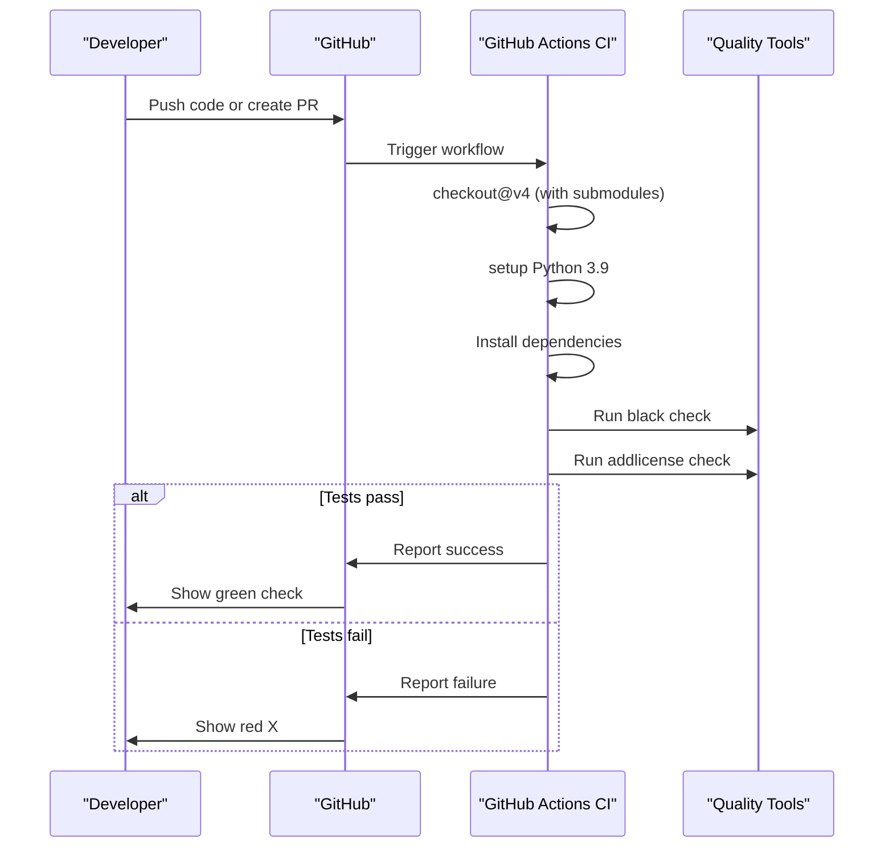
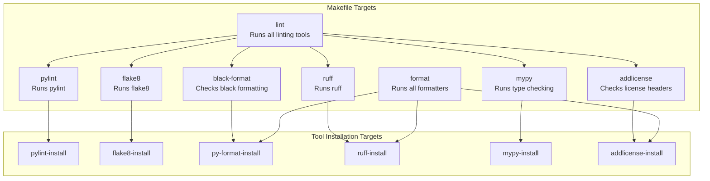

<!-- source: DeepWiki mcp.deepwiki.com · repo deepseek-ai/DeepSeek-VL · page 5.2 Code Quality · fetched 2026-10-30 -->

# Code Quality

<details>
<summary>Relevant source files</summary>

The following files were used as context for generating this wiki page:

- [.flake8](.flake8)
- [.github/workflows/lint.yml](.github/workflows/lint.yml)
- [.pylintrc](.pylintrc)
- [Makefile](Makefile)

</details>


This document describes the code quality tools, configurations, and processes implemented in the DeepSeek-VL project. It covers linting, formatting, type checking, and continuous integration practices that ensure consistent and maintainable code throughout the codebase.

## Overview of Code Quality Tools

DeepSeek-VL employs a comprehensive set of code quality tools to maintain high standards throughout the codebase. These tools are integrated into both the development workflow and continuous integration pipeline.



Sources: [.github/workflows/lint.yml](), [Makefile]()

### Tool Suite

The project uses the following tools to ensure code quality:

| Tool | Category | Purpose |
|------|----------|---------|
| **black** | Formatting | Code formatter that enforces a consistent style |
| **isort** | Formatting | Sorts imports alphabetically and by type |
| **flake8** | Linting | Checks for style and logical errors |
| **pylint** | Linting | More comprehensive linter with additional rules |
| **ruff** | Linting | Fast Python linter with rule enforcement |
| **mypy** | Type Checking | Static type checker for Python |
| **addlicense** | License | Adds and verifies license headers |
| **pre-commit** | Git Hooks | Runs checks before commits are finalized |

Sources: [Makefile:26-47](), [Makefile:59-86]()

## Continuous Integration

DeepSeek-VL uses GitHub Actions to automate code quality checks on every pull request and push to the main branch. This ensures that all code changes maintain the project's quality standards.



Sources: [.github/workflows/lint.yml:1-56]()

### CI Workflow

The GitHub Actions workflow (`lint.yml`) sets up a clean environment, installs the necessary dependencies, and runs the following checks:

1. Code formatting with Black
2. License header validation with addlicense

This ensures that all code merged into the repository maintains a consistent style and includes the appropriate license headers.

Sources: [.github/workflows/lint.yml:22-56]()

## Code Style and Linting Configuration

DeepSeek-VL uses configuration files to maintain consistent rules across all code quality tools.

### Flake8 Configuration

Flake8 is configured via the `.flake8` file, which specifies:

- Maximum line length (120 characters)
- Maximum documentation line length (100 characters)
- Selected and ignored checks
- File exclusions

The configuration allows for certain exceptions like ignoring unused imports in `__init__.py` files and excluding certain directories from checks.

Sources: [.flake8:1-41]()

### Pylint Configuration

Pylint is configured via the `.pylintrc` file, which provides more extensive customization:

- Naming conventions for variables, functions, classes, etc.
- Code complexity rules (maximum arguments, attributes, branches, etc.)
- Design guidelines
- Import regulations
- Custom message control

The configuration is tailored to balance code quality enforcement with practical development needs.

Sources: [.pylintrc:1-630]()

## Tool Integration in Build System

The project's Makefile integrates all code quality tools, providing simple commands for running quality checks.



Sources: [Makefile:13-99]()

### Key Makefile Targets

Here are the primary Makefile targets for code quality:

| Target | Description |
|--------|-------------|
| `format` | Runs isort and black to format code, and adds license headers |
| `lint` | Runs all linting tools: ruff, flake8, black, mypy, pylint, and addlicense |
| `black-format` | Checks code formatting with black |
| `pylint` | Runs pylint for more comprehensive linting |
| `flake8` | Runs flake8 linting |
| `ruff` | Runs the ruff linter |
| `ruff-fix` | Runs ruff and automatically fixes issues where possible |
| `mypy` | Runs mypy type checking |
| `addlicense` | Checks for proper license headers |
| `pre-commit` | Runs pre-commit hooks on all files |

Each of these targets has a corresponding installation target (e.g., `pylint-install`, `flake8-install`) that ensures the necessary tools are installed.

Sources: [Makefile:59-92]()

## Running Code Quality Checks

Developers working on DeepSeek-VL can run the following commands to ensure their code meets the project's quality standards:

1. **Format code**:
   ```bash
   make format
   ```

2. **Check code quality**:
   ```bash
   make lint
   ```

3. **Run specific checks**:
   ```bash
   make black-format
   make pylint
   make flake8
   make ruff
   make mypy
   make addlicense
   ```

4. **Clean up Python cache files**:
   ```bash
   make clean-py
   ```

These commands should be run before committing code to ensure it meets the project's standards and will pass the CI checks.

Sources: [Makefile:86-99]()

## License Management

The project uses the `addlicense` tool to ensure all source files have the appropriate MIT license header with the correct copyright attribution to DeepSeek. The tool is configured to add the current year range to the license header.

Sources: [Makefile:51-55](), [.github/workflows/lint.yml:54-56]()

## Pre-commit Hooks

DeepSeek-VL supports pre-commit hooks to automate quality checks before commits. Developers can install pre-commit hooks with:

```bash
make pre-commit-install
```

This will run the appropriate quality checks automatically when attempting to commit code, preventing commits that would fail the CI checks.

Sources: [Makefile:43-45](), [Makefile:81-82]()

## Summary

The comprehensive code quality system in DeepSeek-VL ensures:

1. Consistent code formatting across the project
2. Detection of common coding errors and anti-patterns
3. Proper license attribution in all files
4. Type-safety through static type checking
5. Automated enforcement via CI and pre-commit hooks

This system helps maintain high code quality standards and facilitates collaboration among multiple developers by providing a consistent development experience.

---

