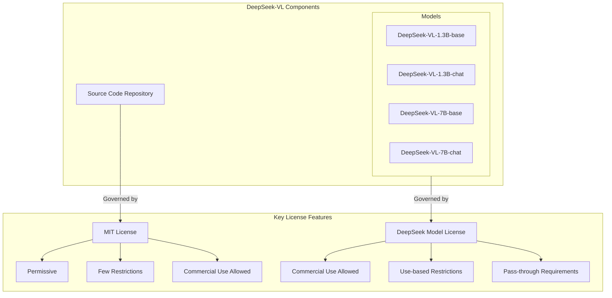
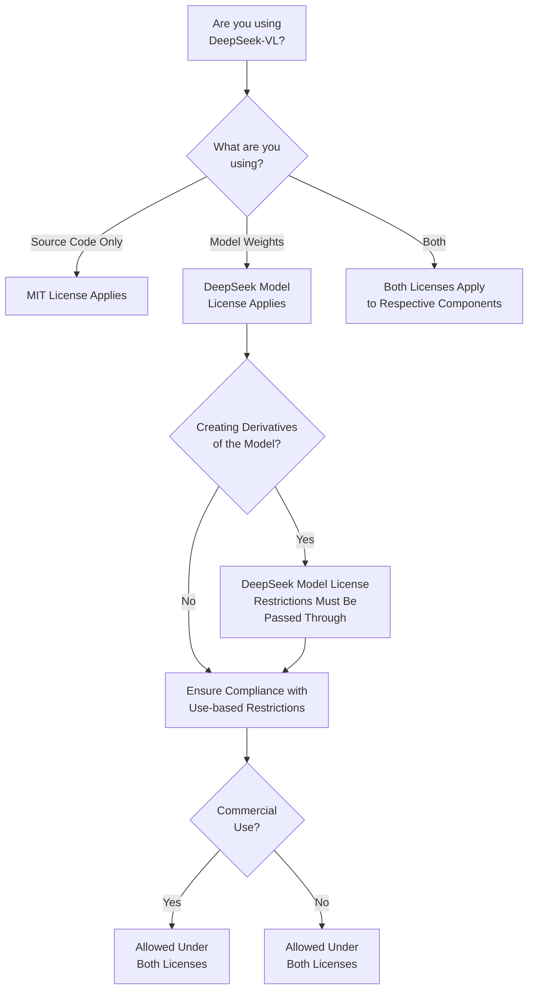
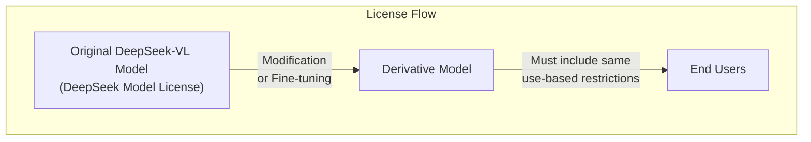

<!-- source: DeepWiki mcp.deepwiki.com · repo deepseek-ai/DeepSeek-VL · page 6 Licensing · fetched 2026-10-30 -->

# Licensing

Relevant source files

The following files were used as context for generating this wiki page:

- [LICENSE-CODE](LICENSE-CODE)
- [LICENSE-MODEL](LICENSE-MODEL)
- [README.md](README.md)

This document describes the licensing terms that govern the use, modification, and distribution of DeepSeek-VL. DeepSeek-VL uses a dual licensing approach, with separate licenses for the code repository and the model weights.

Sources: [README.md:208-210]()

## License Overview

DeepSeek-VL employs a dual licensing structure:

1. **Code License**: The source code, scripts, and other software components are licensed under the MIT License.
2. **Model License**: The model weights and parameters are licensed under the DeepSeek Model License Agreement.

This dual approach allows flexibility for different use cases while maintaining specific protections for the AI models themselves.

Sources: [README.md:40-45](), [README.md:208-210]()

## Code License (MIT)

The entire codebase of DeepSeek-VL, including all software, scripts, and documentation, is licensed under the MIT License. This is a permissive open-source license that places minimal restrictions on reuse.

### Key Terms of the MIT License

- **Permissions**:
  - Commercial use
  - Modification
  - Distribution
  - Private use

- **Limitations**:
  - No liability
  - No warranty

- **Requirements**:
  - License and copyright notice must be included in all copies or substantial portions of the software

### Full MIT License Text

The complete MIT License can be found in the [LICENSE-CODE]() file in the repository root.

Sources: [LICENSE-CODE:1-21](), [README.md:40-41]()

## Model License (DeepSeek Model License)

The DeepSeek-VL models (including base and chat variants) are licensed under the DeepSeek Model License Agreement. This license permits commercial use but includes specific use-based restrictions.

### Key Terms of the DeepSeek Model License

- **Permissions**:
  - Perpetual, worldwide, non-exclusive license
  - Commercial use is allowed
  - Hosting for third-party access (e.g., SaaS)
  - Creating derivatives of the model
  - Finetuning and modifying the model

- **Requirements**:
  - Use-based restrictions must be passed through to end users
  - Attribution must be maintained
  - Modified files must indicate changes
  - License must be included with any distribution

- **Restrictions** (partial list):
  - No use that violates laws or regulations
  - No military use
  - No exploitation or harm to minors
  - No generation of false information to harm others
  - No generation of inappropriate content
  - No unauthorized use of personal identifiable information
  - No defamation or harassment
  - No fully automated decision-making that adversely impacts legal rights
  - No discrimination against individuals or groups

### License Applicability

Sources: [LICENSE-MODEL:1-91](), [README.md:44-45](), [README.md:208-210]()

## License Application to Model Variants

All DeepSeek-VL model variants are subject to the same licensing terms. This includes:

| Model | License | Commercial Use |
|-------|---------|----------------|
| DeepSeek-VL-1.3B-base | DeepSeek Model License | Allowed |
| DeepSeek-VL-1.3B-chat | DeepSeek Model License | Allowed |
| DeepSeek-VL-7B-base | DeepSeek Model License | Allowed |
| DeepSeek-VL-7B-chat | DeepSeek Model License | Allowed |

Sources: [README.md:91-104](), [README.md:210]()

## Output Ownership

The DeepSeek Model License explicitly states that DeepSeek claims no rights in the output generated using the model. Users are accountable for the output they generate and its subsequent uses. However, no use of the output can contravene any provision stated in the license.

Sources: [LICENSE-MODEL:53-54]()

## License Enforcement and Updates

DeepSeek reserves the right to restrict (remotely or otherwise) usage of the model that violates the license terms, to the maximum extent permitted by law.

Sources: [LICENSE-MODEL:57-58]()

## Derivatives of the Model

If you create derivatives of the DeepSeek-VL models, you must include the same use-based restrictions in your licensing terms. This ensures that the responsible use requirements flow through to all derivative works.

Sources: [LICENSE-MODEL:44-49]()

## Disclaimer of Warranty and Limitation of Liability

Both licenses include standard disclaimers of warranty and limitations of liability. The model and code are provided "AS IS" without warranties of any kind. DeepSeek is not liable for damages arising from the use of the model or code.

Sources: [LICENSE-CODE:15-21](), [LICENSE-MODEL:63-67]()

## License Compliance Recommendations

To ensure compliance with the DeepSeek-VL licensing terms:

1. For code-only usage:
   - Include the MIT License notice in your distribution
   - Maintain copyright notices

2. For model usage:
   - Review the full list of use-based restrictions
   - Include the DeepSeek Model License with any distribution
   - Pass through use-based restrictions to end users
   - Ensure your use case doesn't violate any specific restrictions

3. For commercial applications:
   - Both licenses permit commercial use
   - Ensure compliance with all other terms and restrictions

Sources: [LICENSE-MODEL:44-51](), [LICENSE-CODE:9-14]()

## Full License Text

For the complete license texts, refer to:
- [LICENSE-CODE]() for the MIT License
- [LICENSE-MODEL]() for the DeepSeek Model License Agreement

These files are included in the repository root.

Sources: [README.md:40-45]()