# Page: Overview

# Overview

<details>
<summary>Relevant source files</summary>

The following files were used as context for generating this wiki page:

- [README.md](README.md)
- [pyproject.toml](pyproject.toml)

</details>


DeepSeek-VL is an open-source Vision-Language (VL) model designed for real-world vision and language understanding applications. This document provides a high-level summary of the DeepSeek-VL repository, explaining its architecture, components, and capabilities.

For detailed model architecture specifics, see [Model Architecture](#1.1). For information about different model variants, see [Model Variants](#1.2). For a guide on getting started with DeepSeek-VL, see [Getting Started](#2).

## Purpose and Capabilities

DeepSeek-VL is a multimodal AI system capable of understanding and processing both visual and textual information. The model possesses general multimodal understanding capabilities, able to process:

- Logical diagrams
- Web pages
- Mathematical formulas
- Scientific literature
- Natural images
- Embodied intelligence scenarios

The system is designed to bridge the gap between vision and language understanding, allowing for sophisticated analysis and response generation based on both image and text inputs.

Sources: [README.md:60-62]()

## Model Family

DeepSeek-VL is available in multiple variants to accommodate different deployment scenarios and computational requirements:

| Model | Parameters | Sequence Length | Purpose |
|-------|------------|-----------------|---------|
| DeepSeek-VL-1.3B-base | 1.3 billion | 4096 tokens | Foundation model for fine-tuning |
| DeepSeek-VL-1.3B-chat | 1.3 billion | 4096 tokens | Optimized for conversational use |
| DeepSeek-VL-7B-base | 7 billion | 4096 tokens | More capable foundation model |
| DeepSeek-VL-7B-chat | 7 billion | 4096 tokens | More capable conversational model |

Sources: [README.md:90-103]()

## System Architecture

The DeepSeek-VL system integrates vision and language processing capabilities through a carefully designed architecture:

### High-Level Architecture Diagram

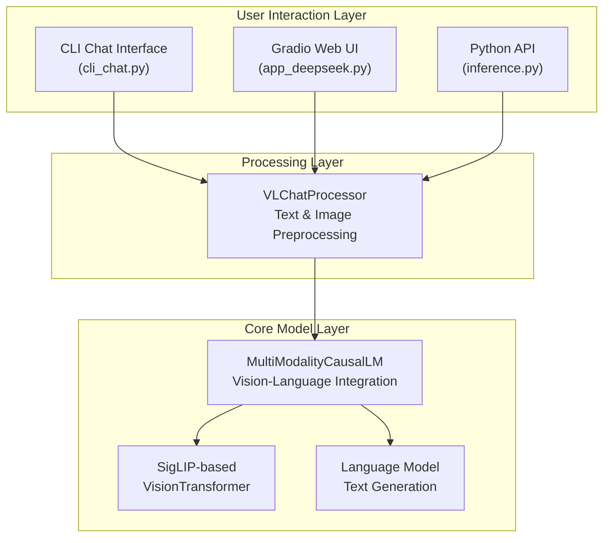

Sources: [README.md:119-126]()

### Information Flow Diagram

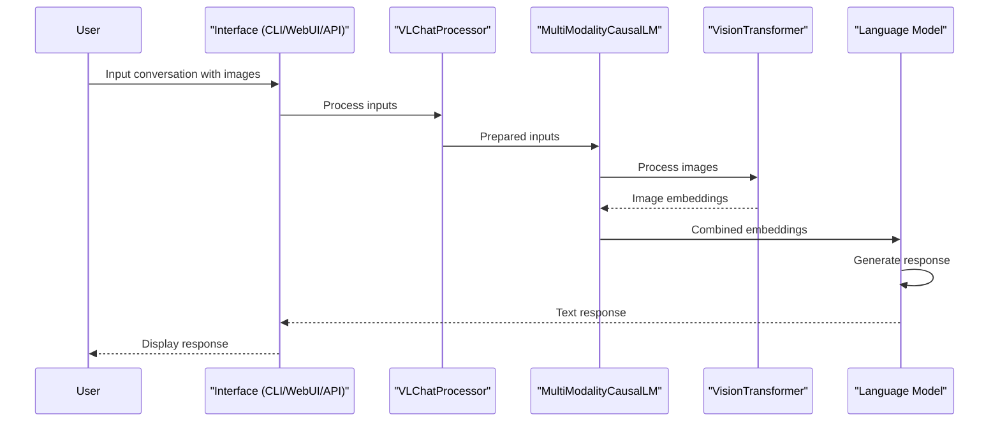

Sources: [README.md:119-187]()

## Core Components

### 1. VLChatProcessor

The `VLChatProcessor` handles preprocessing of both text and images, preparing them for input to the model. It transforms raw user inputs into a format suitable for the multimodal model.

Key responsibilities:
- Processing conversation history
- Handling image placeholders in text
- Preparing images for the vision encoder
- Formatting inputs for the model

Sources: [README.md:129-169]()

### 2. MultiModalityCausalLM

This component serves as the integration point between vision and language processing. It:
- Takes processed inputs from the `VLChatProcessor`
- Incorporates image embeddings from the vision encoder
- Combines them with text embeddings
- Prepares the unified representation for the language model

Sources: [README.md:132-172]()

### 3. Vision Encoder

DeepSeek-VL uses a SigLIP-based Vision Transformer to encode images into embeddings that can be processed alongside text. This component extracts visual features that are then integrated with the language understanding components.

Sources: [README.md:172]()

### 4. Language Model

The language model component handles text generation based on the combined vision and language inputs. It:
- Takes the combined embeddings from the `MultiModalityCausalLM`
- Generates contextually appropriate responses
- Handles token prediction and sequence generation

Sources: [README.md:175-184]()

## User Interfaces

DeepSeek-VL provides multiple ways to interact with the model:

### 1. Python API

For programmatic access and integration into applications, DeepSeek-VL offers a Python API that allows direct interaction with the model.

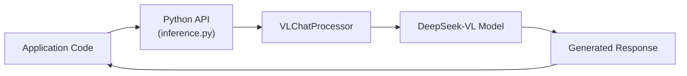

Sources: [README.md:118-187]()

### 2. Command-Line Interface

For quick testing and direct interaction, a command-line chat interface is provided.

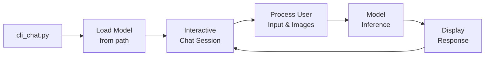

Sources: [README.md:190-196]()

### 3. Gradio Web UI

For a graphical user interface, DeepSeek-VL provides a Gradio-based web UI that allows for easy interaction with the model through a browser.

Sources: [README.md:198-204](), [pyproject.toml:25-36]()

## Dependencies

DeepSeek-VL relies on several key libraries and frameworks:

- **Core Dependencies**:
  - torch (≥2.0.1)
  - transformers (≥4.38.2)
  - timm (≥0.9.16)
  - accelerate
  - sentencepiece
  - attrdict
  - einops

- **Gradio Interface Dependencies** (optional):
  - gradio (3.48.0)
  - gradio-client (0.6.1)
  - mdtex2html
  - pypinyin
  - tiktoken
  - and others for UI rendering

Sources: [pyproject.toml:14-36]()

## Licensing

DeepSeek-VL is distributed under dual licensing:

- **Code Repository**: Licensed under the MIT License
- **Model Weights**: Subject to the DeepSeek Model License

The models support commercial use under these license terms. For more detailed information about licensing, see [Licensing](#6).

Sources: [README.md:208-210]()

---

# Page: Model Architecture

# Model Architecture

<details>
<summary>Relevant source files</summary>

The following files were used as context for generating this wiki page:

- [README.md](README.md)
- [deepseek_vl/__init__.py](deepseek_vl/__init__.py)
- [deepseek_vl/models/siglip_vit.py](deepseek_vl/models/siglip_vit.py)
- [inference.py](inference.py)

</details>


This page documents the core architecture of the DeepSeek-VL model, explaining how the vision and language components are integrated to enable multimodal understanding. For information about specific model variants, see [Model Variants](#1.2).

## Overall Architecture

DeepSeek-VL follows a vision-language architecture that processes both images and text inputs to generate coherent natural language responses. The model consists of three primary components:

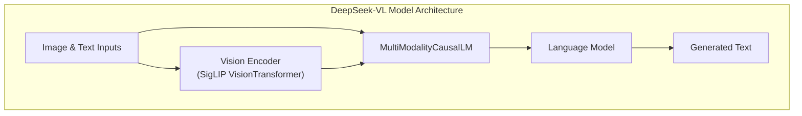

Sources: [README.md:60-62](), [inference.py:20-34]()

1. **Vision Encoder**: A SigLIP-based Vision Transformer that processes and encodes images into a representation that can be understood by the language model.

2. **MultiModalityCausalLM**: The integration layer that combines image embeddings and text tokens to create a unified representation for the language model.

3. **Language Model**: A causal language model that generates coherent text responses based on the multimodal inputs.

## Vision Encoder Component

The vision encoder in DeepSeek-VL is based on the SigLIP Vision Transformer (ViT) architecture. It processes images by dividing them into patches and applying a series of transformer blocks.

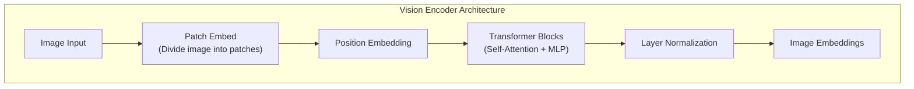

Sources: [deepseek_vl/models/siglip_vit.py:258-589]()

Key components of the Vision Transformer:

- **Patch Embedding**: Divides input images into fixed-size patches and projects them into the embedding space.
- **Position Embedding**: Adds positional information to the patch embeddings.
- **Transformer Blocks**: A series of self-attention and MLP blocks that process the patch embeddings.
- **Normalization**: Layer normalization applied after the transformer blocks.

DeepSeek-VL uses a configurable SigLIP Vision Transformer with various parameter settings depending on the model variant:

| Configuration | Image Size | Patch Size | Width | Layers | Heads | MLP Ratio |
|---------------|------------|------------|-------|--------|-------|-----------|
| siglip_so400m_patch14_384 | 336 | 14 | 1152 | 27 | 16 | 3.7362 |
| siglip_so400m_patch14_224 | 224 | 14 | 1152 | 27 | 16 | 3.7362 |
| siglip_large_patch16_384 | 384 | 16 | 1024 | 24 | 16 | 4.0 |

Sources: [deepseek_vl/models/siglip_vit.py:606-637]()

## Multimodal Integration

The MultiModalityCausalLM component is central to DeepSeek-VL's architecture, serving as the integration point between vision and language modalities.

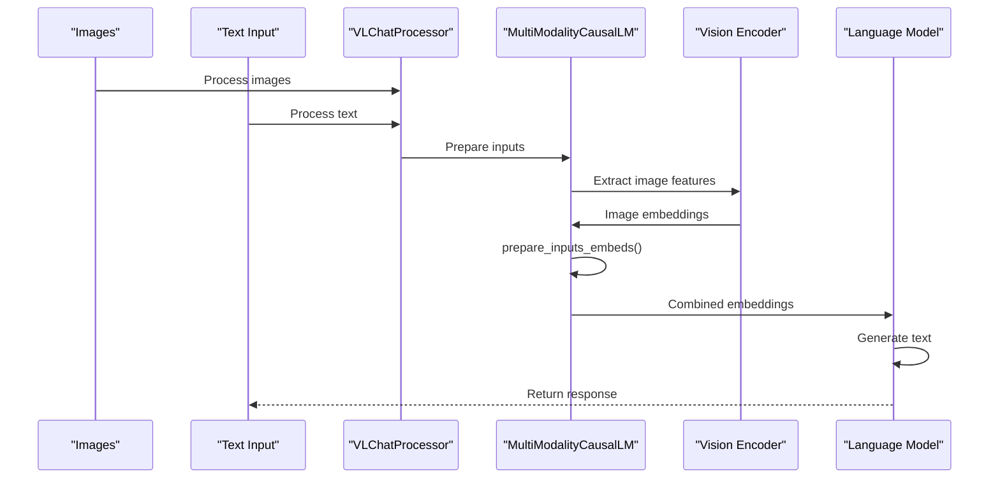

Sources: [inference.py:64-76]()

The integration process involves:

1. **Input Preparation**: The `VLChatProcessor` handles preprocessing of both image and text inputs.
2. **Feature Extraction**: Images are processed through the Vision Encoder to extract embeddings.
3. **Embedding Combination**: The `prepare_inputs_embeds` method in `MultiModalityCausalLM` combines image embeddings with text tokens into a single representation.
4. **Language Generation**: The unified representation is passed to the language model for response generation.

## Inference Pipeline

The inference process in DeepSeek-VL follows a specific pipeline that transforms raw inputs into generated text:

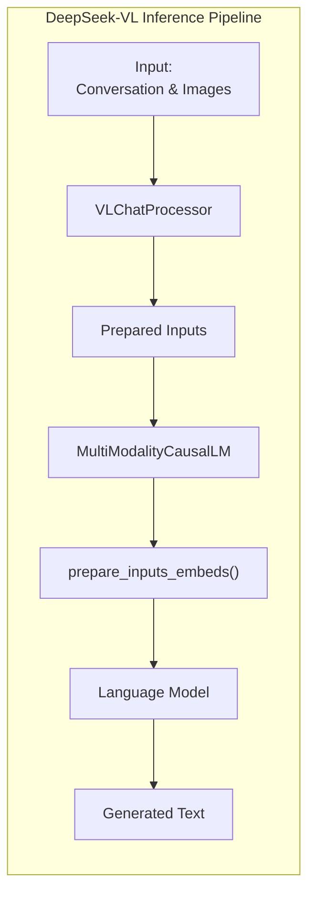

Sources: [inference.py:64-86]()

This pipeline involves several key steps:

1. **Input Processing**: Conversation history and images are processed by the `VLChatProcessor`.
   ```python
   pil_images = load_pil_images(conversation)
   prepare_inputs = vl_chat_processor(
       conversations=conversation, images=pil_images, force_batchify=True
   ).to(vl_gpt.device)
   ```

2. **Embedding Preparation**: The `MultiModalityCausalLM` prepares input embeddings by combining vision and text features.
   ```python
   inputs_embeds = vl_gpt.prepare_inputs_embeds(**prepare_inputs)
   ```

3. **Text Generation**: The language model generates a response based on the input embeddings.
   ```python
   outputs = vl_gpt.language_model.generate(
       inputs_embeds=inputs_embeds,
       attention_mask=prepare_inputs.attention_mask,
       pad_token_id=tokenizer.eos_token_id,
       bos_token_id=tokenizer.bos_token_id,
       eos_token_id=tokenizer.eos_token_id,
       max_new_tokens=512,
       do_sample=False,
       use_cache=True
   )
   ```

Sources: [inference.py:64-86]()

## Vision Transformer Details

The Vision Transformer (ViT) component is built with a series of attention blocks that process image patches:

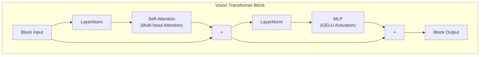

Sources: [deepseek_vl/models/siglip_vit.py:209-256]()

Each block contains:

1. **Layer Normalization**: Applied before both attention and MLP layers.
2. **Multi-head Self-Attention**: Processes relationships between image patches.
3. **MLP**: A feed-forward network with GELU activation.
4. **Skip Connections**: Residual connections around both attention and MLP layers.

The attention mechanism is defined as:

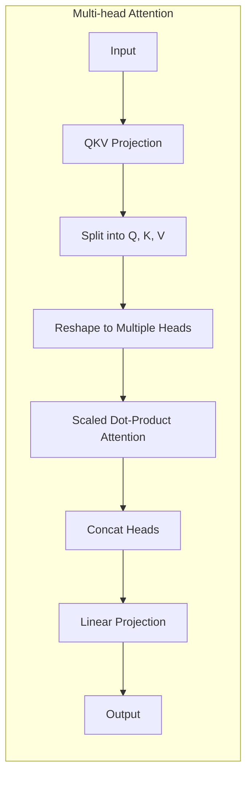

Sources: [deepseek_vl/models/siglip_vit.py:136-191]()

For efficient implementation, DeepSeek-VL uses PyTorch's `F.scaled_dot_product_attention` when available, falling back to manual implementation otherwise.

## Integration with User Code

When using DeepSeek-VL in applications, the main components that developers interact with are:

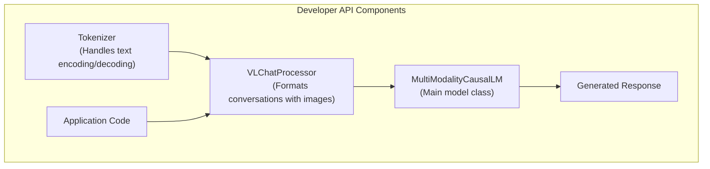

Sources: [inference.py:20-34](), [README.md:119-187]()

The typical usage pattern involves:

1. Loading the model and processor:
   ```python
   model_path = "deepseek-ai/deepseek-vl-7b-chat"
   vl_chat_processor = VLChatProcessor.from_pretrained(model_path)
   tokenizer = vl_chat_processor.tokenizer
   vl_gpt = AutoModelForCausalLM.from_pretrained(model_path, trust_remote_code=True)
   ```

2. Preparing the conversation with images:
   ```python
   conversation = [
       {
           "role": "User",
           "content": "<image_placeholder>Describe this image.",
           "images": ["path/to/image.jpg"],
       },
       {"role": "Assistant", "content": ""},
   ]
   ```

3. Processing inputs and generating responses using the pipeline described earlier.

Sources: [README.md:119-187](), [inference.py:36-86]()

This architecture enables DeepSeek-VL to effectively process and understand both visual and textual information, making it suitable for a wide range of multimodal tasks.

---

# Page: Model Variants

# Model Variants

<details>
<summary>Relevant source files</summary>

The following files were used as context for generating this wiki page:

- [README.md](README.md)
- [pyproject.toml](pyproject.toml)

</details>


This document provides detailed information about the different DeepSeek-VL model variants, explaining the parameter sizes (1.3B and 7B) and model types (base and chat) available in the DeepSeek-VL family. It covers the characteristics, use cases, and selection criteria for each variant. For information about the overall model architecture, see [Model Architecture](#1.1), and for details about model capabilities, see [Capabilities](#1.3).

## Model Family Overview

DeepSeek-VL is released as a family of models with varying parameter sizes and training objectives. All variants share the same fundamental architecture, combining vision and language understanding capabilities, but differ in their size and optimization targets.

### DeepSeek-VL Variant Hierarchy

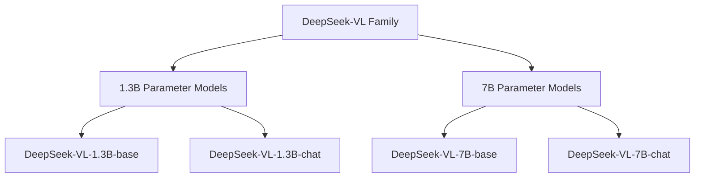

Sources: [README.md:91-103]()

## Parameter Size Variations

DeepSeek-VL is available in two different parameter sizes, each offering different trade-offs between performance and resource requirements.

### 1.3B Parameter Models

The 1.3B parameter models represent the smaller variants in the DeepSeek-VL family:

- **Model Size**: ~1.3 billion parameters
- **Memory Requirements**: Lower memory footprint
- **Inference Speed**: Faster inference
- **Deployment**: Suitable for resource-constrained environments
- **Context Length**: 4096 tokens

### 7B Parameter Models

The 7B parameter models are the larger variants:

- **Model Size**: ~7 billion parameters
- **Memory Requirements**: Higher memory footprint
- **Inference Speed**: Slower compared to 1.3B models
- **Performance**: Generally higher quality outputs and better comprehension
- **Context Length**: 4096 tokens

Sources: [README.md:98-103]()

## Model Types

Each parameter size comes in two different variants optimized for different use cases.

### Base Models

The base models (`DeepSeek-VL-1.3B-base` and `DeepSeek-VL-7B-base`) are general-purpose vision-language models:

- **Training**: Pretrained on a diverse dataset of vision-language data
- **Usage**: Ideal for customization, fine-tuning, and general-purpose tasks
- **Integration**: Can be adapted for specialized applications through additional fine-tuning
- **Flexibility**: More versatile for research and development of new applications

### Chat Models

The chat models (`DeepSeek-VL-1.3B-chat` and `DeepSeek-VL-7B-chat`) are optimized for conversational interactions:

- **Training**: Base models further fine-tuned on conversation data
- **Usage**: Ready-to-use for interactive dialogue applications
- **User Experience**: Designed to provide helpful, coherent responses in a conversational format
- **Integration**: Ideal for chatbots, virtual assistants, and interactive applications

Sources: [README.md:91-94](), [README.md:98-103]()

## Model Implementation and Loading

The DeepSeek-VL models are implemented through a combination of specialized components. The code structure reflects how the different model variants are instantiated and used.

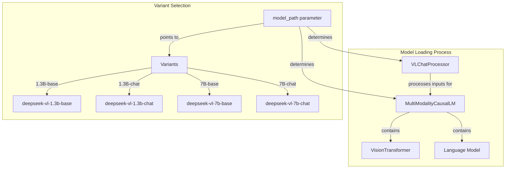

Sources: [README.md:126-134]()

## Model Variant Selection Guide

When choosing between model variants, consider the following factors:

### Resource vs. Performance Trade-off

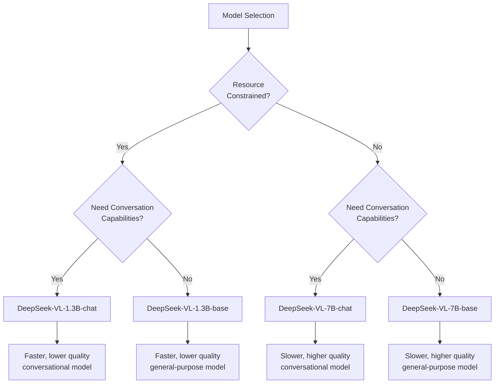

### Selection Criteria Table

| Consideration | Recommended Variant |
|---------------|---------------------|
| Mobile or edge deployment | DeepSeek-VL-1.3B-chat or DeepSeek-VL-1.3B-base |
| Interactive chat applications | DeepSeek-VL-7B-chat (if resources permit) or DeepSeek-VL-1.3B-chat |
| Research and fine-tuning | DeepSeek-VL-7B-base or DeepSeek-VL-1.3B-base |
| Best performance regardless of resources | DeepSeek-VL-7B-chat or DeepSeek-VL-7B-base |
| Balanced performance and speed | DeepSeek-VL-1.3B-chat or DeepSeek-VL-1.3B-base |

Sources: [README.md:91-103](), [README.md:126-134]()

## Model Loading Examples

### Loading a Chat Model

```python
from transformers import AutoModelForCausalLM
from deepseek_vl.models import VLChatProcessor, MultiModalityCausalLM

# For the 7B chat model
model_path = "deepseek-ai/deepseek-vl-7b-chat"

# For the 1.3B chat model
# model_path = "deepseek-ai/deepseek-vl-1.3b-chat"

vl_chat_processor = VLChatProcessor.from_pretrained(model_path)
vl_gpt = AutoModelForCausalLM.from_pretrained(model_path, trust_remote_code=True)
```

### Loading a Base Model

```python
from transformers import AutoModelForCausalLM
from deepseek_vl.models import VLChatProcessor, MultiModalityCausalLM

# For the 7B base model
model_path = "deepseek-ai/deepseek-vl-7b-base"

# For the 1.3B base model
# model_path = "deepseek-ai/deepseek-vl-1.3b-base"

vl_chat_processor = VLChatProcessor.from_pretrained(model_path)
vl_gpt = AutoModelForCausalLM.from_pretrained(model_path, trust_remote_code=True)
```

Sources: [README.md:126-134]()

## Model Availability and Access

All DeepSeek-VL variants are available on Hugging Face and can be accessed using the following model paths:

| Model Variant | Hugging Face Repository |
|---------------|-------------------------|
| DeepSeek-VL-1.3B-base | deepseek-ai/deepseek-vl-1.3b-base |
| DeepSeek-VL-1.3B-chat | deepseek-ai/deepseek-vl-1.3b-chat |
| DeepSeek-VL-7B-base | deepseek-ai/deepseek-vl-7b-base |
| DeepSeek-VL-7B-chat | deepseek-ai/deepseek-vl-7b-chat |

The models are provided under the DeepSeek Model License, which permits commercial use.

Sources: [README.md:98-103](), [README.md:209-210]()

---

# Page: Capabilities

# Capabilities

<details>
<summary>Relevant source files</summary>

The following files were used as context for generating this wiki page:

- [README.md](README.md)
- [inference.py](inference.py)

</details>


This document outlines the multimodal understanding capabilities of DeepSeek-VL, a vision-language model designed to process and interpret various visual and textual data types. For information about the overall model architecture, see [Model Architecture](#1.1), and for details on the different model variants, see [Model Variants](#1.2).

## Multimodal Understanding Overview

DeepSeek-VL is designed to comprehend and reason about diverse visual content in conjunction with natural language. The model integrates visual perception with language understanding to handle complex multimodal tasks across a wide range of real-world scenarios.

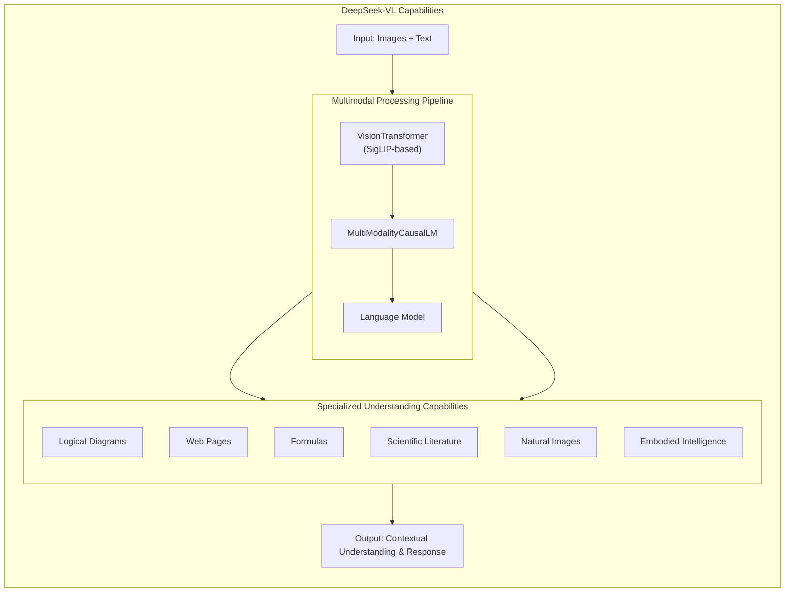

Sources: [README.md:62-62]()

## Key Capabilities

DeepSeek-VL demonstrates proficiency in processing six major categories of visual content, each requiring different types of visual reasoning and domain knowledge.

### 1. Logical Diagrams

The model can interpret diagrams, flowcharts, system architectures, and other visual representations of logical relationships. This includes:

- Understanding the structure and hierarchical relationships in diagrams
- Interpreting connections between components
- Explaining processes represented in flowcharts
- Analyzing system architectures and their components

This capability is demonstrated in the example from the repository where the model describes the stages of a training pipeline diagram.

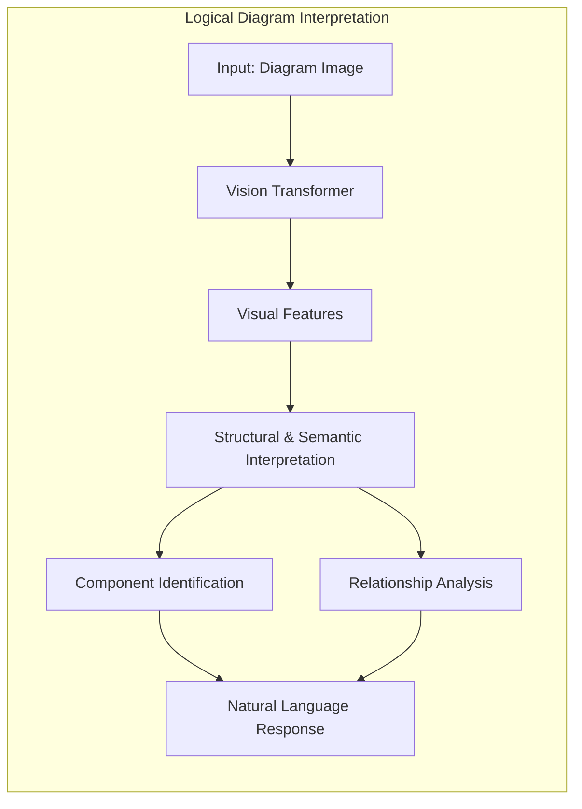

Sources: [README.md:136-144](), [inference.py:36-44]()

### 2. Web Pages

DeepSeek-VL can process and understand web pages, including:

- Interpreting the layout and structure of web interfaces
- Recognizing UI elements and their functions
- Understanding the relationships between text and visual elements
- Comprehending the overall design and purpose of web pages

### 3. Formula Recognition

The model demonstrates the ability to:

- Recognize and interpret mathematical and scientific formulas
- Understand formulas presented in various formats (typeset, handwritten)
- Explain the meaning and components of equations
- Relate formulas to their applications and contexts

### 4. Scientific Literature

DeepSeek-VL can process scientific papers and technical documents, including:

- Understanding figures, graphs, and charts in research papers
- Interpreting specialized scientific visualizations
- Comprehending the relationship between visual data and accompanying text
- Extracting insights from complex scientific imagery

### 5. Natural Images

The model can analyze and describe general photographs and images, including:

- Identifying objects, scenes, and people in photographs
- Understanding spatial relationships between elements
- Recognizing activities and events depicted in images
- Providing detailed descriptions of visual content

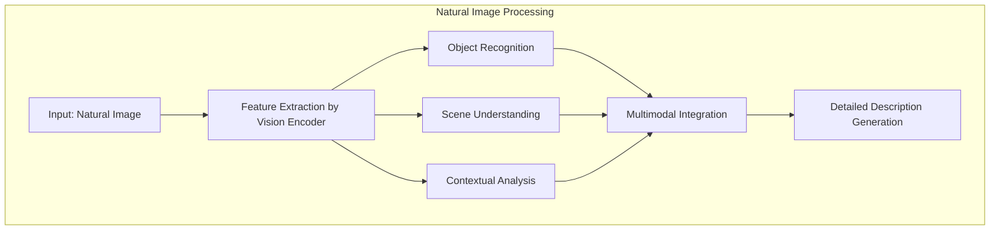

Sources: [README.md:62-62]()

### 6. Embodied Intelligence

DeepSeek-VL demonstrates capabilities relevant to embodied AI applications:

- Understanding spatial navigation scenarios
- Interpreting visual feedback in interactive environments
- Processing visual input for task planning and execution
- Generalizing visual knowledge to novel embodied tasks

## Capability Implementation

The multimodal capabilities are enabled through the integration of the vision encoder and language model components:

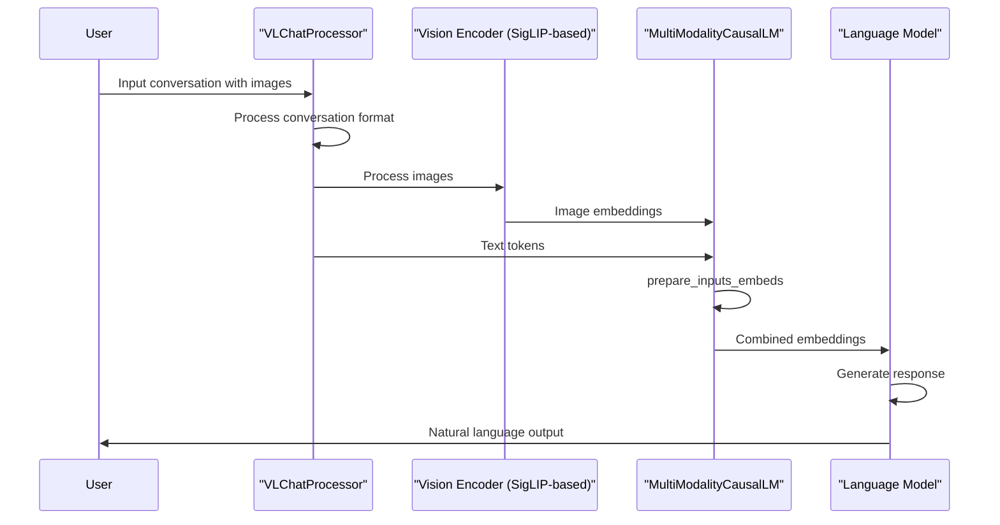

Sources: [inference.py:65-72](), [inference.py:74-83]()

### Technical Implementation Details

The technical implementation involves several key steps:

1. Images are processed by the `VLChatProcessor` which handles the integration of images into the conversation format
2. The vision encoder extracts visual features from images
3. The `MultiModalityCausalLM` integrates vision and language through the `prepare_inputs_embeds` method
4. The language model generates responses based on the multimodal inputs

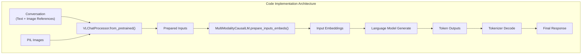

Sources: [inference.py:65-86]()

## Capability Variations Across Model Sizes

The DeepSeek-VL family includes models of different parameter sizes, each with specific capability characteristics:

| Model | Parameters | Use Case | Capability Characteristics |
|-------|------------|----------|----------------------------|
| DeepSeek-VL-7B-chat | 7 billion | Interactive applications | Strongest overall capabilities, ideal for complex multimodal reasoning |
| DeepSeek-VL-7B-base | 7 billion | Foundation for fine-tuning | Strong raw capabilities without alignment for conversation |
| DeepSeek-VL-1.3B-chat | 1.3 billion | Resource-constrained environments | Good capabilities with lower computational requirements |
| DeepSeek-VL-1.3B-base | 1.3 billion | Lightweight foundation | Balance between model size and performance |

All models feature a context length of 4096 tokens, enabling the processing of complex multimodal conversations with multiple images.

Sources: [README.md:91-103]()

## Multi-Image and In-Context Learning

DeepSeek-VL can process multiple images within a single conversation, enabling complex visual reasoning tasks and in-context learning scenarios:

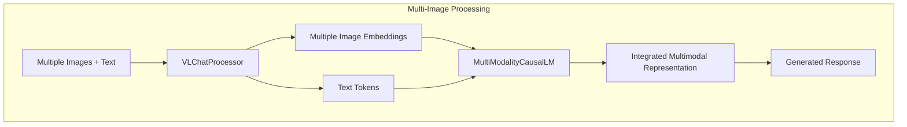

This multi-image capability supports:
- Comparison between multiple images
- Sequential reasoning across images
- In-context learning from example images
- Complex visual reasoning tasks requiring multiple visual contexts

Sources: [README.md:146-161](), [inference.py:46-62]()

## Usage Examples

The following table shows examples of prompts that leverage different capabilities of DeepSeek-VL:

| Capability | Example Prompt |
|------------|----------------|
| Logical Diagrams | "Describe each stage of this [diagram]" |
| Web Pages | "Explain the structure and functionality of this website interface" |
| Formula Recognition | "Interpret this mathematical equation and explain its components" |
| Scientific Literature | "Summarize the key findings presented in this scientific figure" |
| Natural Images | "Describe the scene in detail, noting all important elements" |
| Embodied Intelligence | "What actions should be taken next based on this visual input?" |

Sources: [README.md:136-144](), [inference.py:36-44]()

---

# Page: Getting Started

# Getting Started

<details>
<summary>Relevant source files</summary>

The following files were used as context for generating this wiki page:

- [README.md](README.md)
- [pyproject.toml](pyproject.toml)
- [requirements.txt](requirements.txt)

</details>


This guide provides instructions for setting up and using DeepSeek-VL, a vision-language model for processing and understanding both visual and textual information. It covers installation requirements, basic usage patterns, and how to interact with the model through different interfaces. For detailed information about the model architecture and capabilities, see [Overview](#1). For comprehensive installation steps, see [Installation](#2.1).

## Prerequisites

Before installing DeepSeek-VL, ensure your system meets the following requirements:

- Python 3.8 or higher
- PyTorch 2.0.1 or higher
- CUDA-compatible GPU (recommended for inference)
- Sufficient disk space for model weights (7B models require approximately 14GB)

## Installation

DeepSeek-VL can be installed directly from the repository:

```bash
# Clone the repository
git clone https://github.com/deepseek-ai/DeepSeek-VL.git
cd DeepSeek-VL

# Install the basic package
pip install -e .

# For Gradio web UI support, install additional dependencies
pip install -e .[gradio]
```

The installation process sets up all necessary dependencies, including:
- `transformers` (version 4.38.2 or higher)
- `timm` (version 0.9.16 or higher)
- `accelerate`
- `sentencepiece`
- `attrdict`
- `einops`

Sources:
- [README.md:109-115]()
- [pyproject.toml:14-22]()
- [requirements.txt:1-7]()

## Available Models

DeepSeek-VL offers several model variants to suit different needs and computational resources:

| Model | Parameters | Context Length | Purpose |
|-------|------------|----------------|---------|
| DeepSeek-VL-1.3B-base | 1.3 billion | 4096 tokens | Base model for fine-tuning |
| DeepSeek-VL-1.3B-chat | 1.3 billion | 4096 tokens | Optimized for chat/dialogue |
| DeepSeek-VL-7B-base | 7 billion | 4096 tokens | Larger base model |
| DeepSeek-VL-7B-chat | 7 billion | 4096 tokens | Larger chat-optimized model |

All models can be loaded directly from Hugging Face using the model IDs (e.g., `deepseek-ai/deepseek-vl-7b-chat`) or used locally after downloading.

Sources:
- [README.md:89-104]()

## System Architecture Overview

The following diagram shows the high-level architecture of DeepSeek-VL and how components interact:

```mermaid
flowchart TD
    User["User"] -->|"Inputs text & images"| Interfaces
    
    subgraph Interfaces
        PyAPI["Python API\n(inference.py)"]
        CLI["CLI Chat\n(cli_chat.py)"]
        WebUI["Gradio Web UI\n(app_deepseek.py)"]
    end
    
    subgraph CoreComponents
        VLChatProc["VLChatProcessor\n(processes text & images)"]
        MultiModal["MultiModalityCausalLM\n(integrates vision & language)"]
        LangModel["Language Model\n(generates text)"]
    end
    
    Interfaces --> VLChatProc
    VLChatProc --> MultiModal
    MultiModal -->|"prepare_inputs_embeds()"| InputEmbeds["Input Embeddings"]
    InputEmbeds --> LangModel
    LangModel -->|"generate()"| Outputs["Output Tokens"]
    Outputs -->|"tokenizer.decode()"| Response["Final Text Response"]
```

Sources:
- [README.md:119-187]()

## Data Flow in DeepSeek-VL

The following diagram illustrates how data flows through the system when processing a multimodal input:

```mermaid
flowchart LR
    TextInput["Text Input"] --> VLChatProcessor
    ImageInput["Image Input"] -->|"load_pil_images()"| PILImages["PIL Images"]
    PILImages --> VLChatProcessor["VLChatProcessor"]
    
    VLChatProcessor --> PrepInputs["Prepared Inputs\n(conversations, images, attention_mask)"]
    PrepInputs -->|"prepare_inputs_embeds()"| MultiModalityCausalLM
    
    MultiModalityCausalLM --> InputEmbeds["Input Embeddings"]
    InputEmbeds -->|"language_model.generate()"| OutputTokens["Output Tokens"]
    OutputTokens -->|"tokenizer.decode()"| TextResponse["Text Response"]
```

Sources:
- [README.md:119-187]()

## Python API Example

Here's a basic example of using DeepSeek-VL with the Python API:

```python
import torch
from transformers import AutoModelForCausalLM
from deepseek_vl.models import VLChatProcessor, MultiModalityCausalLM
from deepseek_vl.utils.io import load_pil_images

# Specify the model path
model_path = "deepseek-ai/deepseek-vl-7b-chat"

# Load the processor and tokenizer
vl_chat_processor = VLChatProcessor.from_pretrained(model_path)
tokenizer = vl_chat_processor.tokenizer

# Load the model
vl_gpt = AutoModelForCausalLM.from_pretrained(model_path, trust_remote_code=True)
vl_gpt = vl_gpt.to(torch.bfloat16).cuda().eval()

# Create a conversation with an image
conversation = [
    {
        "role": "User",
        "content": "<image_placeholder>Describe this image.",
        "images": ["path/to/your/image.jpg"],
    },
    {"role": "Assistant", "content": ""},
]

# Load images and prepare for inputs
pil_images = load_pil_images(conversation)
prepare_inputs = vl_chat_processor(
    conversations=conversation,
    images=pil_images,
    force_batchify=True
).to(vl_gpt.device)

# Run image encoder to get the image embeddings
inputs_embeds = vl_gpt.prepare_inputs_embeds(**prepare_inputs)

# Generate the response
outputs = vl_gpt.language_model.generate(
    inputs_embeds=inputs_embeds,
    attention_mask=prepare_inputs.attention_mask,
    pad_token_id=tokenizer.eos_token_id,
    bos_token_id=tokenizer.bos_token_id,
    eos_token_id=tokenizer.eos_token_id,
    max_new_tokens=512,
    do_sample=False,
    use_cache=True
)

# Decode the response
answer = tokenizer.decode(outputs[0].cpu().tolist(), skip_special_tokens=True)
print(answer)
```

Sources:
- [README.md:119-187]()

## Conversation Format

DeepSeek-VL uses a structured format for conversations with images:

```mermaid
flowchart TD
    ConvFormat["Conversation Format"] --> ConvItem1["User Message"]
    ConvFormat --> ConvItem2["Assistant Message"]
    
    ConvItem1 --> Role1["role: User"]
    ConvItem1 --> Content1["content: Text with <image_placeholder>"]
    ConvItem1 --> Images1["images: List of image paths"]
    
    ConvItem2 --> Role2["role: Assistant"]
    ConvItem2 --> Content2["content: Response text (empty for input)"]
```

Example structure:
```python
conversation = [
    {
        "role": "User",
        "content": "<image_placeholder>Describe this image.",
        "images": ["path/to/image.jpg"],
    },
    {"role": "Assistant", "content": ""},  # Empty for input, filled after generation
]
```

Sources:
- [README.md:135-143]()

## Command Line Interface

For interactive chat via command line:

```bash
python cli_chat.py --model_path "deepseek-ai/deepseek-vl-7b-chat"

# Or with a local model path
python cli_chat.py --model_path "/path/to/local/model"
```

Sources:
- [README.md:190-196]()

## Gradio Web Interface

To launch the web interface:

```bash
# First install gradio dependencies if not already done
pip install -e .[gradio]

# Then run the Gradio app
python deepseek_vl/serve/app_deepseek.py
```

The Gradio interface provides a user-friendly way to interact with DeepSeek-VL, allowing you to upload images and chat with the model.

Sources:
- [README.md:198-204]()
- [pyproject.toml:24-36]()
- [requirements.txt:9-19]()

## Next Steps

- Explore detailed [Installation](#2.1) instructions
- Try [Quick Usage Examples](#2.2)
- Learn about the [Model Architecture](#1.1) and [Capabilities](#1.3)
- Explore different [Interfaces](#4) for interacting with DeepSeek-VL

---

# Page: Installation

# Installation

<details>
<summary>Relevant source files</summary>

The following files were used as context for generating this wiki page:

- [Makefile](Makefile)
- [README.md](README.md)
- [pyproject.toml](pyproject.toml)
- [requirements.txt](requirements.txt)

</details>


This page provides detailed instructions for installing DeepSeek-VL and its dependencies. For information about using DeepSeek-VL after installation, see [Quick Usage Examples](#2.2).

## System Requirements

DeepSeek-VL requires the following:

- Python >= 3.8
- For optimal performance: CUDA-compatible GPU
- Sufficient disk space for model weights (several GB depending on model variant)

## Installation Methods

### Basic Installation

The standard way to install DeepSeek-VL with all core dependencies:

```bash
pip install -e .
```

Sources: [README.md:111-114](), [pyproject.toml:6-22]()

### Installation with Optional Features

#### Gradio Web UI

To install DeepSeek-VL with Gradio web interface support:

```bash
pip install -e .[gradio]
```

This installs additional UI-related dependencies required for the web interface.

#### Development Tools

For development and contribution to the codebase:

```bash
pip install -e .[lint]
```

This installs code formatting, linting, and testing tools.

Sources: [README.md:200-201](), [pyproject.toml:24-50]()

## Installation Process Diagram

```mermaid
graph TD
    Start["Start Installation"] --> CheckPython{"Python >= 3.8?"}
    CheckPython -- "No" --> InstallPython["Install Python 3.8+"]
    CheckPython -- "Yes" --> ChooseInstall["Select Installation Type"]
    InstallPython --> ChooseInstall
    
    ChooseInstall --> BasicInstall["Basic: pip install -e ."]
    ChooseInstall --> GradioInstall["With UI: pip install -e .[gradio]"]
    ChooseInstall --> DevInstall["Development: pip install -e .[lint]"]
    
    BasicInstall --> VerifyInstall["Verify Installation"]
    GradioInstall --> VerifyInstall
    DevInstall --> VerifyInstall
    
    VerifyInstall --> TestCLI["Test CLI Interface"]
    VerifyInstall --> TestCode["Test Code Import"]
    GradioInstall --> TestGradio["Test Gradio Interface"]
    
    TestCLI --> Complete["Installation Complete"]
    TestCode --> Complete
    TestGradio --> Complete
```

Sources: [README.md:109-115](), [pyproject.toml:13-50]()

## Dependencies

### Core Dependencies

DeepSeek-VL relies on the following primary dependencies:

| Dependency | Version | Purpose |
|------------|---------|---------|
| torch | >=2.0.1 | Deep learning framework |
| transformers | >=4.38.2 | Transformer model implementation |
| timm | >=0.9.16 | PyTorch Image Models |
| accelerate | - | Hardware acceleration utilities |
| sentencepiece | - | Tokenization |
| attrdict | - | Attribute dictionary functionality |
| einops | - | Tensor operations |

### Optional Dependencies

When installing with `[gradio]`, these additional dependencies are included:

| Dependency | Version | Purpose |
|------------|---------|---------|
| gradio | 3.48.0 | Web UI framework |
| gradio-client | 0.6.1 | Client for Gradio |
| mdtex2html | 1.3.0 | Markdown/LaTeX to HTML conversion |
| pypinyin | 0.50.0 | Chinese pinyin conversion |
| tiktoken | 0.5.2 | Tokenizer |
| tqdm | 4.64.0 | Progress bars |
| colorama | 0.4.5 | Terminal color output |
| Pygments | 2.12.0 | Code syntax highlighting |
| markdown | 3.4.1 | Markdown processing |

Sources: [pyproject.toml:14-36](), [requirements.txt:1-19]()

## Component Architecture

```mermaid
graph TD
    subgraph "Installation Options"
        BasicPip["pip install -e ."]
        GradioPip["pip install -e .[gradio]"]
        DevPip["pip install -e .[lint]"]
    end
    
    subgraph "DeepSeek-VL Core Components"
        VLChatProcessor["VLChatProcessor"]
        MultiModalityCausalLM["MultiModalityCausalLM"]
        VisionEncoder["Vision Encoder (SigLIP-based)"]
        LanguageModel["Language Model"]
    end
    
    subgraph "User Interfaces"
        CLIChat["cli_chat.py"]
        GradioWebUI["deepseek_vl/serve/app_deepseek.py"]
    end
    
    BasicPip --> VLChatProcessor
    BasicPip --> MultiModalityCausalLM
    BasicPip --> VisionEncoder
    BasicPip --> LanguageModel
    
    GradioPip --> VLChatProcessor
    GradioPip --> MultiModalityCausalLM
    GradioPip --> VisionEncoder
    GradioPip --> LanguageModel
    GradioPip --> GradioWebUI
    
    VLChatProcessor --> CLIChat
    MultiModalityCausalLM --> CLIChat
    VLChatProcessor --> GradioWebUI
    MultiModalityCausalLM --> GradioWebUI
```

Sources: [README.md:118-187]()

## Verifying Installation

### Basic Verification

To verify that DeepSeek-VL has been installed correctly, run a simple Python script:

```python
from deepseek_vl.models import VLChatProcessor, MultiModalityCausalLM
print("DeepSeek-VL successfully imported!")
```

If no errors occur, the installation was successful.

### Testing the CLI Interface

Test the command-line interface with:

```bash
python cli_chat.py --model_path "deepseek-ai/deepseek-vl-7b-chat"
```

This will download the model (if not cached locally) and start an interactive chat session.

### Testing the Gradio Web Interface

If you installed with Gradio support:

```bash
python deepseek_vl/serve/app_deepseek.py
```

This starts a local web server with the DeepSeek-VL chat interface.

Sources: [README.md:191-204]()

## Troubleshooting

### Common Issues

#### CUDA/GPU Issues

If you encounter CUDA-related errors:
- Ensure your PyTorch installation matches your CUDA version
- Check that GPU drivers are up-to-date
- Verify CUDA toolkit compatibility

#### Dependency Conflicts

If you encounter dependency conflicts:
- Create a fresh virtual environment:
  ```bash
  python -m venv venv
  source venv/bin/activate  # On Windows: venv\Scripts\activate
  ```
- Then reinstall DeepSeek-VL in the isolated environment

#### Model Download Issues

If model downloading fails:
- Check your internet connection
- Ensure you have sufficient disk space
- Try specifying a local Hugging Face cache directory:
  ```bash
  export TRANSFORMERS_CACHE="/path/to/cache"
  ```

## Next Steps

After successful installation, proceed to [Quick Usage Examples](#2.2) to learn how to use DeepSeek-VL for vision-language tasks.

Sources: [README.md:107-204]()

---

# Page: Quick Usage Examples

# Quick Usage Examples

<details>
<summary>Relevant source files</summary>

The following files were used as context for generating this wiki page:

- [README.md](README.md)
- [cli_chat.py](cli_chat.py)
- [inference.py](inference.py)

</details>


This page provides concise examples for utilizing DeepSeek-VL models in your vision-language applications. These examples demonstrate key usage patterns for quick implementation. For installation instructions, see [Installation](#2.1).

## Basic Inference Pipeline

The DeepSeek-VL inference pipeline follows a straightforward flow from input to output. The basic pattern involves loading a model, preparing a conversation with images, and generating a response.

```mermaid
flowchart LR
    A["User Input\n(Text + Images)"] --> B["VLChatProcessor"]
    B --> C["prepare_inputs"]
    C --> D["MultiModalityCausalLM"]
    D --> |"prepare_inputs_embeds()"| E["inputs_embeds"]
    E --> F["language_model.generate()"]
    F --> G["output tokens"]
    G --> |"tokenizer.decode()"| H["Text Response"]
```

Sources: [inference.py:26-86](), [README.md:119-187]()

### Simple Inference Example

The example below demonstrates basic inference with a single image:

```python
# Load processor and model
model_path = "deepseek-ai/deepseek-vl-7b-chat"
vl_chat_processor = VLChatProcessor.from_pretrained(model_path)
tokenizer = vl_chat_processor.tokenizer
vl_gpt = AutoModelForCausalLM.from_pretrained(model_path, trust_remote_code=True)
vl_gpt = vl_gpt.to(torch.bfloat16).cuda().eval()

# Define conversation with image
conversation = [
    {
        "role": "User",
        "content": "<image_placeholder>Describe each stage of this image.",
        "images": ["./images/training_pipelines.jpg"],
    },
    {"role": "Assistant", "content": ""},
]

# Process inputs and generate response
pil_images = load_pil_images(conversation)
prepare_inputs = vl_chat_processor(
    conversations=conversation, 
    images=pil_images, 
    force_batchify=True
).to(vl_gpt.device)
inputs_embeds = vl_gpt.prepare_inputs_embeds(**prepare_inputs)
outputs = vl_gpt.language_model.generate(
    inputs_embeds=inputs_embeds,
    attention_mask=prepare_inputs.attention_mask,
    pad_token_id=tokenizer.eos_token_id,
    bos_token_id=tokenizer.bos_token_id,
    eos_token_id=tokenizer.eos_token_id,
    max_new_tokens=512,
    do_sample=False,
    use_cache=True
)
answer = tokenizer.decode(outputs[0].cpu().tolist(), skip_special_tokens=True)
```

Sources: [inference.py:26-86](), [README.md:119-187]()

## CLI Chat Interface

DeepSeek-VL provides a command-line interface for interactive conversations with images through the `cli_chat.py` script.

```mermaid
sequenceDiagram
    participant "User" as U
    participant "CLI Interface" as CLI
    participant "VLChatProcessor" as VCP
    participant "MultiModalityCausalLM" as MM
    participant "TextIteratorStreamer" as TIS
    
    U->>CLI: "Input text with <image_placeholder>"
    CLI->>U: "Input image file path"
    U->>CLI: "Provide image path"
    CLI->>VCP: "Process conversation and images"
    VCP->>MM: "prepare_inputs()"
    MM->>MM: "prepare_inputs_embeds()"
    MM->>TIS: "language_model.generate()"
    TIS-->>CLI: "Stream tokens"
    CLI-->>U: "Display response"
```

Sources: [cli_chat.py:94-184](), [README.md:190-196]()

### Running the CLI Chat

To start a chat session:

```bash
python cli_chat.py --model_path "deepseek-ai/deepseek-vl-7b-chat"
```

Available command-line arguments:

| Argument | Default | Description |
|----------|---------|-------------|
| `--model_path` | "deepseek-ai/deepseek-vl-7b-chat" | HuggingFace model name or local path |
| `--temperature` | 0.2 | Controls randomness (0 for deterministic) |
| `--top_p` | 0.95 | Controls diversity of generated text |
| `--repetition_penalty` | 1.1 | Penalizes repetition in generated text |
| `--max_gen_len` | 512 | Maximum number of tokens to generate |

During the chat session, use these special commands:
- `exit`: Quit the program
- `help`: Show help message
- `new`: Start a new conversation

Sources: [cli_chat.py:94-184](), [cli_chat.py:212-224]()

## Multi-Image Conversations

DeepSeek-VL can process multiple images in a single conversation, enabling complex visual reasoning tasks.

```mermaid
graph TD
    subgraph "Input Processing"
        User["User Input"] -->|"count <image_placeholder>"| ImageCounter["Image Token Counter"]
        ImageCounter -->|"n images"| ImageLoader["load_pil_images()"]
        Images["Image File Paths"] --> ImageLoader
        ImageLoader -->|"PIL.Image list"| VLC["VLChatProcessor"]
        Text["Text with <image_placeholder>"] --> VLC
    end
    
    subgraph "Model Processing"
        VLC -->|"prepare_inputs"| MMC["MultiModalityCausalLM"]
        MMC -->|"prepare_inputs_embeds()"| IE["inputs_embeds"]
        IE --> LM["language_model.generate()"]
        LM --> Response["Generated Response"]
    end
```

Sources: [cli_chat.py:125-162](), [inference.py:46-62]()

### Multiple Images Example

```python
conversation = [
    {
        "role": "User",
        "content": "<image_placeholder>A dog wearing nothing, "
                   "<image_placeholder>a dog wearing a santa hat, "
                   "<image_placeholder>a dog wearing a wizard outfit, and "
                   "<image_placeholder>what's the dog wearing?",
        "images": [
            "images/dog_a.png",
            "images/dog_b.png",
            "images/dog_c.png",
            "images/dog_d.png",
        ],
    },
    {"role": "Assistant", "content": ""}
]
```

Sources: [inference.py:46-62](), [README.md:146-161]()

## Model Variants

DeepSeek-VL offers different model sizes and variants to accommodate various needs:

| Model | Parameters | Context Length | Purpose |
|-------|------------|----------------|---------|
| DeepSeek-VL-1.3B-base | 1.3 billion | 4096 | Foundation model for fine-tuning |
| DeepSeek-VL-1.3B-chat | 1.3 billion | 4096 | Optimized for conversation |
| DeepSeek-VL-7B-base | 7 billion | 4096 | Larger foundation model |
| DeepSeek-VL-7B-chat | 7 billion | 4096 | Larger conversation model |

- **Base models**: Better for fine-tuning or specialized applications
- **Chat models**: Ready for conversational applications
- **1.3B models**: Lower resource requirements, faster inference
- **7B models**: Higher capabilities, more resource-intensive

Sources: [README.md:91-104]()

## Gradio Web Interface

For a graphical interface, DeepSeek-VL provides a Gradio-based web UI:

```bash
pip install -e .[gradio]
python deepseek_vl/serve/app_deepseek.py
```

This launches a local web server with an interactive interface for uploading images and chatting with the model.

Sources: [README.md:198-204]()

## Inference Flow Details

The following diagram provides a detailed view of the internal processing flow during inference:

```mermaid
flowchart TD
    subgraph "User Interface"
        UI["User Interface\n(CLI/API/Gradio)"]
    end
    
    subgraph "Input Processing"
        vcp["VLChatProcessor"]
        lpi["load_pil_images()"]
    end
    
    subgraph "Model Components"
        mmclm["MultiModalityCausalLM"]
        pie["prepare_inputs_embeds()"]
        lm["language_model"]
        gen["generate()"]
    end
    
    subgraph "Output Processing"
        td["tokenizer.decode()"]
    end
    
    UI -->|"conversation, image_paths"| lpi
    lpi -->|"conversation, pil_images"| vcp
    vcp -->|"prepare_inputs"| mmclm
    mmclm --> pie
    pie -->|"inputs_embeds"| lm
    lm --> gen
    gen -->|"output_tokens"| td
    td -->|"text_response"| UI
```

Sources: [inference.py:65-86](), [cli_chat.py:56-77]()

This detailed view shows how the components work together during inference:

1. The user interface collects conversation and image paths
2. `load_pil_images()` converts paths to PIL Image objects
3. `VLChatProcessor` prepares inputs from conversation and images
4. `MultiModalityCausalLM.prepare_inputs_embeds()` creates embeddings
5. `language_model.generate()` produces token outputs
6. `tokenizer.decode()` converts tokens to text
7. The response is returned to the user interface

---

# Page: Components

# Components

<details>
<summary>Relevant source files</summary>

The following files were used as context for generating this wiki page:

- [README.md](README.md)
- [deepseek_vl/__init__.py](deepseek_vl/__init__.py)
- [deepseek_vl/models/siglip_vit.py](deepseek_vl/models/siglip_vit.py)
- [inference.py](inference.py)

</details>


This page provides a comprehensive overview of the main components that make up the DeepSeek-VL system. DeepSeek-VL is a vision-language model designed to process and understand both visual and textual information, generating cohesive natural language responses. For information about model architecture specifics, see [Model Architecture](#1.1). For details on installation and usage, see [Getting Started](#2).

## Core Components Overview

DeepSeek-VL is composed of several key components that work together to enable multimodal understanding. These components can be categorized into three main subsystems:

```mermaid
flowchart TD
    subgraph "Core Processing Components"
        VLChatProcessor["VLChatProcessor\n(Processing & Formatting)"]
    end
    
    subgraph "Vision-Language Model Components"
        VisionEncoder["VisionEncoder\n(SigLIP-based VisionTransformer)"]
        LanguageModel["LanguageModel\n(Causal Language Model)"]
        MultiModalProcessor["MultiModalityCausalLM\n(Multimodal Integration)"]
    end
    
    subgraph "Input/Output Components"
        ImageProcessor["Image Processing"]
        TextProcessor["Text Processing"]
        TokenDecoder["Token Decoder"]
    end
    
    ImageProcessor --> VLChatProcessor
    TextProcessor --> VLChatProcessor
    VLChatProcessor --> MultiModalProcessor
    MultiModalProcessor --> VisionEncoder
    MultiModalProcessor --> LanguageModel
    LanguageModel --> TokenDecoder

    class VLChatProcessor,MultiModalProcessor,VisionEncoder,LanguageModel emphasis;
```

Sources: [README.md:60-68](), [inference.py:20-37]()

## Component Interaction Flow

The following diagram illustrates how these components interact during the inference process:

```mermaid
sequenceDiagram
    participant Input as "Input (Text & Images)"
    participant VLChatProcessor as "VLChatProcessor"
    participant MultiModalityCausalLM as "MultiModalityCausalLM"
    participant VisionEncoder as "Vision Encoder (SigLIP ViT)"
    participant LanguageModel as "Language Model"
    participant Output as "Text Output"
    
    Input->>VLChatProcessor: Process conversation & images
    Note over VLChatProcessor: Formats inputs for model consumption
    VLChatProcessor->>MultiModalityCausalLM: Prepared inputs
    MultiModalityCausalLM->>VisionEncoder: Process images
    Note over VisionEncoder: Encodes images into embeddings
    VisionEncoder-->>MultiModalityCausalLM: Image embeddings
    MultiModalityCausalLM->>MultiModalityCausalLM: prepare_inputs_embeds()
    Note over MultiModalityCausalLM: Combines text and image embeddings
    MultiModalityCausalLM->>LanguageModel: Input embeddings
    LanguageModel->>LanguageModel: generate()
    Note over LanguageModel: Generates token sequence
    LanguageModel-->>Output: Generated tokens
    Output-->>Output: Tokenizer decodes to text
```

Sources: [inference.py:64-86]()

## Vision Processing Component

The vision component of DeepSeek-VL is based on a SigLIP (Simple Gated CLIP) Vision Transformer architecture.

### Vision Transformer

```mermaid
classDiagram
    class VisionTransformer {
        +forward_features(x)
        +forward_head(x)
        +forward(x)
    }
    
    class PatchEmbed {
        +Converts images to patch embeddings
    }
    
    class Block {
        +Transformer block
        +Self-attention mechanism
        +MLP layer
    }
    
    class Attention {
        +Multi-head self-attention
    }
    
    VisionTransformer --> PatchEmbed : Contains
    VisionTransformer --> Block : Contains sequence of
    Block --> Attention : Contains
    Block --> "MLP" : Contains
```

The VisionTransformer processes images through the following steps:
1. Images are divided into patches using the PatchEmbed component
2. Positional embeddings are added to provide spatial information
3. The embedded patches are processed through a series of transformer blocks
4. Each block contains self-attention mechanisms and MLP layers
5. The output is a sequence of token embeddings representing the visual content

The primary implementation is in the `VisionTransformer` class, with different configurations available based on model size:

- SigLIP SO400M patch14 (384px)
- SigLIP SO400M patch14 (224px)
- SigLIP Large patch16 (384px)

Sources: [deepseek_vl/models/siglip_vit.py:259-589](), [deepseek_vl/models/siglip_vit.py:606-626]()

## Language Processing Component

The language model component is a decoder-only transformer architecture that processes tokenized text and generates responses. It works with the embeddings provided by the multimodal integration component.

The language model:
1. Takes combined visual and textual embeddings as input
2. Uses the causal attention mechanism to generate tokens sequentially
3. Processes through transformer blocks with self-attention and feed-forward layers
4. Outputs probability distributions over vocabulary tokens

The generation process is controlled by parameters such as:
- `max_new_tokens`: Maximum length of the generated response
- `do_sample`: Whether to use sampling techniques for generation
- `use_cache`: Enables faster generation by caching key/value pairs

Sources: [inference.py:73-84]()

## Multimodal Integration Component

The `MultiModalityCausalLM` is the core component that bridges vision and language processing, implemented as a class that inherits from `AutoModelForCausalLM`.

```mermaid
flowchart TD
    subgraph "MultiModalityCausalLM"
        prep["prepare_inputs_embeds()"]
        proj["Projection layers"]
    end
    
    Images["Image inputs"] --> VisionEncoder["Vision Encoder\n(SigLIP VisionTransformer)"]
    VisionEncoder --> ImageEmbeddings["Image embeddings"]
    Text["Text inputs"] --> TextEmbeddings["Text embeddings"]
    
    ImageEmbeddings --> proj
    TextEmbeddings --> prep
    proj --> prep
    
    prep --> CombinedEmbeddings["Combined embeddings"]
    CombinedEmbeddings --> LanguageModel["Language Model"]
    LanguageModel --> Response["Generated response"]
```

The `MultiModalityCausalLM` performs these key functions:
1. Processes images through the vision encoder
2. Projects image embeddings to the language model's dimension space
3. Combines image and text embeddings in the proper sequence
4. Passes the combined embeddings to the language model for generation
5. The crucial method `prepare_inputs_embeds()` handles the fusion of modalities

Sources: [inference.py:31-32](), [inference.py:70-71]()

## Processing Pipeline Components

### VLChatProcessor

The `VLChatProcessor` is responsible for preparing inputs for the model by handling both text and images:

```mermaid
classDiagram
    class VLChatProcessor {
        +tokenizer
        +__call__(conversations, images, force_batchify)
        +process_images()
        +process_text()
    }
    
    class ConversationFormat {
        +role: String
        +content: String
        +images: List~String~
    }
    
    class PreparedInputs {
        +input_ids
        +attention_mask
        +image_features
        +sft_format
    }
    
    VLChatProcessor ..> ConversationFormat : Processes
    VLChatProcessor ..> PreparedInputs : Returns
```

The VLChatProcessor handles:
1. Loading and preprocessing images from file paths
2. Converting conversation format to model-compatible format
3. Handling image placeholders in text
4. Tokenizing text content
5. Creating attention masks
6. Packaging all inputs in a format expected by the model

Sources: [inference.py:23-24](), [inference.py:65-68]()

### Image Processing

Image processing in DeepSeek-VL involves:
1. Loading images using PIL
2. Resizing and normalizing images
3. Preparing images for the vision encoder

The `load_pil_images` utility function handles converting image paths to PIL Image objects for processing.

Sources: [inference.py:65](), [README.md:164]()

### Text Processing

Text processing involves:
1. Tokenization of text inputs
2. Handling special tokens like image placeholders
3. Creating attention masks for the transformer model
4. Handling the conversation format with roles (User/Assistant)

The tokenizer is a core component used for both encoding inputs and decoding generated outputs.

Sources: [inference.py:23-29](), [inference.py:85-86]()

## Component Implementation Details

### Model Variants

DeepSeek-VL components are available in different configurations:

| Model Variant | Parameter Size | Vision Encoder | Language Model |
|---------------|----------------|----------------|----------------|
| DeepSeek-VL-1.3B-base | 1.3 Billion | SigLIP-based VisionTransformer | 1.3B LM |
| DeepSeek-VL-1.3B-chat | 1.3 Billion | SigLIP-based VisionTransformer | 1.3B LM (chat-tuned) |
| DeepSeek-VL-7B-base | 7 Billion | SigLIP-based VisionTransformer | 7B LM |
| DeepSeek-VL-7B-chat | 7 Billion | SigLIP-based VisionTransformer | 7B LM (chat-tuned) |

All variants share the same component architecture but differ in the size and capabilities of individual components.

Sources: [README.md:91-103]()

### Loading Components

Components are typically loaded and initialized as follows:

1. Load the VLChatProcessor from the model path
2. Extract the tokenizer from the processor
3. Load the MultiModalityCausalLM model
4. Convert model to appropriate precision (e.g., bfloat16)
5. Move model to appropriate device (e.g., CUDA)

This pattern is consistent across different interfaces (CLI, Gradio, Python API).

Sources: [inference.py:27-34](), [README.md:129-133]()

## Component Relationships in Codebase

The following diagram shows how the components are structured in the codebase:

```mermaid
flowchart TD
    subgraph "Interfaces"
        cli["cli_chat.py"]
        gradio["app_deepseek.py"]
        api["inference.py"]
    end
    
    subgraph "Core Models Package"
        models["deepseek_vl/models/"]
        vlchat["VLChatProcessor"]
        multimodal["MultiModalityCausalLM"]
        vit["siglip_vit.py\nVisionTransformer"]
    end
    
    subgraph "Utils Package"
        utils["deepseek_vl/utils/"]
        io["io.py\nload_pil_images()"]
    end
    
    cli --> models
    gradio --> models
    api --> models
    api --> utils
    
    models --> vlchat
    models --> multimodal
    models --> vit
    
    utils --> io
```

Sources: [README.md:192-203](), [inference.py:20-24]()

The DeepSeek-VL component architecture is designed to be modular and flexible, allowing for different model sizes and applications while maintaining a consistent interface for developers.

---

# Page: Vision Processing

# Vision Processing

<details>
<summary>Relevant source files</summary>

The following files were used as context for generating this wiki page:

- [deepseek_vl/__init__.py](deepseek_vl/__init__.py)
- [deepseek_vl/models/siglip_vit.py](deepseek_vl/models/siglip_vit.py)
- [inference.py](inference.py)

</details>


This document details the Vision Processing component in DeepSeek-VL, which is responsible for encoding images into a format that can be processed alongside text inputs. For information about how these visual encodings are combined with text representations, see [Multimodal Integration](#3.3).

## Overview

The Vision Processing component uses a SigLIP-based Vision Transformer (ViT) to convert images into embedded representations. This component is the first stage in processing visual data within the DeepSeek-VL architecture, transforming raw pixel data into meaningful feature vectors that the language model can utilize.

The vision processing pipeline consists of several key steps:
1. Dividing images into patches
2. Embedding these patches into a continuous vector space
3. Adding positional information
4. Processing through transformer layers
5. Generating the final image embeddings

Sources:
- [deepseek_vl/models/siglip_vit.py:259-589]()
- [inference.py:70-71]()

## Vision Transformer Architecture

The DeepSeek-VL system implements a SigLIP (Sigmoid Loss for Image Processing) based Vision Transformer architecture. This implementation follows the design introduced in "An Image is Worth 16x16 Words: Transformers for Image Recognition at Scale" but with specific modifications for multimodal integration.

```mermaid
flowchart TD
    Input["Input Image"] --> PatchEmbed["PatchEmbed\nDivides image into patches"]
    PatchEmbed --> PosEmbed["_pos_embed\nAdds position information"]
    PosEmbed --> PatchDrop["patch_drop\nRegularization technique"]
    PatchDrop --> NormPre["norm_pre\nPre-normalization"]
    NormPre --> Blocks["blocks\nSequence of transformer blocks"]
    Blocks --> Norm["norm\nFinal layer normalization"]
    Norm --> Output["Image Embeddings"]

    subgraph "VisionTransformer.forward_features"
        PatchEmbed
        PosEmbed
        PatchDrop
        NormPre
        Blocks
        Norm
    end
```

Sources:
- [deepseek_vl/models/siglip_vit.py:562-572]()
- [deepseek_vl/models/siglip_vit.py:359-368]() - Patch embedding
- [deepseek_vl/models/siglip_vit.py:476-507]() - Position embedding

### Transformer Block Structure

Each transformer block in the vision encoder contains self-attention mechanisms and feed-forward neural networks, following the standard transformer architecture:

```mermaid
flowchart LR
    Input["Block Input"] --> Norm1["norm1\nLayerNorm"]
    Norm1 --> Attn["attn\nSelf-Attention"]
    Attn --> LS1["ls1\nLayerScale (optional)"]
    LS1 --> DP1["drop_path1\nDropPath"]
    Input --> Add1["+"]
    DP1 --> Add1
    Add1 --> Norm2["norm2\nLayerNorm"]
    Norm2 --> MLP["mlp\nFeed-forward network"]
    MLP --> LS2["ls2\nLayerScale (optional)"]
    LS2 --> DP2["drop_path2\nDropPath"]
    Add1 --> Add2["+"]
    DP2 --> Add2
    Add2 --> Output["Block Output"]
```

Sources:
- [deepseek_vl/models/siglip_vit.py:209-256]() - Block implementation
- [deepseek_vl/models/siglip_vit.py:253-256]() - Block forward method

### Self-Attention Mechanism

The core of each transformer block is the self-attention mechanism, which allows the model to focus on relevant parts of the image:

```mermaid
flowchart LR
    Input["Input Tensor\nShape: [B, N, C]"] --> QKV["qkv\nLinear projection\nShape: [B, N, 3, heads, dim]"]
    QKV --> Split["Split into Q, K, V\nShapes: [B, heads, N, dim]"]
    Split --> QNorm["q_norm\nNormalize Q"]
    Split --> KNorm["k_norm\nNormalize K"]
    QNorm --> SDPA["Scaled Dot-Product Attention\nF.scaled_dot_product_attention"]
    KNorm --> SDPA
    Split --> SDPA
    SDPA --> Reshape["Reshape\nShape: [B, N, C]"]
    Reshape --> Proj["proj\nLinear projection"]
    Proj --> ProjDrop["proj_drop\nDropout"]
    ProjDrop --> Output["Output Tensor\nShape: [B, N, C]"]
```

Sources:
- [deepseek_vl/models/siglip_vit.py:136-191]() - Attention class
- [deepseek_vl/models/siglip_vit.py:164-190]() - Attention forward method

## Model Configurations

DeepSeek-VL provides multiple SigLIP Vision Transformer configurations for different use cases:

| Model Name | Image Size | Patch Size | Width | Layers | Heads | MLP Ratio |
|------------|------------|------------|-------|--------|-------|-----------|
| siglip_so400m_patch14_384 | 336 | 14 | 1152 | 27 | 16 | 3.7362 |
| siglip_so400m_patch14_224 | 224 | 14 | 1152 | 27 | 16 | 3.7362 |
| siglip_large_patch16_384 | 384 | 16 | 1024 | 24 | 16 | 4 |

The configurations are instantiated through the `create_siglip_vit` function, which initializes a `VisionTransformer` with the appropriate parameters based on the model name.

Sources:
- [deepseek_vl/models/siglip_vit.py:606-637]() - SigLIP_MODEL_CONFIG dictionary
- [deepseek_vl/models/siglip_vit.py:640-681]() - create_siglip_vit function

## Integration in the Inference Pipeline

The vision processing component integrates into the overall DeepSeek-VL inference pipeline as follows:

```mermaid
sequenceDiagram
    participant User as "User"
    participant VLChatProc as "VLChatProcessor"
    participant LoadPIL as "load_pil_images"
    participant MMCLM as "MultiModalityCausalLM"
    participant VisionTrans as "VisionTransformer"
    participant LangModel as "Language Model"

    User->>VLChatProc: Input with images
    VLChatProc->>LoadPIL: Load images
    LoadPIL-->>VLChatProc: Return PIL images
    VLChatProc-->>MMCLM: Prepared inputs
    MMCLM->>VisionTrans: Process images
    VisionTrans-->>MMCLM: Return image embeddings
    MMCLM->>MMCLM: Combine with text embeddings
    MMCLM-->>LangModel: inputs_embeds
    LangModel->>User: Generated response
```

The specific steps in the inference process are:

1. **Image Loading**: Images are loaded using `load_pil_images` utility
2. **Input Processing**: `VLChatProcessor` prepares the multimodal inputs
3. **Embedding Generation**: `prepare_inputs_embeds` method in `MultiModalityCausalLM` calls the vision encoder
4. **Vision Processing**: The `VisionTransformer` processes images through its layers
5. **Integration**: Image embeddings are combined with text embeddings
6. **Language Model**: The combined embeddings are passed to the language model for response generation

Sources:
- [inference.py:65-75]() - Input preparation and embedding generation
- [inference.py:74-85]() - Language model generation

## Usage Example

Here's a simplified example of how the vision processing component is used in practice:

```python
# Load processor and model
model_path = "deepseek-ai/deepseek-vl-7b-chat"
vl_chat_processor = VLChatProcessor.from_pretrained(model_path)
tokenizer = vl_chat_processor.tokenizer
vl_gpt = AutoModelForCausalLM.from_pretrained(model_path, trust_remote_code=True)

# Prepare conversation with image
conversation = [
    {
        "role": "User",
        "content": "<image_placeholder>Describe this image.",
        "images": ["path/to/image.jpg"],
    },
    {"role": "Assistant", "content": ""},
]

# Process inputs
pil_images = load_pil_images(conversation)
prepare_inputs = vl_chat_processor(
    conversations=conversation, images=pil_images, force_batchify=True
).to(vl_gpt.device)

# Generate vision embeddings and run language model
inputs_embeds = vl_gpt.prepare_inputs_embeds(**prepare_inputs)
outputs = vl_gpt.language_model.generate(
    inputs_embeds=inputs_embeds,
    attention_mask=prepare_inputs.attention_mask,
    max_new_tokens=512,
)
```

Sources:
- [inference.py:27-86]() - Complete example

## Performance Considerations

The Vision Transformer architecture includes several optimizations for better performance:

1. **Gradient Checkpointing**: Can be enabled via `set_grad_checkpointing` to reduce memory usage during training
2. **Fused Attention**: Uses PyTorch's optimized `scaled_dot_product_attention` for efficient attention computation
3. **LayerScale**: Optional scaling mechanism that helps with training stability, especially for deeper models
4. **DropPath (Stochastic Depth)**: Randomly drops layers during training to improve generalization

Sources:
- [deepseek_vl/models/siglip_vit.py:454-455]() - Gradient checkpointing
- [deepseek_vl/models/siglip_vit.py:174-186]() - Fused attention implementation
- [deepseek_vl/models/siglip_vit.py:194-206]() - LayerScale implementation

## Relationship to the Overall Architecture

The Vision Processing component is part of the broader DeepSeek-VL architecture:

```mermaid
flowchart LR
    subgraph "User Input"
        UserText["Text Input"]
        UserImage["Image Input"]
    end

    subgraph "DeepSeek-VL System"
        subgraph "Processing Components"
            VLChatProc["VLChatProcessor"]
        end

        subgraph "Core Model Components"
            MMCLM["MultiModalityCausalLM"]
            VisionProc["Vision Processing\nVisionTransformer"]
            LangProc["Language Processing\nLanguage Model"]
        end
    end

    UserText --> VLChatProc
    UserImage --> VLChatProc
    VLChatProc --> MMCLM
    MMCLM --> VisionProc
    MMCLM --> LangProc
    VisionProc --> MMCLM
    LangProc --> Output["Generated Response"]
```

The Vision Processing component (highlighted in this document) is responsible for the critical task of transforming visual inputs into representations that can be processed by the language model, enabling DeepSeek-VL's multimodal capabilities.

Sources:
- [inference.py:70-85]() - Integration in the inference pipeline
- [deepseek_vl/models/siglip_vit.py:259-589]() - VisionTransformer implementation

---

# Page: Language Processing

# Language Processing

<details>
<summary>Relevant source files</summary>

The following files were used as context for generating this wiki page:

- [README.md](README.md)
- [inference.py](inference.py)

</details>


This document details the language processing component of the DeepSeek-VL system, focusing on how textual information is processed and generated in response to multimodal inputs. The language model is a key component that works alongside the vision processing system (see [Vision Processing](#3.1)) and forms part of the multimodal integration architecture (see [Multimodal Integration](#3.3)).

## Overview of Language Processing in DeepSeek-VL

The DeepSeek-VL language processing component is built upon a transformer-based language model that handles token generation based on combined text and image representations. It serves as the reasoning and output generation engine of the multimodal system.

Sources: [README.md:60-62](), [inference.py:74-83]()

## Language Model Architecture

DeepSeek-VL incorporates a causal language model that follows a decoder-only transformer architecture. This language model receives embedded representations from both text inputs and processed image features to generate contextually relevant responses.

```mermaid
flowchart TB
    subgraph "DeepSeek-VL Language Processing"
        direction TB
        
        subgraph "Language Model Components"
            direction TB
            tokenizer["Tokenizer"]
            decoder["Decoder-Only Transformer"]
            generation["Text Generation"]
        end
        
        combined_embeddings["Combined Embeddings\n(Text + Vision)"] --> decoder
        decoder --> generation
        generation --> tokenizer
        tokenizer --> final_text["Final Text Response"]
    end
    
    class decoder emphasis
    classDef emphasis stroke-width:2px
```

Sources: [inference.py:70-86]()

### Model Variants

DeepSeek-VL provides language models in two parameter sizes, each with base and chat-optimized variants:

| Model Variant | Parameters | Context Length | Primary Use Case |
|---------------|------------|----------------|------------------|
| DeepSeek-VL-1.3B-base | 1.3 billion | 4096 tokens | Foundational language understanding |
| DeepSeek-VL-1.3B-chat | 1.3 billion | 4096 tokens | Conversational applications |
| DeepSeek-VL-7B-base | 7 billion | 4096 tokens | Enhanced language understanding |
| DeepSeek-VL-7B-chat | 7 billion | 4096 tokens | Advanced conversational applications |

Sources: [README.md:91-103]()

## Language Processing Pipeline

The language processing component operates within a broader multimodal pipeline. Understanding this workflow is essential to grasp how the language model functions in context.

```mermaid
sequenceDiagram
    participant User
    participant Processor as "VLChatProcessor"
    participant MultiModal as "MultiModalityCausalLM"
    participant LM as "Language Model"
    participant Tokenizer as "Tokenizer"
    
    User->>Processor: Text input & images
    Processor->>MultiModal: Process text & images
    MultiModal->>MultiModal: prepare_inputs_embeds()
    MultiModal->>LM: Forward inputs_embeds + attention_mask
    LM->>LM: generate() text output tokens
    LM->>Tokenizer: Send output tokens
    Tokenizer->>User: Decode tokens to text
    
    Note over LM: Language model handles token generation<br>based on contextual understanding
```

Sources: [inference.py:64-86]()

### Input Processing

The language model receives preprocessed inputs from the multimodal integration layer:

1. Text is tokenized into token IDs
2. Vision features are projected into the same embedding space as text
3. Combined embeddings are provided to the language model

Sources: [inference.py:65-71]()

### Text Generation

The generation process is controlled by several parameters that can be tuned for different applications:

```python
# Key generation parameters
outputs = vl_gpt.language_model.generate(
    inputs_embeds=inputs_embeds,
    attention_mask=prepare_inputs.attention_mask,
    pad_token_id=tokenizer.eos_token_id,
    bos_token_id=tokenizer.bos_token_id,
    eos_token_id=tokenizer.eos_token_id,
    max_new_tokens=512,
    do_sample=False,
    use_cache=True
)
```

Sources: [inference.py:74-83]()

## Code Structure and Implementation

The language processing functionality is implemented through several key classes and methods:

```mermaid
classDiagram
    class "MultiModalityCausalLM" {
        +language_model
        +prepare_inputs_embeds()
    }
    
    class "LanguageModel" {
        +generate()
        +forward()
    }
    
    class "VLChatProcessor" {
        +tokenizer
        +__call__()
    }
    
    class "Tokenizer" {
        +encode()
        +decode()
    }
    
    MultiModalityCausalLM --> LanguageModel : contains
    VLChatProcessor --> Tokenizer : contains
    MultiModalityCausalLM ..> VLChatProcessor : uses
```

Sources: [inference.py:20-34]()

### Key Classes

1. **MultiModalityCausalLM**: The top-level model class that integrates vision and language components
   - Contains the language model as a component
   - Provides the `prepare_inputs_embeds()` method to combine text and image representations

2. **Language Model**: Handles the actual text generation based on combined embeddings
   - Implements the `generate()` method for token generation
   - Processes the inputs through transformer layers

3. **VLChatProcessor**: Processes raw inputs (text and images) into a format suitable for the model
   - Contains the tokenizer for text processing
   - Formats conversations in a specific structure expected by the model

4. **Tokenizer**: Handles conversion between text and token IDs
   - Encodes text to token IDs for model input
   - Decodes token IDs to text for final output

Sources: [inference.py:25-34](), [inference.py:65-86]()

## Inference Process

The complete inference process that highlights the language processing component works as follows:

```mermaid
flowchart LR
    input["User Input\n(Text + Images)"] --> processor["VLChatProcessor"]
    processor --> prepared["Prepared Inputs\n(Tokenized + Formatted)"]
    
    prepared --> embedder["MultiModalityCausalLM\nprepare_inputs_embeds()"]
    embedder --> combined["Combined Embeddings"]
    
    combined --> generator["Language Model\ngenerate()"]
    generator --> tokens["Output Tokens"]
    
    tokens --> decoder["Tokenizer\ndecode()"]
    decoder --> text["Final Text Response"]
    
    subgraph "Language Processing"
        generator
        tokens
        decoder
    end
```

Sources: [inference.py:65-86]()

### Loading the Model

The language model is loaded as part of the MultiModalityCausalLM:

```python
vl_gpt: MultiModalityCausalLM = AutoModelForCausalLM.from_pretrained(
    model_path, trust_remote_code=True
)
vl_gpt = vl_gpt.to(torch.bfloat16).cuda().eval()
```

Sources: [inference.py:31-34]()

### Preparing Inputs

Inputs are prepared using the VLChatProcessor, which processes both text and images:

```python
pil_images = load_pil_images(conversation)
prepare_inputs = vl_chat_processor(
    conversations=conversation, images=pil_images, force_batchify=True
).to(vl_gpt.device)
```

Sources: [inference.py:65-68]()

### Generating Text

The actual text generation is performed by the language model:

```python
outputs = vl_gpt.language_model.generate(
    inputs_embeds=inputs_embeds,
    attention_mask=prepare_inputs.attention_mask,
    # Additional parameters...
)
```

Sources: [inference.py:74-83]()

## Practical Usage

The language processing component is seamlessly integrated into the overall multimodal architecture, with the full inference pipeline abstracted for end users. When using DeepSeek-VL, the language processing component automatically handles text generation based on the provided inputs:

```python
# After preparing inputs
inputs_embeds = vl_gpt.prepare_inputs_embeds(**prepare_inputs)
outputs = vl_gpt.language_model.generate(...)
answer = tokenizer.decode(outputs[0].cpu().tolist(), skip_special_tokens=True)
```

Sources: [inference.py:70-86]()

## Capabilities and Use Cases

The language model component enables DeepSeek-VL to handle various text generation tasks:

1. **Image Description**: Generating detailed descriptions of images
2. **Visual Question Answering**: Responding to questions about visual content
3. **Multi-image Reasoning**: Processing multiple images and responding with contextual understanding
4. **Document Understanding**: Comprehending text within images like diagrams, web pages, and formulas

Sources: [README.md:62-63]()

## Integration with Other Components

The language model works in conjunction with other DeepSeek-VL components:

1. **Vision Encoder**: Provides image features that are combined with text representations
2. **MultiModalityCausalLM**: Integrates vision and language components
3. **VLChatProcessor**: Prepares inputs for the language model

For more details on how these components interact, see [Multimodal Integration](#3.3).

Sources: [inference.py:20-34](), [inference.py:70-86]()

---

# Page: Multimodal Integration

# Multimodal Integration

<details>
<summary>Relevant source files</summary>

The following files were used as context for generating this wiki page:

- [README.md](README.md)
- [deepseek_vl/__init__.py](deepseek_vl/__init__.py)
- [deepseek_vl/models/siglip_vit.py](deepseek_vl/models/siglip_vit.py)
- [inference.py](inference.py)

</details>


This document explains the multimodal integration architecture in DeepSeek-VL, specifically focusing on how vision and language modalities are combined to enable comprehensive understanding capabilities. For information about the specific vision processing components, see [Vision Processing](#3.1), and for details on language processing, see [Language Processing](#3.2).

## Overview

DeepSeek-VL uses a carefully designed architecture to integrate visual and textual information. This integration allows the model to process images and text together, enabling it to understand and respond to inputs that contain both modalities.

```mermaid
flowchart TD
    subgraph "Multimodal Integration Flow"
        Input["Input (Images + Text)"] --> VLChatProcessor["VLChatProcessor"]
        VLChatProcessor --> PreparedInputs["Prepared Inputs"]
        PreparedInputs --> MMCLM["MultiModalityCausalLM"]
        MMCLM --> |"prepare_inputs_embeds()"| IE["Integrated Input Embeddings"]
        IE --> LM["Language Model Generation"]
        LM --> Output["Text Response"]
    end
    
    subgraph "Image Processing"
        Images["Images"] --> VE["Vision Encoder\n(SigLIP-based VisionTransformer)"]
        VE --> ImageEmbeddings["Image Embeddings"]
        ImageEmbeddings --> MMCLM
    end
    
    subgraph "Text Processing"
        Text["Text Prompts"] --> Tokenizer["Tokenizer"]
        Tokenizer --> TextEmbeddings["Text Token Embeddings"]
        TextEmbeddings --> MMCLM
    end
```

Sources: [README.md:60-69](), [inference.py:20-36]()

## Key Components

The multimodal integration in DeepSeek-VL is primarily handled by two key components:

1. **VLChatProcessor**: Prepares and formats the multimodal inputs
2. **MultiModalityCausalLM**: Integrates vision and language representations

### VLChatProcessor

The `VLChatProcessor` handles the initial processing of both text and images, preparing them for integration.

```mermaid
flowchart LR
    subgraph "VLChatProcessor"
        direction TB
        Conversations["Conversations Array"] --> |"Format conversations"| FormatText["Formatted Text"]
        Images["PIL Images"] --> |"Process images"| ProcessedImages["Processed Images"]
        FormatText --> InputPrep["Input Preparation"]
        ProcessedImages --> InputPrep
        InputPrep --> |"force_batchify"| BatchedInputs["Batched Inputs"]
    end
    
    BatchedInputs --> |"To Model"| MultiModalityCausalLM
```

Sources: [inference.py:65-68]()

The processor accepts:
- A conversation history in a structured format with "role" and "content" fields
- Images referenced within the conversation using `<image_placeholder>` tokens
- Additional parameters for controlling batch processing

It outputs prepared inputs that are properly formatted for the MultiModalityCausalLM model.

### MultiModalityCausalLM

The `MultiModalityCausalLM` class is the core component responsible for integrating visual and language representations. It contains both the vision encoder (based on SigLIP) and the language model.

```mermaid
classDiagram
    class MultiModalityCausalLM {
        +vision_encoder: VisionTransformer
        +language_model: CausalLM
        +prepare_inputs_embeds()
        +forward()
    }
    
    class VisionTransformer {
        +forward_features()
    }
    
    class LanguageModel {
        +generate()
    }
    
    MultiModalityCausalLM --> VisionTransformer: Contains
    MultiModalityCausalLM --> LanguageModel: Contains
```

Sources: [inference.py:31-33](), [README.md:122-134]()

## Integration Process

The integration of vision and language modalities in DeepSeek-VL follows a specific process:

### 1. Input Preparation

Conversations with both text and images are structured in a specific format:

```
[
    {
        "role": "User",
        "content": "<image_placeholder>Question about the image",
        "images": ["path/to/image.jpg"]
    },
    {"role": "Assistant", "content": ""}
]
```

The `<image_placeholder>` token indicates where in the text the image should be referenced.

Sources: [inference.py:36-43](), [README.md:135-142]()

### 2. Processing and Embedding Generation

```mermaid
sequenceDiagram
    participant User
    participant VLChatProc as VLChatProcessor
    participant MMCLM as MultiModalityCausalLM
    participant VisionEnc as VisionEncoder
    participant LangModel as LanguageModel
    
    User->>VLChatProc: Conversation with images
    VLChatProc->>VLChatProc: load_pil_images
    VLChatProc->>MMCLM: prepared inputs
    activate MMCLM
    MMCLM->>VisionEnc: Image inputs
    VisionEnc->>MMCLM: Image embeddings
    MMCLM->>MMCLM: prepare_inputs_embeds
    MMCLM->>LangModel: integrated embeddings
    deactivate MMCLM
    LangModel->>User: Generated response
```

Sources: [inference.py:64-73](), [README.md:170-173]()

The key steps in this process are:

1. **Image Loading**: Images are loaded and processed using `load_pil_images` and prepared for the vision encoder
2. **Input Preparation**: The `VLChatProcessor` creates a structured input format with both text and image information
3. **Embedding Generation**: The vision encoder processes images to generate visual embeddings
4. **Multimodal Integration**: The `prepare_inputs_embeds` method combines visual and textual embeddings
5. **Response Generation**: The language model generates a response based on the integrated embeddings

### 3. The `prepare_inputs_embeds` Method

The `prepare_inputs_embeds` method in the `MultiModalityCausalLM` class is the critical integration point where vision and language representations are combined:

```mermaid
flowchart TD
    Input["Prepared Inputs"] --> PrepEmbed["prepare_inputs_embeds()"]
    PrepEmbed --> ProcessVision["Process vision inputs"]
    PrepEmbed --> ProcessText["Process text inputs"]
    ProcessVision --> |"VisionTransformer"| VisionEmbeddings["Vision Embeddings"]
    ProcessText --> |"Token Embeddings"| TextEmbeddings["Text Embeddings"]
    VisionEmbeddings --> CombineEmbeddings["Combine embeddings at image_placeholder positions"]
    TextEmbeddings --> CombineEmbeddings
    CombineEmbeddings --> IntegratedEmbeds["Integrated Input Embeddings"]
```

Sources: [inference.py:72](), [README.md:172]()

This method:
1. Processes the vision inputs through the vision encoder
2. Identifies where image embeddings should be inserted based on `<image_placeholder>` tokens
3. Combines the vision embeddings with the text embeddings at the appropriate positions
4. Returns a unified embedding representation that incorporates both modalities

## Vision-Language Understanding

The integration of vision and language enables DeepSeek-VL to perform a variety of multimodal tasks:

| Capability | Description |
|------------|-------------|
| Logical Diagrams | Understanding flowcharts, architectural diagrams, and other structured visual information |
| Web Pages | Processing and understanding web content including text and visual elements |
| Formula Recognition | Recognizing and understanding mathematical formulas in images |
| Scientific Literature | Comprehending scientific papers with figures, graphs, and tables |
| Natural Images | Understanding everyday photographs and their content |
| Embodied Intelligence | Supporting applications that require understanding the physical world |

Sources: [README.md:62]()

## Multi-Image Support

DeepSeek-VL natively supports integration of multiple images within a single conversation context:

```mermaid
flowchart TD
    MultiImages["Multiple Images in Conversation"] --> VLChatProc["VLChatProcessor"]
    VLChatProc --> ProcessEach["Process each image"]
    ProcessEach --> OrderedTokens["Maintain order with placeholder tokens"]
    OrderedTokens --> IntegrateAll["Integrate all images at respective positions"]
    IntegrateAll --> MMCLM["MultiModalityCausalLM"]
    MMCLM --> GenerateResponse["Generate Comprehensive Response"]
```

Sources: [README.md:146-161](), [inference.py:46-62]()

This capability enables:
1. In-context learning with multiple examples
2. Comparative analysis across different images
3. Sequential reasoning through a series of visual inputs
4. Complex multimodal conversations with multiple visual references

## Technical Implementation Details

The integration architecture builds upon several specific technical choices:

1. **SigLIP Vision Transformer**: The vision component uses a SigLIP-based VisionTransformer for high-quality image embedding generation

2. **Placeholder Token Approach**: Rather than having separate inputs for text and images, DeepSeek-VL uses placeholder tokens to indicate where images should be integrated within the text

3. **Unified Embedding Space**: Both vision and language share a compatible embedding space, allowing the language model to process the combined embeddings meaningfully

4. **Batched Processing**: The architecture supports batched processing for efficient handling of multiple inputs

Sources: [deepseek_vl/models/siglip_vit.py:638-681](), [inference.py:66-68]()

## Integration with User Interfaces

The multimodal integration capabilities are exposed through several interfaces:

```mermaid
flowchart LR
    subgraph "User Interfaces"
        CLI["CLI Chat Interface"]
        GradioUI["Gradio Web UI"]
        PythonAPI["Python API"]
    end
    
    subgraph "Core Integration"
        MMCLM["MultiModalityCausalLM"]
        VLChatProc["VLChatProcessor"]
    end
    
    CLI --> VLChatProc
    GradioUI --> VLChatProc
    PythonAPI --> VLChatProc
    VLChatProc --> MMCLM
```

Sources: [README.md:190-204]()

Each interface provides access to the same underlying multimodal integration capabilities while offering different ways to interact with the model.

---

# Page: Interfaces

# Interfaces

<details>
<summary>Relevant source files</summary>

The following files were used as context for generating this wiki page:

- [README.md](README.md)
- [cli_chat.py](cli_chat.py)
- [deepseek_vl/serve/app_deepseek.py](deepseek_vl/serve/app_deepseek.py)

</details>


This page documents the available interfaces for interacting with the DeepSeek-VL model. It covers how users can access and utilize the model's capabilities through different interaction methods. For information about the model's architecture and capabilities, see [Overview](#1) and [Model Architecture](#1.1).

## 1. Interface Overview

DeepSeek-VL provides three primary interfaces for users to interact with the model:

1. **Command Line Interface (CLI)** - For terminal-based interactions
2. **Web Interface (Gradio)** - For browser-based interactions with a graphical user interface
3. **Python API** - For programmatic interactions within Python applications

These interfaces allow users to send text and image inputs to the model and receive generated responses based on the multimodal understanding of DeepSeek-VL.

```mermaid
flowchart TD
    User["User"]

    subgraph "Interface Layer"
        CLI["CLI Interface\n(cli_chat.py)"]
        WebUI["Gradio Web Interface\n(app_deepseek.py)"]
        API["Python API\n(inference.py)"]
    end

    subgraph "Processing Layer"
        Processor["VLChatProcessor"]
        InputPrep["Input Preparation"]
    end

    subgraph "Model Layer"
        MultiModal["MultiModalityCausalLM"]
        VLModel["DeepSeek-VL Model"]
    end

    User -->|"Interacts with"| CLI
    User -->|"Interacts with"| WebUI
    User -->|"Interacts with"| API

    CLI --> Processor
    WebUI --> Processor
    API --> Processor

    Processor --> InputPrep
    InputPrep --> MultiModal
    MultiModal --> VLModel
    VLModel -->|"Returns response"| CLI
    VLModel -->|"Returns response"| WebUI
    VLModel -->|"Returns response"| API
```

Sources: [README.md:60-62](), [README.md:106-116]()

## 2. Command Line Interface (CLI)

The Command Line Interface provides a terminal-based way to interact with DeepSeek-VL through a chat-like experience.

### 2.1 CLI Features

- Interactive chat with the model
- Support for image input through file paths
- Multiple image handling in a single conversation
- Conversation management (new conversations, help, exit)
- Configurable generation parameters

### 2.2 CLI Usage

```
python cli_chat.py --model_path "deepseek-ai/deepseek-vl-7b-chat"
```

Parameters:
- `--model_path`: Model identifier or local path (default: "deepseek-ai/deepseek-vl-7b-chat")
- `--temperature`: Controls randomness in generation (default: 0.2)
- `--top_p`: Controls diversity via nucleus sampling (default: 0.95)
- `--repetition_penalty`: Penalizes repetition (default: 1.1)
- `--max_gen_len`: Maximum tokens to generate (default: 512)

### 2.3 CLI Interaction Flow

```mermaid
sequenceDiagram
    participant User
    participant CLI as "CLI Interface"
    participant VLChatProcessor
    participant VLModel as "DeepSeek-VL Model"
    
    User->>CLI: Start cli_chat.py
    CLI->>User: Display help message
    
    loop Chat Session
        User->>CLI: Enter text with <image_placeholder>
        alt Has Image Placeholder
            CLI->>User: Request image file path
            User->>CLI: Provide image path
            CLI->>VLChatProcessor: Process text and image
        else No Image
            CLI->>VLChatProcessor: Process text only
        end
        
        VLChatProcessor->>VLModel: Prepare inputs
        VLModel->>VLModel: Generate response
        VLModel-->>CLI: Stream tokens
        CLI-->>User: Display response
    end
```

Sources: [cli_chat.py:94-184](), [cli_chat.py:210-224]()

### 2.4 CLI Commands

Within the CLI interface, users can use these special commands:

- `exit`: Quit the chat program
- `help`: Display help message
- `new`: Start a new conversation (clears history)
- `<image_placeholder>`: Indicates an image insertion point in the text

Sources: [cli_chat.py:33-54](), [cli_chat.py:94-133]()

## 3. Gradio Web Interface

The Gradio-based web interface provides a graphical user interface for interacting with DeepSeek-VL through a web browser.

### 3.1 Web Interface Features

- Chat-like conversation interface
- Image upload capability
- Model parameter adjustment panel
- Example showcases
- Conversation controls (regenerate, new conversation, remove last turn)
- Response streaming for real-time feedback

### 3.2 Web Interface Setup

To start the Gradio web interface:

```bash
pip install -e .[gradio]
python deepseek_vl/serve/app_deepseek.py
```

The server will start on `http://0.0.0.0:8122` by default.

### 3.3 Web Interface Components

```mermaid
graph TB
    subgraph "Gradio Web Interface"
        ChatArea["Chat Area\n(Messages History)"]
        InputArea["Input Area\n(Text + Submit Button)"]
        ImageUpload["Image Upload Area"]
        ControlButtons["Control Buttons\n(New, Regenerate, Remove)"]
        ParamSettings["Parameter Settings\n(Temperature, Top-p, etc.)"]
        ModelSelection["Model Selection\n(Dropdown)"]
        Examples["Example Gallery"]
    end
    
    subgraph "Backend Processing"
        GradioServer["Gradio Server"]
        Predict["predict() Function"]
        Transfer["transfer_input() Function"]
        VLProcessor["VLChatProcessor"]
    end
    
    User --> ChatArea
    User --> InputArea
    User --> ImageUpload
    User --> ControlButtons
    User --> ParamSettings
    User --> ModelSelection
    User --> Examples
    
    InputArea --> Transfer
    ImageUpload --> Transfer
    Transfer --> Predict
    ControlButtons --> Predict
    ParamSettings --> Predict
    ModelSelection --> Predict
    
    Predict --> VLProcessor
    VLProcessor --> ChatArea
```

Sources: [deepseek_vl/serve/app_deepseek.py:318-500]()

### 3.4 Web Interface Interaction Flow

The web interface follows this interaction pattern:

1. User enters text and/or uploads an image
2. User clicks "Send" or presses Enter
3. Interface prepares the input (combining text and image)
4. Model processes the input and generates a response
5. Response is streamed back to the interface in real-time
6. User can continue the conversation or start a new one

Sources: [deepseek_vl/serve/app_deepseek.py:196-279](), [deepseek_vl/serve/app_deepseek.py:482-498]()

## 4. Python API

The Python API allows developers to integrate DeepSeek-VL directly into their Python applications.

### 4.1 API Overview

The Python API provides programmatic access to:
- Load and initialize the model
- Process text and image inputs
- Generate responses
- Configure generation parameters

### 4.2 API Usage Example

```python
import torch
from transformers import AutoModelForCausalLM
from deepseek_vl.models import VLChatProcessor, MultiModalityCausalLM
from deepseek_vl.utils.io import load_pil_images

# Specify model path
model_path = "deepseek-ai/deepseek-vl-7b-chat"

# Load processor and model
vl_chat_processor = VLChatProcessor.from_pretrained(model_path)
tokenizer = vl_chat_processor.tokenizer
vl_gpt = AutoModelForCausalLM.from_pretrained(model_path, trust_remote_code=True)
vl_gpt = vl_gpt.to(torch.bfloat16).cuda().eval()

# Prepare conversation
conversation = [
    {
        "role": "User",
        "content": "<image_placeholder>Describe this image.",
        "images": ["path/to/image.jpg"],
    },
    {"role": "Assistant", "content": ""},
]

# Load images and prepare inputs
pil_images = load_pil_images(conversation)
prepare_inputs = vl_chat_processor(
    conversations=conversation,
    images=pil_images,
    force_batchify=True
).to(vl_gpt.device)

# Generate embeddings and response
inputs_embeds = vl_gpt.prepare_inputs_embeds(**prepare_inputs)
outputs = vl_gpt.language_model.generate(
    inputs_embeds=inputs_embeds,
    attention_mask=prepare_inputs.attention_mask,
    pad_token_id=tokenizer.eos_token_id,
    bos_token_id=tokenizer.bos_token_id,
    eos_token_id=tokenizer.eos_token_id,
    max_new_tokens=512,
    do_sample=False,
    use_cache=True
)

# Decode and display response
answer = tokenizer.decode(outputs[0].cpu().tolist(), skip_special_tokens=True)
print(answer)
```

Sources: [README.md:117-187]()

### 4.3 API Core Components

The main components used in the Python API are:

| Component | Description | Purpose |
|-----------|-------------|---------|
| `VLChatProcessor` | Processes conversations and images | Prepares inputs for the model |
| `MultiModalityCausalLM` | Core model class | Handles vision-language processing |
| `prepare_inputs_embeds()` | Method of MultiModalityCausalLM | Creates input embeddings |
| `generate()` | Method of language model | Generates text responses |
| `load_pil_images()` | Utility function | Loads and prepares images |

Sources: [README.md:120-123](), [README.md:127-133](), [README.md:165-172](), [README.md:175-186]()

## 5. Interaction Flow Between Components

The following diagram illustrates how user inputs flow through the DeepSeek-VL system, regardless of which interface is used:

```mermaid
flowchart LR
    subgraph "User Input"
        Text["Text Input"]
        Images["Image Input"]
    end
    
    subgraph "Processing Pipeline"
        VLChatProcessor["VLChatProcessor\n(prepare_inputs)"]
        InputEmbeds["prepare_inputs_embeds()"]
        Generate["language_model.generate()"]
        Decode["tokenizer.decode()"]
    end
    
    subgraph "Output"
        Response["Text Response"]
    end
    
    Text --> VLChatProcessor
    Images --> VLChatProcessor
    VLChatProcessor --> InputEmbeds
    InputEmbeds --> Generate
    Generate --> Decode
    Decode --> Response
```

Sources: [README.md:165-187](), [cli_chat.py:55-77](), [deepseek_vl/serve/app_deepseek.py:250-268]()

## 6. Example Images

DeepSeek-VL includes several example images that showcase the model's capabilities across different types of visual content:

| Example Image | Description | Path |
|---------------|-------------|------|
| Training Pipeline | Diagram of training process | `./images/training_pipelines.jpg` |
| App Screenshot | UI screenshot | `deepseek_vl/serve/examples/app.png` |
| Rap Image | Image for rap generation | `deepseek_vl/serve/examples/rap.jpeg` |
| Pipeline Diagram | Technical pipeline | `deepseek_vl/serve/examples/pipeline.png` |
| Chart | Data visualization | `deepseek_vl/serve/examples/chart.png` |
| Mirror Image | Optical illusion | `deepseek_vl/serve/examples/mirror.png` |
| Puzzle Image | Puzzle pieces | `deepseek_vl/serve/examples/puzzle.png` |

These examples can be used with any of the interfaces to test the model's multimodal understanding.

Sources: [deepseek_vl/serve/app_deepseek.py:414-439](), [README.md:135-142]()

## 7. Interface Selection Guide

| Interface | Best For | Technical Requirements | Startup Time |
|-----------|----------|------------------------|--------------|
| CLI | Terminal users, batch processing, scripting | Python environment | Fast |
| Web UI | Visual interaction, parameter tuning, demonstrations | Python + browser | Medium |
| Python API | Integration into applications, custom workflows | Python development skills | N/A (embedded) |

Choose the interface that best fits your use case and technical environment.

Sources: [README.md:106-116](), [README.md:118-187](), [README.md:189-196](), [README.md:198-204]()

---

# Page: CLI Interface

# CLI Interface

<details>
<summary>Relevant source files</summary>

The following files were used as context for generating this wiki page:

- [README.md](README.md)
- [cli_chat.py](cli_chat.py)

</details>


The CLI (Command Line Interface) provides a terminal-based way to interact with DeepSeek-VL, allowing users to have conversations with the model and analyze images directly from the command line. This interface enables both text-only and multimodal interactions without requiring a graphical interface. For web-based interactions, see the [Gradio Web Interface](#4.2).

## Basic Usage

To use the CLI interface, first install the necessary dependencies:

```bash
pip install -e .
```

Then launch the CLI chat interface with:

```bash
python cli_chat.py --model_path "deepseek-ai/deepseek-vl-7b-chat"
```

You can also use a local model path if you've downloaded the model:

```bash
python cli_chat.py --model_path "/path/to/local/model"
```

Sources: [README.md:189-196](), [cli_chat.py:211-224]()

## Command Line Arguments

The CLI interface accepts several arguments to customize its behavior:

| Argument | Type | Default | Description |
|----------|------|---------|-------------|
| `--model_path` | string | "deepseek-ai/deepseek-vl-7b-chat" | Hugging Face model name or local path |
| `--temperature` | float | 0.2 | Controls randomness (0 for deterministic output) |
| `--top_p` | float | 0.95 | Nucleus sampling parameter |
| `--repetition_penalty` | float | 1.1 | Penalizes repetition in generated text |
| `--max_gen_len` | int | 512 | Maximum number of tokens to generate |

Sources: [cli_chat.py:212-222]()

## Interface Workflow

CLI Interface Control Flow

```mermaid
flowchart TD
    A["User Input"] --> B{"Command?"}
    B -- "exit" --> C["Exit Program"]
    B -- "help" --> D["Display Help Message"]
    B -- "new" --> E["Start New Conversation"]
    B -- "regular input" --> F["Process User Message"]
    F --> G{"Contains image_token?"}
    G -- "Yes" --> H["Prompt for Image Path"]
    H --> I["Load and Process Image"]
    I --> J["Prepare Inputs for Model"]
    G -- "No" --> J
    J --> K["Generate Model Response"]
    K --> L["Display Response"]
    L --> A
```

Sources: [cli_chat.py:94-185]()

## Special Commands

The CLI interface supports several special commands:

| Command | Description |
|---------|-------------|
| `exit` | Terminates the CLI program |
| `help` | Displays a help message explaining usage |
| `new` | Clears the current conversation and starts a new one |

When launching the CLI, a help message automatically displays, explaining these commands and basic usage instructions.

Sources: [cli_chat.py:39-52](), [cli_chat.py:94-124]()

## Working with Images

The CLI interface can process both text and images in conversation. To include images:

1. Use the `<image_placeholder>` token in your message where an image should be placed
2. When prompted, enter the path to the image file
3. Multiple images can be included in a single message by using the token multiple times

Example:
```
User [<image_placeholder> indicates an image]: <image_placeholder>Describe this image.
(1/1) Input the image file path: /path/to/image.jpg
```

Sources: [cli_chat.py:125-162]()

## Interaction Flow

User-Model Interaction Sequence

```mermaid
sequenceDiagram
    participant "User" as User
    participant "CLI Interface" as CLI
    participant "VLChatProcessor" as Processor
    participant "DeepSeek-VL Model" as Model
    
    User->>CLI: Enter message with image_token
    CLI->>User: Prompt for image path
    User->>CLI: Provide image path
    CLI->>Processor: Process conversation & images
    Processor->>Model: Prepare input embeddings
    Model->>Model: Generate response
    Model-->>CLI: Stream output tokens
    CLI-->>User: Display response character by character
```

Sources: [cli_chat.py:54-77](), [cli_chat.py:163-184]()

## Technical Components

Key Components of the CLI Interface

```mermaid
graph LR
    A["cli_chat.py:main()"] --> B["VLChatProcessor"]
    A --> C["Tokenizer"]
    A --> D["MultiModalityCausalLM"]
    
    B --> E["Image Processing"]
    B --> F["Text Processing"]
    
    D --> G["Vision Encoder"]
    D --> H["Language Model"]
    
    G --> I["Image Embeddings"]
    F --> J["Text Embeddings"]
    
    I --> K["prepare_inputs_embeds()"]
    J --> K
    
    K --> L["TextIteratorStreamer"]
    L --> M["Token-by-token Response"]
```

The CLI interface integrates several key components:

1. **VLChatProcessor**: Processes both text and images for model input
2. **MultiModalityCausalLM (vl_gpt)**: The core DeepSeek-VL model
3. **TextIteratorStreamer**: Enables streaming output token-by-token
4. **Threading**: Allows response generation to run asynchronously while streaming results

Sources: [cli_chat.py:186-208](), [cli_chat.py:54-77]()

## Response Generation Process

The response generation flow consists of these steps:

1. User message and images are processed by `vl_chat_processor`
2. Input embeddings are prepared with `vl_gpt.prepare_inputs_embeds()`
3. A `TextIteratorStreamer` is configured to stream output tokens
4. Generation runs in a separate thread to allow streaming
5. Tokens are streamed and displayed in real-time as they're generated

This approach provides immediate feedback as the model generates its response.

Sources: [cli_chat.py:54-77](), [cli_chat.py:163-184]()

## Example Usage

Here's a sample interaction with the CLI interface:

```
DeepSeek-VL-Chat is a chatbot that can answer questions based on the given image. Enjoy it!
Usage:
    1. type `exit` to quit.
    2. type `<image_placeholder>` to indicate there is an image.
    3. type `help` to get the help messages.
    4. type `new` to start a new conversation.
    Here is an example, you can type: '<image_placeholder>Describe the image.'

User [<image_placeholder> indicates an image]: <image_placeholder>What can you see in this image?
(1/1) Input the image file path: ./images/training_pipelines.jpg
Assistant: The image shows a detailed illustration of DeepSeek-VL's training pipeline. It is divided 
into three main stages:

Stage 1: Pre-training
- This stage involves pre-training on a large corpus of image-text pairs
[...]
```

Sources: [README.md:134-143]()

## Troubleshooting

Common issues when using the CLI interface:

1. **Image file not found**: The CLI will show an error message and prompt for a valid path
2. **Memory issues with large models**: 
   - Use a machine with more GPU memory
   - Try the smaller 1.3B parameter model
   - Use the `new` command between conversations to clear cache
3. **Keyboard interrupts**: The CLI handles these gracefully, allowing you to cancel operations without exiting

Sources: [cli_chat.py:125-162](), [cli_chat.py:79-94]()

## Implementation Details

The CLI implementation consists of several key functions:

- `main()`: Entry point that sets up model and generation configuration
- `chat()`: Main loop for user interaction
- `response()`: Generates responses using the model
- `get_user_input()`: Handles user input with error handling
- `load_image()`: Processes image files for model input

The code uses Python's threading module to run generation in the background while streaming tokens to the user interface.

Sources: [cli_chat.py:20-224]()

---

# Page: Gradio Web Interface

# Gradio Web Interface

<details>
<summary>Relevant source files</summary>

The following files were used as context for generating this wiki page:

- [README.md](README.md)
- [deepseek_vl/serve/app_deepseek.py](deepseek_vl/serve/app_deepseek.py)
- [deepseek_vl/serve/app_modules/gradio_utils.py](deepseek_vl/serve/app_modules/gradio_utils.py)
- [deepseek_vl/serve/app_modules/overwrites.py](deepseek_vl/serve/app_modules/overwrites.py)
- [deepseek_vl/serve/app_modules/presets.py](deepseek_vl/serve/app_modules/presets.py)
- [deepseek_vl/serve/app_modules/utils.py](deepseek_vl/serve/app_modules/utils.py)

</details>


This document details the Gradio web interface implementation for DeepSeek-VL, which provides an accessible way for users to interact with the DeepSeek-VL vision-language models through a browser-based UI. For information about other interfaces, see the CLI Interface [CLI Interface](#4.1) or the Python API [Python API](#4.3).

## Overview

The DeepSeek-VL Gradio web interface offers a user-friendly environment for interacting with DeepSeek-VL models, allowing users to upload images, enter text prompts, and engage in multi-turn conversations. The interface features parameter adjustment options, example inputs, and real-time streaming responses.

```mermaid
graph TD
    subgraph "Gradio Web Interface Components"
        Chatbot["Chatbot Display Window"]
        ImageUpload["Image Upload Box"]
        TextInput["Text Input Box"]
        Actions["Action Buttons"]
        Parameters["Parameter Panel"]
        Examples["Example Inputs"]
    end

    User -->|"Uploads images to"| ImageUpload
    User -->|"Enters text in"| TextInput
    User -->|"Controls via"| Actions
    User -->|"Configures via"| Parameters
    User -->|"Can select"| Examples

    ImageUpload -->|"Feeds into"| VLChat["VLChatProcessor"]
    TextInput -->|"Feeds into"| VLChat
    
    VLChat -->|"Prepares inputs for"| Model["DeepSeek-VL Model"]
    Model -->|"Generates responses to"| Chatbot
    Chatbot -->|"Displays to"| User
```

Sources: [deepseek_vl/serve/app_deepseek.py:322-440](). [README.md:203-206]()

## Installation and Usage

### Requirements

To use the Gradio web interface, you must first install the necessary dependencies:

```bash
pip install -e .[gradio]
```

This installs both DeepSeek-VL core dependencies and additional Gradio-specific requirements.

### Launching the Interface

Start the web interface with:

```bash
python deepseek_vl/serve/app_deepseek.py
```

By default, the interface runs on `http://0.0.0.0:8122` and loads the DeepSeek-VL 7B chat model.

Sources: [README.md:200-203](). [deepseek_vl/serve/app_deepseek.py:503-514]()

## Interface Components

### Main UI Elements

The Gradio interface includes these primary components:

| Component | Description | Implementation Reference |
|-----------|-------------|--------------------------|
| Chatbot Window | Displays conversation history between user and model | [app_deepseek.py:335-341]() |
| Text Input | Text field for entering prompts | [app_deepseek.py:344-346]() |
| Image Upload | Area for uploading images | [app_deepseek.py:363]() |
| Send Button | Submits text and image inputs | [app_deepseek.py:350]() |
| Stop Button | Halts generation | [app_deepseek.py:354]() |
| New Conversation | Clears conversation history | [app_deepseek.py:356-358]() |
| Regenerate | Regenerates response for last input | [app_deepseek.py:359]() |
| Remove Last Turn | Deletes the last conversation turn | [app_deepseek.py:360]() |
| Parameter Settings | Controls for generation parameters | [app_deepseek.py:365-405]() |
| Examples | Predefined example inputs | [app_deepseek.py:414-440]() |

Sources: [deepseek_vl/serve/app_deepseek.py:322-440]()

### Parameter Configuration

The interface provides several adjustable parameters:

| Parameter | Default | Description |
|-----------|---------|-------------|
| Top-p | 0.95 | Controls diversity of generated text |
| Temperature | 0.1 | Controls randomness of outputs |
| Repetition Penalty | 1.1 | Discourages repetitive text |
| Max Generation Tokens | 2048 | Limits response length |
| Max History Tokens | 4096 | Limits conversation context length |
| Model Selection | DeepSeek-VL 7B | Allows choosing different DeepSeek-VL models |

Sources: [deepseek_vl/serve/app_deepseek.py:366-412]()

## Interaction Flow

```mermaid
sequenceDiagram
    participant User
    participant GradioUI as "Gradio Interface"
    participant Processor as "VLChatProcessor"
    participant Model as "DeepSeek-VL Model"
    
    User->>GradioUI: Enter text in text box
    User->>GradioUI: Upload image (optional)
    User->>GradioUI: Click "Send" button
    
    GradioUI->>Processor: Process text and image
    Note over GradioUI,Processor: transfer_input function handles inputs
    
    Processor->>Processor: generate_prompt_with_history
    Note over Processor: Adds image_placeholder if needed
    
    Processor->>Processor: convert_conversation_to_prompts
    Processor->>Model: Send prompts for processing
    
    Model->>Model: Generate response
    loop Token generation
        Model-->>GradioUI: Stream output tokens
        GradioUI-->>User: Display tokens in real-time
    end
    
    GradioUI-->>User: Display final response in chatbot
    
    User->>GradioUI: Continue conversation...
```

Sources: [deepseek_vl/serve/app_deepseek.py:196-279](). [deepseek_vl/serve/app_deepseek.py:483-486]()

## Implementation Architecture

The Gradio web interface implementation consists of several interconnected components:

```mermaid
graph TD
    subgraph "Main Application"
        app["app_deepseek.py"]
        build_demo["build_demo()"]
        predict["predict()"]
        gen_prompt["generate_prompt_with_history()"]
    end
    
    subgraph "Helper Modules"
        gradio_utils["gradio_utils.py"]
        overwrites["overwrites.py"]
        presets["presets.py"]
        utils["utils.py"]
    end
    
    subgraph "Core Components"
        load_model["load_model()"]
        VLChat["VLChatProcessor"]
        VLLM["DeepSeek-VL Model"]
    end
    
    app -->|"calls"| build_demo
    build_demo -->|"uses"| predict
    predict -->|"calls"| gen_prompt
    predict -->|"uses"| load_model
    
    gradio_utils -->|"provides"| wrap_gen_fn
    gradio_utils -->|"provides"| reset_state
    overwrites -->|"provides"| reload_javascript
    presets -->|"provides"| title_description
    utils -->|"provides"| strip_stop_words
    
    predict -->|"processes through"| VLChat
    VLChat -->|"prepares inputs for"| VLLM
```

Sources: [deepseek_vl/serve/app_deepseek.py:47-60](). [deepseek_vl/serve/app_deepseek.py:318-500]()

## Key Functions

### Core Processing Functions

The interface implementation includes several key functions:

1. **load_models()** [app_deepseek.py:47-55](): Loads DeepSeek-VL models and returns them as a dictionary.

2. **generate_prompt_with_history()** [app_deepseek.py:63-130](): Prepares the conversation prompt with history for the model.
   - Handles image placeholders
   - Manages conversation context
   - Truncates history if needed to fit within token limits

3. **predict()** [app_deepseek.py:196-279](): Main function that processes user input and returns model responses.
   - Processes text and image inputs
   - Converts conversation to model prompts
   - Streams response tokens in real-time

4. **build_demo()** [app_deepseek.py:318-500](): Constructs the Gradio interface components.
   - Defines UI elements
   - Configures event handlers
   - Sets up example inputs

### Utility Functions

Several helper functions support the main interface functionality:

1. **to_gradio_chatbot()** [app_deepseek.py:133-166](): Converts internal conversation format to Gradio's chatbot format.
   - Handles image formatting for display
   - Organizes messages into user/assistant pairs

2. **to_gradio_history()** [app_deepseek.py:169-171](): Extracts conversation history for state management.

3. **get_prompt()** [app_deepseek.py:174-192](): Generates the complete prompt for the model.

Sources: [deepseek_vl/serve/app_deepseek.py:47-192](). [deepseek_vl/serve/app_modules/gradio_utils.py:25-94]()

## Event Handling

The interface uses Gradio's event handling system to manage user interactions:

```mermaid
graph LR
    subgraph "User Actions"
        text_submit["Text Box Submit"]
        send_click["Send Button Click"]
        stop_click["Stop Button Click"]
        new_click["New Conversation Click"]
        regen_click["Regenerate Click"]
        del_click["Delete Last Click"]
    end
    
    subgraph "Handler Functions"
        transfer["transfer_input()"]
        predict["predict()"]
        cancel["cancel_outputing()"]
        reset["reset_state()"]
        retry["retry()"]
        delete["delete_last_conversation()"]
    end
    
    text_submit -->|"triggers"| transfer
    transfer -->|"then calls"| predict
    
    send_click -->|"triggers"| transfer
    transfer -->|"then calls"| predict
    
    stop_click -->|"triggers"| cancel
    new_click -->|"triggers"| reset
    regen_click -->|"triggers"| retry
    del_click -->|"triggers"| delete
```

Sources: [deepseek_vl/serve/app_deepseek.py:483-498](). [deepseek_vl/serve/app_modules/gradio_utils.py:25-94]()

## Examples and Use Cases

The interface comes with several predefined examples demonstrating different capabilities:

1. **Creative content generation**: Generate rap songs based on images
2. **Application analysis**: Describe the purpose of application screenshots
3. **Code generation**: Create Python code from diagrams or flowcharts
4. **Image recreation**: Generate code to reproduce charts or visualizations
5. **Visual reasoning**: Answer questions requiring reasoning about visual content
6. **Spatial understanding**: Analyze spatial relationships between objects

These examples are defined in [app_deepseek.py:414-440]() and provide quick demonstrations of the model's capabilities.

Sources: [deepseek_vl/serve/app_deepseek.py:414-440]()

## Customizing the Interface

You can customize various aspects of the interface by modifying:

1. **Port and host**: Change the server settings in [app_deepseek.py:507-514]()
2. **Model list**: Add more models to the `models` dictionary in [app_deepseek.py:48-50]()
3. **Examples**: Modify the `examples_list` in [app_deepseek.py:414-440]()
4. **UI appearance**: Adjust the CSS in `deepseek_vl/serve/assets/custom.css`
5. **Default parameters**: Change default values in [app_deepseek.py:366-405]()

Sources: [deepseek_vl/serve/app_deepseek.py:47-55](). [deepseek_vl/serve/app_deepseek.py:503-514]()

## Additional Resources

The Gradio interface is also available as a hosted demo on Hugging Face Spaces:
- [https://huggingface.co/spaces/deepseek-ai/DeepSeek-VL-7B](https://huggingface.co/spaces/deepseek-ai/DeepSeek-VL-7B)

For more details on processing image and text data directly, see the Python API documentation [Python API](#4.3).

---

# Page: Python API

# Python API

<details>
<summary>Relevant source files</summary>

The following files were used as context for generating this wiki page:

- [README.md](README.md)
- [deepseek_vl/serve/inference.py](deepseek_vl/serve/inference.py)
- [inference.py](inference.py)

</details>


The DeepSeek-VL Python API provides programmatic access to the DeepSeek-VL vision-language model, allowing developers to integrate multimodal capabilities into their applications. This document covers how to use the API for processing both text and images to generate coherent natural language responses.

For information about the command-line interface, see [CLI Interface](#4.1). For information about the web-based interface, see [Gradio Web Interface](#4.2).

## Installation and Setup

Before using the Python API, you need to install the DeepSeek-VL package and its dependencies:

```bash
pip install -e .
```

For basic inference with the DeepSeek-VL model, you'll need to import the following key components:

```python
import torch
from transformers import AutoModelForCausalLM
from deepseek_vl.models import VLChatProcessor, MultiModalityCausalLM
from deepseek_vl.utils.io import load_pil_images
```

Sources: [README.md:110-115](), [inference.py:20-24]()

## Core Components

The DeepSeek-VL Python API consists of several key components that work together to provide multimodal understanding capabilities:

```mermaid
classDiagram
    class "VLChatProcessor" {
        +from_pretrained(model_path)
        +__call__(conversations, images, force_batchify)
    }
    
    class "MultiModalityCausalLM" {
        +prepare_inputs_embeds()
        +language_model
    }
    
    class "Utilities" {
        +load_pil_images()
        +convert_conversation_to_prompts()
    }
    
    "VLChatProcessor" --> "MultiModalityCausalLM" : processes inputs for
    "Utilities" --> "VLChatProcessor" : supports
    "MultiModalityCausalLM" --> "generate()" : performs
```

### VLChatProcessor

The `VLChatProcessor` is responsible for processing both conversation text and images, preparing them for the model. It handles tokenization of text and formatting of the overall input structure.

### MultiModalityCausalLM

The `MultiModalityCausalLM` is the main model class that combines vision and language processing. It includes methods for preparing input embeddings and generating responses through its language model component.

### Utility Functions

Several utility functions are provided to support the API:
- `load_pil_images()`: Loads and processes images from file paths
- `convert_conversation_to_prompts()`: Formats conversation data into the required prompt structure

Sources: [inference.py:23-24](), [deepseek_vl/serve/inference.py:32-33](), [deepseek_vl/serve/inference.py:46-63]()

## Basic Usage Flow

The typical workflow for using the DeepSeek-VL Python API involves loading the model, preparing inputs, and generating responses:

```mermaid
flowchart LR
    subgraph "1. Model Loading"
        A["Load VLChatProcessor"]
        B["Load MultiModalityCausalLM"]
    end
    
    subgraph "2. Input Preparation"
        C["Format Conversation Data"]
        D["Load and Process Images"]
        E["Process with VLChatProcessor"]
    end
    
    subgraph "3. Response Generation"
        F["Prepare Input Embeddings"]
        G["Generate Response"]
        H["Decode Output Tokens"]
    end
    
    A --> B
    B --> C
    C --> D
    D --> E
    E --> F
    F --> G
    G --> H
```

Sources: [inference.py:26-86](), [deepseek_vl/serve/inference.py:36-170]()

## Loading the Model

To load the DeepSeek-VL model:

```python
# Specify the model path (either HuggingFace model ID or local path)
model_path = "deepseek-ai/deepseek-vl-7b-chat"

# Load the processor, tokenizer, and model
vl_chat_processor = VLChatProcessor.from_pretrained(model_path)
tokenizer = vl_chat_processor.tokenizer

vl_gpt = AutoModelForCausalLM.from_pretrained(
    model_path, trust_remote_code=True
)
vl_gpt = vl_gpt.to(torch.bfloat16).cuda().eval()
```

Alternatively, you can use the helper function from the serve module:

```python
from deepseek_vl.serve.inference import load_model

tokenizer, vl_gpt, vl_chat_processor = load_model(model_path)
```

Sources: [inference.py:26-34](), [deepseek_vl/serve/inference.py:36-43]()

## Preparing Conversations

Conversations are structured as a list of dictionaries, where each dictionary represents a message in the conversation. The model expects a specific format:

```python
conversation = [
    {
        "role": "User",
        "content": "<image_placeholder>Describe this image.",
        "images": ["path/to/image.jpg"],
    },
    {"role": "Assistant", "content": ""},  # Empty content for model to fill
]
```

Key points about the conversation format:
- Use `<image_placeholder>` in the content to indicate where an image should be referenced
- The `images` field contains a list of paths to image files
- For multiple images, include multiple `<image_placeholder>` markers in the content, each corresponding to an image in the `images` list

Sources: [inference.py:36-44](), [README.md:135-142]()

## Processing Images and Generating Responses

Once you have prepared your conversation structure, you need to load the images, process the inputs, and generate a response:

```python
# Load images from the conversation
pil_images = load_pil_images(conversation)

# Process the conversation and images
prepare_inputs = vl_chat_processor(
    conversations=conversation, 
    images=pil_images, 
    force_batchify=True
).to(vl_gpt.device)

# Generate input embeddings
inputs_embeds = vl_gpt.prepare_inputs_embeds(**prepare_inputs)

# Generate a response
outputs = vl_gpt.language_model.generate(
    inputs_embeds=inputs_embeds,
    attention_mask=prepare_inputs.attention_mask,
    pad_token_id=tokenizer.eos_token_id,
    bos_token_id=tokenizer.bos_token_id,
    eos_token_id=tokenizer.eos_token_id,
    max_new_tokens=512,
    do_sample=False,
    use_cache=True
)

# Decode the response
answer = tokenizer.decode(outputs[0].cpu().tolist(), skip_special_tokens=True)
print(answer)
```

Sources: [inference.py:65-86](), [README.md:165-187]()

## Advanced Usage: Response Streaming

For applications that require streaming responses (producing tokens incrementally as they are generated), the API provides streaming capabilities:

```mermaid
sequenceDiagram
    participant "Application" as App
    participant "VLChatProcessor" as Proc
    participant "MultiModalityCausalLM" as Model
    participant "TextIteratorStreamer" as Streamer
    participant "Thread" as Thread
    
    App->>Proc: Process inputs
    Proc->>Model: Prepare inputs
    App->>Streamer: Create streamer
    App->>Thread: Start generation thread
    Thread->>Model: Generate with streamer
    loop Token Generation
        Model->>Streamer: Send token
        Streamer->>App: Yield token
    end
```

Implementation using the `generate` function from `deepseek_vl.serve.inference`:

```python
from deepseek_vl.serve.inference import generate

# After preparing inputs as in the basic example
for token in generate(
    vl_gpt,
    tokenizer,
    prepare_inputs,
    max_gen_len=256,
    temperature=0.7,
    repetition_penalty=1.1,
    top_p=0.95,
    stop_words=["User:", "Human:"]
):
    print(token, end="", flush=True)
```

Sources: [deepseek_vl/serve/inference.py:119-170]()

## Generation Parameters

When generating responses, you can customize various parameters to control the output:

| Parameter | Description | Default |
|-----------|-------------|---------|
| `max_gen_len` or `max_new_tokens` | Maximum number of tokens to generate | 512 |
| `temperature` | Controls randomness (0 = deterministic, higher = more random) | 0 |
| `top_p` | Controls diversity via nucleus sampling | 0.95 |
| `repetition_penalty` | Penalizes repetition | 1.1 |
| `stop_words` | List of strings that will stop generation when encountered | [] |
| `do_sample` | Whether to use sampling (True) or greedy decoding (False) | False |

Sources: [deepseek_vl/serve/inference.py:84-165](), [inference.py:74-83]()

## Working with Multiple Images

The API supports multiple images in a single conversation turn. Each image should have a corresponding `<image_placeholder>` in the content:

```python
conversation = [
    {
        "role": "User",
        "content": "<image_placeholder>Image A shows... <image_placeholder>Image B shows... Compare these two images.",
        "images": ["path/to/image_a.jpg", "path/to/image_b.jpg"],
    },
    {"role": "Assistant", "content": ""},
]
```

This is particularly useful for tasks that involve comparing multiple images or for in-context learning with visual examples.

Sources: [inference.py:46-62](), [README.md:146-161]()

## Complete Example

Here's a complete example showing how to use the Python API with a single image:

```python
import torch
from transformers import AutoModelForCausalLM
from deepseek_vl.models import VLChatProcessor, MultiModalityCausalLM
from deepseek_vl.utils.io import load_pil_images

# Load model
model_path = "deepseek-ai/deepseek-vl-7b-chat"
vl_chat_processor = VLChatProcessor.from_pretrained(model_path)
tokenizer = vl_chat_processor.tokenizer
vl_gpt = AutoModelForCausalLM.from_pretrained(model_path, trust_remote_code=True)
vl_gpt = vl_gpt.to(torch.bfloat16).cuda().eval()

# Prepare conversation
conversation = [
    {
        "role": "User",
        "content": "<image_placeholder>Describe this image in detail.",
        "images": ["./path/to/your/image.jpg"],
    },
    {"role": "Assistant", "content": ""},
]

# Process inputs
pil_images = load_pil_images(conversation)
prepare_inputs = vl_chat_processor(
    conversations=conversation, images=pil_images, force_batchify=True
).to(vl_gpt.device)

# Generate response
inputs_embeds = vl_gpt.prepare_inputs_embeds(**prepare_inputs)
outputs = vl_gpt.language_model.generate(
    inputs_embeds=inputs_embeds,
    attention_mask=prepare_inputs.attention_mask,
    pad_token_id=tokenizer.eos_token_id,
    bos_token_id=tokenizer.bos_token_id,
    eos_token_id=tokenizer.eos_token_id,
    max_new_tokens=512,
    do_sample=True,
    temperature=0.7,
    top_p=0.9,
    use_cache=True
)

# Output result
answer = tokenizer.decode(outputs[0].cpu().tolist(), skip_special_tokens=True)
print(answer)
```

Sources: [inference.py:20-86](), [README.md:119-187]()

## Integration with Web Applications

When integrating DeepSeek-VL into web applications, you'll typically want to use the streaming capabilities to provide a responsive user experience. For a complete example of how this is implemented in the Gradio web interface, refer to the Gradio Web Interface documentation ([Gradio Web Interface](#4.2)).

Sources: [deepseek_vl/serve/inference.py:119-170]()

---

# Page: Example Images

# Example Images

<details>
<summary>Relevant source files</summary>

The following files were used as context for generating this wiki page:

- [images/dog_a.png](images/dog_a.png)
- [images/dog_b.png](images/dog_b.png)
- [images/dog_c.png](images/dog_c.png)
- [images/dog_d.png](images/dog_d.png)
- [inference.py](inference.py)

</details>


This page provides information about the example images included in the DeepSeek-VL repository and how to use them with the model. The example images serve as practical demonstrations for testing and understanding the model's capabilities. For information on the interfaces themselves, see [CLI Interface](#4.1), [Gradio Web Interface](#4.2), and [Python API](#4.3).

## Image Collection Overview

The DeepSeek-VL repository includes several example images that showcase different use cases and capabilities of the model. These images are located in the `images/` directory and are designed to demonstrate various visual tasks such as:

- Understanding diagrams and flowcharts 
- Analyzing multiple related images
- Describing visual content

### Example Images Included

The repository contains several example images:

| Image Filename | Description | Purpose |
|---------------|-------------|---------|
| `training_pipelines.jpg` | Diagram showing training pipelines | Demonstrates diagram understanding |
| `dog_a.png` | Dog with no accessories | Base image for comparison |
| `dog_b.png` | Dog wearing a santa hat | Shows clothing/accessory recognition |
| `dog_c.png` | Dog wearing a wizard outfit | Shows clothing/accessory recognition |
| `dog_d.png` | Dog with different accessories | Tests model's ability to identify differences |

Sources: [inference.py:37-42](), [inference.py:47-62]()

## Using Example Images

The example images can be used with DeepSeek-VL through the provided inference mechanisms. Below is the diagram showing how example images are used in the inference pipeline:

```mermaid
flowchart LR
    subgraph "Examples"
        img1["Example Images"]
        conv["Conversation Structure"]
    end
    
    subgraph "Processing"
        vlp["VLChatProcessor"]
        prep["prepare_inputs_embeds"]
    end
    
    subgraph "Model Components"
        ie["Image Encoder"]
        lm["Language Model"]
    end
    
    img1 --> load["load_pil_images()"]
    conv --> vlp
    load --> vlp
    vlp --> emd["Model Inputs"]
    emd --> prep
    prep --> ie
    ie --> lm
    lm --> out["Generated Response"]
    
    classDef noFill fill:none;
    class Examples,Processing,ModelComponents noFill;
```

Sources: [inference.py:20-25](), [inference.py:65-86]()

## Single Image Example

DeepSeek-VL supports using a single image within a conversation. This is useful for tasks like image captioning, visual question answering, or detailed scene description.

### Single Image Usage Pattern

```mermaid
sequenceDiagram
    participant User
    participant Code as "Python Code"
    participant Processor as "VLChatProcessor"
    participant Model as "MultiModalityCausalLM"
    
    User->>Code: Provides image path and query
    Code->>Code: Create conversation structure
    Note over Code: Include "<image_placeholder>" in prompt
    Code->>Processor: Process conversation with image
    Processor->>Model: Prepare inputs with image
    Model->>Model: Generate response based on text and image
    Model->>Code: Return text output
    Code->>User: Display response
```

Sources: [inference.py:36-44]()

The single image example from the inference.py file demonstrates asking the model to describe a diagram:

```python
# Single image conversation example
conversation = [
    {
        "role": "User",
        "content": "<image_placeholder>Describe each stage of this image.",
        "images": ["./images/training_pipelines.jpg"],
    },
    {"role": "Assistant", "content": ""},
]
```

Key points for using single images:
- The conversation is structured as a list of dictionaries
- The image placeholder tag `<image_placeholder>` is inserted where you want the image to appear
- The actual image path is provided in the "images" list
- An empty "Assistant" entry is required for the response

Sources: [inference.py:36-44]()

## Multiple Image Example

DeepSeek-VL can also work with multiple images in a single conversation, enabling in-context learning and comparison between images.

### Multiple Image Usage Pattern

```mermaid
flowchart TD
    A["Create conversation with multiple images"] --> B["Add <image_placeholder> for each image"]
    B --> C["Provide image paths in 'images' list"]
    C --> D["Process with VLChatProcessor"]
    D --> E["Generate response with model"]
    
    subgraph "Conversation Structure"
        F["User message with multiple image placeholders"] --> G["Empty Assistant message for response"]
    end
    
    C -.-> F
```

Sources: [inference.py:47-62]()

The commented example in inference.py shows how to use multiple dog images in a sequence:

```python
# Multiple images (or in-context learning) conversation example
# conversation = [
#     {
#         "role": "User",
#         "content": "<image_placeholder>A dog wearing nothing in the foreground, "
#                    "<image_placeholder>a dog wearing a santa hat, "
#                    "<image_placeholder>a dog wearing a wizard outfit, and "
#                    "<image_placeholder>what's the dog wearing?",
#         "images": [
#             "images/dog_a.png",
#             "images/dog_b.png",
#             "images/dog_c.png",
#             "images/dog_d.png",
#         ],
#     },
#     {"role": "Assistant", "content": ""}
# ]
```

Key points for using multiple images:
- Each image needs its own `<image_placeholder>` tag in the content
- The order of images in the "images" list corresponds to the order of placeholders
- This approach can be used for comparative analysis or to demonstrate patterns to the model

Sources: [inference.py:47-62]()

## Processing Images for Inference

The inference pipeline for working with example images involves several key steps, as illustrated in the following diagram:

```mermaid
flowchart TB
    img["Example Images"] --> load["load_pil_images()"]
    load --> pil["PIL Images"]
    pil --> proc["vl_chat_processor()"]
    conv["Conversation Structure"] --> proc
    proc --> inputs["Prepared Inputs"]
    inputs --> prep["prepare_inputs_embeds()"]
    prep --> embeds["Input Embeddings"]
    embeds --> gen["model.language_model.generate()"]
    gen --> tokens["Output Tokens"]
    tokens --> decode["tokenizer.decode()"]
    decode --> response["Final Response"]
```

Sources: [inference.py:65-86]()

The complete inference process involves:

1. **Loading Images**: Images are loaded using the `load_pil_images` function
   ```python
   pil_images = load_pil_images(conversation)
   ```

2. **Preparing Inputs**: The conversation structure and images are processed
   ```python
   prepare_inputs = vl_chat_processor(
       conversations=conversation, images=pil_images, force_batchify=True
   ).to(vl_gpt.device)
   ```

3. **Generating Embeddings**: The image encoder processes the images
   ```python
   inputs_embeds = vl_gpt.prepare_inputs_embeds(**prepare_inputs)
   ```

4. **Running the Model**: The language model generates a response
   ```python
   outputs = vl_gpt.language_model.generate(
       inputs_embeds=inputs_embeds,
       attention_mask=prepare_inputs.attention_mask,
       pad_token_id=tokenizer.eos_token_id,
       bos_token_id=tokenizer.bos_token_id,
       eos_token_id=tokenizer.eos_token_id,
       max_new_tokens=512,
       do_sample=False,
       use_cache=True,
   )
   ```

5. **Decoding the Response**: The output tokens are decoded to text
   ```python
   answer = tokenizer.decode(outputs[0].cpu().tolist(), skip_special_tokens=True)
   ```

Sources: [inference.py:65-86]()

## Best Practices for Using Example Images

When using the example images or your own images with DeepSeek-VL, consider the following best practices:

1. **Image Formatting**: The model works with common image formats like JPG and PNG
2. **Image Resolution**: While there's no strict requirement, the model works best with clear, well-framed images
3. **Placeholder Positioning**: Place `<image_placeholder>` tags strategically in your prompt to naturally reference images
4. **In-context Learning**: When using multiple images, consider their sequence to build a context that helps the model understand your question
5. **Prompt Clarity**: Be specific in your prompts about what you want the model to analyze in the images

Sources: [inference.py:36-44](), [inference.py:47-62]()

## Customizing with Your Own Images

You can easily substitute the example images with your own images by changing the file paths in the "images" list. The model follows the same processing pipeline regardless of which images are used.

To use your own images:

1. Place your images in an accessible directory
2. Update the file paths in the "images" list of your conversation structure
3. Follow the same inference steps as demonstrated with the example images

Sources: [inference.py:37-42](), [inference.py:54-59]()

---

# Page: Development

# Development

<details>
<summary>Relevant source files</summary>

The following files were used as context for generating this wiki page:

- [.github/workflows/lint.yml](.github/workflows/lint.yml)
- [Makefile](Makefile)
- [pyproject.toml](pyproject.toml)

</details>


This page provides technical information for developers interested in contributing to or modifying the DeepSeek-VL codebase. It covers the build system, code quality tools, and project configuration. For instructions on installing and using DeepSeek-VL, see [Getting Started](#2).

## Development Workflow Overview

The DeepSeek-VL development workflow includes several components to ensure code quality and consistency. The following diagram illustrates the main development processes:

```mermaid
flowchart TD
    A["Developer"] --> |"Clone Repository"| B["Local Development"]
    B --> |"Make Changes"| C["Code Quality Checks"]
    C --> |"Submit Changes"| D["GitHub Pull Request"]
    D --> |"CI Pipeline"| E["Automated Checks"]
    E --> |"Review"| F["Merge to Main"]
    
    subgraph "Local Quality Checks"
        C --> C1["Linting (ruff, flake8)"]
        C --> C2["Formatting (black, isort)"]
        C --> C3["Type Checking (mypy)"]
        C --> C4["License Headers (addlicense)"]
    end
    
    subgraph "CI Pipeline"
        E --> E1["GitHub Actions: Lint"]
        E --> E2["Code Review"]
    end
```

Sources: [.github/workflows/lint.yml](), [Makefile]()

## Build System

DeepSeek-VL uses a Makefile-based build system to streamline development tasks. The build system provides commands for installation, linting, formatting, and cleaning.

### Build System Components

```mermaid
flowchart LR
    A["Makefile"] --> B["Installation Commands"]
    A --> C["Linting Commands"]
    A --> D["Formatting Commands"]
    A --> E["Utility Commands"]
    
    subgraph "Installation"
        B --> B1["default/install"]
        B --> B2["Tool Installation\n(pylint-install, flake8-install, etc.)"]
    end
    
    subgraph "Linting"
        C --> C1["pylint"]
        C --> C2["flake8"]
        C --> C3["ruff"]
        C --> C4["mypy"]
        C --> C5["lint (all)"]
    end
    
    subgraph "Formatting"
        D --> D1["py-format"]
        D --> D2["black-format"]
        D --> D3["addlicense"]
        D --> D4["format (all)"]
    end
    
    subgraph "Utilities"
        E --> E1["clean-py"]
        E --> E2["clean"]
    end
```

Sources: [Makefile:13-99]()

### Common Development Commands

The following table summarizes the key commands available for developers:

| Command | Description | Source |
|---------|-------------|--------|
| `make` or `make install` | Default command to install the project | [Makefile:13-14]() |
| `make lint` | Run all linting tools (ruff, flake8, py-format, mypy, pylint, addlicense) | [Makefile:86]() |
| `make format` | Format code with isort, black, and add license headers | [Makefile:88-91]() |
| `make clean` | Clean Python cache files | [Makefile:93-99]() |
| `make pre-commit` | Run pre-commit hooks on all files | [Makefile:81-82]() |

Sources: [Makefile:13-99]()

## Code Quality

DeepSeek-VL enforces code quality through a combination of linting, formatting, and static analysis tools. These tools are integrated into the development workflow through the Makefile and GitHub Actions.

### Code Quality Tools

```mermaid
graph TD
    subgraph "Python Code Quality"
        A["Code Quality\nEnforcement"]
        A --> B["Linters"]
        A --> C["Formatters"]
        A --> D["Static Analysis"]
        A --> E["Workflow Tools"]
        
        subgraph "Linters"
            B --> B1["ruff"]
            B --> B2["flake8"]
            B --> B3["pylint"]
        end
        
        subgraph "Formatters"
            C --> C1["black"]
            C --> C2["isort"]
        end
        
        subgraph "Static Analysis"
            D --> D1["mypy"]
        end
        
        subgraph "Workflow Tools"
            E --> E1["pre-commit"]
            E --> E2["GitHub Actions"]
            E --> E3["addlicense"]
        end
    end
```

Sources: [.github/workflows/lint.yml](), [Makefile:21-82](), [pyproject.toml:37-50]()

### Continuous Integration

DeepSeek-VL uses GitHub Actions for continuous integration, automatically running linting checks on pull requests and pushes to the main branch.

```mermaid
sequenceDiagram
    participant Dev as Developer
    participant GH as GitHub
    participant CI as CI Pipeline
    
    Dev->>GH: Push code or create PR
    GH->>CI: Trigger CI workflow
    CI->>CI: Setup Python 3.9
    CI->>CI: Install dependencies
    CI->>CI: Run black format check
    CI->>CI: Check license headers
    CI-->>GH: Report status
    GH-->>Dev: Notify of results
```

Sources: [.github/workflows/lint.yml:1-56]()

### Linting Configuration

The linting tools are configured through the `pyproject.toml` file and the Makefile. Here's an overview of the linting dependencies:

| Tool | Purpose | Configuration |
|------|---------|---------------|
| black | Code formatting | Configured in `pyproject.toml` |
| isort | Import sorting | Configured via Makefile with project-specific settings |
| flake8 | Style guide enforcement | Multiple plugins for different checks |
| ruff | Fast Python linter | Can fix issues automatically with `make ruff-fix` |
| mypy | Static type checking | Configured to install missing types |
| pylint | Comprehensive linting | Includes spelling checks |

Sources: [Makefile:21-82](), [pyproject.toml:37-50]()

## Project Configuration

DeepSeek-VL uses `pyproject.toml` for project configuration, defining package metadata, dependencies, and build requirements.

### Project Structure

```mermaid
graph TD
    A["DeepSeek-VL Project"] --> B["Core Code\n(deepseek_vl/)"]
    A --> C["Build Configuration\n(pyproject.toml)"]
    A --> D["Build System\n(Makefile)"]
    A --> E["CI Configuration\n(.github/workflows/)"]
    A --> F["Interface Scripts\n(cli_chat.py, inference.py)"]
    
    subgraph "Project Configuration"
        C --> C1["build-system"]
        C --> C2["project metadata"]
        C --> C3["dependencies"]
        C --> C4["optional dependencies"]
        C --> C5["tool configurations"]
    end
```

Sources: [pyproject.toml:1-53]()

### Dependencies

DeepSeek-VL has core dependencies and optional dependencies for different use cases:

#### Core Dependencies

```
torch>=2.0.1
transformers>=4.38.2
timm>=0.9.16
accelerate
sentencepiece
attrdict
einops
```

#### Optional Dependencies Groups

| Group | Purpose | Notable Dependencies |
|-------|---------|---------------------|
| gradio | Web UI interface | gradio, mdtex2html, tiktoken |
| lint | Development tools | isort, black, pylint, flake8, ruff |

Sources: [pyproject.toml:14-50]()

### Build Configuration

The build configuration is defined in `pyproject.toml` and uses setuptools as the build backend:

```
[build-system]
requires = ["setuptools>=40.6.0", "wheel"]
build-backend = "setuptools.build_meta"
```

The project is configured to exclude the `images` directory from the package:

```
[tool.setuptools]
packages = {find = {exclude = ["images"]}}
```

Sources: [pyproject.toml:1-4](), [pyproject.toml:52-53]()

## License Management

DeepSeek-VL includes a license management system using the `addlicense` tool to ensure proper license headers are added to source files.

```mermaid
flowchart LR
    A["addlicense Tool"] --> B["Check License Headers"]
    A --> C["Add License Headers"]
    
    B --> B1["make addlicense"]
    C --> C1["make format"]
    
    B1 --> D["MIT License\nCopyright 2023-current year"]
    C1 --> D
```

Sources: [Makefile:51-55](), [Makefile:88-91]()

The license headers are set to MIT license with copyright attribution to DeepSeek and the years 2023 to the current year.

## Development Setup Guide

To set up a development environment for DeepSeek-VL:

1. Clone the repository:
   ```bash
   git clone https://github.com/deepseek-ai/DeepSeek-VL.git
   cd DeepSeek-VL
   ```

2. Install in development mode with linting tools:
   ```bash
   pip install -vvv --no-build-isolation --editable '.[lint]'
   ```

3. Set up pre-commit hooks:
   ```bash
   make pre-commit-install
   ```

4. Run code quality checks before submitting changes:
   ```bash
   make lint
   ```

5. Format code:
   ```bash
   make format
   ```

Sources: [.github/workflows/lint.yml:42-48](), [Makefile:81-86]()

---

# Page: Build System

# Build System

<details>
<summary>Relevant source files</summary>

The following files were used as context for generating this wiki page:

- [Makefile](Makefile)
- [pyproject.toml](pyproject.toml)

</details>


This document explains the build system used in the DeepSeek-VL repository. It covers the configuration files, development tools, and utilities that facilitate code development, quality control, and project maintenance. For information about overall project configuration and dependencies, see [Project Configuration](#5.3).

## Overview

The DeepSeek-VL build system is primarily composed of two key files:

1. **pyproject.toml** - Defines project metadata, dependencies, and build requirements
2. **Makefile** - Provides a collection of commands for development, linting, and maintenance tasks

These files work together to provide a comprehensive development environment for the DeepSeek-VL project.

Sources: [pyproject.toml:1-54](), [Makefile:1-100]()

## Build System Architecture

```mermaid
graph TD
    subgraph "Build Configuration"
        TOML["pyproject.toml"]
        MAKE["Makefile"]
    end

    subgraph "Development Tasks"
        LINT["Linting Tasks"]
        FORMAT["Formatting Tasks"]
        CLEAN["Cleaning Tasks"]
        INSTALL["Tool Installation"]
    end

    MAKE -->|"defines targets for"| LINT
    MAKE -->|"defines targets for"| FORMAT
    MAKE -->|"defines targets for"| CLEAN
    MAKE -->|"defines targets for"| INSTALL
    
    TOML -->|"defines dependencies for"| LINT
    TOML -->|"defines project metadata"| BUILD["Package Build Config"]
    TOML -->|"defines optional dependencies"| OPT["Optional Features"]

    LINT -->|"ensures quality of"| CODE["Project Code Base"]
    FORMAT -->|"standardizes"| CODE
    CLEAN -->|"removes artifacts from"| CODE
```

Sources: [pyproject.toml:1-54](), [Makefile:1-100]()

## Project Configuration (pyproject.toml)

The `pyproject.toml` file defines the project's metadata, build requirements, and dependencies according to the Python packaging standards (PEP 517/518).

### Build System Requirements

```
[build-system]
requires = ["setuptools>=40.6.0", "wheel"]
build-backend = "setuptools.build_meta"
```

The project uses `setuptools` as its build backend with a minimum version requirement of 40.6.0.

### Project Metadata and Dependencies

The project file defines:

- Basic metadata (name, version, description, authors)
- License information (MIT license for code)
- Core dependencies including PyTorch, Transformers, and other libraries
- Optional dependency groups for specific features:
  - `gradio`: Dependencies for the web interface
  - `lint`: Tools for code quality and linting

### Package Discovery

```
[tool.setuptools]
packages = {find = {exclude = ["images"]}}
```

The configuration uses `setuptools.find_packages` to automatically discover Python packages, excluding the `images` directory.

Sources: [pyproject.toml:1-54]()

## Development Workflow (Makefile)

The Makefile defines various commands for development and quality control. The primary targets are organized into several categories:

```mermaid
graph TD
    subgraph "Main Targets"
        LINT["lint - Run all linting tools"]
        FORMAT["format - Format all code"]
        CLEAN["clean - Remove cache files"]
    end

    subgraph "Linting Targets"
        PYLINT["pylint"]
        FLAKE8["flake8"]
        PYFORMAT["py-format"]
        RUFF["ruff"]
        MYPY["mypy"]
        LICENSE["addlicense"]
    end

    subgraph "Installation Targets"
        PYLINT_I["pylint-install"]
        FLAKE8_I["flake8-install"]
        PYFORMAT_I["py-format-install"]
        RUFF_I["ruff-install"]
        MYPY_I["mypy-install"]
        PRE_I["pre-commit-install"]
        GO_I["go-install"]
        LICENSE_I["addlicense-install"]
    end

    LINT -->|"runs"| PYLINT
    LINT -->|"runs"| FLAKE8
    LINT -->|"runs"| PYFORMAT
    LINT -->|"runs"| RUFF
    LINT -->|"runs"| MYPY
    LINT -->|"runs"| LICENSE

    PYLINT -->|"requires"| PYLINT_I
    FLAKE8 -->|"requires"| FLAKE8_I
    PYFORMAT -->|"requires"| PYFORMAT_I
    RUFF -->|"requires"| RUFF_I
    MYPY -->|"requires"| MYPY_I
    LICENSE -->|"requires"| LICENSE_I
    LICENSE_I -->|"requires"| GO_I

    FORMAT -->|"runs"| PYFORMAT_I
    FORMAT -->|"runs"| RUFF_I
    FORMAT -->|"runs"| LICENSE_I
```

Sources: [Makefile:13-100]()

### Tool Installation

The Makefile includes targets for installing all required development tools, using a helper function that checks if a tool is installed and installs it if necessary:

```
check_pip_install = $(PYTHON) -m pip show $(1) &>/dev/null || (cd && $(PYTHON) -m pip install $(1) --upgrade)
check_pip_install_extra = $(PYTHON) -m pip show $(1) &>/dev/null || (cd && $(PYTHON) -m pip install $(2) --upgrade)
```

Installation targets include:
- `pylint-install`: Installs pylint with spelling support
- `flake8-install`: Installs flake8 and its extensions
- `py-format-install`: Installs isort and black formatters
- `ruff-install`: Installs the ruff linter
- `mypy-install`: Installs the mypy type checker
- `pre-commit-install`: Installs and configures pre-commit hooks
- `go-install`: Installs Go (required for addlicense)
- `addlicense-install`: Installs the addlicense tool

Sources: [Makefile:16-55]()

### Code Quality Tools

The build system integrates several code quality tools:

| Tool | Purpose | Configuration | Make Target |
|------|---------|--------------|-------------|
| pylint | Static code analysis | N/A | `pylint` |
| flake8 | Style guide enforcement | N/A | `flake8` |
| black | Code formatting | N/A | `black-format` |
| isort | Import sorting | Project-specific settings | `py-format` |
| ruff | Fast Python linter | N/A | `ruff` |
| mypy | Static type checking | N/A | `mypy` |
| pre-commit | Git hooks for quality checks | N/A | `pre-commit` |
| addlicense | License header management | MIT license | `addlicense` |

The combined target `lint` runs all linting tools in succession.

Sources: [Makefile:58-86]()

### Formatting and License Management

The build system provides targets for automatically formatting code:

- `format`: Runs isort to organize imports, black to format code, and addlicense to add license headers
- `ruff-fix`: Automatically fixes issues found by ruff

The license management ensures all source files include proper MIT license headers with copyright information.

Sources: [Makefile:88-92]()

### Cleaning and Maintenance

Cleaning targets remove temporary files:

- `clean-py`: Removes Python compiled files, `__pycache__` directories, and linter caches
- `clean`: Runs all cleaning targets

Sources: [Makefile:93-99]()

## Workflow Usage Patterns

```mermaid
flowchart LR
    DEV["Developer"] -->|"makes code changes"| CODE["Project Code"]
    
    CODE -->|"format code"| FORMAT["make format"]
    FORMAT -->|"applies formatting"| CODE
    
    CODE -->|"check quality"| LINT["make lint"]
    LINT -->|"reports issues"| DEV
    
    CODE -->|"clean artifacts"| CLEAN["make clean"]
    CLEAN -->|"removes temporary files"| CODE
    
    DEV -->|"installs tools"| TOOLS["make *-install"]
    TOOLS -->|"provides"| LINT
    TOOLS -->|"provides"| FORMAT
```

Sources: [Makefile:13-100]()

## Project Paths and File Management

The Makefile defines several important variables that control which files are processed:

```
PROJECT_NAME   = DeepSeek-VL
COPYRIGHT      = "DeepSeek."
PROJECT_PATH   = deepseek_vl
SOURCE_FOLDERS = deepseek_vl
PYTHON_FILES   = $(shell find $(SOURCE_FOLDERS) -type f -name "*.py" -o -name "*.pyi") cli_chat.py inference.py
```

These variables ensure that:
1. The correct project name is used in various tools
2. The proper copyright notice is applied to source files
3. All Python files in the project are linted and formatted

Sources: [Makefile:1-8]()

## Conclusion

The DeepSeek-VL build system provides a comprehensive set of tools for development and quality control. Using the Makefile commands, developers can:

1. Install required development tools with a single command
2. Format code to meet project standards
3. Check code quality with various linters
4. Ensure proper license headers are present
5. Clean up temporary files

This system helps maintain consistent code quality across the DeepSeek-VL codebase and simplifies the development workflow.

---

# Page: Code Quality

# Code Quality

<details>
<summary>Relevant source files</summary>

The following files were used as context for generating this wiki page:

- [.flake8](.flake8)
- [.github/workflows/lint.yml](.github/workflows/lint.yml)
- [.pylintrc](.pylintrc)
- [Makefile](Makefile)

</details>


This document describes the code quality tools, configurations, and processes implemented in the DeepSeek-VL project. It covers linting, formatting, type checking, and continuous integration practices that ensure consistent and maintainable code throughout the codebase.

## Overview of Code Quality Tools

DeepSeek-VL employs a comprehensive set of code quality tools to maintain high standards throughout the codebase. These tools are integrated into both the development workflow and continuous integration pipeline.

```mermaid
flowchart TD
    subgraph "Development Process"
        Dev["Developer"] --> LocalChecks["Local Quality Checks"]
        LocalChecks --> GitCommit["Git Commit"]
        GitCommit --> PR["Pull Request"]
        PR --> CI["CI Validation"]
        CI --> Merge["Merge to Main"]
    end
    
    subgraph "Quality Tools"
        Formatting["Code Formatting
        - black
        - isort"]
        
        Linting["Linting
        - flake8
        - pylint
        - ruff"]
        
        TypeChecking["Type Checking
        - mypy"]
        
        License["License Management
        - addlicense"]
        
        PreCommit["Pre-commit Hooks"]
    end
    
    LocalChecks --> Formatting
    LocalChecks --> Linting
    LocalChecks --> TypeChecking
    LocalChecks --> License
    GitCommit --> PreCommit
    PreCommit --> Formatting
    PreCommit --> Linting
    CI --> Formatting
    CI --> Linting
    CI --> TypeChecking
    CI --> License
```

Sources: [.github/workflows/lint.yml](), [Makefile]()

### Tool Suite

The project uses the following tools to ensure code quality:

| Tool | Category | Purpose |
|------|----------|---------|
| **black** | Formatting | Code formatter that enforces a consistent style |
| **isort** | Formatting | Sorts imports alphabetically and by type |
| **flake8** | Linting | Checks for style and logical errors |
| **pylint** | Linting | More comprehensive linter with additional rules |
| **ruff** | Linting | Fast Python linter with rule enforcement |
| **mypy** | Type Checking | Static type checker for Python |
| **addlicense** | License | Adds and verifies license headers |
| **pre-commit** | Git Hooks | Runs checks before commits are finalized |

Sources: [Makefile:26-47](), [Makefile:59-86]()

## Continuous Integration

DeepSeek-VL uses GitHub Actions to automate code quality checks on every pull request and push to the main branch. This ensures that all code changes maintain the project's quality standards.

```mermaid
sequenceDiagram
    participant Dev as "Developer"
    participant Git as "GitHub"
    participant CI as "GitHub Actions CI"
    participant Quality as "Quality Tools"
    
    Dev->>Git: Push code or create PR
    Git->>CI: Trigger workflow
    CI->>CI: checkout@v4 (with submodules)
    CI->>CI: setup Python 3.9
    CI->>CI: Install dependencies
    CI->>Quality: Run black check
    CI->>Quality: Run addlicense check
    
    alt Tests pass
        CI->>Git: Report success
        Git->>Dev: Show green check
    else Tests fail
        CI->>Git: Report failure
        Git->>Dev: Show red X
    end
```

Sources: [.github/workflows/lint.yml:1-56]()

### CI Workflow

The GitHub Actions workflow (`lint.yml`) sets up a clean environment, installs the necessary dependencies, and runs the following checks:

1. Code formatting with Black
2. License header validation with addlicense

This ensures that all code merged into the repository maintains a consistent style and includes the appropriate license headers.

Sources: [.github/workflows/lint.yml:22-56]()

## Code Style and Linting Configuration

DeepSeek-VL uses configuration files to maintain consistent rules across all code quality tools.

### Flake8 Configuration

Flake8 is configured via the `.flake8` file, which specifies:

- Maximum line length (120 characters)
- Maximum documentation line length (100 characters)
- Selected and ignored checks
- File exclusions

The configuration allows for certain exceptions like ignoring unused imports in `__init__.py` files and excluding certain directories from checks.

Sources: [.flake8:1-41]()

### Pylint Configuration

Pylint is configured via the `.pylintrc` file, which provides more extensive customization:

- Naming conventions for variables, functions, classes, etc.
- Code complexity rules (maximum arguments, attributes, branches, etc.)
- Design guidelines
- Import regulations
- Custom message control

The configuration is tailored to balance code quality enforcement with practical development needs.

Sources: [.pylintrc:1-630]()

## Tool Integration in Build System

The project's Makefile integrates all code quality tools, providing simple commands for running quality checks.

```mermaid
graph TD
    subgraph "Makefile Targets"
        format["format
        Runs all formatters"]
        
        lint["lint
        Runs all linting tools"]
        
        blackFormat["black-format
        Checks black formatting"]
        
        pylint["pylint
        Runs pylint"]
        
        flake8["flake8
        Runs flake8"]
        
        ruff["ruff
        Runs ruff"]
        
        mypy["mypy
        Runs type checking"]
        
        addlicense["addlicense
        Checks license headers"]
    end
    
    subgraph "Tool Installation Targets"
        pylintInstall["pylint-install"]
        flake8Install["flake8-install"]
        pyFormatInstall["py-format-install"]
        ruffInstall["ruff-install"]
        mypyInstall["mypy-install"]
        addlicenseInstall["addlicense-install"]
    end
    
    lint --> ruff
    lint --> flake8
    lint --> blackFormat
    lint --> mypy
    lint --> pylint
    lint --> addlicense
    
    pylint --> pylintInstall
    flake8 --> flake8Install
    blackFormat --> pyFormatInstall
    ruff --> ruffInstall
    mypy --> mypyInstall
    addlicense --> addlicenseInstall
    
    format --> pyFormatInstall
    format --> ruffInstall
    format --> addlicenseInstall
```

Sources: [Makefile:13-99]()

### Key Makefile Targets

Here are the primary Makefile targets for code quality:

| Target | Description |
|--------|-------------|
| `format` | Runs isort and black to format code, and adds license headers |
| `lint` | Runs all linting tools: ruff, flake8, black, mypy, pylint, and addlicense |
| `black-format` | Checks code formatting with black |
| `pylint` | Runs pylint for more comprehensive linting |
| `flake8` | Runs flake8 linting |
| `ruff` | Runs the ruff linter |
| `ruff-fix` | Runs ruff and automatically fixes issues where possible |
| `mypy` | Runs mypy type checking |
| `addlicense` | Checks for proper license headers |
| `pre-commit` | Runs pre-commit hooks on all files |

Each of these targets has a corresponding installation target (e.g., `pylint-install`, `flake8-install`) that ensures the necessary tools are installed.

Sources: [Makefile:59-92]()

## Running Code Quality Checks

Developers working on DeepSeek-VL can run the following commands to ensure their code meets the project's quality standards:

1. **Format code**:
   ```bash
   make format
   ```

2. **Check code quality**:
   ```bash
   make lint
   ```

3. **Run specific checks**:
   ```bash
   make black-format
   make pylint
   make flake8
   make ruff
   make mypy
   make addlicense
   ```

4. **Clean up Python cache files**:
   ```bash
   make clean-py
   ```

These commands should be run before committing code to ensure it meets the project's standards and will pass the CI checks.

Sources: [Makefile:86-99]()

## License Management

The project uses the `addlicense` tool to ensure all source files have the appropriate MIT license header with the correct copyright attribution to DeepSeek. The tool is configured to add the current year range to the license header.

Sources: [Makefile:51-55](), [.github/workflows/lint.yml:54-56]()

## Pre-commit Hooks

DeepSeek-VL supports pre-commit hooks to automate quality checks before commits. Developers can install pre-commit hooks with:

```bash
make pre-commit-install
```

This will run the appropriate quality checks automatically when attempting to commit code, preventing commits that would fail the CI checks.

Sources: [Makefile:43-45](), [Makefile:81-82]()

## Summary

The comprehensive code quality system in DeepSeek-VL ensures:

1. Consistent code formatting across the project
2. Detection of common coding errors and anti-patterns
3. Proper license attribution in all files
4. Type-safety through static type checking
5. Automated enforcement via CI and pre-commit hooks

This system helps maintain high code quality standards and facilitates collaboration among multiple developers by providing a consistent development experience.

---

# Page: Project Configuration

# Project Configuration

<details>
<summary>Relevant source files</summary>

The following files were used as context for generating this wiki page:

- [.editorconfig](.editorconfig)
- [.gitattributes](.gitattributes)
- [.gitignore](.gitignore)
- [pyproject.toml](pyproject.toml)
- [requirements.txt](requirements.txt)

</details>


This document details the project structure, dependencies, and configuration files of the DeepSeek-VL repository. It explains how the codebase is organized and configured to ensure proper functionality and development workflow. For information about the build system itself, see [Build System](#5.1), and for code quality tools, see [Code Quality](#5.2).

## Configuration Files Overview

DeepSeek-VL uses several configuration files to manage different aspects of the project:

```mermaid
graph TD
    A["Project Configuration"] --> B["Package Management"]
    A --> C["Development Environment"]
    A --> D["Version Control"]

    B --> B1["pyproject.toml"]
    B --> B2["requirements.txt"]
    
    C --> C1[".editorconfig"]
    
    D --> D1[".gitattributes"]
    D --> D2[".gitignore"]

    class A,B,C,D text-align:left
```

Sources: [pyproject.toml](), [requirements.txt](), [.editorconfig](), [.gitattributes](), [.gitignore]()

## Package Configuration

The main project configuration is defined in `pyproject.toml`, which follows the PEP 518 and PEP 621 standards for Python package metadata and build requirements.

### Build System

The project uses `setuptools` for building the package:

```mermaid
graph LR
    A["Build System Configuration"] --> B["requires"]
    A --> C["build-backend"]
    
    B --> B1["setuptools>=40.6.0"]
    B --> B2["wheel"]
    
    C --> C1["setuptools.build_meta"]
```

Sources: [pyproject.toml:1-3]()

### Project Metadata

The package metadata includes the name, version, description, and other identifying information:

| Field | Value |
|-------|-------|
| Name | deepseek_vl |
| Version | 1.0.0 |
| Description | DeepSeek-VL |
| Authors | DeepSeek-AI |
| License | LICENSE-CODE |
| Homepage | https://github.com/deepseek-ai/DeepSeek-VL |
| Python Requirement | >=3.8 |

Sources: [pyproject.toml:5-13]()

### Core Dependencies

DeepSeek-VL has the following core dependencies:

```mermaid
graph TD
    A["deepseek_vl Core Dependencies"] --> B["torch>=2.0.1"]
    A --> C["transformers>=4.38.2"]
    A --> D["timm>=0.9.16"]
    A --> E["accelerate"]
    A --> F["sentencepiece"]
    A --> G["attrdict"]
    A --> H["einops"]
    
    B["torch>=2.0.1"] --- BB["Deep Learning Framework"]
    C["transformers>=4.38.2"] --- CC["Hugging Face Transformers"]
    D["timm>=0.9.16"] --- DD["PyTorch Image Models"]
    E["accelerate"] --- EE["Distributed Training"]
    F["sentencepiece"] --- FF["Tokenization"]
    G["attrdict"] --- GG["Attribute Dictionary"]
    H["einops"] --- HH["Tensor Operations"]
```

Sources: [pyproject.toml:14-22](), [requirements.txt:1-7]()

### Optional Dependencies

The project defines two sets of optional dependencies:

1. **Gradio dependencies** - For the web interface:

```mermaid
graph TD
    A["Gradio Dependencies"] --> B["gradio==3.48.0"]
    A --> C["gradio-client==0.6.1"]
    A --> D["mdtex2html==1.3.0"]
    A --> E["pypinyin==0.50.0"]
    A --> F["tiktoken==0.5.2"]
    A --> G["tqdm==4.64.0"]
    A --> H["colorama==0.4.5"]
    A --> I["Pygments==2.12.0"]
    A --> J["markdown==3.4.1"]
    A --> K["SentencePiece==0.1.96"]
```

2. **Linting dependencies** - For code quality tools:

```mermaid
graph TD
    A["Linting Dependencies"] --> B["isort"]
    A --> C["black[jupyter] >= 22.6.0"]
    A --> D["pylint[spelling] >= 2.15.0"]
    A --> E["flake8"]
    A --> F["flake8-bugbear"]
    A --> G["flake8-comprehensions"]
    A --> H["flake8-docstrings"]
    A --> I["flake8-pyi"]
    A --> J["flake8-simplify"]
    A --> K["ruff"]
    A --> L["pyenchant"]
    A --> M["pre-commit"]
```

Sources: [pyproject.toml:24-50](), [requirements.txt:9-19]()

### Package Discovery

The project uses setuptools' package discovery mechanism to find packages, excluding the `images` directory:

```python
[tool.setuptools]
packages = {find = {exclude = ["images"]}}
```

Sources: [pyproject.toml:52-53]()

## Development Environment Configuration

### Editor Configuration

The `.editorconfig` file ensures consistent coding styles across different editors and IDEs:

```mermaid
graph TD
    A[".editorconfig"] --> B["Global Settings"]
    A --> C["Language-Specific Settings"]
    
    B --> B1["charset = utf-8"]
    B --> B2["end_of_line = lf"]
    B --> B3["indent_style = space"]
    B --> B4["trim_trailing_whitespace = true"]
    B --> B5["insert_final_newline = true"]
    
    C --> C1["Python Files"]
    C --> C2["YAML/JSON Files"]
    C --> C3["Markdown Files"]
    C --> C4["C++ Files"]
    
    C1 --> C1A["indent_size = 4"]
    C2 --> C2A["indent_size = 2"]
    C3 --> C3A["indent_size = 2"]
    C4 --> C4A["indent_size = 2"]
```

Sources: [.editorconfig]()

Key features of the editor configuration:
- UTF-8 encoding for all files
- Unix-style line endings (LF)
- Space-based indentation with varying sizes per file type
- Consistent handling of trailing whitespace and final newlines

### Version Control Configuration

#### Git Attributes

The `.gitattributes` file specifies how Git should handle different file types:

```
* text eol=lf
*.ipynb linguist-detectable=false
*.png binary
*.jpg binary
*.jpeg binary
*.gif binary
*.pdf binary
```

This configuration ensures:
- Text files use LF line endings
- Jupyter notebooks are excluded from language statistics
- Binary files (images, PDFs) are treated as binary by Git

Sources: [.gitattributes]()

#### Git Ignore Patterns

The `.gitignore` file is extensive and organized by categories:

```mermaid
graph TD
    A[".gitignore Categories"] --> B["Python-specific"]
    A --> C["OS-specific"]
    A --> D["IDE/Editor-specific"]
    A --> E["Archive formats"]
    
    B --> B1["__pycache__/"]
    B --> B2["*.py[cod]"]
    B --> B3["build/ dist/"]
    B --> B4["*.egg-info/"]
    B --> B5["venv/ .env/"]
    
    C --> C1["macOS (.DS_Store)"]
    C --> C2["Windows (Thumbs.db)"]
    C --> C3["Linux (~)"]
    
    D --> D1["JetBrains (.idea/)"]
    D --> D2["VS Code (.vscode/)"]
    D --> D3["Vim (.*.sw[a-p])"]
    
    E --> E1["*.zip, *.tar, etc."]
```

Sources: [.gitignore]()

The `.gitignore` file is comprehensive, covering:
- Python bytecode, build artifacts, and virtual environments
- Operating system temporary files and metadata
- IDE/editor-specific files and directories
- Package and archive formats

## Project Structure

The DeepSeek-VL project structure is defined by the package organization and exclusions:

```mermaid
graph TD
    A["DeepSeek-VL Repository"] --> B["Python Package"]
    A --> C["Configuration Files"]
    A --> D["Excluded Files"]
    
    B --> B1["deepseek_vl/"]
    
    C --> C1["pyproject.toml"]
    C --> C2["requirements.txt"]
    C --> C3[".editorconfig"]
    C --> C4[".gitattributes"]
    C --> C5[".gitignore"]
    
    D --> D1["images/ (Excluded from Package)"]
    
    class A,B,C,D text-align:left
```

Sources: [pyproject.toml:52-53]()

## Dependency Management

DeepSeek-VL uses both `pyproject.toml` and `requirements.txt` for dependency management:

```mermaid
graph LR
    A["Dependency Management"] --> B["pyproject.toml"]
    A --> C["requirements.txt"]
    
    B --> B1["Core Dependencies"]
    B --> B2["Optional Dependencies"]
    
    C --> C1["Fixed Versions"]
    C --> C2["Demo Requirements"]
    
    B1 -->|"Installed with"| D["pip install ."]
    B2 -->|"Installed with"| E["pip install .[gradio]"]
    B2 -->|"Installed with"| F["pip install .[lint]"]
    
    C1 -->|"Installed with"| G["pip install -r requirements.txt"]
```

Sources: [pyproject.toml:14-50](), [requirements.txt]()

The key differences:
- `pyproject.toml` defines dependencies in a structured way with core and optional groups
- `requirements.txt` provides a flattened list with exact versions, primarily for reproducibility

## Integration with the Build System

The project configuration directly impacts how the build system processes the DeepSeek-VL package:

```mermaid
graph TD
    A["pyproject.toml"] --> B["setuptools"]
    B --> C["Build Process"]
    
    A --> D["Dependencies"]
    D --> E["Runtime Environment"]
    
    A --> F["Package Discovery"]
    F --> G["Package Structure"]
    
    C --> H["Distribution Package"]
    E --> I["Deployment Environment"]
    G --> J["Installed Module Structure"]
```

Sources: [pyproject.toml]()

For details on the actual build process, see [Build System](#5.1).

---

# Page: Licensing

# Licensing

<details>
<summary>Relevant source files</summary>

The following files were used as context for generating this wiki page:

- [LICENSE-CODE](LICENSE-CODE)
- [LICENSE-MODEL](LICENSE-MODEL)
- [README.md](README.md)

</details>


This document describes the licensing terms that govern the use, modification, and distribution of DeepSeek-VL. DeepSeek-VL uses a dual licensing approach, with separate licenses for the code repository and the model weights.

Sources: [README.md:208-210]()

## License Overview

DeepSeek-VL employs a dual licensing structure:

1. **Code License**: The source code, scripts, and other software components are licensed under the MIT License.
2. **Model License**: The model weights and parameters are licensed under the DeepSeek Model License Agreement.

This dual approach allows flexibility for different use cases while maintaining specific protections for the AI models themselves.

```mermaid
graph TD
    subgraph "DeepSeek-VL Components"
        Code["Source Code Repository"]
        Models["Model Weights & Parameters"]
        subgraph "Models"
            Base1["DeepSeek-VL-1.3B-base"]
            Chat1["DeepSeek-VL-1.3B-chat"]
            Base7["DeepSeek-VL-7B-base"]
            Chat7["DeepSeek-VL-7B-chat"]
        end
    end
    
    Code --> |"Governed by"| MIT["MIT License"]
    Models --> |"Governed by"| DML["DeepSeek Model License"]
    
    subgraph "Key License Features"
        MIT --> MIT1["Permissive"]
        MIT --> MIT2["Few Restrictions"]
        MIT --> MIT3["Commercial Use Allowed"]
        
        DML --> DML1["Commercial Use Allowed"]
        DML --> DML2["Use-based Restrictions"]
        DML --> DML3["Pass-through Requirements"]
    end
```

Sources: [README.md:40-45](), [README.md:208-210]()

## Code License (MIT)

The entire codebase of DeepSeek-VL, including all software, scripts, and documentation, is licensed under the MIT License. This is a permissive open-source license that places minimal restrictions on reuse.

### Key Terms of the MIT License

- **Permissions**:
  - Commercial use
  - Modification
  - Distribution
  - Private use

- **Limitations**:
  - No liability
  - No warranty

- **Requirements**:
  - License and copyright notice must be included in all copies or substantial portions of the software

### Full MIT License Text

The complete MIT License can be found in the [LICENSE-CODE]() file in the repository root.

Sources: [LICENSE-CODE:1-21](), [README.md:40-41]()

## Model License (DeepSeek Model License)

The DeepSeek-VL models (including base and chat variants) are licensed under the DeepSeek Model License Agreement. This license permits commercial use but includes specific use-based restrictions.

### Key Terms of the DeepSeek Model License

- **Permissions**:
  - Perpetual, worldwide, non-exclusive license
  - Commercial use is allowed
  - Hosting for third-party access (e.g., SaaS)
  - Creating derivatives of the model
  - Finetuning and modifying the model

- **Requirements**:
  - Use-based restrictions must be passed through to end users
  - Attribution must be maintained
  - Modified files must indicate changes
  - License must be included with any distribution

- **Restrictions** (partial list):
  - No use that violates laws or regulations
  - No military use
  - No exploitation or harm to minors
  - No generation of false information to harm others
  - No generation of inappropriate content
  - No unauthorized use of personal identifiable information
  - No defamation or harassment
  - No fully automated decision-making that adversely impacts legal rights
  - No discrimination against individuals or groups

### License Applicability

```mermaid
flowchart TD
    Start["Are you using\nDeepSeek-VL?"] --> CodeOrModel{"What are you\nusing?"}
    
    CodeOrModel -->|"Source Code Only"| CodePath["MIT License Applies"]
    CodeOrModel -->|"Model Weights"| ModelPath["DeepSeek Model\nLicense Applies"]
    CodeOrModel -->|"Both"| BothPath["Both Licenses Apply\nto Respective Components"]
    
    ModelPath --> Derivatives{"Creating Derivatives\nof the Model?"}
    
    Derivatives -->|"Yes"| DerivPath["DeepSeek Model License\nRestrictions Must Be\nPassed Through"]
    Derivatives -->|"No"| UseCase["Ensure Compliance with\nUse-based Restrictions"]
    
    DerivPath --> UseCase
    
    UseCase --> Commercial{"Commercial\nUse?"}
    
    Commercial -->|"Yes"| CommYes["Allowed Under\nBoth Licenses"]
    Commercial -->|"No"| CommNo["Allowed Under\nBoth Licenses"]
```

Sources: [LICENSE-MODEL:1-91](), [README.md:44-45](), [README.md:208-210]()

## License Application to Model Variants

All DeepSeek-VL model variants are subject to the same licensing terms. This includes:

| Model | License | Commercial Use |
|-------|---------|----------------|
| DeepSeek-VL-1.3B-base | DeepSeek Model License | Allowed |
| DeepSeek-VL-1.3B-chat | DeepSeek Model License | Allowed |
| DeepSeek-VL-7B-base | DeepSeek Model License | Allowed |
| DeepSeek-VL-7B-chat | DeepSeek Model License | Allowed |

Sources: [README.md:91-104](), [README.md:210]()

## Output Ownership

The DeepSeek Model License explicitly states that DeepSeek claims no rights in the output generated using the model. Users are accountable for the output they generate and its subsequent uses. However, no use of the output can contravene any provision stated in the license.

Sources: [LICENSE-MODEL:53-54]()

## License Enforcement and Updates

DeepSeek reserves the right to restrict (remotely or otherwise) usage of the model that violates the license terms, to the maximum extent permitted by law.

Sources: [LICENSE-MODEL:57-58]()

## Derivatives of the Model

If you create derivatives of the DeepSeek-VL models, you must include the same use-based restrictions in your licensing terms. This ensures that the responsible use requirements flow through to all derivative works.

```mermaid
graph TD
    subgraph "License Flow"
        Original["Original DeepSeek-VL Model\n(DeepSeek Model License)"]
        Derivative["Derivative Model"]
        EndUser["End Users"]
        
        Original -->|"Modification\nor Fine-tuning"| Derivative
        Derivative -->|"Must include same\nuse-based restrictions"| EndUser
    end
```

Sources: [LICENSE-MODEL:44-49]()

## Disclaimer of Warranty and Limitation of Liability

Both licenses include standard disclaimers of warranty and limitations of liability. The model and code are provided "AS IS" without warranties of any kind. DeepSeek is not liable for damages arising from the use of the model or code.

Sources: [LICENSE-CODE:15-21](), [LICENSE-MODEL:63-67]()

## License Compliance Recommendations

To ensure compliance with the DeepSeek-VL licensing terms:

1. For code-only usage:
   - Include the MIT License notice in your distribution
   - Maintain copyright notices

2. For model usage:
   - Review the full list of use-based restrictions
   - Include the DeepSeek Model License with any distribution
   - Pass through use-based restrictions to end users
   - Ensure your use case doesn't violate any specific restrictions

3. For commercial applications:
   - Both licenses permit commercial use
   - Ensure compliance with all other terms and restrictions

Sources: [LICENSE-MODEL:44-51](), [LICENSE-CODE:9-14]()

## Full License Text

For the complete license texts, refer to:
- [LICENSE-CODE]() for the MIT License
- [LICENSE-MODEL]() for the DeepSeek Model License Agreement

These files are included in the repository root.

Sources: [README.md:40-45]()