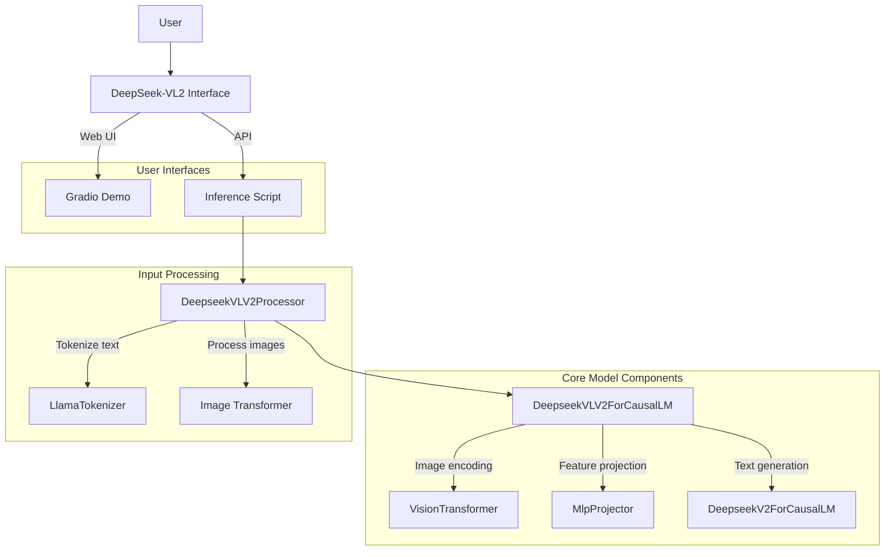
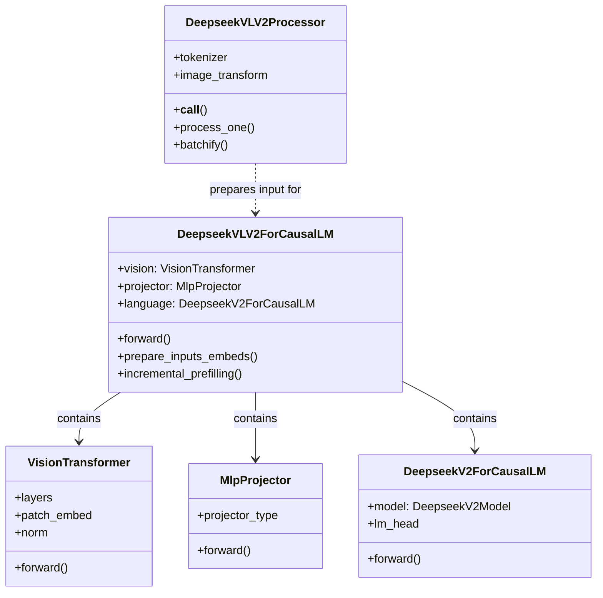
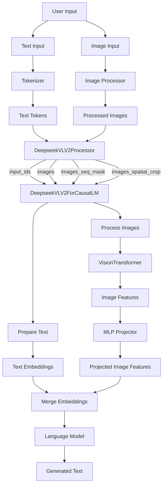
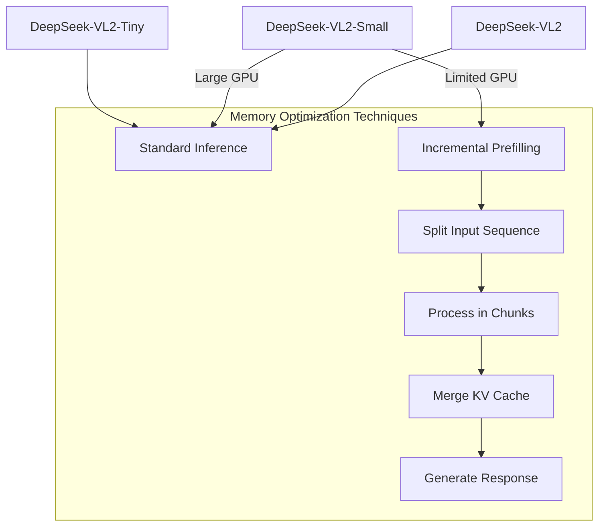

<!-- source: DeepWiki mcp.deepwiki.com · repo deepseek-ai/DeepSeek-VL2 · page 1 Overview · fetched 2026-10-30 -->

# Overview

<details>
<summary>Relevant source files</summary>

The following files were used as context for generating this wiki page:

- [README.md](README.md)
- [images/badge.svg](images/badge.svg)

</details>


This document provides a technical introduction to DeepSeek-VL2, an advanced series of large Mixture-of-Experts (MoE) Vision-Language Models. DeepSeek-VL2 is designed to process both visual and textual inputs for tasks including visual question answering, optical character recognition (OCR), document/table/chart understanding, and visual grounding.

For installation instructions, see [Installation and Requirements](#1.1), and for usage examples, see [Quick Start](#1.2).

## System Architecture

DeepSeek-VL2 follows a modular architecture with specialized components for vision processing, feature projection, and language generation.

### High-Level Architecture



Sources: README.md

### Core Components

The system comprises several key components that work together to process multimodal inputs:



Sources: README.md

1. **DeepseekVLV2Processor**: Handles preprocessing of both text and image inputs.
2. **DeepseekVLV2ForCausalLM**: The main model class that integrates vision and language capabilities.
3. **VisionTransformer**: Processes and encodes images into feature representations.
4. **MlpProjector**: Aligns visual features with the language embedding space.
5. **DeepseekV2ForCausalLM**: Generates text responses based on the combined text and image embeddings.

## Model Variants and Capabilities

DeepSeek-VL2 comes in three variants with different parameter counts and resource requirements:

| Model Variant | Total Parameters | Activated Parameters | Minimum GPU Memory |
|---------------|-----------------|---------------------|-------------------|
| DeepSeek-VL2-Tiny | 3.37B | 1.0B | < 40GB |
| DeepSeek-VL2-Small | 16.1B | 2.8B | 40GB |
| DeepSeek-VL2 | 7.5B | 4.5B | 80GB+ |

All variants utilize Mixture-of-Experts (MoE) technology, which allows them to have a large total parameter count while keeping inference costs manageable by only activating a portion of the parameters during processing.

Sources: README.md:80-90

## Data Flow During Inference

The following diagram illustrates how data flows through the system during inference:



Sources: README.md:107-160

The inference process consists of these key steps:

1. **Input Processing**: The user provides text and image inputs, which are processed by the tokenizer and image processor.
2. **Feature Extraction**: The VisionTransformer extracts features from the images.
3. **Feature Projection**: The MlpProjector aligns visual features with the language embedding space.
4. **Text Generation**: The projected features are merged with text embeddings and fed to the language model to generate the final response.

## Memory Optimization Techniques

For deployment on hardware with limited memory resources, DeepSeek-VL2 implements an incremental prefilling technique to reduce memory requirements:



Sources: README.md:249-325

This approach is particularly useful when running DeepSeek-VL2-Small on 40GB GPUs. It works by:

1. Splitting the input sequence into smaller chunks (typically 512 tokens)
2. Processing each chunk sequentially
3. Merging the key-value caches
4. Generating the final response

This allows larger models to run on more constrained hardware, though with some impact on inference speed.

## Supported Features

DeepSeek-VL2 supports various multimodal capabilities:

1. **Single Image Processing**: Basic visual question answering about individual images
2. **Multi-Image Processing**: Handling multiple images in a single prompt
3. **Visual Grounding**: Object localization with bounding box coordinates using `<|ref|>` and `<|/ref|>` tokens
4. **Special Token Support**: Including `<|grounding|>` for grounded captioning functionality

The output for visual grounding includes bounding box coordinates in the format:
```
<|ref|>Object description<|/ref|><|det|>[[x1, y1, x2, y2]]<|/det|>
```

Sources: README.md:123-169

## Integration and Usage

DeepSeek-VL2 can be integrated through two primary interfaces:

1. **Inference Script**: For programmatic access using Python
2. **Gradio Web Demo**: A web-based user interface for interactive use

Basic usage involves:
1. Loading the model and processor
2. Preparing text and image inputs
3. Running the model to generate a response

For more detailed examples, refer to the [Quick Start](#1.2) guide.

Sources: README.md:93-169, README.md:352-382

---

