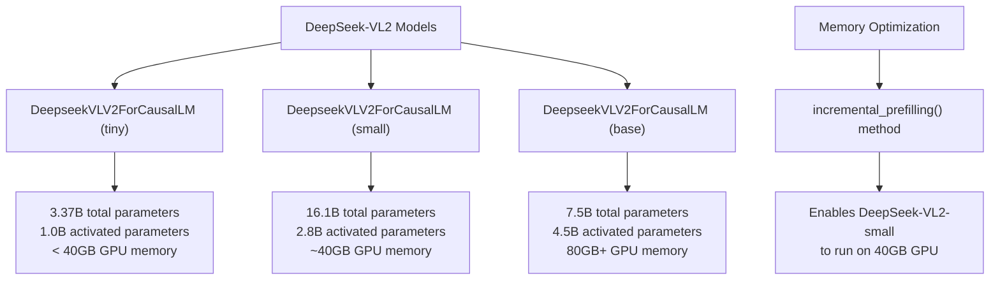
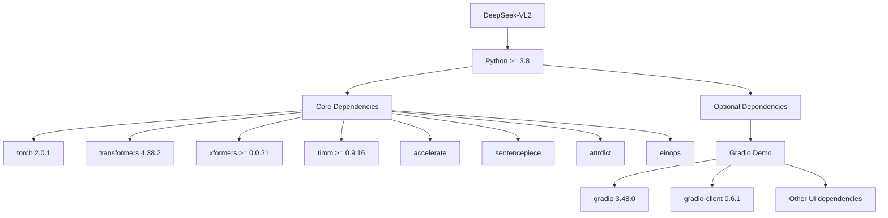
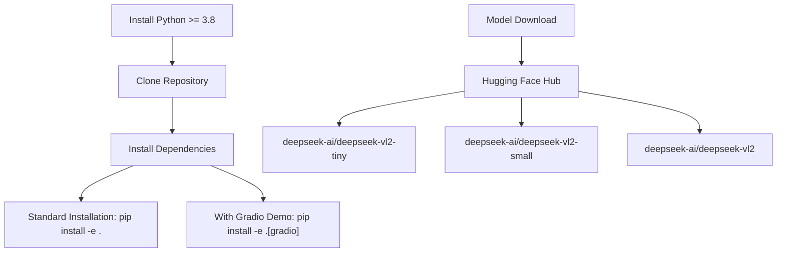
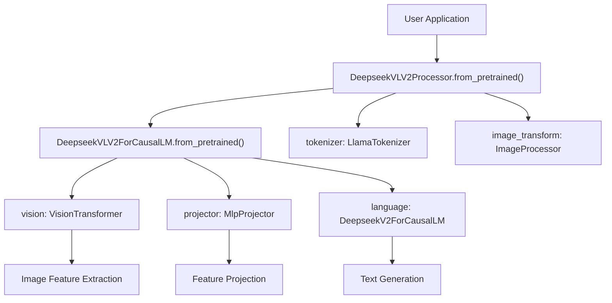
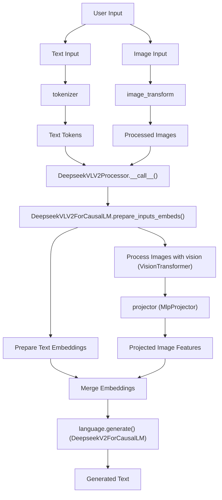
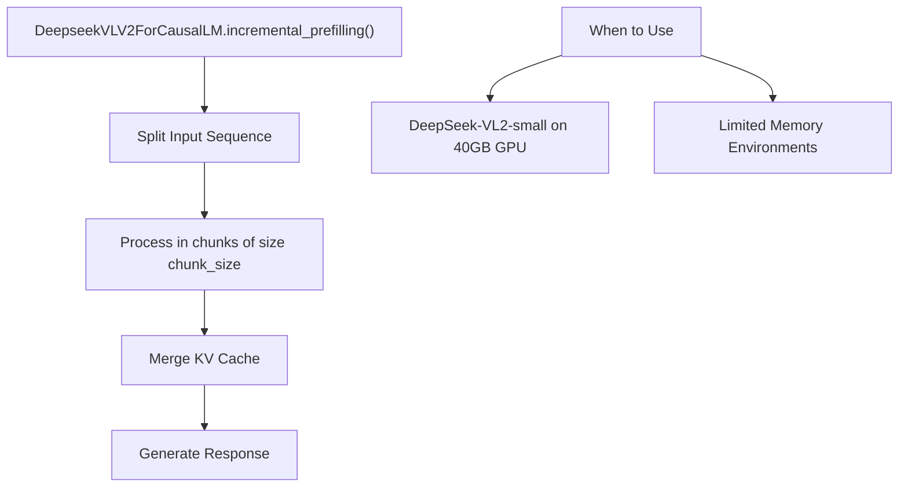

<!-- source: DeepWiki mcp.deepwiki.com · repo deepseek-ai/DeepSeek-VL2 · page 1.1 Installation and Requirements · fetched 2026-10-30 -->

# Installation and Requirements

<details>
<summary>Relevant source files</summary>

The following files were used as context for generating this wiki page:

- [README.md](README.md)
- [pyproject.toml](pyproject.toml)
- [requirements.txt](requirements.txt)

</details>


This document provides a comprehensive guide for installing DeepSeek-VL2 and setting up the required environment. It covers hardware requirements, software dependencies, and installation processes. For information about using the installed system, see [Quick Start](#1.2).

## Hardware Requirements

DeepSeek-VL2 offers three model variants with different parameter counts and hardware requirements:



- **DeepseekVLV2ForCausalLM (tiny)**: Smallest variant with 3.37B total parameters (1.0B activated). Can run on GPUs with less than 40GB memory.
- **DeepseekVLV2ForCausalLM (small)**: Medium variant with 16.1B total parameters (2.8B activated). Requires approximately 40GB GPU memory. Can use incremental prefilling to optimize memory usage.
- **DeepseekVLV2ForCausalLM (base)**: Largest variant with 7.5B total parameters (4.5B activated). Requires 80GB+ GPU memory.

Sources: [README.md:61-62](), [README.md:80-90]()

## Software Dependencies

### Python Environment

DeepSeek-VL2 requires Python 3.8 or newer as specified in the project configuration.



### Core Dependencies

| Requirement | Version | Purpose |
|-------------|---------|---------|
| Python | >= 3.8 | Base language runtime |
| torch | 2.0.1 | Deep learning framework |
| transformers | 4.38.2 | Model loading and inference |
| xformers | >= 0.0.21 | Transformer optimizations |
| timm | >= 0.9.16 | Vision models toolkit |
| accelerate | - | Model acceleration utilities |
| sentencepiece | - | Tokenization library |
| attrdict | - | Attribute dictionaries |
| einops | - | Tensor operations |

### Optional Dependencies for Web Demo

If you plan to use the Gradio web interface, additional dependencies are required:

| Requirement | Version | Purpose |
|-------------|---------|---------|
| gradio | 3.48.0 | Web UI framework |
| gradio-client | 0.6.1 | Client for Gradio |
| mdtex2html | 1.3.0 | Markdown/LaTeX to HTML conversion |
| pypinyin | 0.50.0 | Chinese phonetics processing |
| tiktoken | 0.5.2 | Tokenizer |
| tqdm | 4.64.0 | Progress bars |
| colorama | 0.4.5 | Colored terminal output |
| Pygments | 2.12.0 | Code highlighting |
| markdown | 3.4.1 | Markdown processing |
| SentencePiece | 0.1.96 | Tokenization |

Sources: [requirements.txt:1-9](), [requirements.txt:10-21](), [pyproject.toml:14-23](), [pyproject.toml:26-37]()

## Installation Process



### Standard Installation

1. Ensure you have Python 3.8 or newer installed
2. Clone the DeepSeek-VL2 repository:
   ```bash
   git clone https://github.com/deepseek-ai/DeepSeek-VL2.git
   cd DeepSeek-VL2
   ```
3. Install the package and its dependencies:
   ```bash
   pip install -e .
   ```

### Installation with Gradio Web Demo Support

If you want to use the web-based demo interface, install the package with Gradio support:
```bash
pip install -e .[gradio]
```

Sources: [README.md:95-101](), [README.md:355-357]()

## Model Downloads

DeepSeek-VL2 models are hosted on the Hugging Face Hub and can be loaded directly using the transformers library:

| Model | Download Link | Parameters | Min. GPU Requirements |
|-------|--------------|------------|------------------------|
| DeepSeek-VL2-tiny | [deepseek-ai/deepseek-vl2-tiny](https://huggingface.co/deepseek-ai/deepseek-vl2-tiny) | 3.37B total, 1.0B activated | < 40GB |
| DeepSeek-VL2-small | [deepseek-ai/deepseek-vl2-small](https://huggingface.co/deepseek-ai/deepseek-vl2-small) | 16.1B total, 2.8B activated | 40GB |
| DeepSeek-VL2 | [deepseek-ai/deepseek-vl2](https://huggingface.co/deepseek-ai/deepseek-vl2) | 7.5B total, 4.5B activated | 80GB+ |

Loading a model is done via the Hugging Face transformers library:

```python
from transformers import AutoModelForCausalLM
from deepseek_vl2.models import DeepseekVLV2Processor

model_path = "deepseek-ai/deepseek-vl2-tiny"
processor = DeepseekVLV2Processor.from_pretrained(model_path)
model = AutoModelForCausalLM.from_pretrained(model_path, trust_remote_code=True)
model = model.to(torch.bfloat16).cuda().eval()
```

Sources: [README.md:79-90](), [README.md:107-121]()

## System Components and Data Flow

This diagram illustrates the key components loaded during initialization and their relationships:



The following diagram shows the data flow during model inference:



Sources: [README.md:107-161](), [README.md:176-232]()

## Memory Optimization with Incremental Prefilling

For running larger models on limited hardware, DeepSeek-VL2 provides memory optimization through incremental prefilling:



Incremental prefilling processes the input sequence in chunks to reduce memory requirements. This is particularly useful for running DeepSeek-VL2-small on GPUs with 40GB memory.

Example usage with incremental prefilling:

```python
# For DeepSeek-VL2-small on 40GB GPU
inputs_embeds, past_key_values = model.incremental_prefilling(
    input_ids=inputs.input_ids,
    images=inputs.images,
    images_seq_mask=inputs.images_seq_mask,
    images_spatial_crop=inputs.images_spatial_crop,
    attention_mask=inputs.attention_mask,
    chunk_size=512  # Prefilling chunk size
)

# Use the processed inputs for generation
outputs = model.generate(
    inputs_embeds=inputs_embeds,
    past_key_values=past_key_values,
    attention_mask=inputs.attention_mask,
    # ... other generation parameters
)
```

Sources: [README.md:245-336](), [README.md:367-374]()

## Running the Web Demo

After installing the package with Gradio support, you can run the web demo with different model variants:

```bash
# For DeepSeek-VL2-tiny (< 40GB GPU)
CUDA_VISIBLE_DEVICES=0 python web_demo.py --model_name "deepseek-ai/deepseek-vl2-tiny" --port 37914

# For DeepSeek-VL2-small on 40GB GPU (with incremental prefilling)
CUDA_VISIBLE_DEVICES=0 python web_demo.py --model_name "deepseek-ai/deepseek-vl2-small" --port 37914 --chunk_size 512

# For DeepSeek-VL2 (80GB+ GPU)
CUDA_VISIBLE_DEVICES=0 python web_demo.py --model_name "deepseek-ai/deepseek-vl2" --port 37914
```

Sources: [README.md:354-380]()

## Next Steps

After installation, you can proceed to:
- Learn basic usage patterns in the [Quick Start](#1.2) guide
- Explore the [Model Architecture](#2) documentation
- Set up and use the [Web Demo](#5)

---

