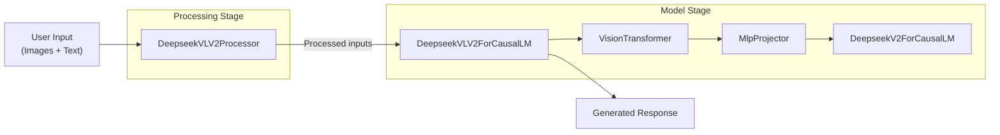
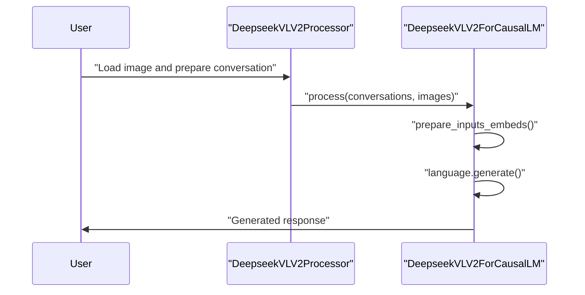
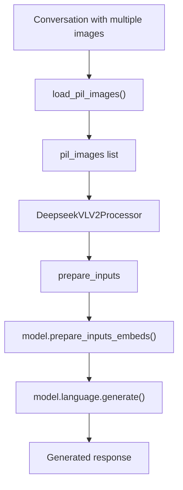
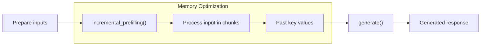
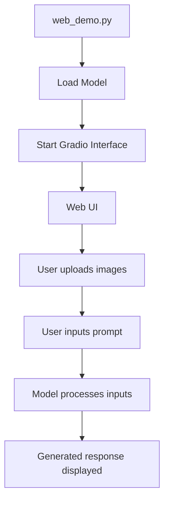

<!-- source: DeepWiki mcp.deepwiki.com · repo deepseek-ai/DeepSeek-VL2 · page 1.2 Quick Start · fetched 2026-10-30 -->

# Quick Start

<details>
<summary>Relevant source files</summary>

The following files were used as context for generating this wiki page:

- [README.md](README.md)
- [inference.py](inference.py)

</details>


This guide provides practical examples to help you start using DeepSeek-VL2 quickly. It covers installation, basic inference workflows, and usage patterns. For detailed information about the model architecture, see [Model Architecture](#2).

## Installation

To install DeepSeek-VL2, you need Python 3.8 or higher. Install the package and its dependencies using:

```bash
pip install -e .
```

For the Gradio web demo, install additional dependencies:

```bash
pip install -e .[gradio]
```

Sources: [README.md:96-101](), [README.md:354-357]()

## Basic Usage Flow

The typical DeepSeek-VL2 inference workflow follows this pattern:



Sources: [README.md:107-122](), [README.md:176-189]()

## Model Variants

DeepSeek-VL2 comes in three variants with different parameter counts and hardware requirements:

| Model | Total Parameters | Activated Parameters | Recommended GPU Memory |
|-------|------------------|----------------------|------------------------|
| DeepSeek-VL2-tiny | 3.37B | 1.0B | < 40GB |
| DeepSeek-VL2-small | 16.1B | 2.8B | 40GB (with optimization) |
| DeepSeek-VL2 | 7.5B | 4.5B | 80GB+ |

Sources: [README.md:80-90](), [README.md:362-379]()

## Single Image Inference

Here's the basic workflow for running inference with a single image:



Basic single image inference example:

```python
# Load processor and model
model_path = "deepseek-ai/deepseek-vl2-tiny"
processor = DeepseekVLV2Processor.from_pretrained(model_path)
model = AutoModelForCausalLM.from_pretrained(model_path, trust_remote_code=True)
model = model.to(torch.bfloat16).cuda().eval()

# Prepare conversation with image
conversation = [
    {
        "role": "<|User|>",
        "content": "<image>\nWhat's in this image?",
        "images": ["path/to/image.jpg"],
    },
    {"role": "<|Assistant|>", "content": ""},
]

# Process inputs
pil_images = load_pil_images(conversation)
inputs = processor(conversations=conversation, images=pil_images, force_batchify=True)
inputs = inputs.to(model.device)

# Generate response
inputs_embeds = model.prepare_inputs_embeds(**inputs)
outputs = model.language.generate(
    inputs_embeds=inputs_embeds,
    attention_mask=inputs.attention_mask,
    max_new_tokens=512,
    do_sample=False
)

# Decode the response
answer = processor.tokenizer.decode(outputs[0].cpu().tolist(), skip_special_tokens=False)
print(answer)
```

Sources: [README.md:104-161]()

## Multiple Images Inference

DeepSeek-VL2 supports multiple images in a single conversation:



Example with multiple images:

```python
# Prepare conversation with multiple images
conversation = [
    {
        "role": "<|User|>",
        "content": "This is image_1: <image>\n"
                   "This is image_2: <image>\n"
                   "This is image_3: <image>\n Can you tell me what are in the images?",
        "images": [
            "path/to/image1.jpg",
            "path/to/image2.jpg",
            "path/to/image3.jpg",
        ],
    },
    {"role": "<|Assistant|>", "content": ""}
]

# Process and generate using the same steps as single image inference
```

Sources: [README.md:172-243]()

## Memory Optimization with Incremental Prefilling

For models requiring more memory than available (especially DeepSeek-VL2-small on 40GB GPUs), incremental prefilling helps optimize memory usage:



Example with incremental prefilling:

```python
# After preparing inputs
with torch.no_grad():
    # Use incremental prefilling to save memory
    inputs_embeds, past_key_values = model.incremental_prefilling(
        input_ids=inputs.input_ids,
        images=inputs.images,
        images_seq_mask=inputs.images_seq_mask,
        images_spatial_crop=inputs.images_spatial_crop,
        attention_mask=inputs.attention_mask,
        chunk_size=512  # prefilling chunk size
    )
    
    # Generate response with the prefilled state
    outputs = model.generate(
        inputs_embeds=inputs_embeds,
        input_ids=inputs.input_ids,
        images=inputs.images,
        images_seq_mask=inputs.images_seq_mask,
        images_spatial_crop=inputs.images_spatial_crop,
        attention_mask=inputs.attention_mask,
        past_key_values=past_key_values,
        max_new_tokens=512,
        do_sample=False
    )
    
    answer = processor.tokenizer.decode(
        outputs[0][len(inputs.input_ids[0]):].cpu().tolist(), 
        skip_special_tokens=False
    )
```

Sources: [README.md:245-336](), [inference.py:110-147]()

## Command-line Inference

For convenience, you can use the provided `inference.py` script:

```bash
# Standard inference (requires sufficient GPU memory)
CUDA_VISIBLE_DEVICES=0 python inference.py --model_path "deepseek-ai/deepseek-vl2-tiny"

# With incremental prefilling (for memory optimization)
CUDA_VISIBLE_DEVICES=0 python inference.py --model_path "deepseek-ai/deepseek-vl2-small" --chunk_size 512
```

Sources: [README.md:342-349](), [inference.py:157-167]()

## Running the Gradio Web Demo

DeepSeek-VL2 provides a Gradio web interface for easy interaction:



Run the web demo with different model variants:

```bash
# For DeepSeek-VL2-tiny (suitable for GPUs < 40GB)
CUDA_VISIBLE_DEVICES=0 python web_demo.py --model_name "deepseek-ai/deepseek-vl2-tiny" --port 37914

# For DeepSeek-VL2-small with memory optimization on 40GB GPU
CUDA_VISIBLE_DEVICES=0 python web_demo.py --model_name "deepseek-ai/deepseek-vl2-small" --port 37914 --chunk_size 512

# For DeepSeek-VL2 (requires 80GB+ GPU)
CUDA_VISIBLE_DEVICES=0 python web_demo.py --model_name "deepseek-ai/deepseek-vl2" --port 37914
```

**Note**: The basic Gradio demo is for demonstration purposes and isn't optimized for production. For better performance, consider using optimized deployment solutions like vllm, sglang, or lmdeploy.

Sources: [README.md:353-383]()

## Special Tokens and Features

DeepSeek-VL2 supports special features through reserved tokens:

| Special Token | Purpose |
|---------------|---------|
| `<\|ref\|>...<\|/ref\|>` | Visual reference in prompts for object localization |
| `<\|grounding\|>` | Enables grounded captioning with object localization |
| `<\|User\|>` | Marks user messages in conversation format |
| `<\|Assistant\|>` | Marks assistant responses in conversation format |

Sources: [README.md:124-126](), [inference.py:80-83]()

## Next Steps

For more detailed information on:
- Model architecture details, see [Model Architecture](#2)
- Input processing mechanisms, see [Input Processing](#3)
- Advanced inference techniques, see [Inference Guide](#4)
- Memory optimization techniques, see [Memory Optimization Techniques](#4.1)

---

