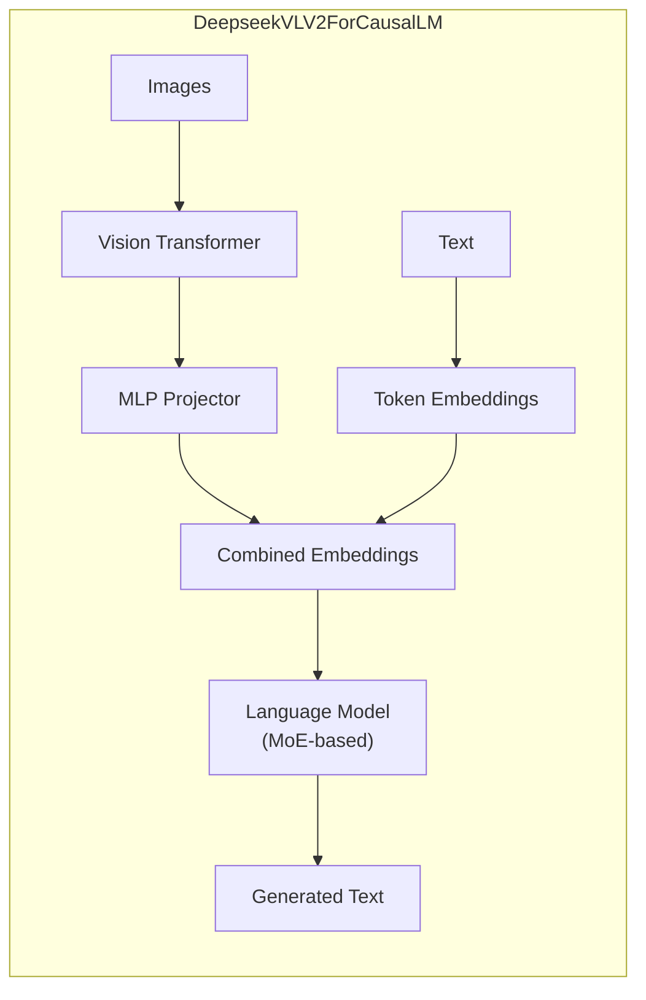
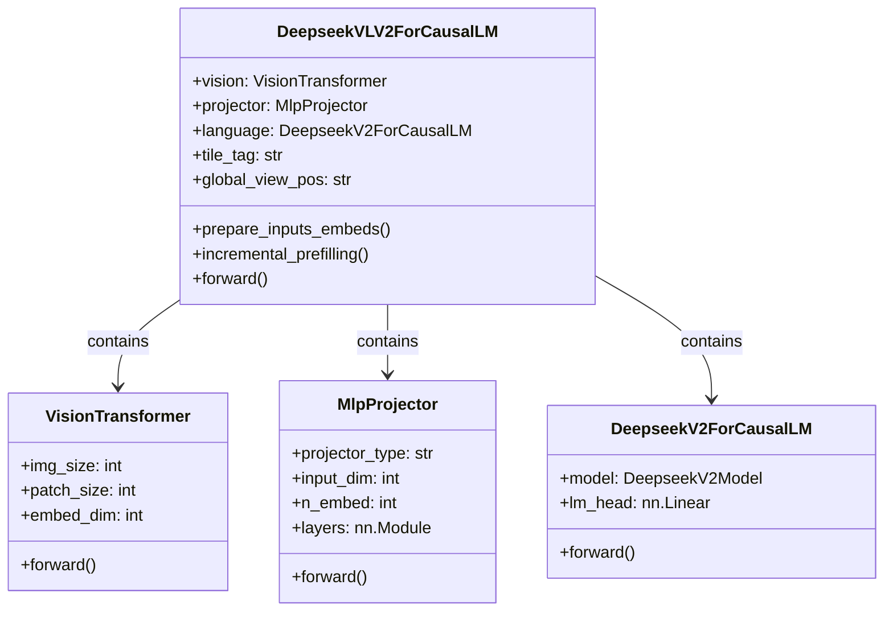
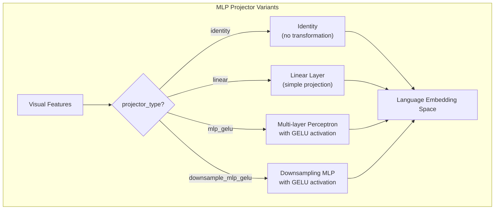
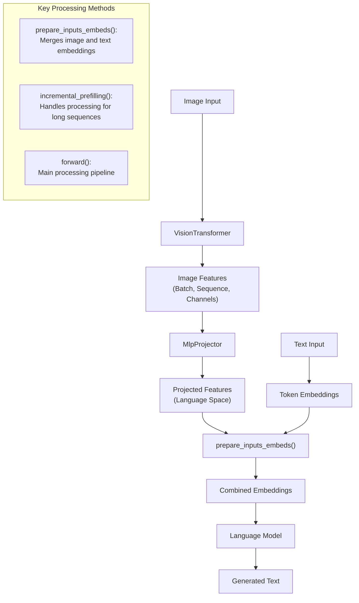
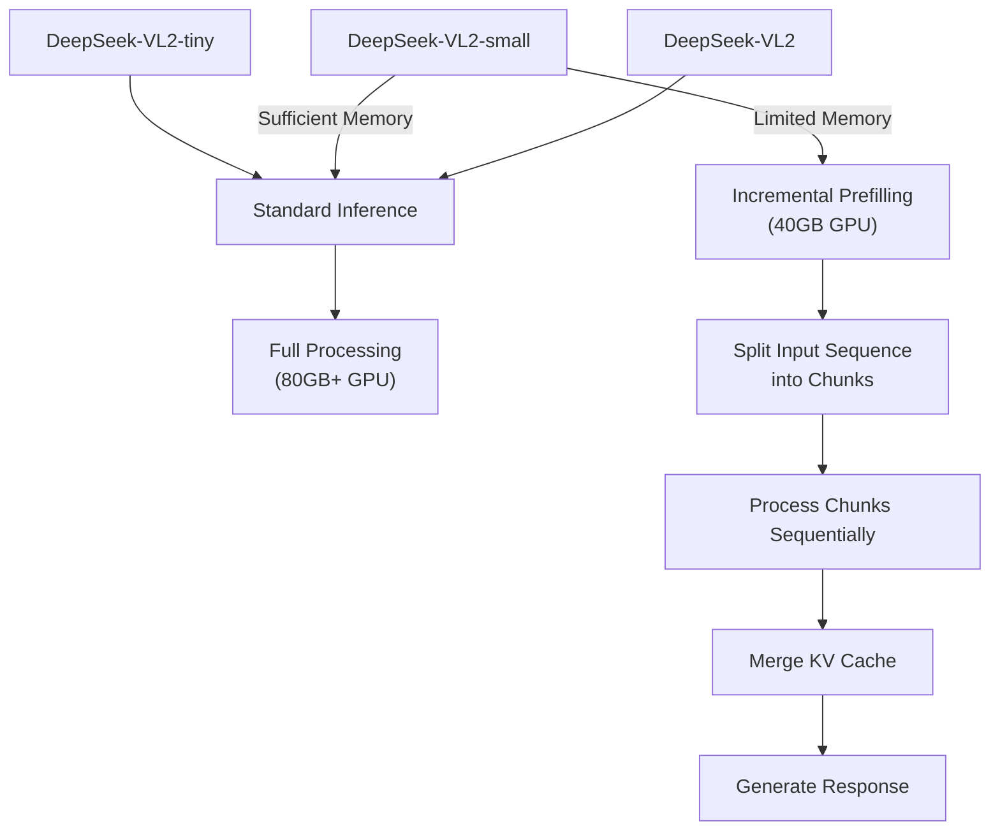
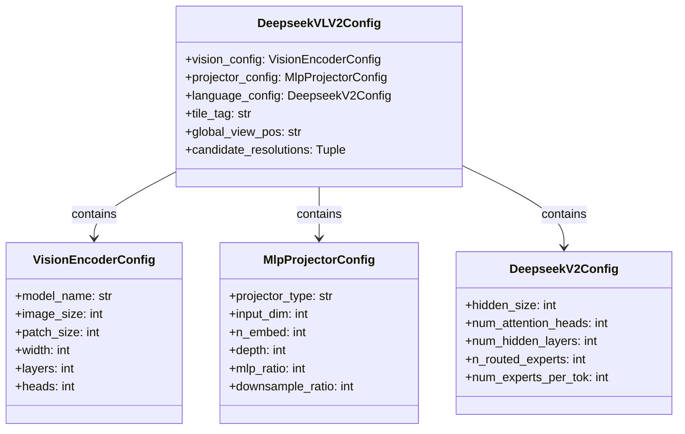

<!-- source: DeepWiki mcp.deepwiki.com · repo deepseek-ai/DeepSeek-VL2 · page 2 Model Architecture · fetched 2026-10-30 -->

# Model Architecture

Relevant source files

The following files were used as context for generating this wiki page:

- [README.md](README.md)
- [deepseek_vl2/models/modeling_deepseek.py](deepseek_vl2/models/modeling_deepseek.py)
- [deepseek_vl2/models/modeling_deepseek_vl_v2.py](deepseek_vl2/models/modeling_deepseek_vl_v2.py)

This document provides a detailed overview of the DeepSeek-VL2 model architecture, its core components, and how these components work together to process and understand multimodal inputs combining vision and language. For information about input processing, see [Input Processing](#3), and for inference guidance, see [Inference Guide](#4).

## Overview

DeepSeek-VL2 is a multimodal vision-language model that combines vision processing capabilities with a powerful language model using a Mixture-of-Experts (MoE) architecture. The model processes images and text inputs to generate relevant text responses that demonstrate understanding of visual content.

The architecture consists of three primary components:

**Architecture Diagram: High-Level Components of DeepSeek-VL2**

Sources: [deepseek_vl2/models/modeling_deepseek_vl_v2.py:278-334](). [README.md:61-62]().

## Core Components

The DeepSeek-VL2 model is implemented through the `DeepseekVLV2ForCausalLM` class, which integrates three main components:

**Component Diagram: Class Relationships in DeepSeek-VL2**

Sources: [deepseek_vl2/models/modeling_deepseek_vl_v2.py:278-334]().

### Vision Transformer Component

The vision component is responsible for processing image inputs and extracting meaningful features. It uses a Vision Transformer architecture implemented as `VisionTransformer`.

Key characteristics:
- Divides images into patches (typically 16×16 pixels)
- Processes these patches through transformer blocks
- Outputs image embeddings representing visual features

Configuration parameters for the Vision Transformer are specified in the `VisionEncoderConfig` class, including:
- `image_size`: Default 384
- `patch_size`: Default 16
- `width`: Embedding dimension (default 1024)
- `layers`: Number of transformer layers
- `heads`: Number of attention heads

Sources: [deepseek_vl2/models/modeling_deepseek_vl_v2.py:115-133](), [deepseek_vl2/models/modeling_deepseek_vl_v2.py:286-301]().

### MLP Projector Component

The MLP Projector bridges the gap between vision and language by projecting visual features into the language embedding space. The projector can be configured in different ways based on the `projector_type` parameter:

**Diagram: MLP Projector Variants in DeepSeek-VL2**

The projector is configured through the `MlpProjectorConfig` class with parameters:
- `projector_type`: Type of projection (identity, linear, mlp_gelu, downsample_mlp_gelu)
- `input_dim`: Dimension of input features from vision transformer
- `n_embed`: Dimension of output embeddings for language model
- `depth`: Number of layers in MLP variants
- `mlp_ratio`: Expansion ratio for hidden dimensions
- `downsample_ratio`: Ratio for downsampling in downsample_mlp_gelu variant

Sources: [deepseek_vl2/models/modeling_deepseek_vl_v2.py:34-112](), [deepseek_vl2/models/modeling_deepseek_vl_v2.py:166-193]().

### Language Model Component

The language model component is a Mixture-of-Experts (MoE) architecture based on `DeepseekV2ForCausalLM` that processes the combined embeddings from text inputs and projected image features.

Key features:
- Uses a transformer-based decoder architecture
- Implements Mixture-of-Experts (MoE) for efficient scaling
- Includes specialized rotary position embeddings for handling long contexts
- Outputs text completions based on the multimodal inputs

The language component configuration is handled through the `DeepseekV2Config` class, which specifies parameters like:
- `hidden_size`: Dimension of hidden states
- `num_attention_heads`: Number of attention heads
- `num_hidden_layers`: Number of transformer layers
- `n_routed_experts`: Number of available experts in MoE layers
- `num_experts_per_tok`: Number of experts used for each token
- `moe_layer_freq`: Frequency of MoE layers in the model

Sources: [deepseek_vl2/models/modeling_deepseek_vl_v2.py:334](), [deepseek_vl2/models/modeling_deepseek.py:1623-1843]().

## Integration and Data Flow

The integration of vision and language components is achieved through a careful process of embedding and merging:

**Data Flow Diagram: Integration of Vision and Language in DeepSeek-VL2**

The `prepare_inputs_embeds` method plays a crucial role in merging the visual and textual information. It:
1. Processes images through the vision transformer
2. Projects the resulting features via the MLP projector
3. Formats the image tokens appropriately using special tokens for structure
4. Merges these with the text token embeddings to create a unified input representation

For images, the model uses a tiling approach with both global and local views:
- Global features represent the entire image
- Local features capture detailed information from specific regions
- Special tokens like `<|view_separator|>` and `<|\n|>` structure the image token sequence

Sources: [deepseek_vl2/models/modeling_deepseek_vl_v2.py:336-477](), [deepseek_vl2/models/modeling_deepseek_vl_v2.py:559-621]().

## Model Variants and Specifications

DeepSeek-VL2 is available in three variants with different parameter counts and performance characteristics:

| Model Variant | Total Parameters | Activated Parameters | Context Length | Typical GPU Requirements |
|---------------|------------------|----------------------|----------------|--------------------------|
| DeepSeek-VL2-tiny | 3.37B | 1.0B | 4096 | < 40GB VRAM |
| DeepSeek-VL2-small | 16.1B | 2.8B | 4096 | 40GB VRAM |
| DeepSeek-VL2 | 7.5B | 4.5B | 4096 | 80GB+ VRAM |

All variants use the same basic architecture but differ in scale. The Mixture-of-Experts approach allows these models to have a large total parameter count while keeping the number of activated parameters manageable, providing efficiency during inference.

Sources: [README.md:80-91](), [README.md:61-62]().

## Memory Optimization

For resource-constrained environments, DeepSeek-VL2 implements memory optimization techniques, particularly for the larger model variants:

**Memory Optimization Diagram: Techniques for Different Hardware Constraints**

The `incremental_prefilling` method is key to reducing memory requirements:
- Processes the input sequence in chunks
- Accumulates key-value caches incrementally
- Allows running larger models on GPUs with limited memory (e.g., DeepSeek-VL2-small on 40GB GPUs)

This approach trades processing time for memory efficiency, making the larger model variants accessible on more modest hardware.

Sources: [deepseek_vl2/models/modeling_deepseek_vl_v2.py:479-557](), [README.md:247-326]().

## Config Classes and Model Registration

The model uses a hierarchy of configuration classes to define its behavior:

**Config Classes Diagram: Configuration Hierarchy in DeepSeek-VL2**

The model and its configurations are registered with the Hugging Face `AutoConfig` and `AutoModelForCausalLM` systems to enable easy loading with standard interfaces.

Sources: [deepseek_vl2/models/modeling_deepseek_vl_v2.py:235-269](), [deepseek_vl2/models/modeling_deepseek_vl_v2.py:693-697]().

## Summary

DeepSeek-VL2 uses a modular architecture that combines:
1. A Vision Transformer for image processing
2. An MLP Projector for feature alignment
3. A powerful MoE-based language model for text generation

This design allows the model to process and understand multimodal inputs, generating coherent and contextually relevant text responses that reference visual content. The use of Mixture-of-Experts architecture enables efficient scaling with manageable compute requirements, while techniques like incremental prefilling provide flexibility across different hardware configurations.

---

