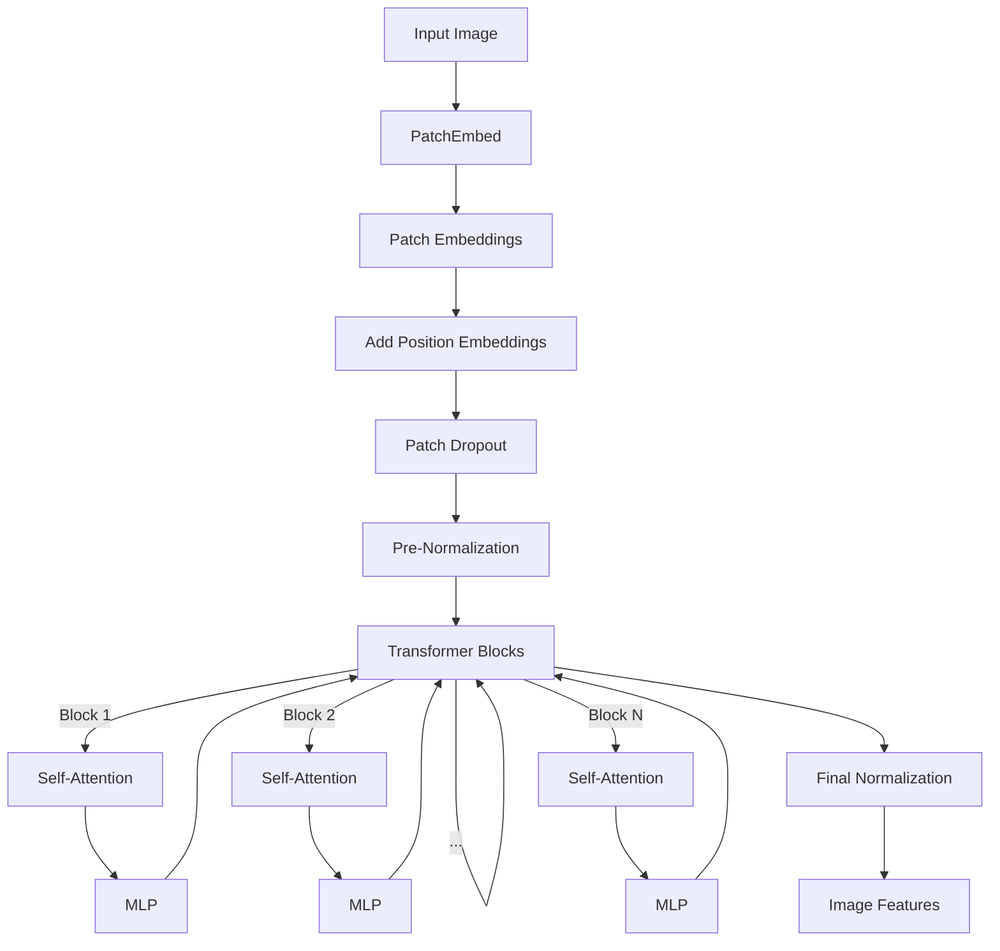
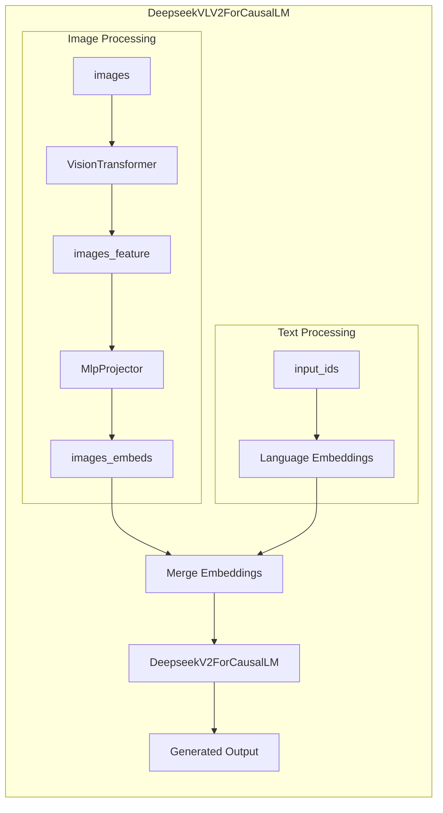
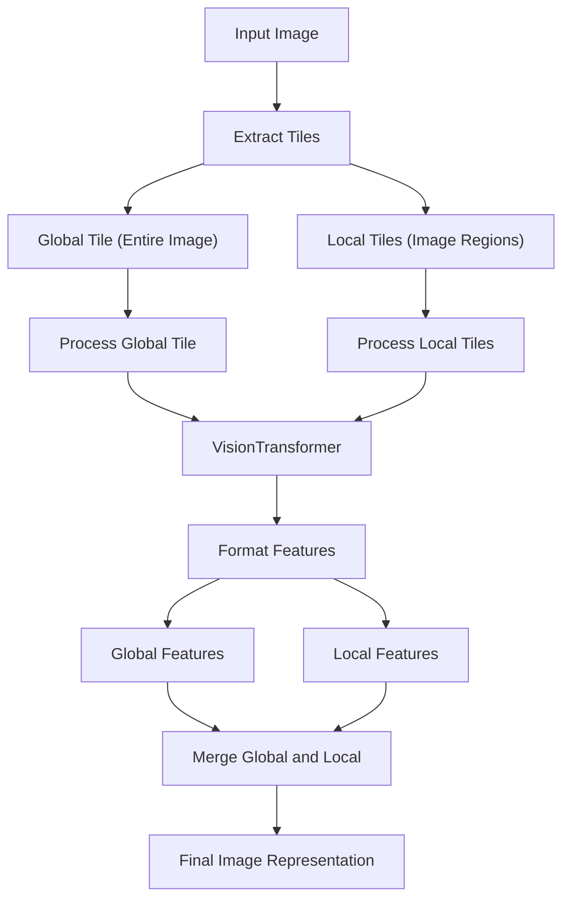
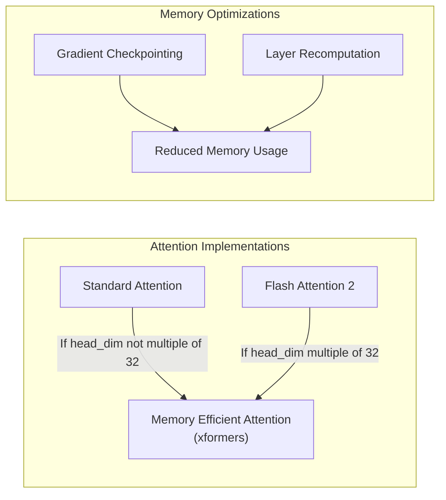
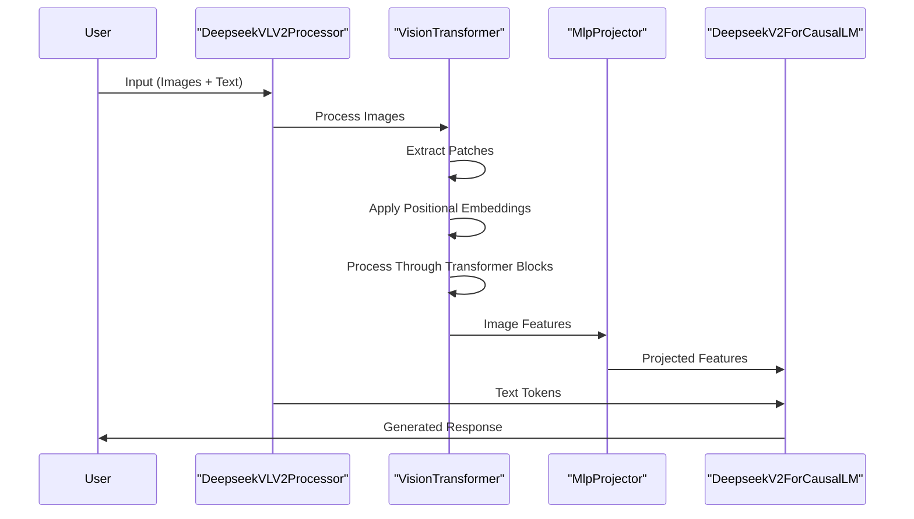

<!-- source: DeepWiki mcp.deepwiki.com · repo deepseek-ai/DeepSeek-VL2 · page 2.1 Vision Transformer Component · fetched 2026-10-30 -->

# Vision Transformer Component

<details>
<summary>Relevant source files</summary>

The following files were used as context for generating this wiki page:

- [deepseek_vl2/models/modeling_deepseek_vl_v2.py](deepseek_vl2/models/modeling_deepseek_vl_v2.py)
- [deepseek_vl2/models/siglip_vit.py](deepseek_vl2/models/siglip_vit.py)

</details>


This document provides a detailed explanation of the Vision Transformer component used in DeepSeek-VL2. The Vision Transformer is responsible for processing image inputs and transforming them into feature representations that can be integrated with text features in the multimodal model. For information about how these image features are projected into the language embedding space, see [MLP Projector](#2.2).

## Purpose and Role

The Vision Transformer component in DeepSeek-VL2 serves as the visual encoder, transforming raw image inputs into high-dimensional feature representations. These visual features are then processed by the MLP Projector before being combined with text embeddings for multimodal reasoning.


Sources: [deepseek_vl2/models/modeling_deepseek_vl_v2.py:287-301](), [deepseek_vl2/models/modeling_deepseek_vl_v2.py:377-381]()

## Architecture

The Vision Transformer used in DeepSeek-VL2 is based on the SigLIP (Simple and Scalable Visual Language Learning) architecture. It follows the standard Vision Transformer design with some SigLIP-specific modifications.

```mermaid
classDiagram
    class VisionTransformer {
        +patch_embed: PatchEmbed
        +pos_embed: Parameter
        +blocks: Sequential[Block]
        +norm: LayerNorm
        +forward()
        +forward_features()
    }
    
    class PatchEmbed {
        +proj: Conv2d
        +forward()
    }
    
    class Block {
        +norm1: LayerNorm
        +attn: Attention
        +norm2: LayerNorm
        +mlp: Mlp
        +forward()
    }
    
    class Attention {
        +qkv: Linear
        +proj: Linear
        +forward()
    }
    
    VisionTransformer --> PatchEmbed: contains
    VisionTransformer --> "Block[depth]": contains
    Block --> Attention: contains
    Block --> Mlp: contains
```

Sources: [deepseek_vl2/models/siglip_vit.py:241-569]()

### Key Components

1. **Patch Embedding**: Divides the input image into fixed-size patches and linearly projects them into embedding vectors.
2. **Position Embeddings**: Adds learned positional information to the patch embeddings.
3. **Transformer Blocks**: A stack of transformer blocks, each containing:
   - Self-attention layer
   - Feed-forward network (MLP)
   - Layer normalization
   - Residual connections
4. **Final Normalization**: Normalizes the output features before they are passed to the next component.

Sources: [deepseek_vl2/models/siglip_vit.py:341-348](), [deepseek_vl2/models/siglip_vit.py:355](), [deepseek_vl2/models/siglip_vit.py:367-383](), [deepseek_vl2/models/siglip_vit.py:384]()

## Data Flow

The following diagram illustrates how image data flows through the Vision Transformer component in DeepSeek-VL2:



Sources: [deepseek_vl2/models/siglip_vit.py:524-537](), [deepseek_vl2/models/modeling_deepseek_vl_v2.py:377-381]()

## Integration with DeepSeek-VL2

The Vision Transformer component is integrated into the DeepSeek-VL2 model as part of the `DeepseekVLV2ForCausalLM` class. It processes images before they are combined with text inputs.



Sources: [deepseek_vl2/models/modeling_deepseek_vl_v2.py:376-386](), [deepseek_vl2/models/modeling_deepseek_vl_v2.py:607-621]()

### Image Tile Processing

DeepSeek-VL2 processes images by dividing them into tiles, including a global view of the entire image and local views of smaller regions. This approach helps the model analyze both the overall image and its detailed parts.



Sources: [deepseek_vl2/models/modeling_deepseek_vl_v2.py:359-475]()

## Configuration

The Vision Transformer component in DeepSeek-VL2 can be configured through the `VisionEncoderConfig` class, which defines parameters such as image size, patch size, model width, and number of layers.

| Parameter | Description | Default |
|-----------|-------------|---------|
| `model_name` | Name of the SigLIP model variant | "siglip_large_patch16_384" |
| `image_size` | Size of input images | 384 |
| `patch_size` | Size of image patches | 16 |
| `width` | Embedding dimension | 1024 |
| `layers` | Number of transformer layers | 24 |
| `heads` | Number of attention heads | 16 |
| `mlp_ratio` | Ratio of MLP hidden dim to embedding dim | 4 |
| `global_pool` | Type of global pooling | "map" |
| `class_token` | Whether to use class token | False |
| `use_checkpoint` | Whether to use gradient checkpointing | False |

Sources: [deepseek_vl2/models/modeling_deepseek_vl_v2.py:115-163](), [deepseek_vl2/models/siglip_vit.py:586-619]()

## Model Variants

DeepSeek-VL2 supports multiple SigLIP Vision Transformer variants with different parameter counts and image sizes:

| Model Name | Image Size | Patch Size | Width | Layers | Heads |
|------------|------------|------------|-------|--------|-------|
| siglip_so400m_patch14_384 | 384 | 14 | 1152 | 27 | 16 |
| siglip_so400m_patch14_224 | 224 | 14 | 1152 | 27 | 16 |
| siglip_large_patch16_384 | 384 | 16 | 1024 | 24 | 16 |

Sources: [deepseek_vl2/models/siglip_vit.py:586-619]()

## Performance Optimizations

The Vision Transformer includes several optimizations for efficient training and inference:

1. **Flash Attention**: Uses efficient attention implementations when available.
2. **Gradient Checkpointing**: Optionally trades computation for memory by not storing intermediate activations.
3. **Layer Recomputation**: Allows specifying the number of layers to recompute during backpropagation.



Sources: [deepseek_vl2/models/siglip_vit.py:135-175](), [deepseek_vl2/models/siglip_vit.py:530-533]()

## Usage in Inference

During inference, the Vision Transformer processes the input images to extract features, which are then projected and combined with text embeddings before being passed to the language model:



Sources: [deepseek_vl2/models/modeling_deepseek_vl_v2.py:596-621]()

## Conclusion

The Vision Transformer component is a critical part of the DeepSeek-VL2 architecture, responsible for transforming raw image inputs into high-dimensional feature representations that can be combined with text features. It employs the SigLIP Vision Transformer architecture with various optimizations for efficient inference and supports multiple model variants to balance performance and resource requirements.

---

