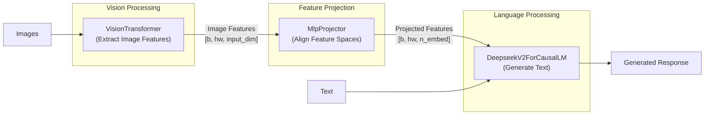
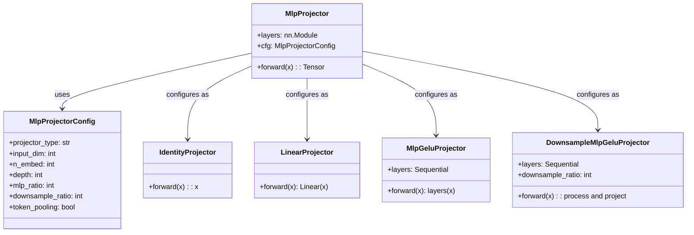
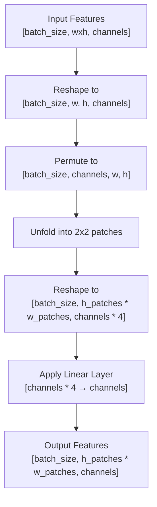
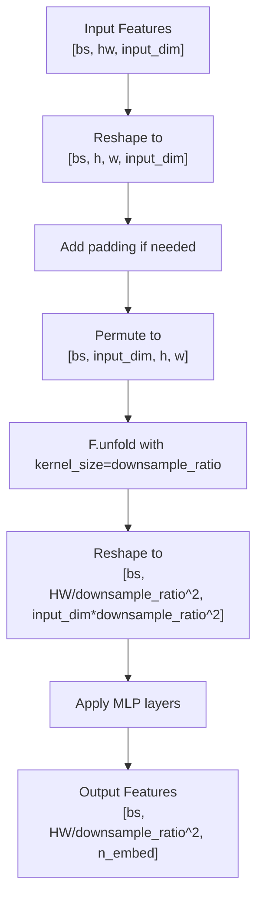
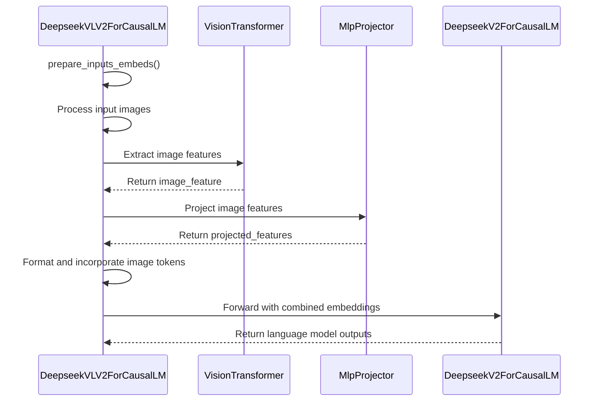

<!-- source: DeepWiki mcp.deepwiki.com · repo deepseek-ai/DeepSeek-VL2 · page 2.2 MLP Projector · fetched 2026-10-30 -->

# MLP Projector

Relevant source files

The following files were used as context for generating this wiki page:

- [deepseek_vl2/models/modeling_deepseek_vl_v2.py](deepseek_vl2/models/modeling_deepseek_vl_v2.py)

The MLP Projector is a critical component in the DeepSeek-VL2 architecture that bridges the gap between visual and linguistic representations. It transforms image features extracted by the Vision Transformer into a format compatible with the language model's embedding space, enabling the model to reason about visual content using its language capabilities.

This page details the MLP Projector's architecture, implementation variants, and its role in the overall multimodal processing pipeline. For information about the Vision Transformer that provides input to the MLP Projector, see [Vision Transformer Component](#2.1), and for details about the Language Model that receives its output, see [Language Model Component](#2.3).

## 1. MLP Projector in the DeepSeek-VL2 Architecture

The MLP Projector serves as a crucial bridge between the vision and language components of DeepSeek-VL2. It converts the high-dimensional representation of images into tokens that the language model can process alongside text tokens.

**MLP Projector Data Flow Diagram**

Sources: [deepseek_vl2/models/modeling_deepseek_vl_v2.py:34-112](), [deepseek_vl2/models/modeling_deepseek_vl_v2.py:166-193](), [deepseek_vl2/models/modeling_deepseek_vl_v2.py:381]()

## 2. Implementation Details

The MLP Projector is implemented as the `MlpProjector` class and configured through the `MlpProjectorConfig` class. It supports multiple projection strategies with varying complexity and performance characteristics.

### 2.1 Projector Types

The MLP Projector supports four different types of projection methods:

**MLP Projector Types Diagram**

Sources: [deepseek_vl2/models/modeling_deepseek_vl_v2.py:34-74](), [deepseek_vl2/models/modeling_deepseek_vl_v2.py:166-193]()

| Projector Type | Description | Implementation |
| --- | --- | --- |
| `identity` | Passes through visual features without modification | `nn.Identity()` |
| `linear` | Simple linear projection from input dimension to embedding dimension | `nn.Linear(cfg.input_dim, cfg.n_embed)` |
| `mlp_gelu` | Multi-layer perceptron with GELU activations | Sequential layers of Linear and GELU activations |
| `downsample_mlp_gelu` | MLP with downsampling to reduce spatial dimensions | Downsampling followed by MLP with GELU activations |

Sources: [deepseek_vl2/models/modeling_deepseek_vl_v2.py:42-65]()

### 2.2 Token Pooling

For specific configurations, the MLP Projector can use token pooling to reduce the number of tokens by combining adjacent patches:

**Token Pooling Process Diagram**

Sources: [deepseek_vl2/models/modeling_deepseek_vl_v2.py:76-91]()

### 2.3 Downsampling in MLP-GELU

The `downsample_mlp_gelu` projector type includes a downsampling operation that reduces spatial dimensions before applying the MLP:

**Downsample MLP-GELU Process Diagram**

Sources: [deepseek_vl2/models/modeling_deepseek_vl_v2.py:93-111]()

## 3. Configuration Parameters

The `MlpProjectorConfig` class defines the following key parameters:

| Parameter | Description | Default Value |
| --- | --- | --- |
| `projector_type` | Type of projector architecture | `"downsample_mlp_gelu"` |
| `input_dim` | Dimension of input features from Vision Transformer | `1152` |
| `n_embed` | Dimension of output embeddings for Language Model | `2048` |
| `depth` | Number of layers in MLP projector | `2` |
| `mlp_ratio` | Ratio for hidden dimension in MLP | `1` |
| `downsample_ratio` | Spatial downsampling factor | `2` |
| `token_pooling` | Whether to use token pooling | `False` |

Sources: [deepseek_vl2/models/modeling_deepseek_vl_v2.py:166-193]()

## 4. Integration with DeepSeek-VL2

The MLP Projector is instantiated by the main `DeepseekVLV2ForCausalLM` class and used during the preparation of input embeddings:

**MLP Projector Integration Sequence Diagram**

Sources: [deepseek_vl2/models/modeling_deepseek_vl_v2.py:304-305](), [deepseek_vl2/models/modeling_deepseek_vl_v2.py:378-382](), [deepseek_vl2/models/modeling_deepseek_vl_v2.py:596-601]()

### 4.1 Forward Pass

During the forward pass, image features extracted by the Vision Transformer are processed by the MLP Projector before being integrated with text embeddings:

1. Image features are extracted by the Vision Transformer as `[batch_all_tiles, vit_seq_len, channels]`
2. The MLP Projector transforms these to `[batch_all_tiles, hw, n_embed]`
3. The projected features are then formatted and inserted into the text embedding sequence at positions specified by `images_seq_mask`

Sources: [deepseek_vl2/models/modeling_deepseek_vl_v2.py:75-112](), [deepseek_vl2/models/modeling_deepseek_vl_v2.py:378-382]()

## 5. Common Configurations

The default configuration uses `downsample_mlp_gelu` with a `depth` of 2, which provides a good balance between computational efficiency and projection quality. This configuration is used in the main DeepSeek-VL2 model variants.

For simpler deployments or when computational resources are limited, the `linear` projector type can be used, though it may result in reduced performance in complex visual reasoning tasks.

Sources: [deepseek_vl2/models/modeling_deepseek_vl_v2.py:168](), [deepseek_vl2/models/modeling_deepseek_vl_v2.py:178-184]()

---

