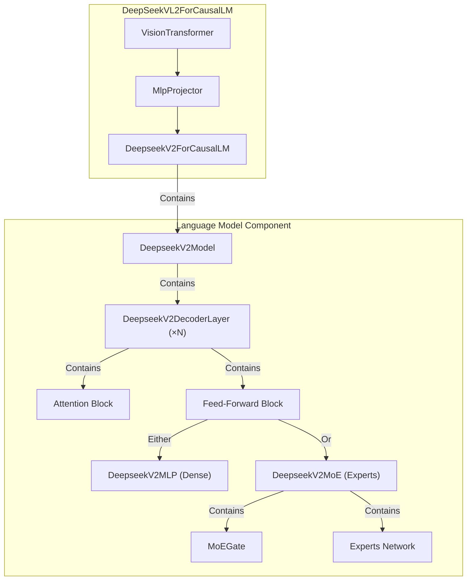
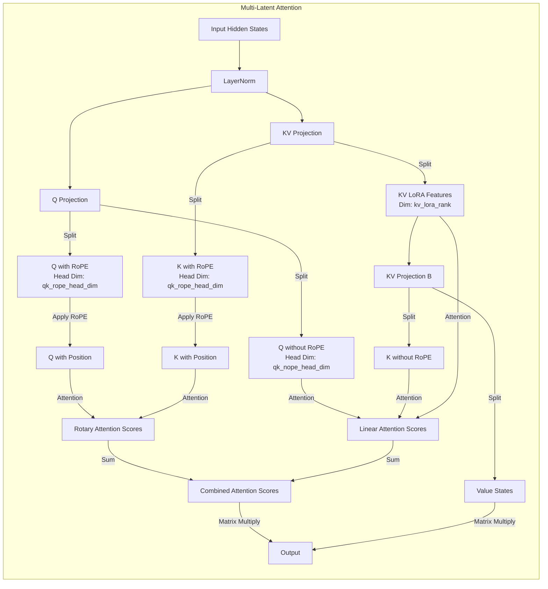
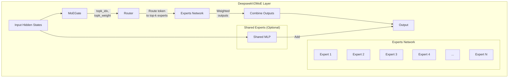
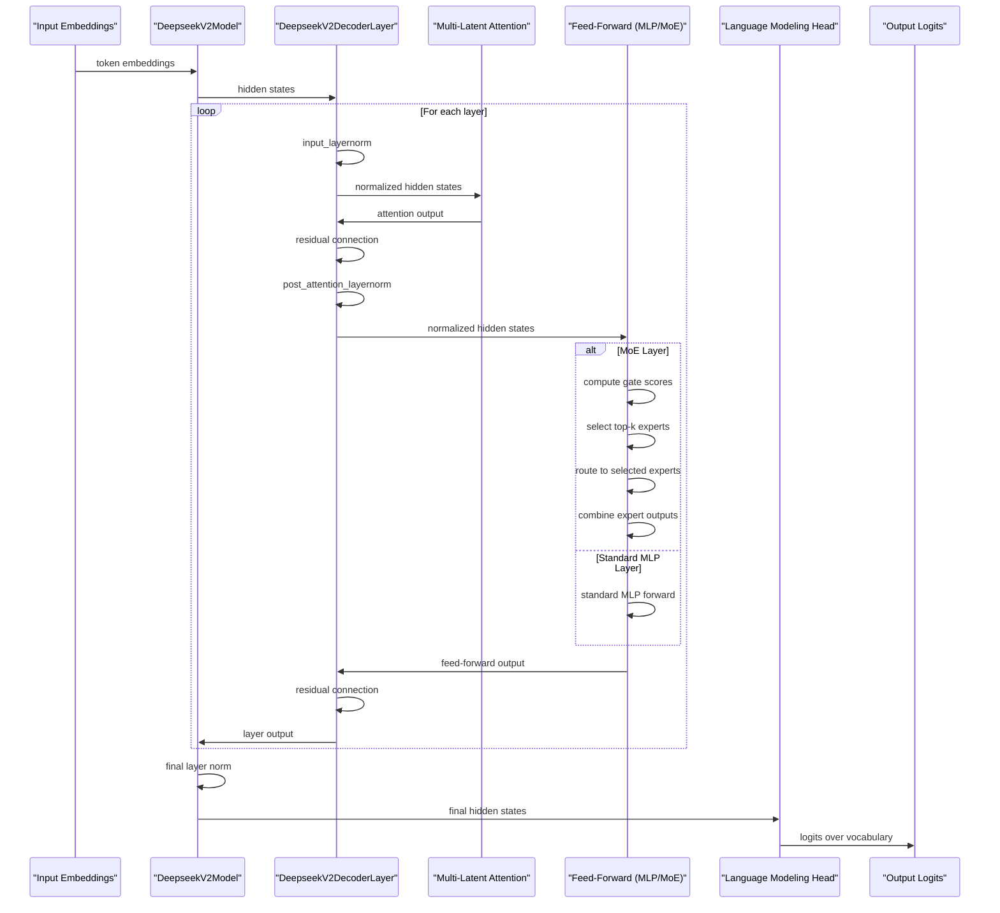

<!-- source: DeepWiki mcp.deepwiki.com · repo deepseek-ai/DeepSeek-VL2 · page 2.3 Language Model Component · fetched 2026-10-30 -->

# Language Model Component

<details>
<summary>Relevant source files</summary>

The following files were used as context for generating this wiki page:

- [deepseek_vl2/models/configuration_deepseek.py](deepseek_vl2/models/configuration_deepseek.py)
- [deepseek_vl2/models/modeling_deepseek.py](deepseek_vl2/models/modeling_deepseek.py)

</details>


This document provides a technical overview of the Language Model component in DeepSeek-VL2, which is responsible for text generation based on multimodal inputs. This component is one of the three main architectural pieces of the system, alongside the [Vision Transformer Component](#2.1) and the [MLP Projector](#2.2).

## 1. Overview and Architecture

The Language Model in DeepSeek-VL2 is based on the DeepseekV2 architecture, a decoder-only transformer model that utilizes a Mixture-of-Experts (MoE) approach to efficiently scale parameters while maintaining reasonable computational requirements during inference.



*The Language Model components within the overall DeepSeek-VL2 architecture. The language component takes projected image features from the MLP Projector and uses them alongside text embeddings to generate text responses.*

Sources: [deepseek_vl2/models/modeling_deepseek.py:1623-1651](https://github.com/deepseek-ai/DeepSeek-VL2/blob/main/deepseek_vl2/models/modeling_deepseek.py#L1623-L1651)

## 2. Core Components

### 2.1 DeepseekV2ForCausalLM

The top-level language model class that handles the generation of text given input embeddings. This class:

- Wraps the `DeepseekV2Model` backbone
- Contains the language modeling head for token prediction
- Manages the generation process, including handling past key/value caches for efficient autoregressive generation

```python
class DeepseekV2ForCausalLM(DeepseekV2PreTrainedModel):
    def __init__(self, config):
        super().__init__(config)
        self.model = DeepseekV2Model(config)
        self.vocab_size = config.vocab_size
        self.lm_head = nn.Linear(config.hidden_size, config.vocab_size, bias=False)
```

Sources: [deepseek_vl2/models/modeling_deepseek.py:1623-1651](https://github.com/deepseek-ai/DeepSeek-VL2/blob/main/deepseek_vl2/models/modeling_deepseek.py#L1623-L1651)

### 2.2 DeepseekV2Model

The transformer backbone that processes input embeddings. This class:

- Contains the token embedding layer
- Manages a stack of transformer decoder layers
- Applies final layer normalization

```python
class DeepseekV2Model(DeepseekV2PreTrainedModel):
    def __init__(self, config: DeepseekV2Config):
        super().__init__(config)
        self.padding_idx = config.pad_token_id
        self.vocab_size = config.vocab_size
        self.embed_tokens = nn.Embedding(config.vocab_size, config.hidden_size, self.padding_idx)
        self.layers = nn.ModuleList([
            DeepseekV2DecoderLayer(config, layer_idx)
            for layer_idx in range(config.num_hidden_layers)
        ])
        self.norm = DeepseekV2RMSNorm(config.hidden_size, eps=config.rms_norm_eps)
```

Sources: [deepseek_vl2/models/modeling_deepseek.py:1436-1464](https://github.com/deepseek-ai/DeepSeek-VL2/blob/main/deepseek_vl2/models/modeling_deepseek.py#L1436-L1464)

### 2.3 DeepseekV2DecoderLayer

Each decoder layer combines a self-attention mechanism with a feed-forward network:

```python
class DeepseekV2DecoderLayer(nn.Module):
    def __init__(self, config: DeepseekV2Config, layer_idx: int):
        super().__init__()
        self.self_attn = ATTENTION_CLASSES[attn_implementation](config=config, layer_idx=layer_idx)
        self.mlp = (
            DeepseekV2MoE(config)
            if (config.n_routed_experts is not None and 
                layer_idx >= config.first_k_dense_replace and 
                layer_idx % config.moe_layer_freq == 0)
            else DeepseekV2MLP(config)
        )
        self.input_layernorm = DeepseekV2RMSNorm(config.hidden_size, eps=config.rms_norm_eps)
        self.post_attention_layernorm = DeepseekV2RMSNorm(config.hidden_size, eps=config.rms_norm_eps)
```

The decoder layer alternates between:
- Layer normalization + self-attention + residual connection
- Layer normalization + feed-forward network + residual connection

The feed-forward network can be either a standard MLP or a Mixture-of-Experts module, determined by layer position and configuration.

Sources: [deepseek_vl2/models/modeling_deepseek.py:1227-1256](https://github.com/deepseek-ai/DeepSeek-VL2/blob/main/deepseek_vl2/models/modeling_deepseek.py#L1227-L1256)

## 3. Multi-Latent Attention

DeepSeek-VL2 uses Multi-Latent Attention (MLA), an optimized attention mechanism that reduces computational costs while maintaining model performance.



*Multi-Latent Attention mechanism splits queries and keys into portions with and without rotary position embeddings, applying different attention patterns to each.*

Key features:
- Uses a LoRA-like projection mechanism for key and value states
- Splits query and key into portions with and without Rotary Position Embeddings (RoPE)
- Combines different attention patterns for enhanced efficiency
- Supports Flash Attention 2 for faster computation on supported hardware

Sources: [deepseek_vl2/models/modeling_deepseek.py:714-934](https://github.com/deepseek-ai/DeepSeek-VL2/blob/main/deepseek_vl2/models/modeling_deepseek.py#L714-L934), [deepseek_vl2/models/modeling_deepseek.py:938-1166](https://github.com/deepseek-ai/DeepSeek-VL2/blob/main/deepseek_vl2/models/modeling_deepseek.py#L938-L1166)

## 4. Mixture of Experts Architecture

A key feature of the Language Model in DeepSeek-VL2 is its use of Mixture of Experts (MoE), which allows the model to have a much larger total parameter count while only activating a fraction of parameters during inference.



*The Mixture of Experts architecture routes each token to a subset of experts, combining their outputs with learned weights.*

### 4.1 MoE Components

| Component | Description | Key Parameters |
|-----------|-------------|----------------|
| **DeepseekV2MoE** | Main MoE class that manages experts and routing | `n_routed_experts`, `num_experts_per_tok` |
| **MoEGate** | Determines routing of tokens to experts | `scoring_func`, `topk_method` |
| **Experts** | Individual DeepseekV2MLP modules | `moe_intermediate_size` |
| **Shared Experts** | Optional dense path alongside sparse experts | `n_shared_experts` |

Sources: [deepseek_vl2/models/modeling_deepseek.py:552-593](https://github.com/deepseek-ai/DeepSeek-VL2/blob/main/deepseek_vl2/models/modeling_deepseek.py#L552-L593)

### 4.2 Expert Routing

The MoEGate component handles the routing of tokens to experts:

1. Computes a routing score for each token against each expert
2. Selects the top-k experts for each token based on these scores
3. Routes the token to the selected experts with appropriate weights
4. Combines the outputs from selected experts

Multiple selection strategies are supported:
- `greedy`: Simply selects the top-k experts with highest scores
- `group_limited_greedy`: Organizes experts into groups and selects from a limited number of groups
- `noaux_tc`: A specialized strategy for inference that balances expert utilization

Sources: [deepseek_vl2/models/modeling_deepseek.py:394-528](https://github.com/deepseek-ai/DeepSeek-VL2/blob/main/deepseek_vl2/models/modeling_deepseek.py#L394-L528)

## 5. Data Flow During Forward Pass



*The forward pass through the Language Model, showing the flow of data through the decoder layers, attention mechanism, and feed-forward networks.*

Sources: [deepseek_vl2/models/modeling_deepseek.py:1472-1620](https://github.com/deepseek-ai/DeepSeek-VL2/blob/main/deepseek_vl2/models/modeling_deepseek.py#L1472-L1620), [deepseek_vl2/models/modeling_deepseek.py:1657-1750](https://github.com/deepseek-ai/DeepSeek-VL2/blob/main/deepseek_vl2/models/modeling_deepseek.py#L1657-L1750)

## 6. Model Variants and Configuration

DeepSeek-VL2 offers multiple variants of the language model with different parameter counts:

| Variant | Total Parameters | Activated Parameters | Description |
|---------|------------------|----------------------|-------------|
| **DeepSeek-VL2-tiny** | 3.37B | 1.0B | Smallest variant, suitable for limited hardware |
| **DeepSeek-VL2-small** | 16.1B | 2.8B | Mid-sized variant balancing performance and efficiency |
| **DeepSeek-VL2** | 7.5B | 4.5B | Largest variant with highest performance |

### 6.1 Key Configuration Parameters

The behavior of the Language Model can be controlled through various configuration parameters:

| Parameter | Description |
|-----------|-------------|
| `n_routed_experts` | Number of experts in MoE layers |
| `num_experts_per_tok` | Number of experts selected for each token |
| `moe_layer_freq` | Frequency of MoE layers (1 = all layers are MoE) |
| `first_k_dense_replace` | Number of initial layers that remain dense |
| `hidden_size` | Dimension of hidden representations |
| `num_hidden_layers` | Total number of transformer layers |
| `num_attention_heads` | Number of attention heads |
| `use_mla` | Whether to use Multi-Latent Attention (true) or standard Multi-Head Attention (false) |
| `rope_scaling` | Configuration for extending context length |

Sources: [deepseek_vl2/models/configuration_deepseek.py:7-211](https://github.com/deepseek-ai/DeepSeek-VL2/blob/main/deepseek_vl2/models/configuration_deepseek.py#L7-L211)

## 7. Position Embeddings and Long Context Support

DeepSeek-VL2 uses Rotary Position Embeddings (RoPE) and supports various scaling strategies to extend context windows beyond training length:

| Scaling Method | Description | Configuration |
|----------------|-------------|---------------|
| Linear Scaling | Simple linear interpolation of position indices | `rope_scaling={"type": "linear", "factor": factor}` |
| Dynamic NTK Scaling | Non-linear scaling adapting to position dynamics | `rope_scaling={"type": "dynamic", "factor": factor}` |
| YaRN | Advanced method with fine-grained control | `rope_scaling={"type": "yarn", "factor": factor, ...}` |

Sources: [deepseek_vl2/models/modeling_deepseek.py:114-132](https://github.com/deepseek-ai/DeepSeek-VL2/blob/main/deepseek_vl2/models/modeling_deepseek.py#L114-L132), [deepseek_vl2/models/modeling_deepseek.py:158-327](https://github.com/deepseek-ai/DeepSeek-VL2/blob/main/deepseek_vl2/models/modeling_deepseek.py#L158-L327)

---

