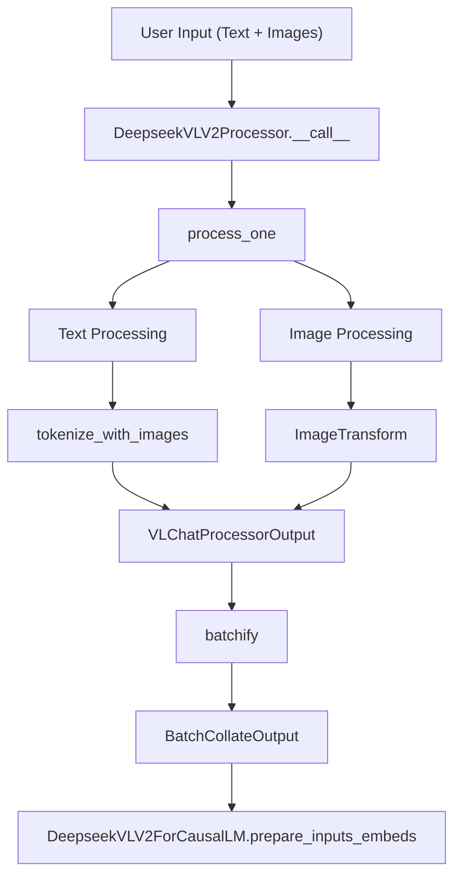
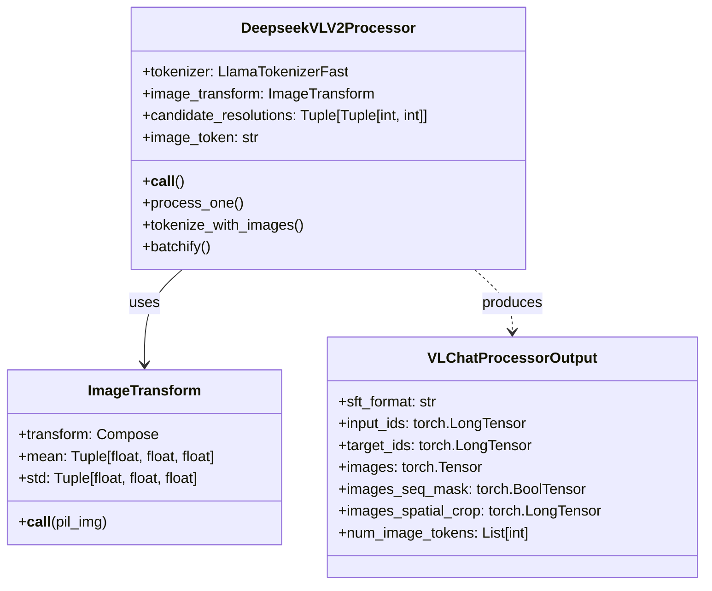
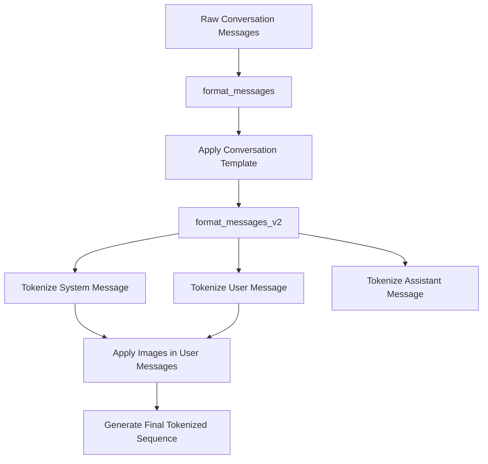
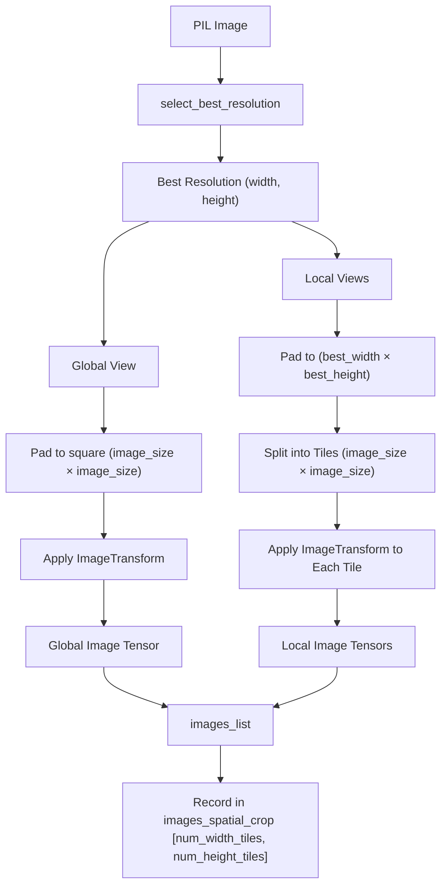
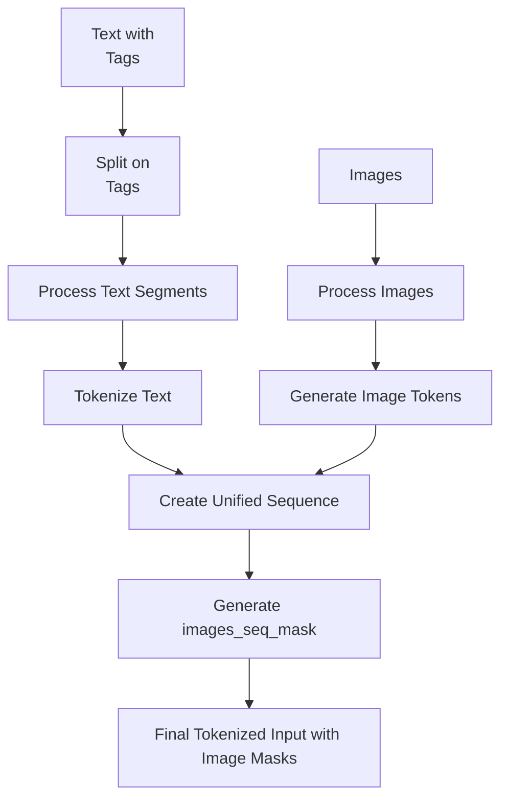
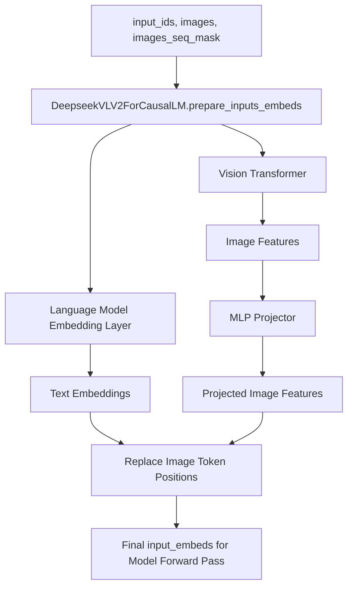
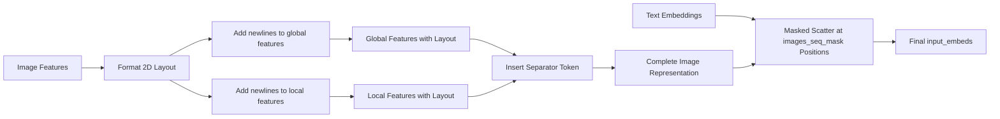
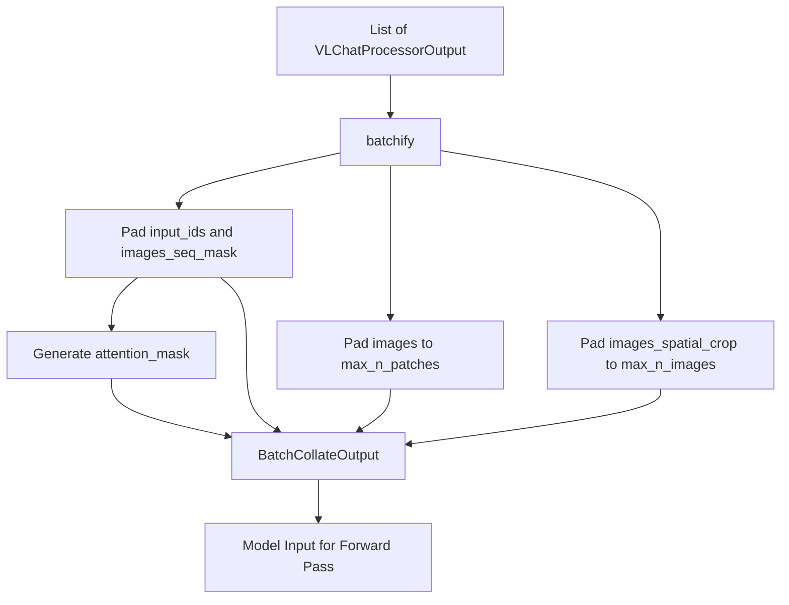

<!-- source: DeepWiki mcp.deepwiki.com · repo deepseek-ai/DeepSeek-VL2 · page 3 Input Processing · fetched 2026-10-30 -->

# Input Processing

Relevant source files

The following files were used as context for generating this wiki page:

- [deepseek_vl2/models/modeling_deepseek_vl_v2.py](deepseek_vl2/models/modeling_deepseek_vl_v2.py)
- [deepseek_vl2/models/processing_deepseek_vl_v2.py](deepseek_vl2/models/processing_deepseek_vl_v2.py)

This document explains how DeepSeek-VL2 processes inputs (images and text) before they are fed to the model. Input processing is a critical component that transforms raw user inputs into the format required by the multimodal model architecture. For information about the overall model architecture, see [Model Architecture](#2).

## Overview of Input Processing

The input processing system in DeepSeek-VL2 handles both text and images, integrating them into a unified representation that can be processed by the model. The main class responsible for this process is `DeepseekVLV2Processor`, which orchestrates tokenization, image transformation, and the merging of different modalities.

Input Processing Flow:

Sources: [deepseek_vl2/models/processing_deepseek_vl_v2.py:128-521]()

## Key Components

### DeepseekVLV2Processor

The central class responsible for processing inputs is `DeepseekVLV2Processor`. It handles:

1. Text tokenization using a LlamaTokenizer
2. Image transformation and processing
3. Integration of text and images into a single sequence
4. Batching multiple samples together

Sources: [deepseek_vl2/models/processing_deepseek_vl_v2.py:128-209](), [deepseek_vl2/models/processing_deepseek_vl_v2.py:102-124](), [deepseek_vl2/models/processing_deepseek_vl_v2.py:67-78]()

## Text Processing

### Tokenization

Text inputs are tokenized using the LlamaTokenizer, which converts text into token IDs that the model can process. The processor adds several special tokens to the tokenizer vocabulary:

| Token | Purpose |
|-------|---------|
| `<image>` | Marks positions where images should be inserted |
| `<｜▁pad▁｜>` | Used for padding sequences to the same length |
| `<|User|>`, `<|Assistant|>` | Used for conversation formatting |
| `<|ref|>`, `<|/ref|>`, etc. | Used for grounding-related tasks |

### Conversation Formatting

DeepSeek-VL2 supports various conversation templates. The processor can format messages according to different templates (e.g., "deepseek"), applying the appropriate structure for system messages, user messages, and assistant messages.

Sources: [deepseek_vl2/models/processing_deepseek_vl_v2.py:214-238](), [deepseek_vl2/models/processing_deepseek_vl_v2.py:240-322]()

## Image Processing

### Image Transformation

The `ImageTransform` class is responsible for converting PIL images to tensors and normalizing them. By default, it applies:

1. Conversion to PyTorch tensor
2. Normalization with mean and standard deviation (usually 0.5 for both)

### Resolution Selection and Tiling

A key feature of DeepSeek-VL2's image processing is its ability to handle different image resolutions through:

1. Selecting an optimal resolution from candidate_resolutions
2. Creating a global view of the entire image
3. Creating multiple local views (tiles) for detailed processing

Sources: [deepseek_vl2/models/processing_deepseek_vl_v2.py:34-52](), [deepseek_vl2/models/processing_deepseek_vl_v2.py:523-597]()

## Integrating Text and Images

The method `tokenize_with_images` is responsible for integrating text and images into a unified sequence:

1. It splits text on `<image>` tags
2. Processes each text segment and the corresponding images
3. Creates a unified sequence with both text tokens and image tokens
4. Generates a mask (`images_seq_mask`) to identify positions containing image tokens

For each image, the processor creates:
- Tokens for the global view
- A separator token
- Tokens for local views (tiles)

This approach preserves both global context and local details of the image.

Sources: [deepseek_vl2/models/processing_deepseek_vl_v2.py:523-597]()

## Model Input Preparation

After processing by the `DeepseekVLV2Processor`, the output is passed to the model's `prepare_inputs_embeds` method, which:

1. Embeds text tokens using the language model's embedding layer
2. Processes images through the vision transformer
3. Projects image features using the MLP projector
4. Integrates image embeddings into the text embeddings at positions marked by `images_seq_mask`

Sources: [deepseek_vl2/models/modeling_deepseek_vl_v2.py:336-477]()

## Spatial Representation of Images

DeepSeek-VL2 uses a sophisticated approach to represent the spatial layout of images through two main methods:

### 2D Tiling (Default)

In 2D tiling mode (`tile_tag="2D"`), the model:
1. Organizes image tokens in a 2D grid that preserves spatial relationships
2. Uses special tokens for newlines (`image_newline`) and separators (`view_seperator`)
3. Arranges global and local features according to `global_view_pos` (typically "head")

Sources: [deepseek_vl2/models/modeling_deepseek_vl_v2.py:410-454]()

### 1D Tiling (Alternative)

In 1D tiling mode (`tile_tag="1D"`), the model:
1. Uses special tile indicator tokens to mark different parts of the image
2. Arranges tiles in a linear sequence

This approach is simpler but preserves less spatial information.

Sources: [deepseek_vl2/models/modeling_deepseek_vl_v2.py:456-469]()

## Batching and Padding

For efficient processing, multiple inputs are batched together. Since inputs have varying lengths, padding is applied to ensure all inputs in a batch have the same dimensions:

The default padding strategy is "left" padding, which matches the causal attention mask used in the model. The `BatchCollateOutput` contains all necessary tensors for the model:

| Tensor | Purpose |
|--------|---------|
| `input_ids` | Token IDs with padding |
| `attention_mask` | Indicates real content vs padding |
| `images` | Batch of processed image tensors |
| `images_seq_mask` | Indicates image token positions |
| `images_spatial_crop` | Records tiling information |
| `labels` | Target IDs for training |

Sources: [deepseek_vl2/models/processing_deepseek_vl_v2.py:599-675]()

## Summary

The input processing system in DeepSeek-VL2 handles the complex task of transforming raw text and images into a format that the model can process. It preserves both the semantic content of text and the spatial structure of images, allowing the model to understand multimodal inputs effectively.

Key functionalities include:
1. Text tokenization with special tokens for images
2. Image processing with global and local views
3. Integration of text and image features into a unified representation
4. Preservation of spatial information through 2D tiling
5. Efficient batching and padding for model inference

This sophisticated processing pipeline enables DeepSeek-VL2 to handle a wide range of multimodal inputs while maintaining both global context and local detail.

---

