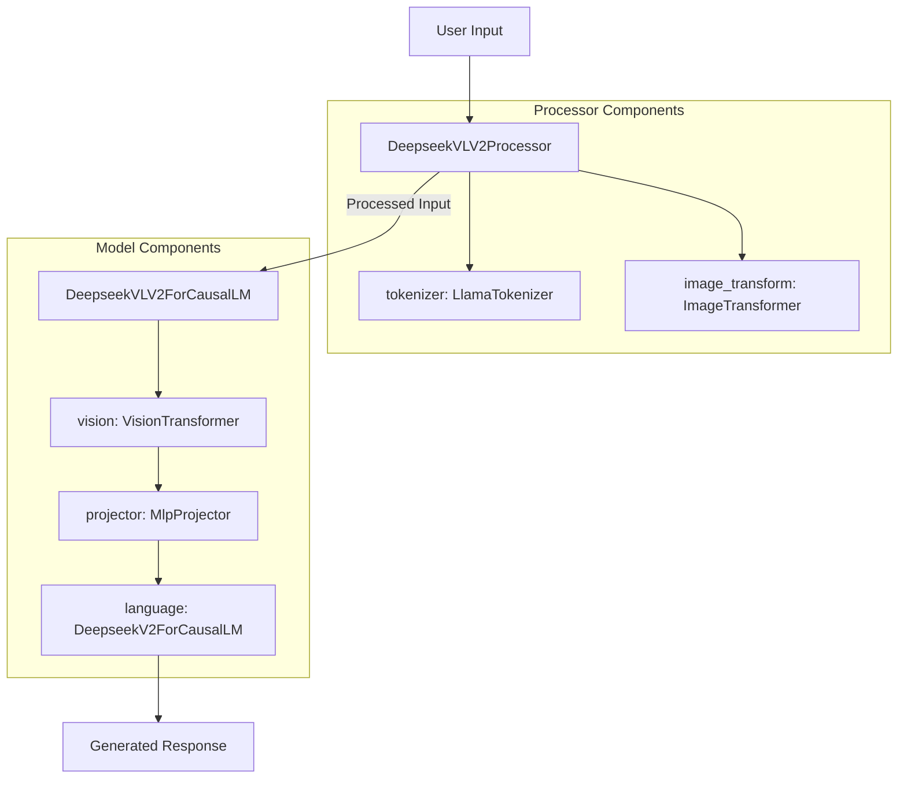
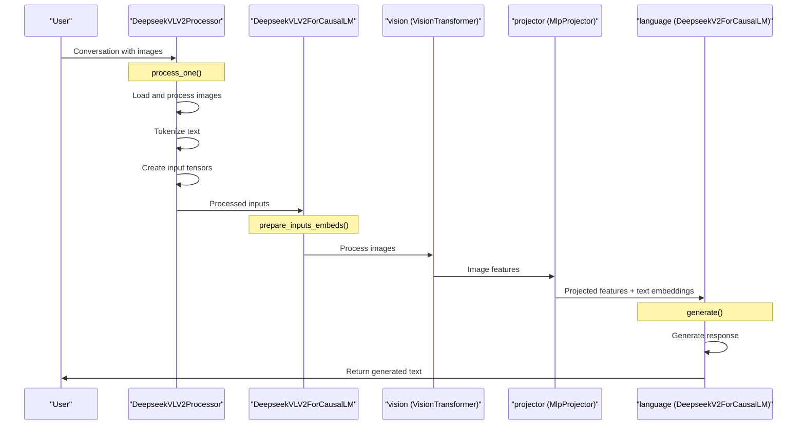
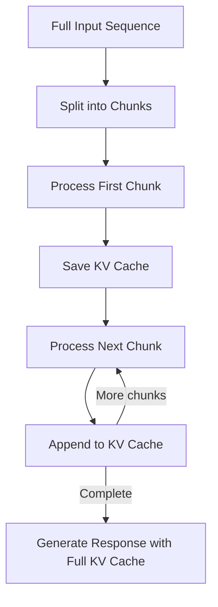

<!-- source: DeepWiki mcp.deepwiki.com · repo deepseek-ai/DeepSeek-VL2 · page 4 Inference Guide · fetched 2026-10-30 -->

# Inference Guide

<details>
<summary>Relevant source files</summary>

The following files were used as context for generating this wiki page:

- [README.md](README.md)
- [inference.py](inference.py)

</details>


This guide provides detailed instructions for running inference with DeepSeek-VL2, a multimodal model that combines vision and language capabilities through a Mixture-of-Experts (MoE) architecture. You'll learn how to set up the model, process inputs, and generate responses for various use cases including single and multiple image scenarios.

For information about the model architecture, see [Model Architecture](#2). For advanced memory optimization techniques, see [Memory Optimization Techniques](#4.1). For details on different model variants, see [Model Variants and Requirements](#4.2).

## Model Variants and Requirements

DeepSeek-VL2 is available in three variants, each with different parameter counts and hardware requirements:

| Model Variant | Total Parameters | Activated Parameters | Minimum GPU Memory | Hugging Face ID |
|---------------|-------------------|---------------------|-------------------|-----------------|
| DeepSeek-VL2-tiny | 3.37B | 1.0B | < 40GB | deepseek-ai/deepseek-vl2-tiny |
| DeepSeek-VL2-small | 16.1B | 2.8B | 40GB* | deepseek-ai/deepseek-vl2-small |
| DeepSeek-VL2 | 7.5B | 4.5B | 80GB+ | deepseek-ai/deepseek-vl2 |

*Requires incremental prefilling technique for 40GB GPUs

The MoE architecture allows these models to have a large number of total parameters while only activating a subset during inference, reducing computational requirements.

Sources: [README.md:80-90](), [inference.py:65-77]()

## Inference Components and Workflow

### Core Components



DeepSeek-VL2 uses two main components for inference:

1. **DeepseekVLV2Processor**: Handles preprocessing of inputs (images and text)
2. **DeepseekVLV2ForCausalLM**: Performs the actual inference and generates responses

Sources: [inference.py:68-77]()

### Inference Workflow



The inference workflow follows these steps:

1. Load the model and processor from Hugging Face or a local path
2. Prepare input images and text in a conversation format
3. Process inputs with DeepseekVLV2Processor
4. Generate embeddings with prepare_inputs_embeds
5. Run the language model to generate a response

Sources: [inference.py:95-149]()

## Conversation Format

DeepSeek-VL2 expects inputs in a specific conversation format:

```python
conversation = [
    {
        "role": "<|User|>",
        "content": "<image>\nDescribe this image in detail.",
        "images": ["path/to/image.jpg"],
    },
    {"role": "<|Assistant|>", "content": ""},
]
```

The conversation is a list of messages, where each message is a dictionary with:
- `role`: Either `<|User|>` or `<|Assistant|>`
- `content`: The text content of the message, with `<image>` placeholders
- `images`: A list of image paths corresponding to the `<image>` placeholders

The last message should be an empty assistant message where the model will generate the response.

Sources: [inference.py:80-91](), [README.md:123-133]()

## Basic Inference Examples

### Single Image Inference

Here's a basic example of inference with a single image:

```python
import torch
from transformers import AutoModelForCausalLM

from deepseek_vl2.models import DeepseekVLV2Processor, DeepseekVLV2ForCausalLM
from deepseek_vl2.utils.io import load_pil_images

# Load model and processor
model_path = "deepseek-ai/deepseek-vl2-tiny"
processor = DeepseekVLV2Processor.from_pretrained(model_path)
tokenizer = processor.tokenizer

model = AutoModelForCausalLM.from_pretrained(model_path, trust_remote_code=True)
model = model.to(torch.bfloat16).cuda().eval()

# Prepare conversation with image
conversation = [
    {
        "role": "<|User|>",
        "content": "<image>\nDescribe this image in detail.",
        "images": ["path/to/image.jpg"],
    },
    {"role": "<|Assistant|>", "content": ""},
]

# Load and process images
pil_images = load_pil_images(conversation)
prepare_inputs = processor(
    conversations=conversation,
    images=pil_images,
    force_batchify=True,
    system_prompt=""
).to(model.device)

# Generate embeddings and response
inputs_embeds = model.prepare_inputs_embeds(**prepare_inputs)
outputs = model.language.generate(
    inputs_embeds=inputs_embeds,
    attention_mask=prepare_inputs.attention_mask,
    pad_token_id=tokenizer.eos_token_id,
    bos_token_id=tokenizer.bos_token_id,
    eos_token_id=tokenizer.eos_token_id,
    max_new_tokens=512,
    do_sample=False,
    use_cache=True
)

# Decode the response
answer = tokenizer.decode(outputs[0].cpu().tolist(), skip_special_tokens=False)
print(answer)
```

Sources: [README.md:107-160]()

### Multiple Image Inference

You can include multiple images in a single prompt:

```python
# Conversation with multiple images
conversation = [
    {
        "role": "<|User|>",
        "content": "This is image_1: <image>\n"
                   "This is image_2: <image>\n"
                   "This is image_3: <image>\n"
                   "Compare these three images.",
        "images": [
            "path/to/image1.jpg",
            "path/to/image2.jpg",
            "path/to/image3.jpg",
        ],
    },
    {"role": "<|Assistant|>", "content": ""}
]
```

In this example, multiple images are included in the conversation structure and processed together. The `<image>` placeholder in the content string marks where each image appears in the context.

Sources: [README.md:192-232]()

## Memory-Optimized Inference with Incremental Prefilling

For larger models like DeepSeek-VL2-small running on 40GB GPUs, incremental prefilling reduces memory requirements by processing the input in chunks:



Example code using incremental prefilling:

```python
# Prepare inputs as before
# ...

with torch.no_grad():
    # Incremental prefilling for memory optimization
    inputs_embeds, past_key_values = model.incremental_prefilling(
        input_ids=prepare_inputs.input_ids,
        images=prepare_inputs.images,
        images_seq_mask=prepare_inputs.images_seq_mask,
        images_spatial_crop=prepare_inputs.images_spatial_crop,
        attention_mask=prepare_inputs.attention_mask,
        chunk_size=512  # Process 512 tokens at a time
    )

    # Generate response using the prefilled cache
    outputs = model.generate(
        inputs_embeds=inputs_embeds,
        input_ids=prepare_inputs.input_ids,
        images=prepare_inputs.images,
        images_seq_mask=prepare_inputs.images_seq_mask,
        images_spatial_crop=prepare_inputs.images_spatial_crop,
        attention_mask=prepare_inputs.attention_mask,
        past_key_values=past_key_values,
        
        pad_token_id=tokenizer.eos_token_id,
        bos_token_id=tokenizer.bos_token_id,
        eos_token_id=tokenizer.eos_token_id,
        max_new_tokens=512,
        do_sample=False,
        use_cache=True,
    )

    # Decode the response
    answer = tokenizer.decode(outputs[0][len(prepare_inputs.input_ids[0]):].cpu().tolist(), 
                             skip_special_tokens=False)
    print(answer)
```

Sources: [README.md:249-325](), [inference.py:107-151]()

## Generation Parameters

When calling the `generate` method, you can customize various parameters:

| Parameter | Description | Effect |
|-----------|-------------|--------|
| `max_new_tokens` | Maximum number of tokens to generate | Limits response length |
| `do_sample` | Whether to use sampling | If True, enables non-deterministic outputs |
| `temperature` | Controls randomness in sampling | Lower = more deterministic, higher = more random |
| `top_p` | Controls diversity via nucleus sampling | Lower = more focused on likely tokens |
| `repetition_penalty` | Penalizes repetition | Higher = less repetition |
| `use_cache` | Whether to use the KV cache | Improves performance |

Example with generation parameters:

```python
outputs = model.language.generate(
    inputs_embeds=inputs_embeds,
    attention_mask=prepare_inputs.attention_mask,
    pad_token_id=tokenizer.eos_token_id,
    bos_token_id=tokenizer.bos_token_id,
    eos_token_id=tokenizer.eos_token_id,
    max_new_tokens=512,
    do_sample=True,
    temperature=0.4,
    top_p=0.9,
    repetition_penalty=1.1,
    use_cache=True
)
```

Sources: [inference.py:133-146]()

## Special Tokens and Advanced Features

DeepSeek-VL2 supports several special tokens for advanced features:

### Visual Grounding

Use `<|ref|>` and `<|/ref|>` tokens to refer to specific objects in images:

```
<|User|>: <image>
<|ref|>The giraffe at the back.<|/ref|>.

<|Assistant|>: <|ref|>The giraffe at the back.<|/ref|><|det|>[[580, 270, 999, 900]]<|/det|>
```

The model responds with bounding box coordinates for the referenced object in the format `<|det|>[[x1, y1, x2, y2]]<|/det|>`, where:
- `x1, y1`: Top-left corner coordinates
- `x2, y2`: Bottom-right corner coordinates

### Grounded Captioning

Use the `<|grounding|>` token at the beginning of the prompt to enable grounded captioning:

```
<|User|>: <image>
<|grounding|>What animals do you see in this image?

<|Assistant|>: I can see two animals in this image:
1. <|ref|>A giraffe<|/ref|><|det|>[[580, 270, 999, 900]]<|/det|>
2. <|ref|>A zebra<|/ref|><|det|>[[100, 400, 300, 600]]<|/det|>
```

You can parse these bounding box coordinates using the `parse_ref_bbox` function:

```python
from deepseek_vl2.serve.app_modules.utils import parse_ref_bbox

vg_image = parse_ref_bbox(answer, image=pil_image)
if vg_image is not None:
    vg_image.save("./output_with_boxes.jpg", format="JPEG", quality=85)
```

Sources: [README.md:124-126](), [inference.py:152-154]()

## Command-Line Inference

You can run inference using the command-line script:

```bash
# Standard inference
CUDA_VISIBLE_DEVICES=0 python inference.py --model_path "deepseek-ai/deepseek-vl2"

# With incremental prefilling for memory optimization
CUDA_VISIBLE_DEVICES=0 python inference.py --model_path "deepseek-ai/deepseek-vl2-small" --chunk_size 512
```

The script accepts the following arguments:
- `--model_path`: Path to the model (Hugging Face ID or local path)
- `--chunk_size`: Chunk size for incremental prefilling (-1 to disable)

Sources: [inference.py:157-167](), [README.md:342-349]()

## Web Demo

For a graphical user interface, you can run the provided Gradio web demo:

```bash
# For DeepSeek-VL2-tiny (< 40GB GPU)
CUDA_VISIBLE_DEVICES=0 python web_demo.py \
--model_name "deepseek-ai/deepseek-vl2-tiny" \
--port 37914

# For DeepSeek-VL2-small with incremental prefilling (40GB GPU)
CUDA_VISIBLE_DEVICES=0 python web_demo.py \
--model_name "deepseek-ai/deepseek-vl2-small" \
--port 37914 \
--chunk_size 512

# For DeepSeek-VL2 (80GB+ GPU)
CUDA_VISIBLE_DEVICES=0 python web_demo.py \
--model_name "deepseek-ai/deepseek-vl2" \
--port 37914
```

For more details on the web demo, see [Web Demo](#5).

Sources: [README.md:354-380]()

---

