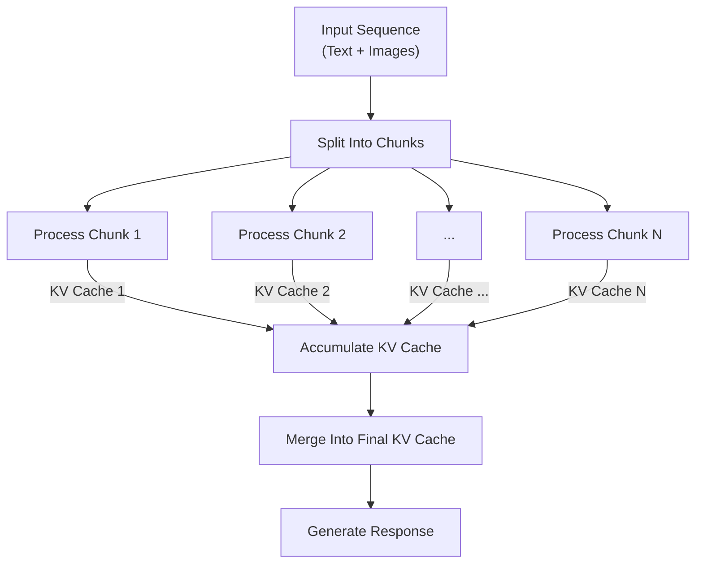
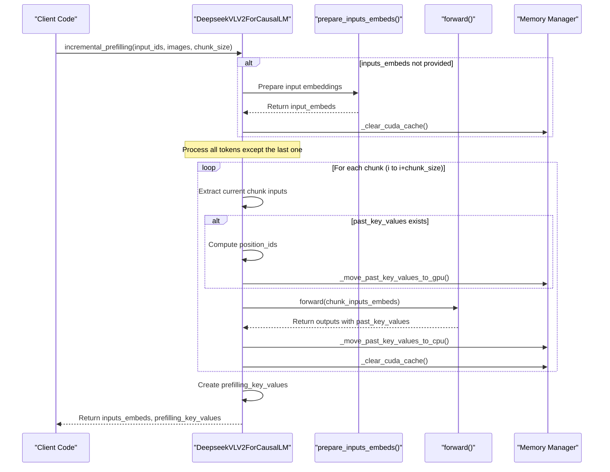

<!-- source: DeepWiki mcp.deepwiki.com · repo deepseek-ai/DeepSeek-VL2 · page 4.1 Memory Optimization Techniques · fetched 2026-10-30 -->

# Memory Optimization Techniques

<details>
<summary>Relevant source files</summary>

The following files were used as context for generating this wiki page:

- [README.md](README.md)
- [deepseek_vl2/models/modeling_deepseek_vl_v2.py](deepseek_vl2/models/modeling_deepseek_vl_v2.py)
- [inference.py](inference.py)

</details>


This document explains memory optimization techniques implemented in DeepSeek-VL2, with a primary focus on incremental prefilling. These techniques enable running larger model variants on GPUs with limited memory capacity. For information about specific model variants and their hardware requirements, see [Model Variants and Requirements](#4.2).

## Memory Challenges in Vision-Language Models

Vision-Language Models (VLMs) like DeepSeek-VL2 consume significant GPU memory during inference due to three primary factors:

1. **Model parameters**: DeepSeek-VL2 uses a Mixture-of-Experts (MoE) architecture where only a subset of parameters are activated during inference, which helps manage memory usage.
2. **Intermediate activations**: These are generated during forward passes when processing inputs.
3. **Attention key-value cache**: This grows with the context length and is essential for efficient generation.

When processing multiple images in a single conversation, memory requirements grow substantially. The incremental prefilling technique addresses these memory constraints, particularly for the larger model variants.

## Incremental Prefilling Technique

Incremental prefilling processes input sequences in smaller chunks rather than all at once, significantly reducing peak memory usage during inference.

**Diagram: Incremental Prefilling Process**


Sources: [deepseek_vl2/models/modeling_deepseek_vl_v2.py:479-557](), [README.md:245-326]()

### How It Works

1. **Input Preparation**: The model processes images and prepares input embeddings
2. **Chunking**: The input sequence is divided into manageable segments of specified size
3. **Sequential Processing**: Each chunk is processed in order, with the key-value cache being accumulated
4. **Memory Management**: After processing each chunk, the key-value cache is moved to CPU, freeing GPU memory
5. **Final Consolidation**: All chunk-specific caches are combined into a complete key-value cache
6. **Generation**: The model generates text using this prefilled cache

## Implementation Details

The technique is implemented in the `incremental_prefilling` method of the `DeepseekVLV2ForCausalLM` class.

**Diagram: Incremental Prefilling Implementation Flow**


Sources: [deepseek_vl2/models/modeling_deepseek_vl_v2.py:479-557]()

### Key Implementation Components

1. **Core Prefilling Method**: The `incremental_prefilling` method [deepseek_vl2/models/modeling_deepseek_vl_v2.py:479-557]() implements the chunked processing approach.

2. **Memory Management Utilities**:
   - `_clear_cuda_cache()` [deepseek_vl2/models/modeling_deepseek_vl_v2.py:623-628](): Performs garbage collection and clears CUDA memory
   - `_move_past_key_values_to_cpu()` [deepseek_vl2/models/modeling_deepseek_vl_v2.py:630-634](): Offloads key-value cache to CPU
   - `_move_past_key_values_to_gpu()` [deepseek_vl2/models/modeling_deepseek_vl_v2.py:636-640](): Brings key-value cache back to GPU when needed

3. **Chunk Processing Logic**:
   - Processes the sequence in chunks of size `chunk_size`
   - Creates appropriate position IDs for each chunk
   - Accumulates the key-value cache across chunks

## Usage Guide

To use incremental prefilling in your inference code:

1. **Prepare Inputs**:
```python
prepare_inputs = vl_chat_processor(
    conversations=conversation,
    images=pil_images,
    force_batchify=True,
    system_prompt=""
).to(vl_gpt.device)
```

2. **Apply Incremental Prefilling**:
```python
with torch.no_grad():
    inputs_embeds, past_key_values = vl_gpt.incremental_prefilling(
        input_ids=prepare_inputs.input_ids,
        images=prepare_inputs.images,
        images_seq_mask=prepare_inputs.images_seq_mask,
        images_spatial_crop=prepare_inputs.images_spatial_crop,
        attention_mask=prepare_inputs.attention_mask,
        chunk_size=512  # Adjust based on GPU memory
    )
```

3. **Generate Response**:
```python
outputs = vl_gpt.generate(
    inputs_embeds=inputs_embeds,
    input_ids=prepare_inputs.input_ids,
    images=prepare_inputs.images,
    images_seq_mask=prepare_inputs.images_seq_mask,
    images_spatial_crop=prepare_inputs.images_spatial_crop,
    attention_mask=prepare_inputs.attention_mask,
    past_key_values=past_key_values,
    
    pad_token_id=tokenizer.eos_token_id,
    bos_token_id=tokenizer.bos_token_id,
    eos_token_id=tokenizer.eos_token_id,
    max_new_tokens=512,
    do_sample=False,
    use_cache=True,
)
```

Sources: [README.md:249-326](), [inference.py:107-147]()

## Performance Trade-offs

Incremental prefilling involves trade-offs that should be considered when deploying DeepSeek-VL2:

| Aspect | Standard Inference | With Incremental Prefilling |
|--------|-------------------|----------------------------|
| Memory Usage | Higher (full sequence) | Lower (chunk-by-chunk) |
| Inference Speed | Faster (single pass) | Slower (multiple passes) |
| GPU Requirements | Larger (80GB+) | Smaller (e.g., 40GB) |
| Implementation Complexity | Simpler | More complex |

Sources: [README.md:366-380]()

### Chunk Size Selection

The `chunk_size` parameter controls the memory-performance trade-off:

- **Smaller chunk size**: Lower peak memory usage but more iterations and overhead
- **Larger chunk size**: Faster processing but higher memory requirements per chunk

The repository recommends starting with `chunk_size=512` for running DeepSeek-VL2-small on 40GB GPUs.

## Model-Specific Recommendations

| Model Variant | Total Parameters | Activated Parameters | GPU Memory | Recommended Approach |
|---------------|------------------|----------------------|------------|---------------------|
| DeepSeek-VL2-tiny | 3.37B | 1.0B | <40GB | Standard inference |
| DeepSeek-VL2-small | 16.1B | 2.8B | 40GB | Incremental prefilling (chunk_size=512) |
|  |  |  | >40GB | Standard inference |
| DeepSeek-VL2 | 7.5B | 4.5B | 80GB+ | Standard inference |

Sources: [README.md:87-90](), [README.md:366-380]()

## Conclusion

Incremental prefilling is a powerful memory optimization technique that enables running DeepSeek-VL2-small on more accessible GPU hardware. By processing input sequences in chunks and carefully managing memory, this approach trades some inference speed for significantly reduced memory requirements. This makes larger VLM models more accessible for researchers and developers with limited hardware resources.

When implementing DeepSeek-VL2 in resource-constrained environments, carefully consider the model variant, available GPU memory, and appropriate chunk size to achieve the optimal balance between memory usage and inference speed.

---

