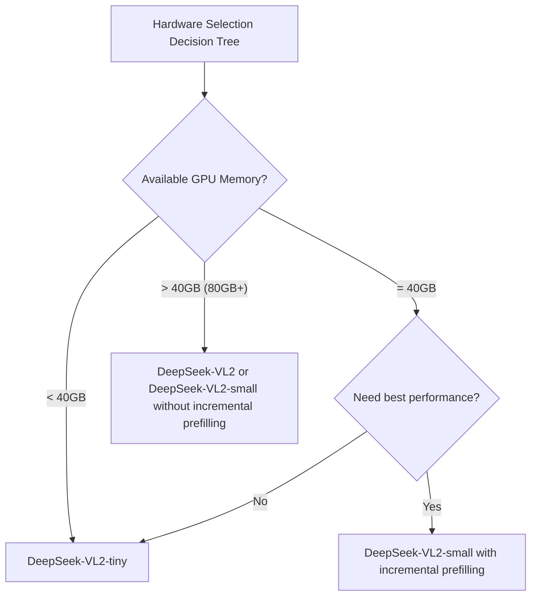
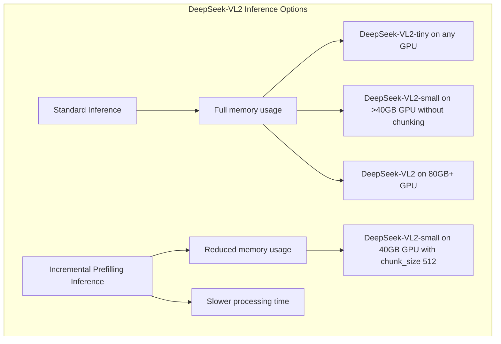
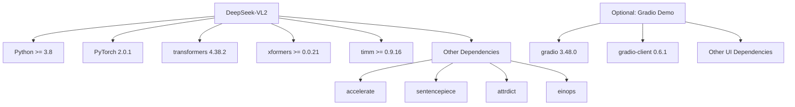

<!-- source: DeepWiki mcp.deepwiki.com · repo deepseek-ai/DeepSeek-VL2 · page 4.2 Model Variants and Requirements · fetched 2026-10-30 -->

# Model Variants and Requirements

<details>
<summary>Relevant source files</summary>

The following files were used as context for generating this wiki page:

- [README.md](README.md)
- [pyproject.toml](pyproject.toml)
- [requirements.txt](requirements.txt)

</details>


This document provides detailed information about the different DeepSeek-VL2 model variants and their hardware/software requirements. It covers the specific characteristics of each model variant, their memory requirements, and guidance on selecting the appropriate model based on available resources.

For information about memory optimization techniques when running larger models, see [Memory Optimization Techniques](#4.1).

## 1. Model Variants Overview

DeepSeek-VL2 is available in three different variants, each with different parameter counts and resource requirements:

```mermaid
classDiagram
    class "DeepSeek-VL2 Variants" {
        <<interface>>
    }
    
    class "DeepseekVLV2ForCausalLM" {
        Base model class
        vision
        projector
        language
    }
    
    class "DeepSeek-VL2-tiny" {
        Total parameters: 3.37B
        Activated parameters: 1.0B
        Context length: 4096 tokens
    }
    
    class "DeepSeek-VL2-small" {
        Total parameters: 16.1B
        Activated parameters: 2.8B
        Context length: 4096 tokens
    }
    
    class "DeepSeek-VL2" {
        Total parameters: 7.5B
        Activated parameters: 4.5B
        Context length: 4096 tokens
    }
    
    "DeepSeek-VL2 Variants" <|-- "DeepseekVLV2ForCausalLM"
    "DeepseekVLV2ForCausalLM" <|-- "DeepSeek-VL2-tiny"
    "DeepseekVLV2ForCausalLM" <|-- "DeepSeek-VL2-small"
    "DeepseekVLV2ForCausalLM" <|-- "DeepSeek-VL2"
```

Sources: [README.md:86-90]()

### Key Characteristics

All DeepSeek-VL2 variants:
- Are Mixture-of-Experts (MoE) Vision-Language Models
- Support a sequence length of 4096 tokens
- Share the same architecture but differ in size and performance
- Available on Hugging Face

The MoE architecture allows for a large total parameter count while activating only a subset during inference, which provides better efficiency without sacrificing performance.

Sources: [README.md:61-62](), [README.md:86-90]()

## 2. Hardware Requirements

Each model variant has different GPU memory requirements based on its size:



Sources: [README.md:105-106](), [README.md:247-248](), [README.md:362-379]()

### Detailed GPU Memory Requirements

| Model Variant | Total Parameters | Activated Parameters | Minimum GPU Memory | Optimal GPU Memory |
|---------------|------------------|----------------------|-------------------|-------------------|
| DeepSeek-VL2-tiny | 3.37B | 1.0B | < 40GB | 24GB+ |
| DeepSeek-VL2-small | 16.1B | 2.8B | 40GB (with incremental prefilling) | > 40GB |
| DeepSeek-VL2 | 7.5B | 4.5B | 80GB+ | 80GB+ |

Sources: [README.md:362-379]()

## 3. Inference Options Based on Hardware



### Standard Inference vs. Incremental Prefilling

- **Standard Inference**: Used when sufficient GPU memory is available
  - Suitable for DeepSeek-VL2-tiny on any modern GPU
  - Suitable for DeepSeek-VL2-small on GPUs > 40GB
  - Suitable for DeepSeek-VL2 on 80GB+ GPUs
  
- **Incremental Prefilling**: Used when GPU memory is constrained
  - Splits input sequence into chunks (typically 512 tokens)
  - Processes chunks sequentially to save memory
  - Suitable for running DeepSeek-VL2-small on 40GB GPUs
  - Results in slower inference but enables using larger models on limited hardware

Sources: [README.md:247-336]()

## 4. Software Requirements

### Core Dependencies



The software requirements for running DeepSeek-VL2 include:

#### Required Dependencies
- Python 3.8 or higher
- PyTorch 2.0.1
- transformers 4.38.2
- xformers 0.0.21 or higher
- timm 0.9.16 or higher
- accelerate
- sentencepiece
- attrdict
- einops

#### Optional Dependencies for Gradio Demo
Additional packages are required for running the web demo interface, which can be installed with:
```
pip install -e .[gradio]
```

Sources: [requirements.txt:1-9](), [pyproject.toml:14-23](), [pyproject.toml:26-37]()

## 5. Installation Guide

### Basic Installation

```bash
# Clone the repository
git clone https://github.com/deepseek-ai/DeepSeek-VL2
cd DeepSeek-VL2

# Install the package and its dependencies
pip install -e .
```

### Installation with Gradio Demo Support

```bash
# Install with gradio demo dependencies
pip install -e .[gradio]
```

Sources: [README.md:95-101](), [README.md:354-357]()

## 6. Model Selection Guide

When choosing a DeepSeek-VL2 variant, consider the following factors:

1. **Available GPU memory**: This is the primary constraint that determines which model you can run
2. **Performance requirements**: Larger models generally provide better performance but require more resources
3. **Inference speed requirements**: Using incremental prefilling will slow down inference

### Recommended Configurations

1. **For resource-constrained environments (< 40GB GPU):**
   - Use DeepSeek-VL2-tiny for fastest inference
   
2. **For balanced performance (40GB GPU):**
   - Use DeepSeek-VL2-small with incremental prefilling (chunk_size=512)
   
3. **For high-performance environments (> 40GB GPU):**
   - Use DeepSeek-VL2-small without incremental prefilling for faster inference
   - Use DeepSeek-VL2 on 80GB+ GPUs for best performance

Sources: [README.md:362-379]()

---

Note: This document focuses on model variants and their requirements. For information about inference and memory optimization techniques, please refer to [Inference Guide](#4) and [Memory Optimization Techniques](#4.1).

---

