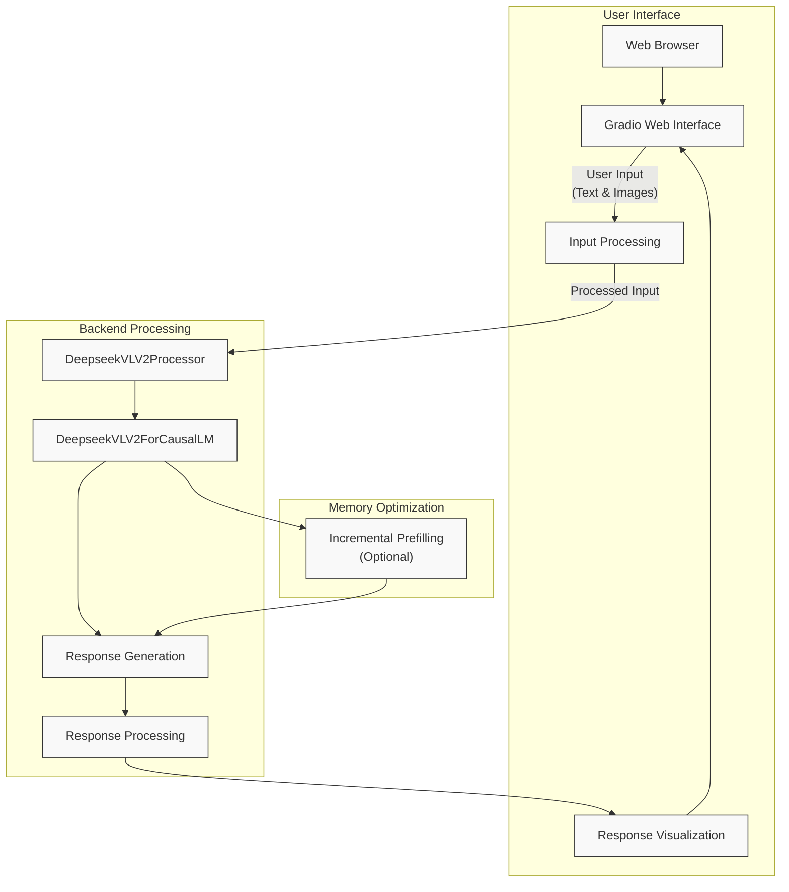
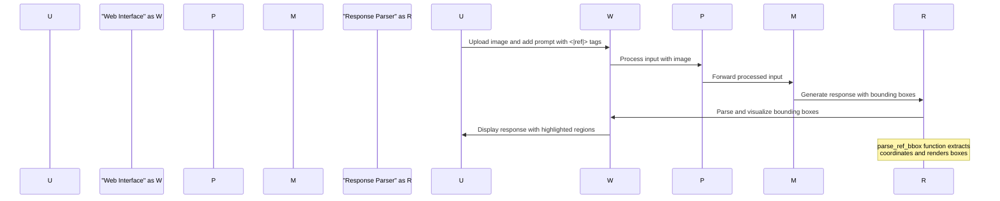
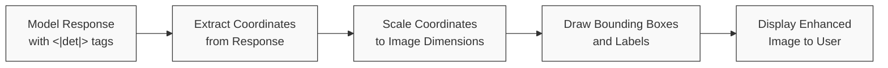

<!-- source: DeepWiki mcp.deepwiki.com · repo deepseek-ai/DeepSeek-VL2 · page 5 Web Demo · fetched 2026-10-30 -->

# Web Demo

<details>
<summary>Relevant source files</summary>

The following files were used as context for generating this wiki page:

- [README.md](README.md)
- [deepseek_vl2/serve/app_modules/presets.py](deepseek_vl2/serve/app_modules/presets.py)
- [deepseek_vl2/serve/app_modules/utils.py](deepseek_vl2/serve/app_modules/utils.py)

</details>


This page provides a comprehensive guide on setting up and using the Gradio web interface for DeepSeek-VL2. The web demo offers a user-friendly graphical interface to interact with the model's multimodal capabilities without writing code. For information about running inference programmatically, see [Inference Guide](#4).

## Installation and Setup

### Requirements

To run the web demo, you need to install the additional Gradio dependencies:

```bash
pip install -e .[gradio]
```

This command installs both the core DeepSeek-VL2 package and the Gradio web interface dependencies.

Sources: [README.md:355-357]()

### Hardware Requirements

The hardware requirements depend on the model variant you choose to run:

| Model Variant | Total Parameters | Activated Parameters | Minimum GPU Memory |
|---------------|------------------|----------------------|-------------------|
| DeepSeek-VL2-tiny | 3.37B | 1.0B | < 40GB |
| DeepSeek-VL2-small | 16.1B | 2.8B | 40GB (with chunking) |
| DeepSeek-VL2 | 7.5B | 4.5B | 80GB+ |

For the smaller models like DeepSeek-VL2-tiny, you can run the web demo on consumer GPUs with less than 40GB memory. For larger models like DeepSeek-VL2-small, you'll need memory optimization techniques (incremental prefilling) when running on limited hardware.

Sources: [README.md:363-380]()

## Running the Web Demo

### Basic Command

To start the web demo with the tiny model variant:

```bash
CUDA_VISIBLE_DEVICES=0 python web_demo.py \
--model_name "deepseek-ai/deepseek-vl2-tiny" \
--port 37914
```

This command launches a Gradio web interface on port 37914 using the DeepSeek-VL2-tiny model.

Sources: [README.md:363-366]()

### Memory Optimization

For larger models running on limited hardware, enable incremental prefilling with the `--chunk_size` parameter:

```bash
CUDA_VISIBLE_DEVICES=0 python web_demo.py \
--model_name "deepseek-ai/deepseek-vl2-small" \
--port 37914 \
--chunk_size 512
```

This processes the input in chunks to reduce memory requirements, though it may result in slower response times.

Sources: [README.md:370-374]()

### Command Line Options

The `web_demo.py` script accepts the following key parameters:

- `--model_name`: Hugging Face model identifier (e.g., "deepseek-ai/deepseek-vl2-tiny")
- `--port`: Port number for the web server (default: 7860)
- `--chunk_size`: Size of chunks for incremental prefilling (optional, for memory optimization)

## Web Demo Architecture

The web demo integrates the DeepSeek-VL2 model with a Gradio interface for user interaction:



Sources: [README.md:352-383]()

## Interface Features

### Main Components

The web demo interface includes:

1. **Conversation History**: Displays the ongoing chat between the user and the model
2. **Input Area**: Text input for user prompts
3. **Image Upload**: Functionality to upload and include images in the conversation
4. **Special Token Support**: Support for visual grounding tokens

### Special Tokens and Features

The web demo supports several special tokens for advanced interactions:

- `<image>`: Marks where an image should be inserted in the text
- `<|ref|>{query}<|/ref|>`: Used for visual grounding, where `{query}` is the text describing what to locate in the image
- `<|grounding|>{question}`: Initiates a grounding conversation where the model will provide both textual responses and visual localization

Sources: [deepseek_vl2/serve/app_modules/presets.py:24-25]()

## Visual Grounding Features

One of the key features of the web demo is visual grounding, which allows the model to identify and highlight specific objects or regions in an image based on textual descriptions.



When a response contains visual grounding information, the `parse_ref_bbox` function processes the response text to extract bounding box coordinates and renders them on the image with appropriate labels.

Sources: [deepseek_vl2/serve/app_modules/utils.py:270-313]()

### Bounding Box Processing

The model outputs bounding box coordinates in a normalized format (0-999 range). The web demo processes these coordinates and renders them on the image:



The bounding box processing flow:
1. Extract references and detection tags from the response
2. Parse the coordinates from the `<|det|>` tags
3. Match coordinates with their corresponding labels from `<|ref|>` tags
4. Scale the coordinates from the normalized space (0-999) to actual image dimensions
5. Draw colored rectangles and labels on the image

Sources: [deepseek_vl2/serve/app_modules/utils.py:270-313](), [deepseek_vl2/serve/app_modules/presets.py:31-45]()

## Image Processing

The web demo includes functionality to process and optimize images for the model:

1. **Resizing**: Images are resized to maintain a balance between quality and performance
2. **Format Conversion**: Images are converted to appropriate formats for the model
3. **Base64 Encoding**: Images are encoded for embedding in the web interface

The constants `MAX_IMAGE_SIZE` (800) and `MIN_IMAGE_SIZE` (400) control the resizing behavior to keep images within appropriate dimensions.

Sources: [deepseek_vl2/serve/app_modules/utils.py:240-267](), [deepseek_vl2/serve/app_modules/presets.py:28-29]()

## Response Formatting

Responses from the model are processed to create a readable and visually appealing display in the web interface:

1. Markdown conversion for proper formatting
2. Code block syntax highlighting
3. Special token handling and removal
4. Visual grounding tag processing and rendering

The demo includes a comprehensive set of utilities to handle various formatting needs, ensuring that code blocks, lists, tables, and other structured content are displayed correctly.

Sources: [deepseek_vl2/serve/app_modules/utils.py:87-209]()

## Performance Considerations

The web demo is a basic implementation without deployment optimizations:

- For production environments, consider using optimized deployment solutions like vllm, sglang, or lmdeploy
- Incremental prefilling is a memory optimization technique that processes the input in chunks but may result in slower responses
- Larger models require more GPU memory and computing resources

The README explicitly states that this is a "naive implementation" intended for demonstration purposes rather than production deployment.

Sources: [README.md:382-383]()

## Logging and Debugging

The web demo includes a logging system that captures events and errors:

- Logs are stored in `deepseek_vl2/serve/logs/{timestamp}_gradio_log.log`
- Console logging is set to INFO level
- File logging captures more detailed information

This logging helps diagnose issues when running the web demo and can be useful for troubleshooting performance or functionality problems.

Sources: [deepseek_vl2/serve/app_modules/utils.py:48-71]()

---

