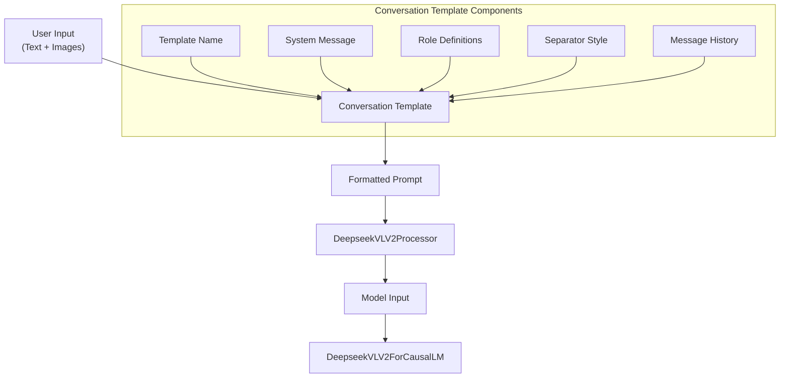
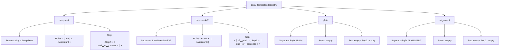
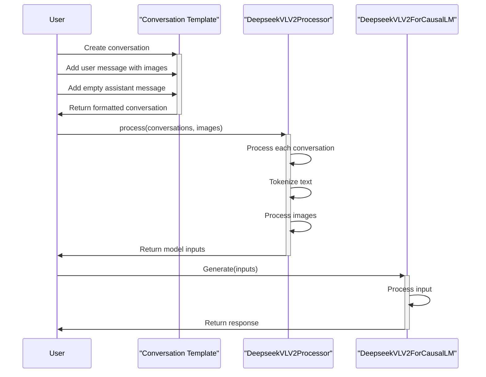

<!-- source: DeepWiki mcp.deepwiki.com · repo deepseek-ai/DeepSeek-VL2 · page 6 Conversation Templates · fetched 2026-10-30 -->

# Conversation Templates

<details>
<summary>Relevant source files</summary>

The following files were used as context for generating this wiki page:

- [README.md](README.md)
- [deepseek_vl2/models/conversation.py](deepseek_vl2/models/conversation.py)

</details>


## Purpose and Scope

This document explains how conversation templates work in the DeepSeek-VL2 system. Conversation templates provide structured formats for interactions between users and the model, handling both text and image inputs. They standardize prompt formatting and manage conversation history while supporting special tokens for features like visual grounding.

For information about model inference and execution, see [Inference Guide](#4).

## Conversation Template System Overview

Conversation templates in DeepSeek-VL2 manage the formatting of multi-turn conversations, ensuring consistency and proper handling of special tokens. The system is built around the `Conversation` class that defines the structure and behavior of different template styles.



*Diagram: Conversation template flow in DeepSeek-VL2*

Sources: [deepseek_vl2/models/conversation.py](), [README.md:115-138]()

## Template Structure

The `Conversation` class is the core component for managing conversation templates. Each template defines how messages should be formatted, including separators between messages, role names, and stop tokens.

```mermaid
classDiagram
    class "Conversation" {
        +name: str
        +system_template: str
        +system_message: str
        +roles: List[str]
        +messages: List[List[str]]
        +offset: int
        +sep_style: SeparatorStyle
        +sep: str
        +sep2: str
        +stop_str: str
        +stop_token_ids: List[int]
        +get_prompt()
        +set_system_message()
        +append_message()
        +update_last_message()
        +reset_message()
    }
    
    class "SeparatorStyle" {
        <<enumeration>>
        DeepSeek
        DeepSeekV2
        PLAIN
        ALIGNMENT
    }
    
    "Conversation" --> "SeparatorStyle" : uses
```

*Diagram: Conversation class structure*

Sources: [deepseek_vl2/models/conversation.py:19-122]()

### Key Components

- **Name**: Unique identifier for the template (e.g., "deepseek", "deepseekv2")
- **System Message**: Optional instructional message that precedes the conversation
- **Roles**: Names for conversation participants (typically user and assistant)
- **Messages**: The conversation history stored as role-message pairs
- **Separator Style**: Defines how messages are separated and formatted
- **Separators**: Strings used to separate messages in the prompt
- **Stop Tokens**: Criteria to determine when generation should stop

## Separator Styles

The `SeparatorStyle` enum defines different formatting approaches for conversations:

| Style | Purpose | Format Characteristics |
|-------|---------|------------------------|
| `DeepSeek` | Standard format for DeepSeek-VL2 | Uses role labels with colons and double newlines between turns |
| `DeepSeekV2` | Alternative format with specialized tokens | Uses special tokens like `<｜sft▁begin｜>` and `<｜sft▁end｜>` |
| `PLAIN` | Simple messages without role labels | No explicit role markers, minimal formatting |
| `ALIGNMENT` | Special format for image inputs | Automatically adds `<image>` for user turns |

Sources: [deepseek_vl2/models/conversation.py:10-16](), [deepseek_vl2/models/conversation.py:44-104]()

## Built-in Templates

DeepSeek-VL2 comes with several pre-registered conversation templates:



*Diagram: Built-in conversation templates*

Sources: [deepseek_vl2/models/conversation.py:174-287]()

### Default Template: "deepseek"

The standard template used for most interactions with DeepSeek-VL2:

```
<|User|>: <image>
<|ref|>The giraffe at the back.<|/ref|>.

<|Assistant|>: <|ref|>The giraffe at the back.<|/ref|><|det|>[[580, 270, 999, 900]]<|/det|><｜end▁of▁sentence｜>
```

Sources: [README.md:123-169]()

## Using Templates for Conversation

### Creating Conversations

To create a conversation:

1. Get a template instance: `conv = get_conv_template("deepseek")`
2. Add messages: `conv.append_message(conv.roles[0], "Hello with <image>")`
3. Generate the prompt: `prompt = conv.get_prompt()`

### Special Tokens

DeepSeek-VL2 uses special tokens in conversations for specific functions:

| Token | Purpose |
|-------|---------|
| `<image>` | Indicates image placement in the text |
| `<\|ref\|>...<\|/ref\|>` | Marks text referring to specific objects in images |
| `<\|det\|>[[x1, y1, x2, y2]]<\|/det\|>` | Contains bounding box coordinates for detected objects |
| `<｜end▁of▁sentence｜>` | Marks the end of the assistant's response |
| `<｜sft▁begin｜>`, `<｜sft▁end｜>` | Used in the DeepSeekV2 template to mark message boundaries |

Sources: [README.md:124-169](), [deepseek_vl2/models/conversation.py:204-254]()

## Integration with DeepSeek-VL2 Processor

Conversation templates are integrated with the `DeepseekVLV2Processor` to prepare inputs for the model:



*Diagram: Conversation processing flow*

Sources: [README.md:126-143]()

## Example Usage

The conversation format used in the DeepSeek-VL2 codebase typically follows this structure:

```python
conversation = [
    {
        "role": "<|User|>",
        "content": "This is image_1: <image>\nCan you describe it?",
        "images": ["path/to/image.jpg"],
    },
    {"role": "<|Assistant|>", "content": ""},  # Empty for generation
]
```

This structure is then processed by the `DeepseekVLV2Processor` to create the necessary inputs for the model:

```python
prepare_inputs = vl_chat_processor(
    conversations=conversation,
    images=pil_images,
    force_batchify=True,
    system_prompt=""
)
```

Sources: [README.md:105-143](), [README.md:265-288]()

## Template Registration

New conversation templates can be registered using the `register_conv_template` function:

```python
register_conv_template(
    Conversation(
        name="custom_template",
        system_template="{system_message}",
        system_message="",
        roles=("User", "Assistant"),
        messages=(),
        sep_style=SeparatorStyle.DeepSeek,
        sep="\n\n",
        sep2="<｜end▁of▁sentence｜>",
        stop_token_ids=[100001],
        stop_str=["User:", "<｜end▁of▁sentence｜>"]
    )
)
```

Sources: [deepseek_vl2/models/conversation.py:176-187](), [deepseek_vl2/models/conversation.py:208-223]()

## Memory Considerations

When using conversation templates with large models like DeepSeek-VL2-small, memory optimization techniques like incremental prefilling may be necessary, especially on GPUs with limited memory (e.g., 40GB).

Sources: [README.md:245-336]()

---

