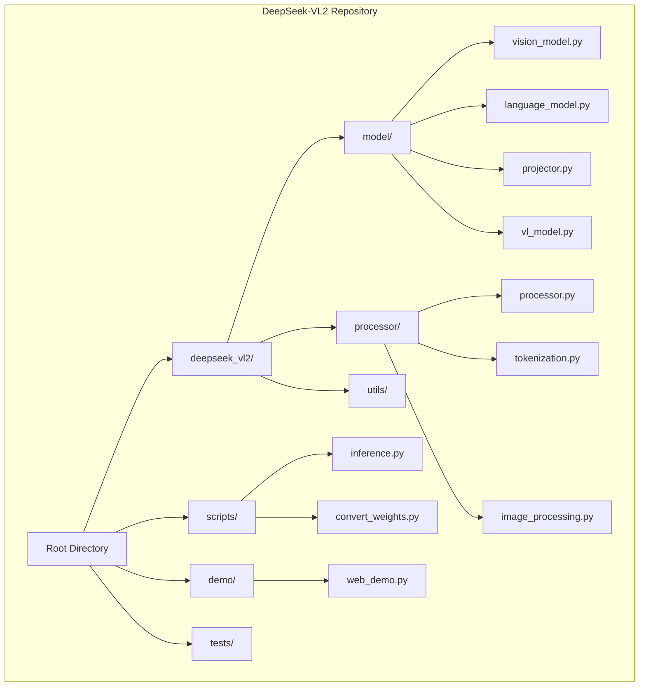
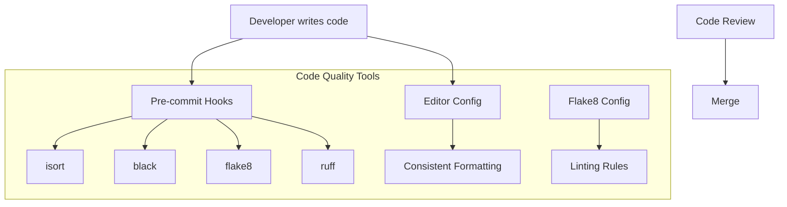
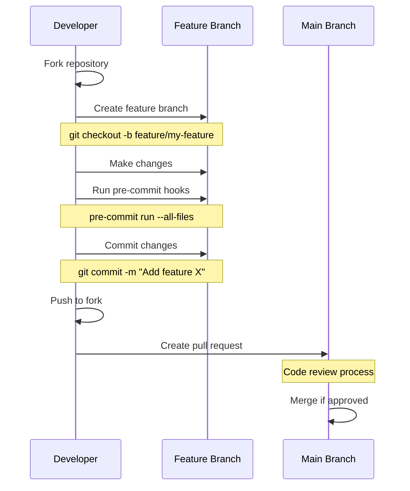
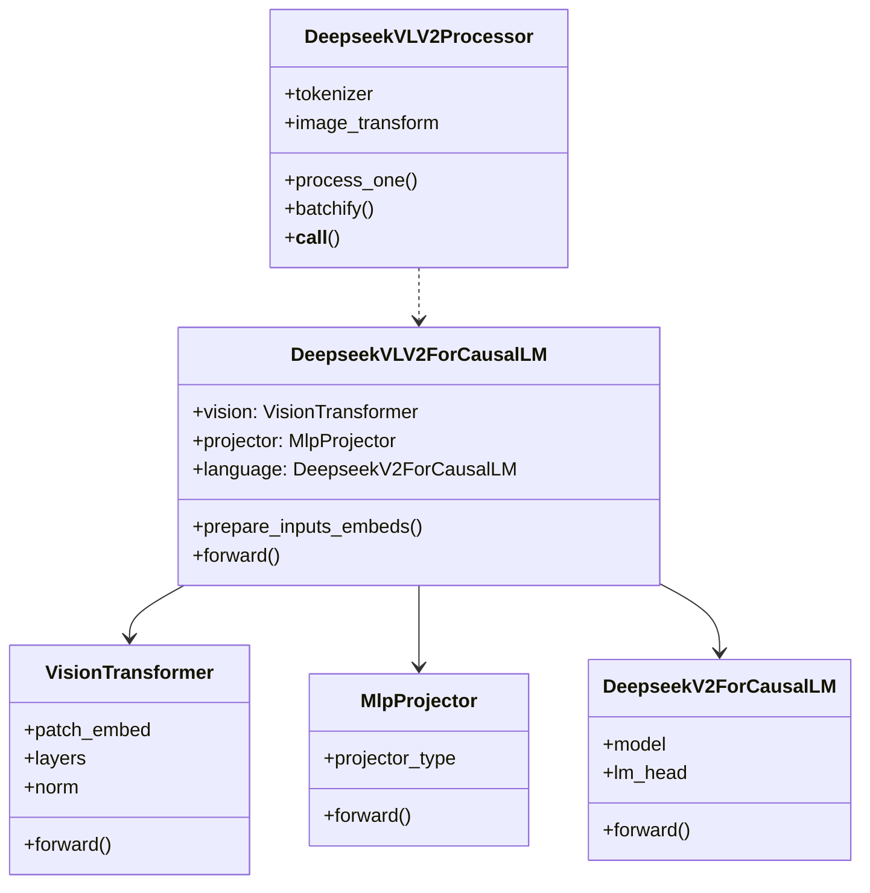
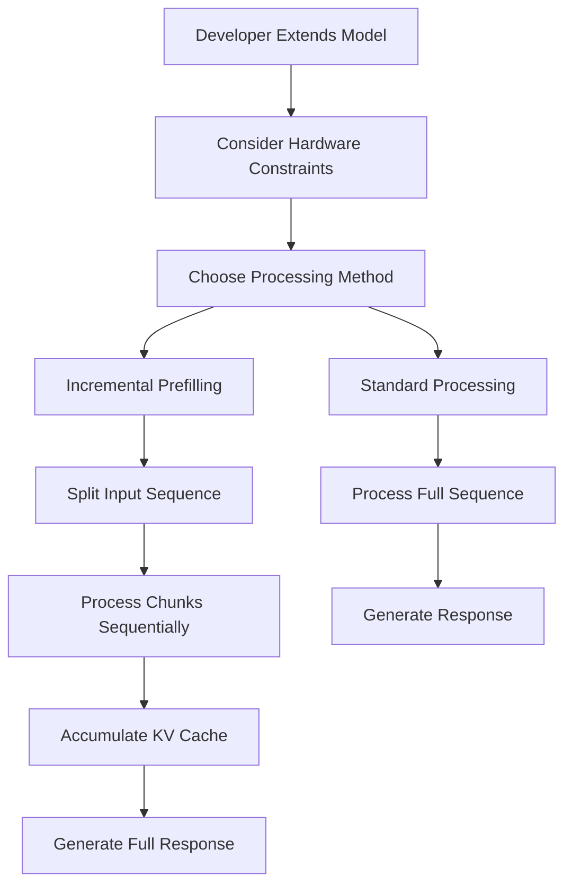

<!-- source: DeepWiki mcp.deepwiki.com · repo deepseek-ai/DeepSeek-VL2 · page 7 Development Guide · fetched 2026-10-30 -->

# Development Guide

<details>
<summary>Relevant source files</summary>

The following files were used as context for generating this wiki page:

- [.editorconfig](.editorconfig)
- [.flake8](.flake8)
- [.gitattributes](.gitattributes)
- [.gitignore](.gitignore)
- [pyproject.toml](pyproject.toml)
- [requirements.txt](requirements.txt)

</details>


This guide provides information for developers who want to contribute to or modify the DeepSeek-VL2 codebase. It covers development environment setup, code organization, coding standards, and contribution workflow. For information about using the model for inference, see [Inference Guide](#4).

## 1. Setting Up Development Environment

### 1.1 Requirements

DeepSeek-VL2 requires the following dependencies:

```
# Core Dependencies
torch==2.0.1
transformers==4.38.2
xformers>=0.0.21
timm>=0.9.16
accelerate
sentencepiece
attrdict
einops

# For Gradio Demo (Optional)
gradio==3.48.0
gradio-client==0.6.1
mdtex2html==1.3.0
pypinyin==0.50.0
tiktoken==0.5.2
tqdm==4.64.0
colorama==0.4.5
Pygments==2.12.0
markdown==3.4.1
SentencePiece==0.1.96
```

Sources: [requirements.txt:1-21](), [pyproject.toml:14-23]()

### 1.2 Development Setup

For development, it's recommended to install the package in development mode with additional development dependencies:

```bash
# Clone the repository
git clone https://github.com/deepseek-ai/DeepSeek-VL2
cd DeepSeek-VL2

# Create and activate a virtual environment (optional but recommended)
python -m venv venv
source venv/bin/activate  # On Windows: venv\Scripts\activate

# Install in development mode with lint tools
pip install -e ".[lint]"
```

The `lint` optional dependencies include tools for code quality and formatting:

| Tool | Purpose |
|------|---------|
| isort | Sort imports alphabetically and automatically |
| black | Code formatter that enforces PEP 8 |
| pylint | Static code analyzer |
| flake8 | Code style enforcement tool |
| ruff | Fast Python linter |
| pre-commit | Git hooks manager for consistent code checks |

Sources: [pyproject.toml:38-51]()

## 2. Code Structure and Organization

The codebase follows a modular architecture that reflects the model's components. Below is a high-level overview of the repository structure:



**Key Components in the Codebase**

The codebase is organized around the three main components of the DeepSeek-VL2 model:

1. **Vision Transformer** - Handles image processing and feature extraction
2. **MLP Projector** - Projects visual features into the language embedding space
3. **Language Model** - Processes text and generates responses with MoE capability

Sources: [pyproject.toml:53-54]()

## 3. Development Workflow

### 3.1 Coding Standards

The project uses several tools to maintain code quality:



DeepSeek-VL2 follows these coding standards:

- **Line Length**: Maximum line length is 120 characters, with docstrings limited to 100 characters
- **Indentation**: 4 spaces for Python files, 2 spaces for YAML, JSON, and C++ files
- **Imports**: Sorted alphabetically using isort
- **Code Style**: Formatted with Black and checked with Flake8
- **End of Line**: LF (Unix-style line endings)

Sources: [.editorconfig:5-42](), [.flake8:1-41]()

### 3.2 Git Workflow

The recommended Git workflow for contributing to DeepSeek-VL2:



Best practices for commits:
- Use descriptive commit messages
- Keep commits focused on a single logical change
- Run pre-commit hooks before committing

Sources: [pyproject.toml:38-51](), [.gitignore:1-416]()

## 4. Key Development Areas

### 4.1 Model Architecture Components

If you're planning to modify or extend the model architecture, these are the key components to be familiar with:



When extending or modifying these components, consider:
- The `VisionTransformer` uses patch embedding and transformer blocks to process images
- The `MlpProjector` aligns visual features with the language embedding space
- The `DeepseekV2ForCausalLM` handles text generation with Mixture-of-Experts capability
- The `DeepseekVLV2Processor` provides a unified interface for preprocessing inputs

### 4.2 Memory Optimization

For developers working on improving the model's memory efficiency, the key area to focus on is the incremental prefilling technique implemented in the model:



When making changes that affect memory usage, consider:
- The different model variants have varying memory requirements
- Incremental prefilling is essential for running larger models on limited hardware
- Any modifications should maintain compatibility with both standard and incremental processing methods

## 5. Testing

While specific testing files weren't provided in the source material, these are general testing guidelines for the project:

1. **Unit Tests**: Write tests for individual components
2. **Integration Tests**: Test the interaction between components
3. **Regression Tests**: Ensure new changes don't break existing functionality
4. **Performance Tests**: Verify memory usage and inference speed

## 6. Contributing

Steps for contributing to DeepSeek-VL2:

1. **Fork the repository** on GitHub
2. **Set up the development environment** as described in Section 1
3. **Create a feature branch** for your changes
4. **Make your changes** following the coding standards
5. **Run tests** to ensure functionality
6. **Submit a pull request** with a clear description of the changes

For developers extending the model to new domains or creating variations, ensure your changes maintain compatibility with the core architecture and follow the established patterns.

## 7. Additional Resources

For more detailed information about specific parts of the system:

- Model architecture details: [Model Architecture](#2)
- Input processing pipeline: [Input Processing](#3)
- Memory optimization techniques: [Memory Optimization Techniques](#4.1)
- Web demo implementation: [Web Demo](#5)

---

