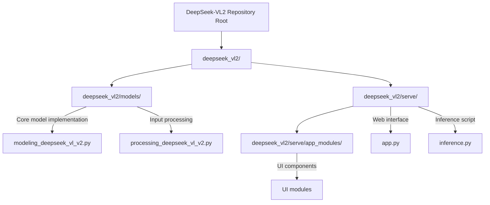
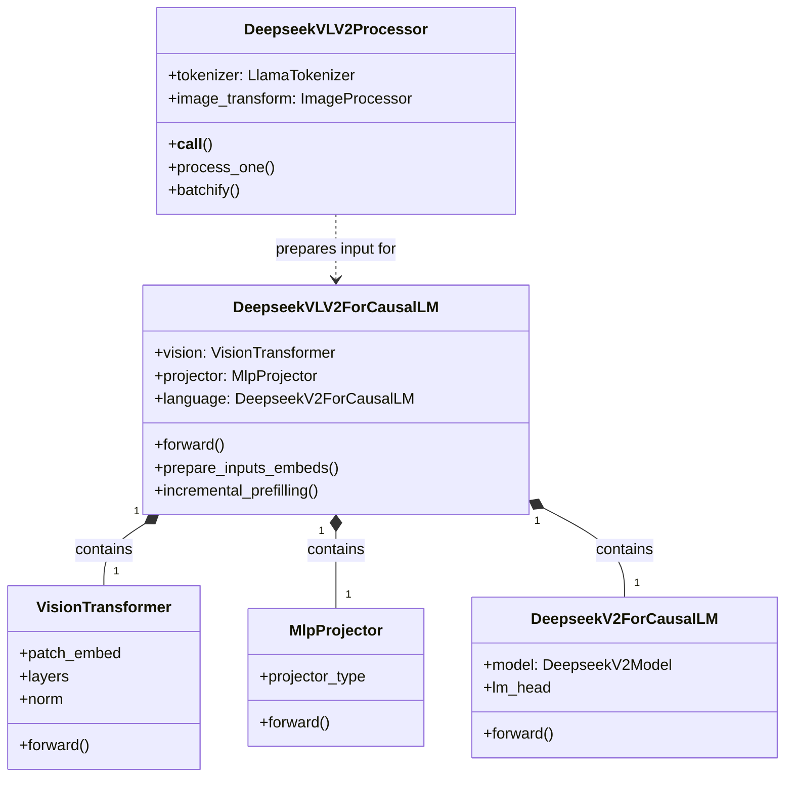
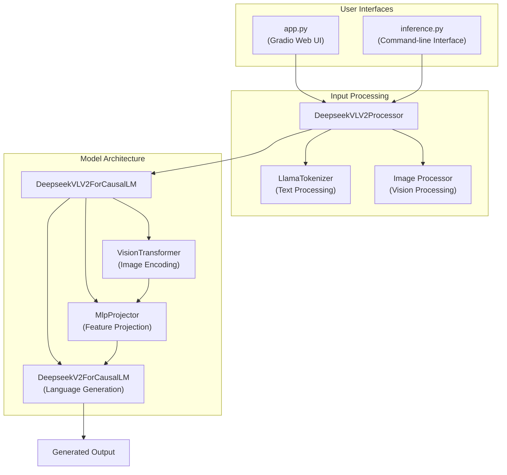
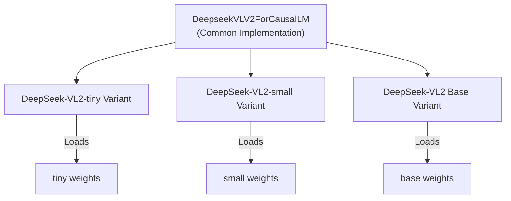
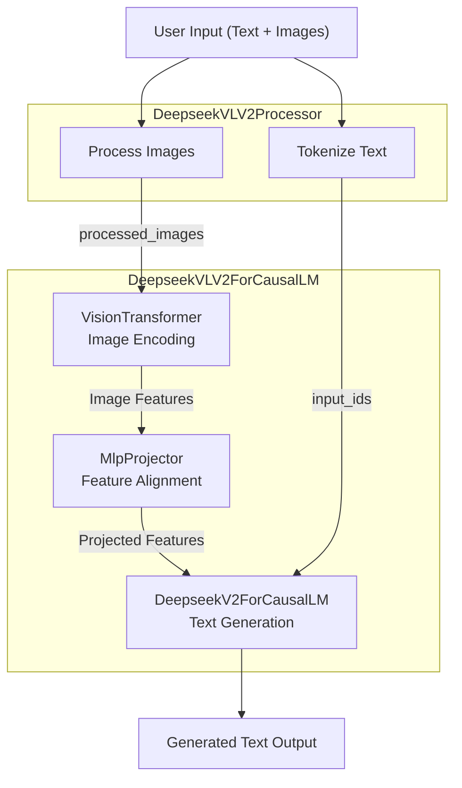
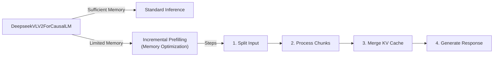
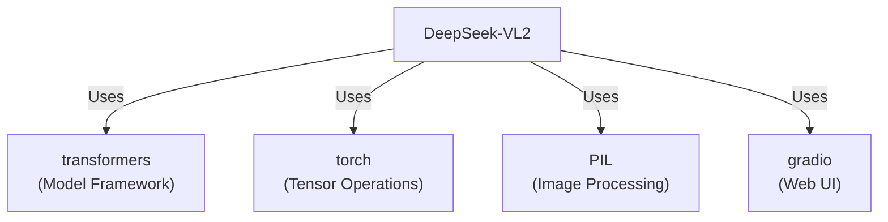

<!-- source: DeepWiki mcp.deepwiki.com · repo deepseek-ai/DeepSeek-VL2 · page 7.1 Project Structure · fetched 2026-10-30 -->

# Project Structure

<details>
<summary>Relevant source files</summary>

The following files were used as context for generating this wiki page:

- [deepseek_vl2/__init__.py](deepseek_vl2/__init__.py)
- [deepseek_vl2/models/__init__.py](deepseek_vl2/models/__init__.py)
- [deepseek_vl2/serve/__init__.py](deepseek_vl2/serve/__init__.py)
- [deepseek_vl2/serve/app_modules/__init__.py](deepseek_vl2/serve/app_modules/__init__.py)

</details>


This document outlines the organization of the DeepSeek-VL2 codebase, providing a technical overview of directory structure, key components, and file relationships. For detailed information about the model architecture itself, see [Model Architecture](#2).

## Repository Overview

The DeepSeek-VL2 repository follows a modular structure with clear separation between model implementation, processing, and serving components.



Sources: [deepseek_vl2/__init__.py](), [deepseek_vl2/models/__init__.py](), [deepseek_vl2/serve/__init__.py](), [deepseek_vl2/serve/app_modules/__init__.py]()

## Key Package Modules

### Core Package (`deepseek_vl2/`)

The root package provides initialization and compatibility utilities:

- `__init__.py`: Contains package initialization with Python version compatibility checks
  - Includes compatibility patches for Python 3.10+ to ensure proper collections module functionality

Sources: [deepseek_vl2/__init__.py:21-31]()

### Model Implementation (`deepseek_vl2/models/`)

Contains the core model implementation files:

- `__init__.py`: Exports the main model classes for easy import by users
- `modeling_deepseek_vl_v2.py`: Defines the `DeepseekVLV2ForCausalLM` class and component classes
- `processing_deepseek_vl_v2.py`: Implements the `DeepseekVLV2Processor` for handling inputs

The models module exports two primary classes:

```python
from .processing_deepseek_vl_v2 import DeepseekVLV2Processor
from .modeling_deepseek_vl_v2 import DeepseekVLV2ForCausalLM

__all__ = [
  "DeepseekVLV2Processor",
  "DeepseekVLV2ForCausalLM",
]
```

Sources: [deepseek_vl2/models/__init__.py:20-26]()

### Serving Infrastructure (`deepseek_vl2/serve/`)

Contains code for serving the model and running the web demo:

- `__init__.py`: Package initialization
- `app.py`: Implementation of the Gradio web interface
- `inference.py`: Script for model inference

#### Web UI Components (`deepseek_vl2/serve/app_modules/`)

Contains modular components for the web interface:

- `__init__.py`: Package initialization
- Various UI modules and components for the Gradio interface

Sources: [deepseek_vl2/serve/__init__.py](), [deepseek_vl2/serve/app_modules/__init__.py]()

## Core Components and Their Relationships

The following diagram shows the relationship between the main classes in the codebase:



Sources: [deepseek_vl2/models/__init__.py:20-26]()

## Code to Functionality Mapping

The following diagram maps the code structure to the functional components of the system:



Sources: Based on system architecture diagrams

## Model Variants Organization

DeepSeek-VL2 supports multiple model variants that share the same code structure but differ in their parameter configurations:

| Model Variant | Total Parameters | Activated Parameters | Memory Requirements |
|---------------|------------------|----------------------|--------------------|
| tiny          | 3.37B            | 1.0B                 | < 40GB GPU         |
| small         | 16.1B            | 2.8B                 | 40GB GPU           |
| base          | 7.5B             | 4.5B                 | 80GB+ GPU          |

All variants use the Mixture-of-Experts approach, where only a portion of the parameters are activated during inference, reducing memory and computational requirements.



Sources: Based on model variants diagram

## Data Flow During Inference

The following diagram illustrates the data flow through the codebase during inference:



Sources: Based on data flow diagram

## Memory Optimization Techniques

For memory-constrained environments, the codebase includes optimization techniques:



Sources: Based on memory optimization techniques diagram

## Dependencies and Integration

DeepSeek-VL2 integrates with several external libraries:



Sources: Based on system architecture analysis

This document provides a comprehensive view of the DeepSeek-VL2 codebase structure. For detailed information about using the model for inference, see [Inference Guide](#4).