# Page: Overview

# Overview

<details>
<summary>Relevant source files</summary>

The following files were used as context for generating this wiki page:

- [README.md](README.md)
- [images/badge.svg](images/badge.svg)

</details>


This document provides a technical introduction to DeepSeek-VL2, an advanced series of large Mixture-of-Experts (MoE) Vision-Language Models. DeepSeek-VL2 is designed to process both visual and textual inputs for tasks including visual question answering, optical character recognition (OCR), document/table/chart understanding, and visual grounding.

For installation instructions, see [Installation and Requirements](#1.1), and for usage examples, see [Quick Start](#1.2).

## System Architecture

DeepSeek-VL2 follows a modular architecture with specialized components for vision processing, feature projection, and language generation.

### High-Level Architecture

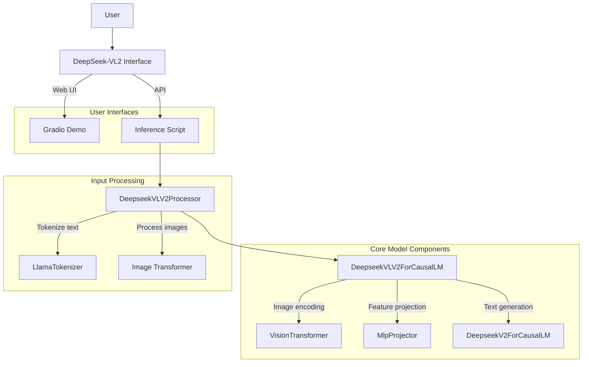

Sources: README.md

### Core Components

The system comprises several key components that work together to process multimodal inputs:

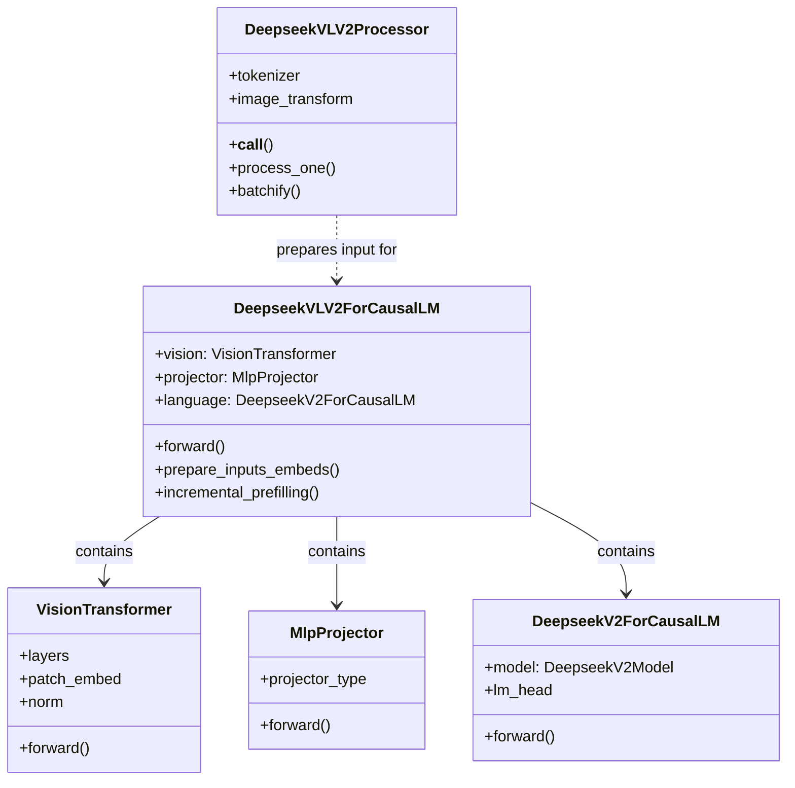

Sources: README.md

1. **DeepseekVLV2Processor**: Handles preprocessing of both text and image inputs.
2. **DeepseekVLV2ForCausalLM**: The main model class that integrates vision and language capabilities.
3. **VisionTransformer**: Processes and encodes images into feature representations.
4. **MlpProjector**: Aligns visual features with the language embedding space.
5. **DeepseekV2ForCausalLM**: Generates text responses based on the combined text and image embeddings.

## Model Variants and Capabilities

DeepSeek-VL2 comes in three variants with different parameter counts and resource requirements:

| Model Variant | Total Parameters | Activated Parameters | Minimum GPU Memory |
|---------------|-----------------|---------------------|-------------------|
| DeepSeek-VL2-Tiny | 3.37B | 1.0B | < 40GB |
| DeepSeek-VL2-Small | 16.1B | 2.8B | 40GB |
| DeepSeek-VL2 | 7.5B | 4.5B | 80GB+ |

All variants utilize Mixture-of-Experts (MoE) technology, which allows them to have a large total parameter count while keeping inference costs manageable by only activating a portion of the parameters during processing.

Sources: README.md:80-90

## Data Flow During Inference

The following diagram illustrates how data flows through the system during inference:

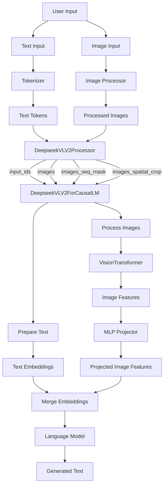

Sources: README.md:107-160

The inference process consists of these key steps:

1. **Input Processing**: The user provides text and image inputs, which are processed by the tokenizer and image processor.
2. **Feature Extraction**: The VisionTransformer extracts features from the images.
3. **Feature Projection**: The MlpProjector aligns visual features with the language embedding space.
4. **Text Generation**: The projected features are merged with text embeddings and fed to the language model to generate the final response.

## Memory Optimization Techniques

For deployment on hardware with limited memory resources, DeepSeek-VL2 implements an incremental prefilling technique to reduce memory requirements:

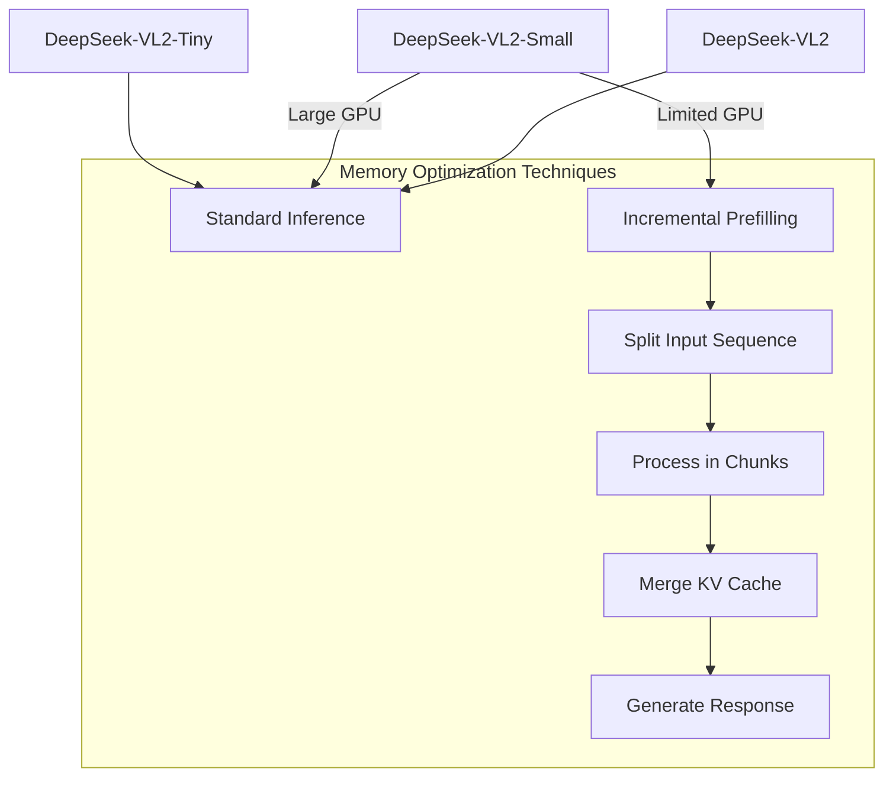

Sources: README.md:249-325

This approach is particularly useful when running DeepSeek-VL2-Small on 40GB GPUs. It works by:

1. Splitting the input sequence into smaller chunks (typically 512 tokens)
2. Processing each chunk sequentially
3. Merging the key-value caches
4. Generating the final response

This allows larger models to run on more constrained hardware, though with some impact on inference speed.

## Supported Features

DeepSeek-VL2 supports various multimodal capabilities:

1. **Single Image Processing**: Basic visual question answering about individual images
2. **Multi-Image Processing**: Handling multiple images in a single prompt
3. **Visual Grounding**: Object localization with bounding box coordinates using `<|ref|>` and `<|/ref|>` tokens
4. **Special Token Support**: Including `<|grounding|>` for grounded captioning functionality

The output for visual grounding includes bounding box coordinates in the format:
```
<|ref|>Object description<|/ref|><|det|>[[x1, y1, x2, y2]]<|/det|>
```

Sources: README.md:123-169

## Integration and Usage

DeepSeek-VL2 can be integrated through two primary interfaces:

1. **Inference Script**: For programmatic access using Python
2. **Gradio Web Demo**: A web-based user interface for interactive use

Basic usage involves:
1. Loading the model and processor
2. Preparing text and image inputs
3. Running the model to generate a response

For more detailed examples, refer to the [Quick Start](#1.2) guide.

Sources: README.md:93-169, README.md:352-382

---

# Page: Installation and Requirements

# Installation and Requirements

<details>
<summary>Relevant source files</summary>

The following files were used as context for generating this wiki page:

- [README.md](README.md)
- [pyproject.toml](pyproject.toml)
- [requirements.txt](requirements.txt)

</details>


This document provides a comprehensive guide for installing DeepSeek-VL2 and setting up the required environment. It covers hardware requirements, software dependencies, and installation processes. For information about using the installed system, see [Quick Start](#1.2).

## Hardware Requirements

DeepSeek-VL2 offers three model variants with different parameter counts and hardware requirements:

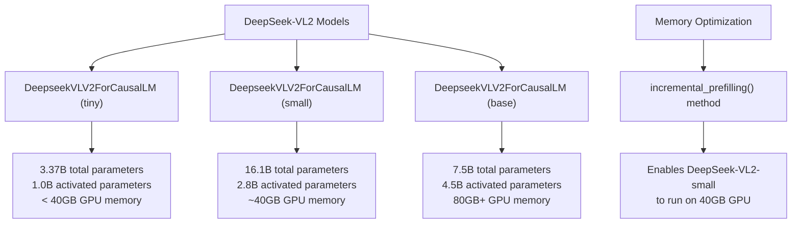

- **DeepseekVLV2ForCausalLM (tiny)**: Smallest variant with 3.37B total parameters (1.0B activated). Can run on GPUs with less than 40GB memory.
- **DeepseekVLV2ForCausalLM (small)**: Medium variant with 16.1B total parameters (2.8B activated). Requires approximately 40GB GPU memory. Can use incremental prefilling to optimize memory usage.
- **DeepseekVLV2ForCausalLM (base)**: Largest variant with 7.5B total parameters (4.5B activated). Requires 80GB+ GPU memory.

Sources: [README.md:61-62](), [README.md:80-90]()

## Software Dependencies

### Python Environment

DeepSeek-VL2 requires Python 3.8 or newer as specified in the project configuration.

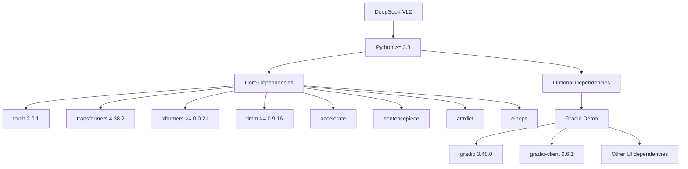

### Core Dependencies

| Requirement | Version | Purpose |
|-------------|---------|---------|
| Python | >= 3.8 | Base language runtime |
| torch | 2.0.1 | Deep learning framework |
| transformers | 4.38.2 | Model loading and inference |
| xformers | >= 0.0.21 | Transformer optimizations |
| timm | >= 0.9.16 | Vision models toolkit |
| accelerate | - | Model acceleration utilities |
| sentencepiece | - | Tokenization library |
| attrdict | - | Attribute dictionaries |
| einops | - | Tensor operations |

### Optional Dependencies for Web Demo

If you plan to use the Gradio web interface, additional dependencies are required:

| Requirement | Version | Purpose |
|-------------|---------|---------|
| gradio | 3.48.0 | Web UI framework |
| gradio-client | 0.6.1 | Client for Gradio |
| mdtex2html | 1.3.0 | Markdown/LaTeX to HTML conversion |
| pypinyin | 0.50.0 | Chinese phonetics processing |
| tiktoken | 0.5.2 | Tokenizer |
| tqdm | 4.64.0 | Progress bars |
| colorama | 0.4.5 | Colored terminal output |
| Pygments | 2.12.0 | Code highlighting |
| markdown | 3.4.1 | Markdown processing |
| SentencePiece | 0.1.96 | Tokenization |

Sources: [requirements.txt:1-9](), [requirements.txt:10-21](), [pyproject.toml:14-23](), [pyproject.toml:26-37]()

## Installation Process

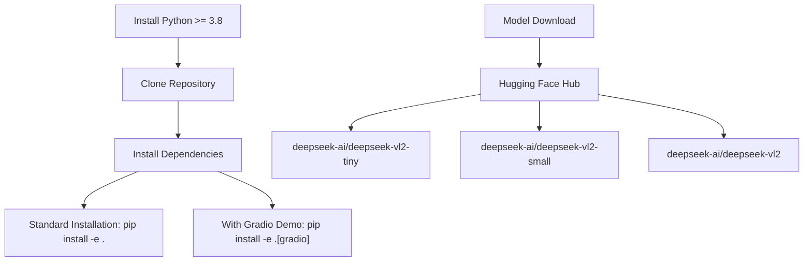

### Standard Installation

1. Ensure you have Python 3.8 or newer installed
2. Clone the DeepSeek-VL2 repository:
   ```bash
   git clone https://github.com/deepseek-ai/DeepSeek-VL2.git
   cd DeepSeek-VL2
   ```
3. Install the package and its dependencies:
   ```bash
   pip install -e .
   ```

### Installation with Gradio Web Demo Support

If you want to use the web-based demo interface, install the package with Gradio support:
```bash
pip install -e .[gradio]
```

Sources: [README.md:95-101](), [README.md:355-357]()

## Model Downloads

DeepSeek-VL2 models are hosted on the Hugging Face Hub and can be loaded directly using the transformers library:

| Model | Download Link | Parameters | Min. GPU Requirements |
|-------|--------------|------------|------------------------|
| DeepSeek-VL2-tiny | [deepseek-ai/deepseek-vl2-tiny](https://huggingface.co/deepseek-ai/deepseek-vl2-tiny) | 3.37B total, 1.0B activated | < 40GB |
| DeepSeek-VL2-small | [deepseek-ai/deepseek-vl2-small](https://huggingface.co/deepseek-ai/deepseek-vl2-small) | 16.1B total, 2.8B activated | 40GB |
| DeepSeek-VL2 | [deepseek-ai/deepseek-vl2](https://huggingface.co/deepseek-ai/deepseek-vl2) | 7.5B total, 4.5B activated | 80GB+ |

Loading a model is done via the Hugging Face transformers library:

```python
from transformers import AutoModelForCausalLM
from deepseek_vl2.models import DeepseekVLV2Processor

model_path = "deepseek-ai/deepseek-vl2-tiny"
processor = DeepseekVLV2Processor.from_pretrained(model_path)
model = AutoModelForCausalLM.from_pretrained(model_path, trust_remote_code=True)
model = model.to(torch.bfloat16).cuda().eval()
```

Sources: [README.md:79-90](), [README.md:107-121]()

## System Components and Data Flow

This diagram illustrates the key components loaded during initialization and their relationships:

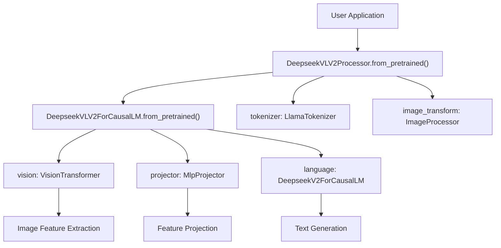

The following diagram shows the data flow during model inference:

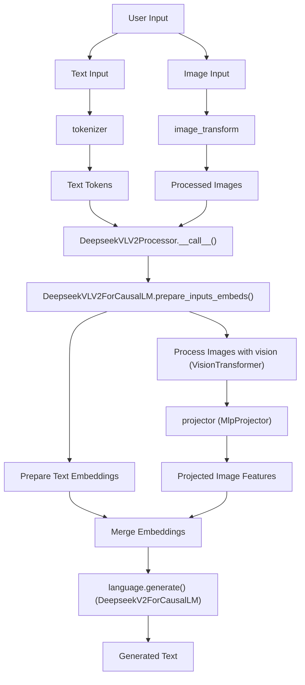

Sources: [README.md:107-161](), [README.md:176-232]()

## Memory Optimization with Incremental Prefilling

For running larger models on limited hardware, DeepSeek-VL2 provides memory optimization through incremental prefilling:

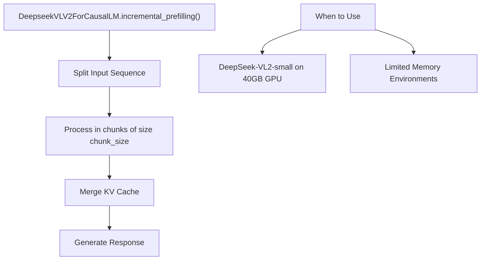

Incremental prefilling processes the input sequence in chunks to reduce memory requirements. This is particularly useful for running DeepSeek-VL2-small on GPUs with 40GB memory.

Example usage with incremental prefilling:

```python
# For DeepSeek-VL2-small on 40GB GPU
inputs_embeds, past_key_values = model.incremental_prefilling(
    input_ids=inputs.input_ids,
    images=inputs.images,
    images_seq_mask=inputs.images_seq_mask,
    images_spatial_crop=inputs.images_spatial_crop,
    attention_mask=inputs.attention_mask,
    chunk_size=512  # Prefilling chunk size
)

# Use the processed inputs for generation
outputs = model.generate(
    inputs_embeds=inputs_embeds,
    past_key_values=past_key_values,
    attention_mask=inputs.attention_mask,
    # ... other generation parameters
)
```

Sources: [README.md:245-336](), [README.md:367-374]()

## Running the Web Demo

After installing the package with Gradio support, you can run the web demo with different model variants:

```bash
# For DeepSeek-VL2-tiny (< 40GB GPU)
CUDA_VISIBLE_DEVICES=0 python web_demo.py --model_name "deepseek-ai/deepseek-vl2-tiny" --port 37914

# For DeepSeek-VL2-small on 40GB GPU (with incremental prefilling)
CUDA_VISIBLE_DEVICES=0 python web_demo.py --model_name "deepseek-ai/deepseek-vl2-small" --port 37914 --chunk_size 512

# For DeepSeek-VL2 (80GB+ GPU)
CUDA_VISIBLE_DEVICES=0 python web_demo.py --model_name "deepseek-ai/deepseek-vl2" --port 37914
```

Sources: [README.md:354-380]()

## Next Steps

After installation, you can proceed to:
- Learn basic usage patterns in the [Quick Start](#1.2) guide
- Explore the [Model Architecture](#2) documentation
- Set up and use the [Web Demo](#5)

---

# Page: Quick Start

# Quick Start

<details>
<summary>Relevant source files</summary>

The following files were used as context for generating this wiki page:

- [README.md](README.md)
- [inference.py](inference.py)

</details>


This guide provides practical examples to help you start using DeepSeek-VL2 quickly. It covers installation, basic inference workflows, and usage patterns. For detailed information about the model architecture, see [Model Architecture](#2).

## Installation

To install DeepSeek-VL2, you need Python 3.8 or higher. Install the package and its dependencies using:

```bash
pip install -e .
```

For the Gradio web demo, install additional dependencies:

```bash
pip install -e .[gradio]
```

Sources: [README.md:96-101](), [README.md:354-357]()

## Basic Usage Flow

The typical DeepSeek-VL2 inference workflow follows this pattern:

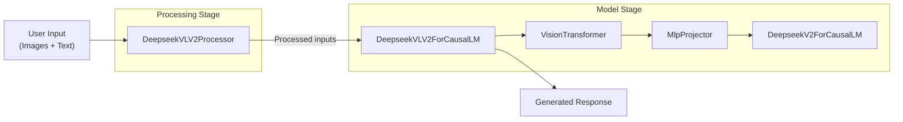

Sources: [README.md:107-122](), [README.md:176-189]()

## Model Variants

DeepSeek-VL2 comes in three variants with different parameter counts and hardware requirements:

| Model | Total Parameters | Activated Parameters | Recommended GPU Memory |
|-------|------------------|----------------------|------------------------|
| DeepSeek-VL2-tiny | 3.37B | 1.0B | < 40GB |
| DeepSeek-VL2-small | 16.1B | 2.8B | 40GB (with optimization) |
| DeepSeek-VL2 | 7.5B | 4.5B | 80GB+ |

Sources: [README.md:80-90](), [README.md:362-379]()

## Single Image Inference

Here's the basic workflow for running inference with a single image:

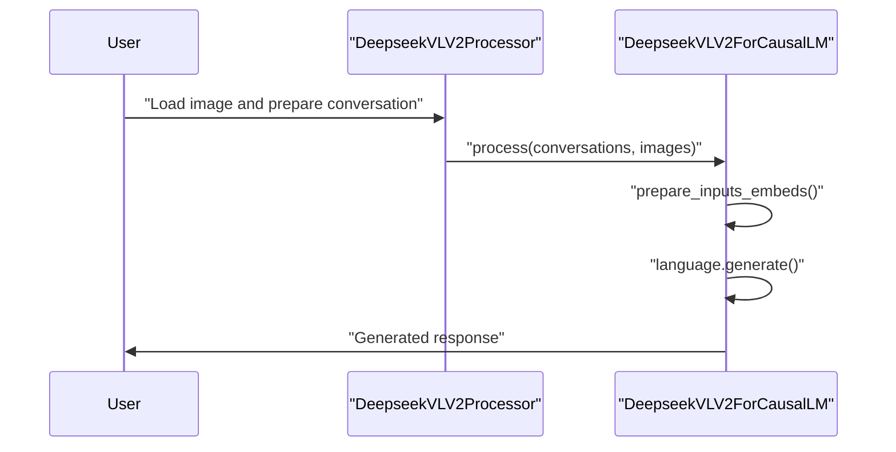

Basic single image inference example:

```python
# Load processor and model
model_path = "deepseek-ai/deepseek-vl2-tiny"
processor = DeepseekVLV2Processor.from_pretrained(model_path)
model = AutoModelForCausalLM.from_pretrained(model_path, trust_remote_code=True)
model = model.to(torch.bfloat16).cuda().eval()

# Prepare conversation with image
conversation = [
    {
        "role": "<|User|>",
        "content": "<image>\nWhat's in this image?",
        "images": ["path/to/image.jpg"],
    },
    {"role": "<|Assistant|>", "content": ""},
]

# Process inputs
pil_images = load_pil_images(conversation)
inputs = processor(conversations=conversation, images=pil_images, force_batchify=True)
inputs = inputs.to(model.device)

# Generate response
inputs_embeds = model.prepare_inputs_embeds(**inputs)
outputs = model.language.generate(
    inputs_embeds=inputs_embeds,
    attention_mask=inputs.attention_mask,
    max_new_tokens=512,
    do_sample=False
)

# Decode the response
answer = processor.tokenizer.decode(outputs[0].cpu().tolist(), skip_special_tokens=False)
print(answer)
```

Sources: [README.md:104-161]()

## Multiple Images Inference

DeepSeek-VL2 supports multiple images in a single conversation:

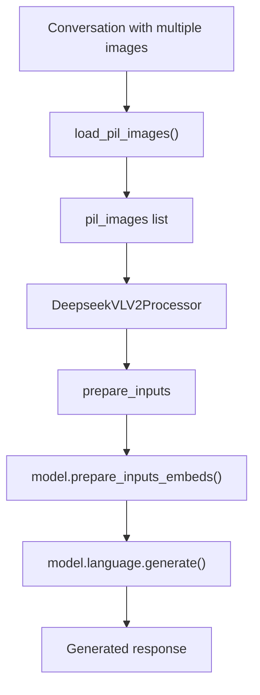

Example with multiple images:

```python
# Prepare conversation with multiple images
conversation = [
    {
        "role": "<|User|>",
        "content": "This is image_1: <image>\n"
                   "This is image_2: <image>\n"
                   "This is image_3: <image>\n Can you tell me what are in the images?",
        "images": [
            "path/to/image1.jpg",
            "path/to/image2.jpg",
            "path/to/image3.jpg",
        ],
    },
    {"role": "<|Assistant|>", "content": ""}
]

# Process and generate using the same steps as single image inference
```

Sources: [README.md:172-243]()

## Memory Optimization with Incremental Prefilling

For models requiring more memory than available (especially DeepSeek-VL2-small on 40GB GPUs), incremental prefilling helps optimize memory usage:


Example with incremental prefilling:

```python
# After preparing inputs
with torch.no_grad():
    # Use incremental prefilling to save memory
    inputs_embeds, past_key_values = model.incremental_prefilling(
        input_ids=inputs.input_ids,
        images=inputs.images,
        images_seq_mask=inputs.images_seq_mask,
        images_spatial_crop=inputs.images_spatial_crop,
        attention_mask=inputs.attention_mask,
        chunk_size=512  # prefilling chunk size
    )
    
    # Generate response with the prefilled state
    outputs = model.generate(
        inputs_embeds=inputs_embeds,
        input_ids=inputs.input_ids,
        images=inputs.images,
        images_seq_mask=inputs.images_seq_mask,
        images_spatial_crop=inputs.images_spatial_crop,
        attention_mask=inputs.attention_mask,
        past_key_values=past_key_values,
        max_new_tokens=512,
        do_sample=False
    )
    
    answer = processor.tokenizer.decode(
        outputs[0][len(inputs.input_ids[0]):].cpu().tolist(), 
        skip_special_tokens=False
    )
```

Sources: [README.md:245-336](), [inference.py:110-147]()

## Command-line Inference

For convenience, you can use the provided `inference.py` script:

```bash
# Standard inference (requires sufficient GPU memory)
CUDA_VISIBLE_DEVICES=0 python inference.py --model_path "deepseek-ai/deepseek-vl2-tiny"

# With incremental prefilling (for memory optimization)
CUDA_VISIBLE_DEVICES=0 python inference.py --model_path "deepseek-ai/deepseek-vl2-small" --chunk_size 512
```

Sources: [README.md:342-349](), [inference.py:157-167]()

## Running the Gradio Web Demo

DeepSeek-VL2 provides a Gradio web interface for easy interaction:

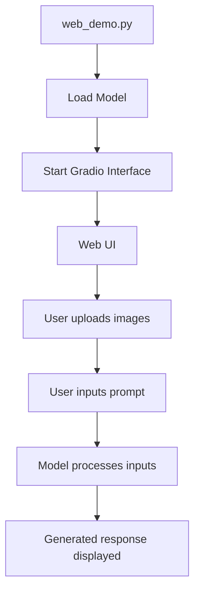

Run the web demo with different model variants:

```bash
# For DeepSeek-VL2-tiny (suitable for GPUs < 40GB)
CUDA_VISIBLE_DEVICES=0 python web_demo.py --model_name "deepseek-ai/deepseek-vl2-tiny" --port 37914

# For DeepSeek-VL2-small with memory optimization on 40GB GPU
CUDA_VISIBLE_DEVICES=0 python web_demo.py --model_name "deepseek-ai/deepseek-vl2-small" --port 37914 --chunk_size 512

# For DeepSeek-VL2 (requires 80GB+ GPU)
CUDA_VISIBLE_DEVICES=0 python web_demo.py --model_name "deepseek-ai/deepseek-vl2" --port 37914
```

**Note**: The basic Gradio demo is for demonstration purposes and isn't optimized for production. For better performance, consider using optimized deployment solutions like vllm, sglang, or lmdeploy.

Sources: [README.md:353-383]()

## Special Tokens and Features

DeepSeek-VL2 supports special features through reserved tokens:

| Special Token | Purpose |
|---------------|---------|
| `<\|ref\|>...<\|/ref\|>` | Visual reference in prompts for object localization |
| `<\|grounding\|>` | Enables grounded captioning with object localization |
| `<\|User\|>` | Marks user messages in conversation format |
| `<\|Assistant\|>` | Marks assistant responses in conversation format |

Sources: [README.md:124-126](), [inference.py:80-83]()

## Next Steps

For more detailed information on:
- Model architecture details, see [Model Architecture](#2)
- Input processing mechanisms, see [Input Processing](#3)
- Advanced inference techniques, see [Inference Guide](#4)
- Memory optimization techniques, see [Memory Optimization Techniques](#4.1)

---

# Page: Model Architecture

# Model Architecture

<details>
<summary>Relevant source files</summary>

The following files were used as context for generating this wiki page:

- [README.md](README.md)
- [deepseek_vl2/models/modeling_deepseek.py](deepseek_vl2/models/modeling_deepseek.py)
- [deepseek_vl2/models/modeling_deepseek_vl_v2.py](deepseek_vl2/models/modeling_deepseek_vl_v2.py)

</details>


This document provides a detailed overview of the DeepSeek-VL2 model architecture, its core components, and how these components work together to process and understand multimodal inputs combining vision and language. For information about input processing, see [Input Processing](#3), and for inference guidance, see [Inference Guide](#4).

## Overview

DeepSeek-VL2 is a multimodal vision-language model that combines vision processing capabilities with a powerful language model using a Mixture-of-Experts (MoE) architecture. The model processes images and text inputs to generate relevant text responses that demonstrate understanding of visual content.

The architecture consists of three primary components:

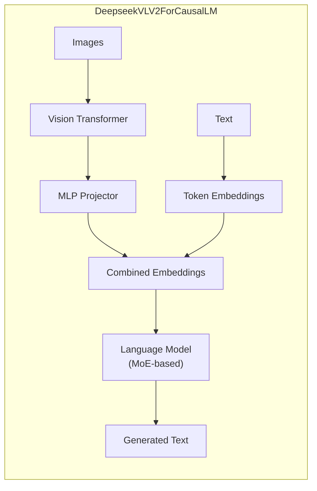

**Architecture Diagram: High-Level Components of DeepSeek-VL2**

Sources: [deepseek_vl2/models/modeling_deepseek_vl_v2.py:278-334](). [README.md:61-62]().

## Core Components

The DeepSeek-VL2 model is implemented through the `DeepseekVLV2ForCausalLM` class, which integrates three main components:

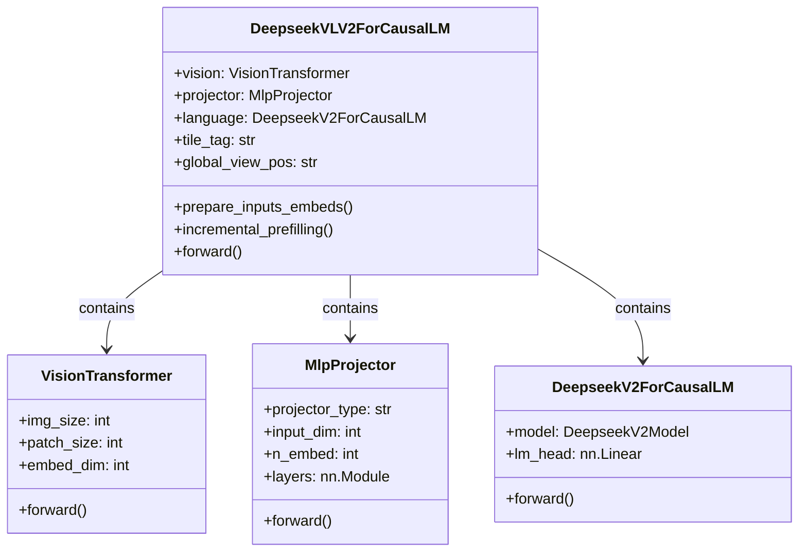

**Component Diagram: Class Relationships in DeepSeek-VL2**

Sources: [deepseek_vl2/models/modeling_deepseek_vl_v2.py:278-334]().

### Vision Transformer Component

The vision component is responsible for processing image inputs and extracting meaningful features. It uses a Vision Transformer architecture implemented as `VisionTransformer`.

Key characteristics:
- Divides images into patches (typically 16×16 pixels)
- Processes these patches through transformer blocks
- Outputs image embeddings representing visual features

Configuration parameters for the Vision Transformer are specified in the `VisionEncoderConfig` class, including:
- `image_size`: Default 384
- `patch_size`: Default 16
- `width`: Embedding dimension (default 1024)
- `layers`: Number of transformer layers
- `heads`: Number of attention heads

Sources: [deepseek_vl2/models/modeling_deepseek_vl_v2.py:115-133](), [deepseek_vl2/models/modeling_deepseek_vl_v2.py:286-301]().

### MLP Projector Component

The MLP Projector bridges the gap between vision and language by projecting visual features into the language embedding space. The projector can be configured in different ways based on the `projector_type` parameter:

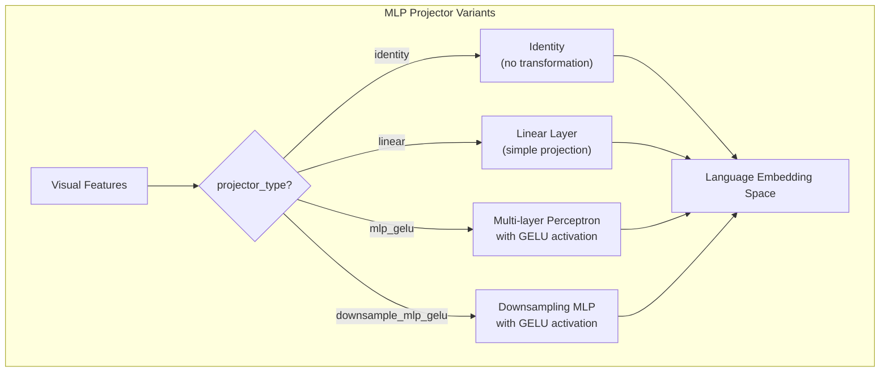

**Diagram: MLP Projector Variants in DeepSeek-VL2**

The projector is configured through the `MlpProjectorConfig` class with parameters:
- `projector_type`: Type of projection (identity, linear, mlp_gelu, downsample_mlp_gelu)
- `input_dim`: Dimension of input features from vision transformer
- `n_embed`: Dimension of output embeddings for language model
- `depth`: Number of layers in MLP variants
- `mlp_ratio`: Expansion ratio for hidden dimensions
- `downsample_ratio`: Ratio for downsampling in downsample_mlp_gelu variant

Sources: [deepseek_vl2/models/modeling_deepseek_vl_v2.py:34-112](), [deepseek_vl2/models/modeling_deepseek_vl_v2.py:166-193]().

### Language Model Component

The language model component is a Mixture-of-Experts (MoE) architecture based on `DeepseekV2ForCausalLM` that processes the combined embeddings from text inputs and projected image features.

Key features:
- Uses a transformer-based decoder architecture
- Implements Mixture-of-Experts (MoE) for efficient scaling
- Includes specialized rotary position embeddings for handling long contexts
- Outputs text completions based on the multimodal inputs

The language component configuration is handled through the `DeepseekV2Config` class, which specifies parameters like:
- `hidden_size`: Dimension of hidden states
- `num_attention_heads`: Number of attention heads
- `num_hidden_layers`: Number of transformer layers
- `n_routed_experts`: Number of available experts in MoE layers
- `num_experts_per_tok`: Number of experts used for each token
- `moe_layer_freq`: Frequency of MoE layers in the model

Sources: [deepseek_vl2/models/modeling_deepseek_vl_v2.py:334](), [deepseek_vl2/models/modeling_deepseek.py:1623-1843]().

## Integration and Data Flow

The integration of vision and language components is achieved through a careful process of embedding and merging:

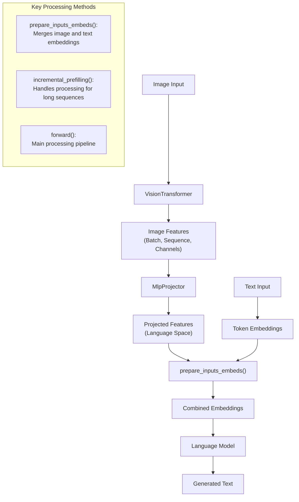

**Data Flow Diagram: Integration of Vision and Language in DeepSeek-VL2**

The `prepare_inputs_embeds` method plays a crucial role in merging the visual and textual information. It:
1. Processes images through the vision transformer
2. Projects the resulting features via the MLP projector
3. Formats the image tokens appropriately using special tokens for structure
4. Merges these with the text token embeddings to create a unified input representation

For images, the model uses a tiling approach with both global and local views:
- Global features represent the entire image
- Local features capture detailed information from specific regions
- Special tokens like `<|view_separator|>` and `<|\n|>` structure the image token sequence

Sources: [deepseek_vl2/models/modeling_deepseek_vl_v2.py:336-477](), [deepseek_vl2/models/modeling_deepseek_vl_v2.py:559-621]().

## Model Variants and Specifications

DeepSeek-VL2 is available in three variants with different parameter counts and performance characteristics:

| Model Variant | Total Parameters | Activated Parameters | Context Length | Typical GPU Requirements |
|---------------|------------------|----------------------|----------------|--------------------------|
| DeepSeek-VL2-tiny | 3.37B | 1.0B | 4096 | < 40GB VRAM |
| DeepSeek-VL2-small | 16.1B | 2.8B | 4096 | 40GB VRAM |
| DeepSeek-VL2 | 7.5B | 4.5B | 4096 | 80GB+ VRAM |

All variants use the same basic architecture but differ in scale. The Mixture-of-Experts approach allows these models to have a large total parameter count while keeping the number of activated parameters manageable, providing efficiency during inference.

Sources: [README.md:80-91](), [README.md:61-62]().

## Memory Optimization

For resource-constrained environments, DeepSeek-VL2 implements memory optimization techniques, particularly for the larger model variants:

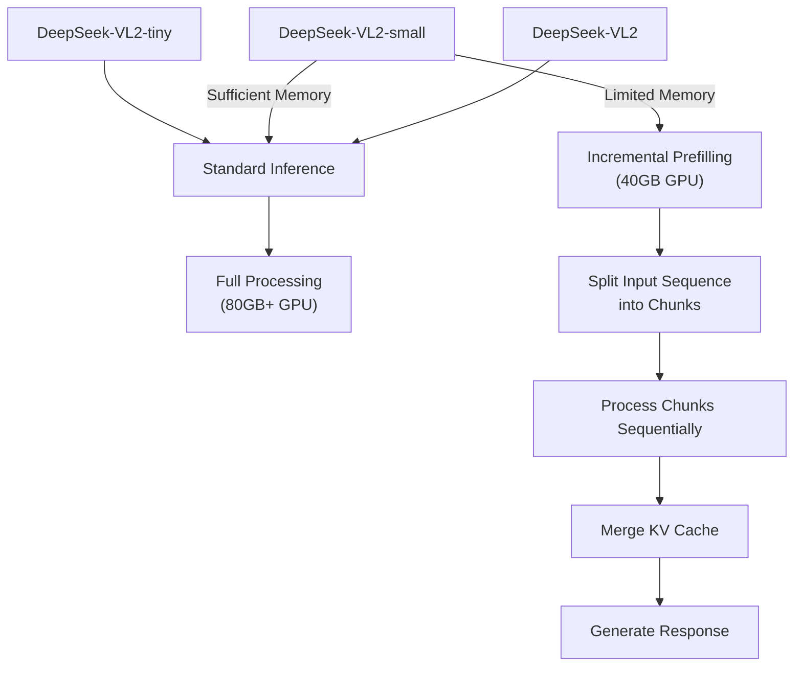

**Memory Optimization Diagram: Techniques for Different Hardware Constraints**

The `incremental_prefilling` method is key to reducing memory requirements:
- Processes the input sequence in chunks
- Accumulates key-value caches incrementally
- Allows running larger models on GPUs with limited memory (e.g., DeepSeek-VL2-small on 40GB GPUs)

This approach trades processing time for memory efficiency, making the larger model variants accessible on more modest hardware.

Sources: [deepseek_vl2/models/modeling_deepseek_vl_v2.py:479-557](), [README.md:247-326]().

## Config Classes and Model Registration

The model uses a hierarchy of configuration classes to define its behavior:

```mermaid
classDiagram
    class DeepseekVLV2Config {
        +vision_config: VisionEncoderConfig
        +projector_config: MlpProjectorConfig
        +language_config: DeepseekV2Config
        +tile_tag: str
        +global_view_pos: str
        +candidate_resolutions: Tuple
    }
    
    class VisionEncoderConfig {
        +model_name: str
        +image_size: int
        +patch_size: int
        +width: int
        +layers: int
        +heads: int
    }
    
    class MlpProjectorConfig {
        +projector_type: str
        +input_dim: int
        +n_embed: int
        +depth: int
        +mlp_ratio: int
        +downsample_ratio: int
    }
    
    class DeepseekV2Config {
        +hidden_size: int
        +num_attention_heads: int
        +num_hidden_layers: int
        +n_routed_experts: int
        +num_experts_per_tok: int
    }
    
    DeepseekVLV2Config --> VisionEncoderConfig : contains
    DeepseekVLV2Config --> MlpProjectorConfig : contains
    DeepseekVLV2Config --> DeepseekV2Config : contains
```

**Config Classes Diagram: Configuration Hierarchy in DeepSeek-VL2**

The model and its configurations are registered with the Hugging Face `AutoConfig` and `AutoModelForCausalLM` systems to enable easy loading with standard interfaces.

Sources: [deepseek_vl2/models/modeling_deepseek_vl_v2.py:235-269](), [deepseek_vl2/models/modeling_deepseek_vl_v2.py:693-697]().

## Summary

DeepSeek-VL2 uses a modular architecture that combines:
1. A Vision Transformer for image processing
2. An MLP Projector for feature alignment
3. A powerful MoE-based language model for text generation

This design allows the model to process and understand multimodal inputs, generating coherent and contextually relevant text responses that reference visual content. The use of Mixture-of-Experts architecture enables efficient scaling with manageable compute requirements, while techniques like incremental prefilling provide flexibility across different hardware configurations.

---

# Page: Vision Transformer Component

# Vision Transformer Component

<details>
<summary>Relevant source files</summary>

The following files were used as context for generating this wiki page:

- [deepseek_vl2/models/modeling_deepseek_vl_v2.py](deepseek_vl2/models/modeling_deepseek_vl_v2.py)
- [deepseek_vl2/models/siglip_vit.py](deepseek_vl2/models/siglip_vit.py)

</details>


This document provides a detailed explanation of the Vision Transformer component used in DeepSeek-VL2. The Vision Transformer is responsible for processing image inputs and transforming them into feature representations that can be integrated with text features in the multimodal model. For information about how these image features are projected into the language embedding space, see [MLP Projector](#2.2).

## Purpose and Role

The Vision Transformer component in DeepSeek-VL2 serves as the visual encoder, transforming raw image inputs into high-dimensional feature representations. These visual features are then processed by the MLP Projector before being combined with text embeddings for multimodal reasoning.

```mermaid
flowchart LR
    subgraph "Image Processing Pipeline"
        direction LR
        A["Raw Images"] --> B["VisionTransformer"]
        B --> C["Image Features"]
        C --> D["MlpProjector"]
        D --> E["Projected Features"]
        E --> F["Integration with Text"]
    end
```

Sources: [deepseek_vl2/models/modeling_deepseek_vl_v2.py:287-301](), [deepseek_vl2/models/modeling_deepseek_vl_v2.py:377-381]()

## Architecture

The Vision Transformer used in DeepSeek-VL2 is based on the SigLIP (Simple and Scalable Visual Language Learning) architecture. It follows the standard Vision Transformer design with some SigLIP-specific modifications.

```mermaid
classDiagram
    class VisionTransformer {
        +patch_embed: PatchEmbed
        +pos_embed: Parameter
        +blocks: Sequential[Block]
        +norm: LayerNorm
        +forward()
        +forward_features()
    }
    
    class PatchEmbed {
        +proj: Conv2d
        +forward()
    }
    
    class Block {
        +norm1: LayerNorm
        +attn: Attention
        +norm2: LayerNorm
        +mlp: Mlp
        +forward()
    }
    
    class Attention {
        +qkv: Linear
        +proj: Linear
        +forward()
    }
    
    VisionTransformer --> PatchEmbed: contains
    VisionTransformer --> "Block[depth]": contains
    Block --> Attention: contains
    Block --> Mlp: contains
```

Sources: [deepseek_vl2/models/siglip_vit.py:241-569]()

### Key Components

1. **Patch Embedding**: Divides the input image into fixed-size patches and linearly projects them into embedding vectors.
2. **Position Embeddings**: Adds learned positional information to the patch embeddings.
3. **Transformer Blocks**: A stack of transformer blocks, each containing:
   - Self-attention layer
   - Feed-forward network (MLP)
   - Layer normalization
   - Residual connections
4. **Final Normalization**: Normalizes the output features before they are passed to the next component.

Sources: [deepseek_vl2/models/siglip_vit.py:341-348](), [deepseek_vl2/models/siglip_vit.py:355](), [deepseek_vl2/models/siglip_vit.py:367-383](), [deepseek_vl2/models/siglip_vit.py:384]()

## Data Flow

The following diagram illustrates how image data flows through the Vision Transformer component in DeepSeek-VL2:

```mermaid
flowchart TD
    A["Input Image"] --> B["PatchEmbed"]
    B --> C["Patch Embeddings"]
    C --> D["Add Position Embeddings"]
    D --> E["Patch Dropout"]
    E --> F["Pre-Normalization"]
    
    F --> G["Transformer Blocks"]
    G --> |"Block 1"| H1["Self-Attention"]
    H1 --> I1["MLP"]
    I1 --> G
    
    G --> |"Block 2"| H2["Self-Attention"]
    H2 --> I2["MLP"]
    I2 --> G
    
    G --> |"..."|G
    
    G --> |"Block N"| HN["Self-Attention"]
    HN --> IN["MLP"]
    IN --> G
    
    G --> J["Final Normalization"]
    J --> K["Image Features"]
```

Sources: [deepseek_vl2/models/siglip_vit.py:524-537](), [deepseek_vl2/models/modeling_deepseek_vl_v2.py:377-381]()

## Integration with DeepSeek-VL2

The Vision Transformer component is integrated into the DeepSeek-VL2 model as part of the `DeepseekVLV2ForCausalLM` class. It processes images before they are combined with text inputs.

```mermaid
flowchart LR
    subgraph "DeepseekVLV2ForCausalLM"
        direction TB
        subgraph "Image Processing"
            A["images"] --> B["VisionTransformer"]
            B --> C["images_feature"]
            C --> D["MlpProjector"]
            D --> E["images_embeds"]
        end
        
        subgraph "Text Processing"
            F["input_ids"] --> G["Language Embeddings"]
        end
        
        E --> H["Merge Embeddings"]
        G --> H
        
        H --> I["DeepseekV2ForCausalLM"]
        I --> J["Generated Output"]
    end
```

Sources: [deepseek_vl2/models/modeling_deepseek_vl_v2.py:376-386](), [deepseek_vl2/models/modeling_deepseek_vl_v2.py:607-621]()

### Image Tile Processing

DeepSeek-VL2 processes images by dividing them into tiles, including a global view of the entire image and local views of smaller regions. This approach helps the model analyze both the overall image and its detailed parts.

```mermaid
flowchart TD
    A["Input Image"] --> B["Extract Tiles"]
    B --> C["Global Tile (Entire Image)"]
    B --> D["Local Tiles (Image Regions)"]
    
    C --> E["Process Global Tile"]
    D --> F["Process Local Tiles"]
    
    E --> G["VisionTransformer"]
    F --> G
    
    G --> H["Format Features"]
    H --> I["Global Features"]
    H --> J["Local Features"]
    
    I --> K["Merge Global and Local"]
    J --> K
    
    K --> L["Final Image Representation"]
```

Sources: [deepseek_vl2/models/modeling_deepseek_vl_v2.py:359-475]()

## Configuration

The Vision Transformer component in DeepSeek-VL2 can be configured through the `VisionEncoderConfig` class, which defines parameters such as image size, patch size, model width, and number of layers.

| Parameter | Description | Default |
|-----------|-------------|---------|
| `model_name` | Name of the SigLIP model variant | "siglip_large_patch16_384" |
| `image_size` | Size of input images | 384 |
| `patch_size` | Size of image patches | 16 |
| `width` | Embedding dimension | 1024 |
| `layers` | Number of transformer layers | 24 |
| `heads` | Number of attention heads | 16 |
| `mlp_ratio` | Ratio of MLP hidden dim to embedding dim | 4 |
| `global_pool` | Type of global pooling | "map" |
| `class_token` | Whether to use class token | False |
| `use_checkpoint` | Whether to use gradient checkpointing | False |

Sources: [deepseek_vl2/models/modeling_deepseek_vl_v2.py:115-163](), [deepseek_vl2/models/siglip_vit.py:586-619]()

## Model Variants

DeepSeek-VL2 supports multiple SigLIP Vision Transformer variants with different parameter counts and image sizes:

| Model Name | Image Size | Patch Size | Width | Layers | Heads |
|------------|------------|------------|-------|--------|-------|
| siglip_so400m_patch14_384 | 384 | 14 | 1152 | 27 | 16 |
| siglip_so400m_patch14_224 | 224 | 14 | 1152 | 27 | 16 |
| siglip_large_patch16_384 | 384 | 16 | 1024 | 24 | 16 |

Sources: [deepseek_vl2/models/siglip_vit.py:586-619]()

## Performance Optimizations

The Vision Transformer includes several optimizations for efficient training and inference:

1. **Flash Attention**: Uses efficient attention implementations when available.
2. **Gradient Checkpointing**: Optionally trades computation for memory by not storing intermediate activations.
3. **Layer Recomputation**: Allows specifying the number of layers to recompute during backpropagation.

```mermaid
flowchart LR
    subgraph "Attention Implementations"
        A["Standard Attention"] -->|"If head_dim not multiple of 32"| C["Memory Efficient Attention<br>(xformers)"]
        B["Flash Attention 2"] -->|"If head_dim multiple of 32"| C
    end
    
    subgraph "Memory Optimizations"
        D["Gradient Checkpointing"] --> F["Reduced Memory Usage"]
        E["Layer Recomputation"] --> F
    end
```

Sources: [deepseek_vl2/models/siglip_vit.py:135-175](), [deepseek_vl2/models/siglip_vit.py:530-533]()

## Usage in Inference

During inference, the Vision Transformer processes the input images to extract features, which are then projected and combined with text embeddings before being passed to the language model:

```mermaid
sequenceDiagram
    participant User
    participant Processor as "DeepseekVLV2Processor"
    participant VT as "VisionTransformer"
    participant Projector as "MlpProjector"
    participant LM as "DeepseekV2ForCausalLM"
    
    User->>Processor: Input (Images + Text)
    Processor->>VT: Process Images
    VT->>VT: Extract Patches
    VT->>VT: Apply Positional Embeddings
    VT->>VT: Process Through Transformer Blocks
    VT->>Projector: Image Features
    Projector->>LM: Projected Features
    Processor->>LM: Text Tokens
    LM->>User: Generated Response
```

Sources: [deepseek_vl2/models/modeling_deepseek_vl_v2.py:596-621]()

## Conclusion

The Vision Transformer component is a critical part of the DeepSeek-VL2 architecture, responsible for transforming raw image inputs into high-dimensional feature representations that can be combined with text features. It employs the SigLIP Vision Transformer architecture with various optimizations for efficient inference and supports multiple model variants to balance performance and resource requirements.

---

# Page: MLP Projector

# MLP Projector

<details>
<summary>Relevant source files</summary>

The following files were used as context for generating this wiki page:

- [deepseek_vl2/models/modeling_deepseek_vl_v2.py](deepseek_vl2/models/modeling_deepseek_vl_v2.py)

</details>


The MLP Projector is a critical component in the DeepSeek-VL2 architecture that bridges the gap between visual and linguistic representations. It transforms image features extracted by the Vision Transformer into a format compatible with the language model's embedding space, enabling the model to reason about visual content using its language capabilities.

This page details the MLP Projector's architecture, implementation variants, and its role in the overall multimodal processing pipeline. For information about the Vision Transformer that provides input to the MLP Projector, see [Vision Transformer Component](#2.1), and for details about the Language Model that receives its output, see [Language Model Component](#2.3).

## 1. MLP Projector in the DeepSeek-VL2 Architecture

The MLP Projector serves as a crucial bridge between the vision and language components of DeepSeek-VL2. It converts the high-dimensional representation of images into tokens that the language model can process alongside text tokens.

```mermaid
flowchart LR
    subgraph "Vision Processing"
        VIT["VisionTransformer
        (Extract Image Features)"]
    end
    
    subgraph "Feature Projection"
        MLP["MlpProjector
        (Align Feature Spaces)"]
    end
    
    subgraph "Language Processing"
        LLM["DeepseekV2ForCausalLM
        (Generate Text)"]
    end
    
    Images --> VIT
    VIT -- "Image Features
    [b, hw, input_dim]" --> MLP
    MLP -- "Projected Features
    [b, hw, n_embed]" --> LLM
    Text --> LLM
    
    LLM --> Output["Generated Response"]
```

**MLP Projector Data Flow Diagram**

Sources: [deepseek_vl2/models/modeling_deepseek_vl_v2.py:34-112](), [deepseek_vl2/models/modeling_deepseek_vl_v2.py:166-193](), [deepseek_vl2/models/modeling_deepseek_vl_v2.py:381]()

## 2. Implementation Details

The MLP Projector is implemented as the `MlpProjector` class and configured through the `MlpProjectorConfig` class. It supports multiple projection strategies with varying complexity and performance characteristics.

### 2.1 Projector Types

The MLP Projector supports four different types of projection methods:

```mermaid
classDiagram
    class MlpProjector {
        +layers: nn.Module
        +cfg: MlpProjectorConfig
        +forward(x): Tensor
    }
    
    class MlpProjectorConfig {
        +projector_type: str
        +input_dim: int
        +n_embed: int
        +depth: int
        +mlp_ratio: int
        +downsample_ratio: int
        +token_pooling: bool
    }
    
    MlpProjector --> MlpProjectorConfig: uses
    
    class IdentityProjector {
        +forward(x): x
    }
    
    class LinearProjector {
        +forward(x): Linear(x)
    }
    
    class MlpGeluProjector {
        +layers: Sequential
        +forward(x): layers(x)
    }
    
    class DownsampleMlpGeluProjector {
        +layers: Sequential
        +downsample_ratio: int
        +forward(x): process and project
    }
    
    MlpProjector --> IdentityProjector: configures as
    MlpProjector --> LinearProjector: configures as
    MlpProjector --> MlpGeluProjector: configures as
    MlpProjector --> DownsampleMlpGeluProjector: configures as
```

**MLP Projector Types Diagram**

Sources: [deepseek_vl2/models/modeling_deepseek_vl_v2.py:34-74](), [deepseek_vl2/models/modeling_deepseek_vl_v2.py:166-193]()

| Projector Type | Description | Implementation |
| --- | --- | --- |
| `identity` | Passes through visual features without modification | `nn.Identity()` |
| `linear` | Simple linear projection from input dimension to embedding dimension | `nn.Linear(cfg.input_dim, cfg.n_embed)` |
| `mlp_gelu` | Multi-layer perceptron with GELU activations | Sequential layers of Linear and GELU activations |
| `downsample_mlp_gelu` | MLP with downsampling to reduce spatial dimensions | Downsampling followed by MLP with GELU activations |

Sources: [deepseek_vl2/models/modeling_deepseek_vl_v2.py:42-65]()

### 2.2 Token Pooling

For specific configurations, the MLP Projector can use token pooling to reduce the number of tokens by combining adjacent patches:

```mermaid
flowchart TD
    input["Input Features
    [batch_size, wxh, channels]"] --> reshape["Reshape to
    [batch_size, w, h, channels]"]
    reshape --> permute["Permute to
    [batch_size, channels, w, h]"]
    permute --> unfold["Unfold into 2x2 patches"]
    unfold --> reshape2["Reshape to
    [batch_size, h_patches * w_patches, channels * 4]"]
    reshape2 --> linear["Apply Linear Layer
    [channels * 4 → channels]"]
    linear --> output["Output Features
    [batch_size, h_patches * w_patches, channels]"]
```

**Token Pooling Process Diagram**

Sources: [deepseek_vl2/models/modeling_deepseek_vl_v2.py:76-91]()

### 2.3 Downsampling in MLP-GELU

The `downsample_mlp_gelu` projector type includes a downsampling operation that reduces spatial dimensions before applying the MLP:

```mermaid
flowchart TD
    input["Input Features
    [bs, hw, input_dim]"] --> reshape["Reshape to
    [bs, h, w, input_dim]"]
    reshape --> padding["Add padding if needed"]
    padding --> permute["Permute to
    [bs, input_dim, h, w]"]
    permute --> unfold["F.unfold with kernel_size=downsample_ratio"]
    unfold --> reshape2["Reshape to
    [bs, HW/downsample_ratio^2, input_dim*downsample_ratio^2]"]
    reshape2 --> mlp["Apply MLP layers"]
    mlp --> output["Output Features
    [bs, HW/downsample_ratio^2, n_embed]"]
```

**Downsample MLP-GELU Process Diagram**

Sources: [deepseek_vl2/models/modeling_deepseek_vl_v2.py:93-111]()

## 3. Configuration Parameters

The `MlpProjectorConfig` class defines the following key parameters:

| Parameter | Description | Default Value |
| --- | --- | --- |
| `projector_type` | Type of projector architecture | `"downsample_mlp_gelu"` |
| `input_dim` | Dimension of input features from Vision Transformer | `1152` |
| `n_embed` | Dimension of output embeddings for Language Model | `2048` |
| `depth` | Number of layers in MLP projector | `2` |
| `mlp_ratio` | Ratio for hidden dimension in MLP | `1` |
| `downsample_ratio` | Spatial downsampling factor | `2` |
| `token_pooling` | Whether to use token pooling | `False` |

Sources: [deepseek_vl2/models/modeling_deepseek_vl_v2.py:166-193]()

## 4. Integration with DeepSeek-VL2

The MLP Projector is instantiated by the main `DeepseekVLV2ForCausalLM` class and used during the preparation of input embeddings:

```mermaid
sequenceDiagram
    participant Model as DeepseekVLV2ForCausalLM
    participant VisionTrans as VisionTransformer
    participant MlpProj as MlpProjector
    participant LangModel as DeepseekV2ForCausalLM
    
    Model->>Model: prepare_inputs_embeds()
    Model->>Model: Process input images
    Model->>VisionTrans: Extract image features
    VisionTrans-->>Model: Return image_feature
    Model->>MlpProj: Project image features
    MlpProj-->>Model: Return projected_features
    Model->>Model: Format and incorporate image tokens
    Model->>LangModel: Forward with combined embeddings
    LangModel-->>Model: Return language model outputs
```

**MLP Projector Integration Sequence Diagram**

Sources: [deepseek_vl2/models/modeling_deepseek_vl_v2.py:304-305](), [deepseek_vl2/models/modeling_deepseek_vl_v2.py:378-382](), [deepseek_vl2/models/modeling_deepseek_vl_v2.py:596-601]()

### 4.1 Forward Pass

During the forward pass, image features extracted by the Vision Transformer are processed by the MLP Projector before being integrated with text embeddings:

1. Image features are extracted by the Vision Transformer as `[batch_all_tiles, vit_seq_len, channels]`
2. The MLP Projector transforms these to `[batch_all_tiles, hw, n_embed]`
3. The projected features are then formatted and inserted into the text embedding sequence at positions specified by `images_seq_mask`

Sources: [deepseek_vl2/models/modeling_deepseek_vl_v2.py:75-112](), [deepseek_vl2/models/modeling_deepseek_vl_v2.py:378-382]()

## 5. Common Configurations

The default configuration uses `downsample_mlp_gelu` with a `depth` of 2, which provides a good balance between computational efficiency and projection quality. This configuration is used in the main DeepSeek-VL2 model variants.

For simpler deployments or when computational resources are limited, the `linear` projector type can be used, though it may result in reduced performance in complex visual reasoning tasks.

Sources: [deepseek_vl2/models/modeling_deepseek_vl_v2.py:168](), [deepseek_vl2/models/modeling_deepseek_vl_v2.py:178-184]()

---

# Page: Language Model Component

# Language Model Component

<details>
<summary>Relevant source files</summary>

The following files were used as context for generating this wiki page:

- [deepseek_vl2/models/configuration_deepseek.py](deepseek_vl2/models/configuration_deepseek.py)
- [deepseek_vl2/models/modeling_deepseek.py](deepseek_vl2/models/modeling_deepseek.py)

</details>


This document provides a technical overview of the Language Model component in DeepSeek-VL2, which is responsible for text generation based on multimodal inputs. This component is one of the three main architectural pieces of the system, alongside the [Vision Transformer Component](#2.1) and the [MLP Projector](#2.2).

## 1. Overview and Architecture

The Language Model in DeepSeek-VL2 is based on the DeepseekV2 architecture, a decoder-only transformer model that utilizes a Mixture-of-Experts (MoE) approach to efficiently scale parameters while maintaining reasonable computational requirements during inference.

```mermaid
flowchart TD
    subgraph "DeepSeekVL2ForCausalLM"
        VT["VisionTransformer"] --> MP["MlpProjector"]
        MP --> LM["DeepseekV2ForCausalLM"]
    end

    subgraph "Language Model Component"
        LM --> |Contains| DM["DeepseekV2Model"]
        DM --> |Contains| DL["DeepseekV2DecoderLayer (×N)"]
        DL --> |Contains| AT["Attention Block"]
        DL --> |Contains| FF["Feed-Forward Block"]
        FF --> |Either| FM["DeepseekV2MLP (Dense)"]
        FF --> |Or| ME["DeepseekV2MoE (Experts)"]
        ME --> |Contains| MG["MoEGate"]
        ME --> |Contains| EX["Experts Network"]
    end

    class LM,DM,DL,AT,FF,FM,ME,MG,EX highlight
```

*The Language Model components within the overall DeepSeek-VL2 architecture. The language component takes projected image features from the MLP Projector and uses them alongside text embeddings to generate text responses.*

Sources: [deepseek_vl2/models/modeling_deepseek.py:1623-1651](https://github.com/deepseek-ai/DeepSeek-VL2/blob/main/deepseek_vl2/models/modeling_deepseek.py#L1623-L1651)

## 2. Core Components

### 2.1 DeepseekV2ForCausalLM

The top-level language model class that handles the generation of text given input embeddings. This class:

- Wraps the `DeepseekV2Model` backbone
- Contains the language modeling head for token prediction
- Manages the generation process, including handling past key/value caches for efficient autoregressive generation

```python
class DeepseekV2ForCausalLM(DeepseekV2PreTrainedModel):
    def __init__(self, config):
        super().__init__(config)
        self.model = DeepseekV2Model(config)
        self.vocab_size = config.vocab_size
        self.lm_head = nn.Linear(config.hidden_size, config.vocab_size, bias=False)
```

Sources: [deepseek_vl2/models/modeling_deepseek.py:1623-1651](https://github.com/deepseek-ai/DeepSeek-VL2/blob/main/deepseek_vl2/models/modeling_deepseek.py#L1623-L1651)

### 2.2 DeepseekV2Model

The transformer backbone that processes input embeddings. This class:

- Contains the token embedding layer
- Manages a stack of transformer decoder layers
- Applies final layer normalization

```python
class DeepseekV2Model(DeepseekV2PreTrainedModel):
    def __init__(self, config: DeepseekV2Config):
        super().__init__(config)
        self.padding_idx = config.pad_token_id
        self.vocab_size = config.vocab_size
        self.embed_tokens = nn.Embedding(config.vocab_size, config.hidden_size, self.padding_idx)
        self.layers = nn.ModuleList([
            DeepseekV2DecoderLayer(config, layer_idx)
            for layer_idx in range(config.num_hidden_layers)
        ])
        self.norm = DeepseekV2RMSNorm(config.hidden_size, eps=config.rms_norm_eps)
```

Sources: [deepseek_vl2/models/modeling_deepseek.py:1436-1464](https://github.com/deepseek-ai/DeepSeek-VL2/blob/main/deepseek_vl2/models/modeling_deepseek.py#L1436-L1464)

### 2.3 DeepseekV2DecoderLayer

Each decoder layer combines a self-attention mechanism with a feed-forward network:

```python
class DeepseekV2DecoderLayer(nn.Module):
    def __init__(self, config: DeepseekV2Config, layer_idx: int):
        super().__init__()
        self.self_attn = ATTENTION_CLASSES[attn_implementation](config=config, layer_idx=layer_idx)
        self.mlp = (
            DeepseekV2MoE(config)
            if (config.n_routed_experts is not None and 
                layer_idx >= config.first_k_dense_replace and 
                layer_idx % config.moe_layer_freq == 0)
            else DeepseekV2MLP(config)
        )
        self.input_layernorm = DeepseekV2RMSNorm(config.hidden_size, eps=config.rms_norm_eps)
        self.post_attention_layernorm = DeepseekV2RMSNorm(config.hidden_size, eps=config.rms_norm_eps)
```

The decoder layer alternates between:
- Layer normalization + self-attention + residual connection
- Layer normalization + feed-forward network + residual connection

The feed-forward network can be either a standard MLP or a Mixture-of-Experts module, determined by layer position and configuration.

Sources: [deepseek_vl2/models/modeling_deepseek.py:1227-1256](https://github.com/deepseek-ai/DeepSeek-VL2/blob/main/deepseek_vl2/models/modeling_deepseek.py#L1227-L1256)

## 3. Multi-Latent Attention

DeepSeek-VL2 uses Multi-Latent Attention (MLA), an optimized attention mechanism that reduces computational costs while maintaining model performance.

```mermaid
flowchart LR
    subgraph "Multi-Latent Attention"
        direction TB
        I["Input Hidden States"] --> LN["LayerNorm"]
        LN --> Q["Q Projection"]
        LN --> KV["KV Projection"]
        
        Q --> |"Split"| QR["Q with RoPE<br>Head Dim: qk_rope_head_dim"]
        Q --> |"Split"| QN["Q without RoPE<br>Head Dim: qk_nope_head_dim"]
        
        KV --> |"Split"| KR["K with RoPE<br>Head Dim: qk_rope_head_dim"]
        KV --> |"Split"| KVLORA["KV LoRA Features<br>Dim: kv_lora_rank"]
        
        KVLORA --> KVB["KV Projection B"]
        KVB --> |"Split"| KN["K without RoPE"]
        KVB --> |"Split"| VN["Value States"]
        
        QR --> |"Apply RoPE"| QRP["Q with Position"]
        KR --> |"Apply RoPE"| KRP["K with Position"]
        
        QRP & KRP --> |"Attention"| A1["Rotary Attention Scores"]
        QN & KN & KVLORA --> |"Attention"| A2["Linear Attention Scores"]
        
        A1 & A2 --> |"Sum"| AS["Combined Attention Scores"]
        AS & VN --> |"Matrix Multiply"| O["Output"]
    end
```

*Multi-Latent Attention mechanism splits queries and keys into portions with and without rotary position embeddings, applying different attention patterns to each.*

Key features:
- Uses a LoRA-like projection mechanism for key and value states
- Splits query and key into portions with and without Rotary Position Embeddings (RoPE)
- Combines different attention patterns for enhanced efficiency
- Supports Flash Attention 2 for faster computation on supported hardware

Sources: [deepseek_vl2/models/modeling_deepseek.py:714-934](https://github.com/deepseek-ai/DeepSeek-VL2/blob/main/deepseek_vl2/models/modeling_deepseek.py#L714-L934), [deepseek_vl2/models/modeling_deepseek.py:938-1166](https://github.com/deepseek-ai/DeepSeek-VL2/blob/main/deepseek_vl2/models/modeling_deepseek.py#L938-L1166)

## 4. Mixture of Experts Architecture

A key feature of the Language Model in DeepSeek-VL2 is its use of Mixture of Experts (MoE), which allows the model to have a much larger total parameter count while only activating a fraction of parameters during inference.

```mermaid
flowchart TB
    subgraph "DeepseekV2MoE Layer"
        direction LR
        I["Input Hidden States"] --> G["MoEGate"]
        G --> |"topk_idx,<br>topk_weight"| R["Router"]
        
        subgraph "Experts Network"
            E1["Expert 1"]
            E2["Expert 2"]
            E3["Expert 3"]
            E4["Expert 4"]
            E5["..."]
            EN["Expert N"]
        end
        
        R --> |"Route token<br>to top-k experts"| Experts["Experts Network"]
        Experts --> |"Weighted<br>outputs"| C["Combine Outputs"]
        C --> O["Output"]
        
        subgraph "Shared Experts (Optional)"
            SE["Shared MLP"]
        end
        
        I --> SE
        SE --> |"Add"| O
    end
```

*The Mixture of Experts architecture routes each token to a subset of experts, combining their outputs with learned weights.*

### 4.1 MoE Components

| Component | Description | Key Parameters |
|-----------|-------------|----------------|
| **DeepseekV2MoE** | Main MoE class that manages experts and routing | `n_routed_experts`, `num_experts_per_tok` |
| **MoEGate** | Determines routing of tokens to experts | `scoring_func`, `topk_method` |
| **Experts** | Individual DeepseekV2MLP modules | `moe_intermediate_size` |
| **Shared Experts** | Optional dense path alongside sparse experts | `n_shared_experts` |

Sources: [deepseek_vl2/models/modeling_deepseek.py:552-593](https://github.com/deepseek-ai/DeepSeek-VL2/blob/main/deepseek_vl2/models/modeling_deepseek.py#L552-L593)

### 4.2 Expert Routing

The MoEGate component handles the routing of tokens to experts:

1. Computes a routing score for each token against each expert
2. Selects the top-k experts for each token based on these scores
3. Routes the token to the selected experts with appropriate weights
4. Combines the outputs from selected experts

Multiple selection strategies are supported:
- `greedy`: Simply selects the top-k experts with highest scores
- `group_limited_greedy`: Organizes experts into groups and selects from a limited number of groups
- `noaux_tc`: A specialized strategy for inference that balances expert utilization

Sources: [deepseek_vl2/models/modeling_deepseek.py:394-528](https://github.com/deepseek-ai/DeepSeek-VL2/blob/main/deepseek_vl2/models/modeling_deepseek.py#L394-L528)

## 5. Data Flow During Forward Pass

```mermaid
sequenceDiagram
    participant Input as "Input Embeddings"
    participant Model as "DeepseekV2Model"
    participant Layer as "DeepseekV2DecoderLayer"
    participant Attn as "Multi-Latent Attention"
    participant FF as "Feed-Forward (MLP/MoE)"
    participant LMHead as "Language Modeling Head"
    participant Output as "Output Logits"
    
    Input->>Model: token embeddings
    Model->>Layer: hidden states
    
    loop For each layer
        Layer->>Layer: input_layernorm
        Layer->>Attn: normalized hidden states
        Attn->>Layer: attention output
        Layer->>Layer: residual connection
        
        Layer->>Layer: post_attention_layernorm
        Layer->>FF: normalized hidden states
        
        alt MoE Layer
            FF->>FF: compute gate scores
            FF->>FF: select top-k experts
            FF->>FF: route to selected experts
            FF->>FF: combine expert outputs
        else Standard MLP Layer
            FF->>FF: standard MLP forward
        end
        
        FF->>Layer: feed-forward output
        Layer->>Layer: residual connection
        Layer->>Model: layer output
    end
    
    Model->>Model: final layer norm
    Model->>LMHead: final hidden states
    LMHead->>Output: logits over vocabulary
```

*The forward pass through the Language Model, showing the flow of data through the decoder layers, attention mechanism, and feed-forward networks.*

Sources: [deepseek_vl2/models/modeling_deepseek.py:1472-1620](https://github.com/deepseek-ai/DeepSeek-VL2/blob/main/deepseek_vl2/models/modeling_deepseek.py#L1472-L1620), [deepseek_vl2/models/modeling_deepseek.py:1657-1750](https://github.com/deepseek-ai/DeepSeek-VL2/blob/main/deepseek_vl2/models/modeling_deepseek.py#L1657-L1750)

## 6. Model Variants and Configuration

DeepSeek-VL2 offers multiple variants of the language model with different parameter counts:

| Variant | Total Parameters | Activated Parameters | Description |
|---------|------------------|----------------------|-------------|
| **DeepSeek-VL2-tiny** | 3.37B | 1.0B | Smallest variant, suitable for limited hardware |
| **DeepSeek-VL2-small** | 16.1B | 2.8B | Mid-sized variant balancing performance and efficiency |
| **DeepSeek-VL2** | 7.5B | 4.5B | Largest variant with highest performance |

### 6.1 Key Configuration Parameters

The behavior of the Language Model can be controlled through various configuration parameters:

| Parameter | Description |
|-----------|-------------|
| `n_routed_experts` | Number of experts in MoE layers |
| `num_experts_per_tok` | Number of experts selected for each token |
| `moe_layer_freq` | Frequency of MoE layers (1 = all layers are MoE) |
| `first_k_dense_replace` | Number of initial layers that remain dense |
| `hidden_size` | Dimension of hidden representations |
| `num_hidden_layers` | Total number of transformer layers |
| `num_attention_heads` | Number of attention heads |
| `use_mla` | Whether to use Multi-Latent Attention (true) or standard Multi-Head Attention (false) |
| `rope_scaling` | Configuration for extending context length |

Sources: [deepseek_vl2/models/configuration_deepseek.py:7-211](https://github.com/deepseek-ai/DeepSeek-VL2/blob/main/deepseek_vl2/models/configuration_deepseek.py#L7-L211)

## 7. Position Embeddings and Long Context Support

DeepSeek-VL2 uses Rotary Position Embeddings (RoPE) and supports various scaling strategies to extend context windows beyond training length:

| Scaling Method | Description | Configuration |
|----------------|-------------|---------------|
| Linear Scaling | Simple linear interpolation of position indices | `rope_scaling={"type": "linear", "factor": factor}` |
| Dynamic NTK Scaling | Non-linear scaling adapting to position dynamics | `rope_scaling={"type": "dynamic", "factor": factor}` |
| YaRN | Advanced method with fine-grained control | `rope_scaling={"type": "yarn", "factor": factor, ...}` |

Sources: [deepseek_vl2/models/modeling_deepseek.py:114-132](https://github.com/deepseek-ai/DeepSeek-VL2/blob/main/deepseek_vl2/models/modeling_deepseek.py#L114-L132), [deepseek_vl2/models/modeling_deepseek.py:158-327](https://github.com/deepseek-ai/DeepSeek-VL2/blob/main/deepseek_vl2/models/modeling_deepseek.py#L158-L327)

---

# Page: Input Processing

# Input Processing

<details>
<summary>Relevant source files</summary>

The following files were used as context for generating this wiki page:

- [deepseek_vl2/models/modeling_deepseek_vl_v2.py](deepseek_vl2/models/modeling_deepseek_vl_v2.py)
- [deepseek_vl2/models/processing_deepseek_vl_v2.py](deepseek_vl2/models/processing_deepseek_vl_v2.py)

</details>


This document explains how DeepSeek-VL2 processes inputs (images and text) before they are fed to the model. Input processing is a critical component that transforms raw user inputs into the format required by the multimodal model architecture. For information about the overall model architecture, see [Model Architecture](#2).

## Overview of Input Processing

The input processing system in DeepSeek-VL2 handles both text and images, integrating them into a unified representation that can be processed by the model. The main class responsible for this process is `DeepseekVLV2Processor`, which orchestrates tokenization, image transformation, and the merging of different modalities.

Input Processing Flow:
```mermaid
flowchart TD
    A["User Input (Text + Images)"] --> B["DeepseekVLV2Processor.__call__"]
    B --> C["process_one"]
    C --> D1["Text Processing"]
    C --> D2["Image Processing"]
    D1 --> E["tokenize_with_images"]
    D2 --> F["ImageTransform"]
    E --> G["VLChatProcessorOutput"]
    F --> G
    G --> H["batchify"]
    H --> I["BatchCollateOutput"]
    I --> J["DeepseekVLV2ForCausalLM.prepare_inputs_embeds"]
```

Sources: [deepseek_vl2/models/processing_deepseek_vl_v2.py:128-521]()

## Key Components

### DeepseekVLV2Processor

The central class responsible for processing inputs is `DeepseekVLV2Processor`. It handles:

1. Text tokenization using a LlamaTokenizer
2. Image transformation and processing
3. Integration of text and images into a single sequence
4. Batching multiple samples together

```mermaid
classDiagram
    class DeepseekVLV2Processor {
        +tokenizer: LlamaTokenizerFast
        +image_transform: ImageTransform
        +candidate_resolutions: Tuple[Tuple[int, int]]
        +image_token: str
        +__call__()
        +process_one()
        +tokenize_with_images()
        +batchify()
    }
    
    class ImageTransform {
        +transform: Compose
        +mean: Tuple[float, float, float]
        +std: Tuple[float, float, float]
        +__call__(pil_img)
    }
    
    class VLChatProcessorOutput {
        +sft_format: str
        +input_ids: torch.LongTensor
        +target_ids: torch.LongTensor
        +images: torch.Tensor
        +images_seq_mask: torch.BoolTensor
        +images_spatial_crop: torch.LongTensor
        +num_image_tokens: List[int]
    }
    
    DeepseekVLV2Processor --> ImageTransform: uses
    DeepseekVLV2Processor ..> VLChatProcessorOutput: produces
```

Sources: [deepseek_vl2/models/processing_deepseek_vl_v2.py:128-209](), [deepseek_vl2/models/processing_deepseek_vl_v2.py:102-124](), [deepseek_vl2/models/processing_deepseek_vl_v2.py:67-78]()

## Text Processing

### Tokenization

Text inputs are tokenized using the LlamaTokenizer, which converts text into token IDs that the model can process. The processor adds several special tokens to the tokenizer vocabulary:

| Token | Purpose |
|-------|---------|
| `<image>` | Marks positions where images should be inserted |
| `<｜▁pad▁｜>` | Used for padding sequences to the same length |
| `<|User|>`, `<|Assistant|>` | Used for conversation formatting |
| `<|ref|>`, `<|/ref|>`, etc. | Used for grounding-related tasks |

### Conversation Formatting

DeepSeek-VL2 supports various conversation templates. The processor can format messages according to different templates (e.g., "deepseek"), applying the appropriate structure for system messages, user messages, and assistant messages.

```mermaid
flowchart TD
    A["Raw Conversation Messages"] --> B["format_messages"]
    B --> C["Apply Conversation Template"]
    C --> D["format_messages_v2"]
    D --> E1["Tokenize System Message"]
    D --> E2["Tokenize User Message"]
    D --> E3["Tokenize Assistant Message"]
    E1 --> F["Apply Images in User Messages"]
    E2 --> F
    F --> G["Generate Final Tokenized Sequence"]
```

Sources: [deepseek_vl2/models/processing_deepseek_vl_v2.py:214-238](), [deepseek_vl2/models/processing_deepseek_vl_v2.py:240-322]()

## Image Processing

### Image Transformation

The `ImageTransform` class is responsible for converting PIL images to tensors and normalizing them. By default, it applies:

1. Conversion to PyTorch tensor
2. Normalization with mean and standard deviation (usually 0.5 for both)

### Resolution Selection and Tiling

A key feature of DeepSeek-VL2's image processing is its ability to handle different image resolutions through:

1. Selecting an optimal resolution from candidate_resolutions
2. Creating a global view of the entire image
3. Creating multiple local views (tiles) for detailed processing

```mermaid
flowchart TD
    A["PIL Image"] --> B["select_best_resolution"]
    B --> C["Best Resolution (width, height)"]
    
    C --> D["Global View"]
    D --> E["Pad to square (image_size × image_size)"]
    E --> F["Apply ImageTransform"]
    
    C --> G["Local Views"]
    G --> H["Pad to (best_width × best_height)"]
    H --> I["Split into Tiles (image_size × image_size)"]
    I --> J["Apply ImageTransform to Each Tile"]
    
    F --> K["Global Image Tensor"]
    J --> L["Local Image Tensors"]
    
    K --> M["images_list"]
    L --> M
    
    M --> N["Record in images_spatial_crop [num_width_tiles, num_height_tiles]"]
```

Sources: [deepseek_vl2/models/processing_deepseek_vl_v2.py:34-52](), [deepseek_vl2/models/processing_deepseek_vl_v2.py:523-597]()

## Integrating Text and Images

The method `tokenize_with_images` is responsible for integrating text and images into a unified sequence:

1. It splits text on `<image>` tags
2. Processes each text segment and the corresponding images
3. Creates a unified sequence with both text tokens and image tokens
4. Generates a mask (`images_seq_mask`) to identify positions containing image tokens

```mermaid
flowchart TD
    A["Text with <image> Tags"] --> B["Split on <image> Tags"]
    B --> C["Process Text Segments"]
    D["Images"] --> E["Process Images"]
    
    C --> F["Tokenize Text"]
    E --> G["Generate Image Tokens"]
    
    F --> H["Create Unified Sequence"]
    G --> H
    
    H --> I["Generate images_seq_mask"]
    
    I --> J["Final Tokenized Input with Image Masks"]
```

For each image, the processor creates:
- Tokens for the global view
- A separator token
- Tokens for local views (tiles)

This approach preserves both global context and local details of the image.

Sources: [deepseek_vl2/models/processing_deepseek_vl_v2.py:523-597]()

## Model Input Preparation

After processing by the `DeepseekVLV2Processor`, the output is passed to the model's `prepare_inputs_embeds` method, which:

1. Embeds text tokens using the language model's embedding layer
2. Processes images through the vision transformer
3. Projects image features using the MLP projector
4. Integrates image embeddings into the text embeddings at positions marked by `images_seq_mask`

```mermaid
flowchart TD
    A["input_ids, images, images_seq_mask"] --> B["DeepseekVLV2ForCausalLM.prepare_inputs_embeds"]
    
    B --> C["Language Model Embedding Layer"]
    B --> D["Vision Transformer"]
    
    C --> E["Text Embeddings"]
    D --> F["Image Features"]
    
    F --> G["MLP Projector"]
    G --> H["Projected Image Features"]
    
    E --> I["Replace Image Token Positions"]
    H --> I
    
    I --> J["Final input_embeds for Model Forward Pass"]
```

Sources: [deepseek_vl2/models/modeling_deepseek_vl_v2.py:336-477]()

## Spatial Representation of Images

DeepSeek-VL2 uses a sophisticated approach to represent the spatial layout of images through two main methods:

### 2D Tiling (Default)

In 2D tiling mode (`tile_tag="2D"`), the model:
1. Organizes image tokens in a 2D grid that preserves spatial relationships
2. Uses special tokens for newlines (`image_newline`) and separators (`view_seperator`)
3. Arranges global and local features according to `global_view_pos` (typically "head")

```mermaid
flowchart LR
    A["Image Features"] --> B["Format 2D Layout"]
    B --> C["Add newlines to global features"]
    B --> D["Add newlines to local features"]
    
    C --> E["Global Features with Layout"]
    D --> F["Local Features with Layout"]
    
    E --> G["Insert Separator Token"]
    F --> G
    
    G --> H["Complete Image Representation"]
    
    I["Text Embeddings"] --> J["Masked Scatter at images_seq_mask Positions"]
    H --> J
    
    J --> K["Final input_embeds"]
```

Sources: [deepseek_vl2/models/modeling_deepseek_vl_v2.py:410-454]()

### 1D Tiling (Alternative)

In 1D tiling mode (`tile_tag="1D"`), the model:
1. Uses special tile indicator tokens to mark different parts of the image
2. Arranges tiles in a linear sequence

This approach is simpler but preserves less spatial information.

Sources: [deepseek_vl2/models/modeling_deepseek_vl_v2.py:456-469]()

## Batching and Padding

For efficient processing, multiple inputs are batched together. Since inputs have varying lengths, padding is applied to ensure all inputs in a batch have the same dimensions:

```mermaid
flowchart TD
    A["List of VLChatProcessorOutput"] --> B["batchify"]
    
    B --> C["Pad input_ids and images_seq_mask"]
    B --> D["Pad images to max_n_patches"]
    B --> E["Pad images_spatial_crop to max_n_images"]
    
    C --> F["Generate attention_mask"]
    
    C --> G["BatchCollateOutput"]
    D --> G
    E --> G
    F --> G
    
    G --> H["Model Input for Forward Pass"]
```

The default padding strategy is "left" padding, which matches the causal attention mask used in the model. The `BatchCollateOutput` contains all necessary tensors for the model:

| Tensor | Purpose |
|--------|---------|
| `input_ids` | Token IDs with padding |
| `attention_mask` | Indicates real content vs padding |
| `images` | Batch of processed image tensors |
| `images_seq_mask` | Indicates image token positions |
| `images_spatial_crop` | Records tiling information |
| `labels` | Target IDs for training |

Sources: [deepseek_vl2/models/processing_deepseek_vl_v2.py:599-675]()

## Summary

The input processing system in DeepSeek-VL2 handles the complex task of transforming raw text and images into a format that the model can process. It preserves both the semantic content of text and the spatial structure of images, allowing the model to understand multimodal inputs effectively.

Key functionalities include:
1. Text tokenization with special tokens for images
2. Image processing with global and local views
3. Integration of text and image features into a unified representation
4. Preservation of spatial information through 2D tiling
5. Efficient batching and padding for model inference

This sophisticated processing pipeline enables DeepSeek-VL2 to handle a wide range of multimodal inputs while maintaining both global context and local detail.

---

# Page: Inference Guide

# Inference Guide

<details>
<summary>Relevant source files</summary>

The following files were used as context for generating this wiki page:

- [README.md](README.md)
- [inference.py](inference.py)

</details>


This guide provides detailed instructions for running inference with DeepSeek-VL2, a multimodal model that combines vision and language capabilities through a Mixture-of-Experts (MoE) architecture. You'll learn how to set up the model, process inputs, and generate responses for various use cases including single and multiple image scenarios.

For information about the model architecture, see [Model Architecture](#2). For advanced memory optimization techniques, see [Memory Optimization Techniques](#4.1). For details on different model variants, see [Model Variants and Requirements](#4.2).

## Model Variants and Requirements

DeepSeek-VL2 is available in three variants, each with different parameter counts and hardware requirements:

| Model Variant | Total Parameters | Activated Parameters | Minimum GPU Memory | Hugging Face ID |
|---------------|-------------------|---------------------|-------------------|-----------------|
| DeepSeek-VL2-tiny | 3.37B | 1.0B | < 40GB | deepseek-ai/deepseek-vl2-tiny |
| DeepSeek-VL2-small | 16.1B | 2.8B | 40GB* | deepseek-ai/deepseek-vl2-small |
| DeepSeek-VL2 | 7.5B | 4.5B | 80GB+ | deepseek-ai/deepseek-vl2 |

*Requires incremental prefilling technique for 40GB GPUs

The MoE architecture allows these models to have a large number of total parameters while only activating a subset during inference, reducing computational requirements.

Sources: [README.md:80-90](), [inference.py:65-77]()

## Inference Components and Workflow

### Core Components

```mermaid
graph TD
    A["User Input"] --> B["DeepseekVLV2Processor"]
    B --> |"Processed Input"| C["DeepseekVLV2ForCausalLM"]
    
    subgraph "Processor Components"
        B --> D["tokenizer: LlamaTokenizer"]
        B --> E["image_transform: ImageTransformer"]
    end
    
    subgraph "Model Components"
        C --> F["vision: VisionTransformer"]
        F --> G["projector: MlpProjector"]
        G --> H["language: DeepseekV2ForCausalLM"]
    end
    
    H --> I["Generated Response"]
```

DeepSeek-VL2 uses two main components for inference:

1. **DeepseekVLV2Processor**: Handles preprocessing of inputs (images and text)
2. **DeepseekVLV2ForCausalLM**: Performs the actual inference and generates responses

Sources: [inference.py:68-77]()

### Inference Workflow

```mermaid
sequenceDiagram
    participant U as "User"
    participant P as "DeepseekVLV2Processor"
    participant M as "DeepseekVLV2ForCausalLM"
    participant V as "vision (VisionTransformer)"
    participant PR as "projector (MlpProjector)"
    participant LM as "language (DeepseekV2ForCausalLM)"
    
    U->>P: Conversation with images
    Note over P: process_one()
    P->>P: Load and process images
    P->>P: Tokenize text
    P->>P: Create input tensors
    P->>M: Processed inputs
    Note over M: prepare_inputs_embeds()
    M->>V: Process images
    V->>PR: Image features
    PR->>LM: Projected features + text embeddings
    Note over LM: generate()
    LM->>LM: Generate response
    LM->>U: Return generated text
```

The inference workflow follows these steps:

1. Load the model and processor from Hugging Face or a local path
2. Prepare input images and text in a conversation format
3. Process inputs with DeepseekVLV2Processor
4. Generate embeddings with prepare_inputs_embeds
5. Run the language model to generate a response

Sources: [inference.py:95-149]()

## Conversation Format

DeepSeek-VL2 expects inputs in a specific conversation format:

```python
conversation = [
    {
        "role": "<|User|>",
        "content": "<image>\nDescribe this image in detail.",
        "images": ["path/to/image.jpg"],
    },
    {"role": "<|Assistant|>", "content": ""},
]
```

The conversation is a list of messages, where each message is a dictionary with:
- `role`: Either `<|User|>` or `<|Assistant|>`
- `content`: The text content of the message, with `<image>` placeholders
- `images`: A list of image paths corresponding to the `<image>` placeholders

The last message should be an empty assistant message where the model will generate the response.

Sources: [inference.py:80-91](), [README.md:123-133]()

## Basic Inference Examples

### Single Image Inference

Here's a basic example of inference with a single image:

```python
import torch
from transformers import AutoModelForCausalLM

from deepseek_vl2.models import DeepseekVLV2Processor, DeepseekVLV2ForCausalLM
from deepseek_vl2.utils.io import load_pil_images

# Load model and processor
model_path = "deepseek-ai/deepseek-vl2-tiny"
processor = DeepseekVLV2Processor.from_pretrained(model_path)
tokenizer = processor.tokenizer

model = AutoModelForCausalLM.from_pretrained(model_path, trust_remote_code=True)
model = model.to(torch.bfloat16).cuda().eval()

# Prepare conversation with image
conversation = [
    {
        "role": "<|User|>",
        "content": "<image>\nDescribe this image in detail.",
        "images": ["path/to/image.jpg"],
    },
    {"role": "<|Assistant|>", "content": ""},
]

# Load and process images
pil_images = load_pil_images(conversation)
prepare_inputs = processor(
    conversations=conversation,
    images=pil_images,
    force_batchify=True,
    system_prompt=""
).to(model.device)

# Generate embeddings and response
inputs_embeds = model.prepare_inputs_embeds(**prepare_inputs)
outputs = model.language.generate(
    inputs_embeds=inputs_embeds,
    attention_mask=prepare_inputs.attention_mask,
    pad_token_id=tokenizer.eos_token_id,
    bos_token_id=tokenizer.bos_token_id,
    eos_token_id=tokenizer.eos_token_id,
    max_new_tokens=512,
    do_sample=False,
    use_cache=True
)

# Decode the response
answer = tokenizer.decode(outputs[0].cpu().tolist(), skip_special_tokens=False)
print(answer)
```

Sources: [README.md:107-160]()

### Multiple Image Inference

You can include multiple images in a single prompt:

```python
# Conversation with multiple images
conversation = [
    {
        "role": "<|User|>",
        "content": "This is image_1: <image>\n"
                   "This is image_2: <image>\n"
                   "This is image_3: <image>\n"
                   "Compare these three images.",
        "images": [
            "path/to/image1.jpg",
            "path/to/image2.jpg",
            "path/to/image3.jpg",
        ],
    },
    {"role": "<|Assistant|>", "content": ""}
]
```

In this example, multiple images are included in the conversation structure and processed together. The `<image>` placeholder in the content string marks where each image appears in the context.

Sources: [README.md:192-232]()

## Memory-Optimized Inference with Incremental Prefilling

For larger models like DeepSeek-VL2-small running on 40GB GPUs, incremental prefilling reduces memory requirements by processing the input in chunks:

```mermaid
graph TD
    A["Full Input Sequence"] --> B["Split into Chunks"]
    B --> C["Process First Chunk"]
    C --> D["Save KV Cache"]
    D --> E["Process Next Chunk"]
    E --> F["Append to KV Cache"]
    F -- "More chunks" --> E
    F -- "Complete" --> G["Generate Response with Full KV Cache"]
```

Example code using incremental prefilling:

```python
# Prepare inputs as before
# ...

with torch.no_grad():
    # Incremental prefilling for memory optimization
    inputs_embeds, past_key_values = model.incremental_prefilling(
        input_ids=prepare_inputs.input_ids,
        images=prepare_inputs.images,
        images_seq_mask=prepare_inputs.images_seq_mask,
        images_spatial_crop=prepare_inputs.images_spatial_crop,
        attention_mask=prepare_inputs.attention_mask,
        chunk_size=512  # Process 512 tokens at a time
    )

    # Generate response using the prefilled cache
    outputs = model.generate(
        inputs_embeds=inputs_embeds,
        input_ids=prepare_inputs.input_ids,
        images=prepare_inputs.images,
        images_seq_mask=prepare_inputs.images_seq_mask,
        images_spatial_crop=prepare_inputs.images_spatial_crop,
        attention_mask=prepare_inputs.attention_mask,
        past_key_values=past_key_values,
        
        pad_token_id=tokenizer.eos_token_id,
        bos_token_id=tokenizer.bos_token_id,
        eos_token_id=tokenizer.eos_token_id,
        max_new_tokens=512,
        do_sample=False,
        use_cache=True,
    )

    # Decode the response
    answer = tokenizer.decode(outputs[0][len(prepare_inputs.input_ids[0]):].cpu().tolist(), 
                             skip_special_tokens=False)
    print(answer)
```

Sources: [README.md:249-325](), [inference.py:107-151]()

## Generation Parameters

When calling the `generate` method, you can customize various parameters:

| Parameter | Description | Effect |
|-----------|-------------|--------|
| `max_new_tokens` | Maximum number of tokens to generate | Limits response length |
| `do_sample` | Whether to use sampling | If True, enables non-deterministic outputs |
| `temperature` | Controls randomness in sampling | Lower = more deterministic, higher = more random |
| `top_p` | Controls diversity via nucleus sampling | Lower = more focused on likely tokens |
| `repetition_penalty` | Penalizes repetition | Higher = less repetition |
| `use_cache` | Whether to use the KV cache | Improves performance |

Example with generation parameters:

```python
outputs = model.language.generate(
    inputs_embeds=inputs_embeds,
    attention_mask=prepare_inputs.attention_mask,
    pad_token_id=tokenizer.eos_token_id,
    bos_token_id=tokenizer.bos_token_id,
    eos_token_id=tokenizer.eos_token_id,
    max_new_tokens=512,
    do_sample=True,
    temperature=0.4,
    top_p=0.9,
    repetition_penalty=1.1,
    use_cache=True
)
```

Sources: [inference.py:133-146]()

## Special Tokens and Advanced Features

DeepSeek-VL2 supports several special tokens for advanced features:

### Visual Grounding

Use `<|ref|>` and `<|/ref|>` tokens to refer to specific objects in images:

```
<|User|>: <image>
<|ref|>The giraffe at the back.<|/ref|>.

<|Assistant|>: <|ref|>The giraffe at the back.<|/ref|><|det|>[[580, 270, 999, 900]]<|/det|>
```

The model responds with bounding box coordinates for the referenced object in the format `<|det|>[[x1, y1, x2, y2]]<|/det|>`, where:
- `x1, y1`: Top-left corner coordinates
- `x2, y2`: Bottom-right corner coordinates

### Grounded Captioning

Use the `<|grounding|>` token at the beginning of the prompt to enable grounded captioning:

```
<|User|>: <image>
<|grounding|>What animals do you see in this image?

<|Assistant|>: I can see two animals in this image:
1. <|ref|>A giraffe<|/ref|><|det|>[[580, 270, 999, 900]]<|/det|>
2. <|ref|>A zebra<|/ref|><|det|>[[100, 400, 300, 600]]<|/det|>
```

You can parse these bounding box coordinates using the `parse_ref_bbox` function:

```python
from deepseek_vl2.serve.app_modules.utils import parse_ref_bbox

vg_image = parse_ref_bbox(answer, image=pil_image)
if vg_image is not None:
    vg_image.save("./output_with_boxes.jpg", format="JPEG", quality=85)
```

Sources: [README.md:124-126](), [inference.py:152-154]()

## Command-Line Inference

You can run inference using the command-line script:

```bash
# Standard inference
CUDA_VISIBLE_DEVICES=0 python inference.py --model_path "deepseek-ai/deepseek-vl2"

# With incremental prefilling for memory optimization
CUDA_VISIBLE_DEVICES=0 python inference.py --model_path "deepseek-ai/deepseek-vl2-small" --chunk_size 512
```

The script accepts the following arguments:
- `--model_path`: Path to the model (Hugging Face ID or local path)
- `--chunk_size`: Chunk size for incremental prefilling (-1 to disable)

Sources: [inference.py:157-167](), [README.md:342-349]()

## Web Demo

For a graphical user interface, you can run the provided Gradio web demo:

```bash
# For DeepSeek-VL2-tiny (< 40GB GPU)
CUDA_VISIBLE_DEVICES=0 python web_demo.py \
--model_name "deepseek-ai/deepseek-vl2-tiny" \
--port 37914

# For DeepSeek-VL2-small with incremental prefilling (40GB GPU)
CUDA_VISIBLE_DEVICES=0 python web_demo.py \
--model_name "deepseek-ai/deepseek-vl2-small" \
--port 37914 \
--chunk_size 512

# For DeepSeek-VL2 (80GB+ GPU)
CUDA_VISIBLE_DEVICES=0 python web_demo.py \
--model_name "deepseek-ai/deepseek-vl2" \
--port 37914
```

For more details on the web demo, see [Web Demo](#5).

Sources: [README.md:354-380]()

---

# Page: Memory Optimization Techniques

# Memory Optimization Techniques

<details>
<summary>Relevant source files</summary>

The following files were used as context for generating this wiki page:

- [README.md](README.md)
- [deepseek_vl2/models/modeling_deepseek_vl_v2.py](deepseek_vl2/models/modeling_deepseek_vl_v2.py)
- [inference.py](inference.py)

</details>


This document explains memory optimization techniques implemented in DeepSeek-VL2, with a primary focus on incremental prefilling. These techniques enable running larger model variants on GPUs with limited memory capacity. For information about specific model variants and their hardware requirements, see [Model Variants and Requirements](#4.2).

## Memory Challenges in Vision-Language Models

Vision-Language Models (VLMs) like DeepSeek-VL2 consume significant GPU memory during inference due to three primary factors:

1. **Model parameters**: DeepSeek-VL2 uses a Mixture-of-Experts (MoE) architecture where only a subset of parameters are activated during inference, which helps manage memory usage.
2. **Intermediate activations**: These are generated during forward passes when processing inputs.
3. **Attention key-value cache**: This grows with the context length and is essential for efficient generation.

When processing multiple images in a single conversation, memory requirements grow substantially. The incremental prefilling technique addresses these memory constraints, particularly for the larger model variants.

## Incremental Prefilling Technique

Incremental prefilling processes input sequences in smaller chunks rather than all at once, significantly reducing peak memory usage during inference.

**Diagram: Incremental Prefilling Process**
```mermaid
flowchart TD
    A["Input Sequence\n(Text + Images)"] --> B["Split Into Chunks"]
    B --> C["Process Chunk 1"]
    B --> D["Process Chunk 2"]
    B --> E["..."]
    B --> F["Process Chunk N"]
    
    C --> |"KV Cache 1"| G["Accumulate KV Cache"]
    D --> |"KV Cache 2"| G
    E --> |"KV Cache ..."| G
    F --> |"KV Cache N"| G
    
    G --> H["Merge Into Final KV Cache"]
    H --> I["Generate Response"]
```

Sources: [deepseek_vl2/models/modeling_deepseek_vl_v2.py:479-557](), [README.md:245-326]()

### How It Works

1. **Input Preparation**: The model processes images and prepares input embeddings
2. **Chunking**: The input sequence is divided into manageable segments of specified size
3. **Sequential Processing**: Each chunk is processed in order, with the key-value cache being accumulated
4. **Memory Management**: After processing each chunk, the key-value cache is moved to CPU, freeing GPU memory
5. **Final Consolidation**: All chunk-specific caches are combined into a complete key-value cache
6. **Generation**: The model generates text using this prefilled cache

## Implementation Details

The technique is implemented in the `incremental_prefilling` method of the `DeepseekVLV2ForCausalLM` class.

**Diagram: Incremental Prefilling Implementation Flow**
```mermaid
sequenceDiagram
    participant Client as "Client Code"
    participant Model as "DeepseekVLV2ForCausalLM"
    participant Embedder as "prepare_inputs_embeds()"
    participant Forward as "forward()"
    participant MemMgr as "Memory Manager"
    
    Client->>Model: incremental_prefilling(input_ids, images, chunk_size)
    
    alt inputs_embeds not provided
        Model->>Embedder: Prepare input embeddings
        Embedder-->>Model: Return input_embeds
        Model->>MemMgr: _clear_cuda_cache()
    end
    
    Note over Model: Process all tokens except the last one
    
    loop For each chunk (i to i+chunk_size)
        Model->>Model: Extract current chunk inputs
        
        alt past_key_values exists
            Model->>Model: Compute position_ids
            Model->>MemMgr: _move_past_key_values_to_gpu()
        end
        
        Model->>Forward: forward(chunk_inputs_embeds)
        Forward-->>Model: Return outputs with past_key_values
        Model->>MemMgr: _move_past_key_values_to_cpu()
        Model->>MemMgr: _clear_cuda_cache()
    end
    
    Model->>Model: Create prefilling_key_values
    Model-->>Client: Return inputs_embeds, prefilling_key_values
```

Sources: [deepseek_vl2/models/modeling_deepseek_vl_v2.py:479-557]()

### Key Implementation Components

1. **Core Prefilling Method**: The `incremental_prefilling` method [deepseek_vl2/models/modeling_deepseek_vl_v2.py:479-557]() implements the chunked processing approach.

2. **Memory Management Utilities**:
   - `_clear_cuda_cache()` [deepseek_vl2/models/modeling_deepseek_vl_v2.py:623-628](): Performs garbage collection and clears CUDA memory
   - `_move_past_key_values_to_cpu()` [deepseek_vl2/models/modeling_deepseek_vl_v2.py:630-634](): Offloads key-value cache to CPU
   - `_move_past_key_values_to_gpu()` [deepseek_vl2/models/modeling_deepseek_vl_v2.py:636-640](): Brings key-value cache back to GPU when needed

3. **Chunk Processing Logic**:
   - Processes the sequence in chunks of size `chunk_size`
   - Creates appropriate position IDs for each chunk
   - Accumulates the key-value cache across chunks

## Usage Guide

To use incremental prefilling in your inference code:

1. **Prepare Inputs**:
```python
prepare_inputs = vl_chat_processor(
    conversations=conversation,
    images=pil_images,
    force_batchify=True,
    system_prompt=""
).to(vl_gpt.device)
```

2. **Apply Incremental Prefilling**:
```python
with torch.no_grad():
    inputs_embeds, past_key_values = vl_gpt.incremental_prefilling(
        input_ids=prepare_inputs.input_ids,
        images=prepare_inputs.images,
        images_seq_mask=prepare_inputs.images_seq_mask,
        images_spatial_crop=prepare_inputs.images_spatial_crop,
        attention_mask=prepare_inputs.attention_mask,
        chunk_size=512  # Adjust based on GPU memory
    )
```

3. **Generate Response**:
```python
outputs = vl_gpt.generate(
    inputs_embeds=inputs_embeds,
    input_ids=prepare_inputs.input_ids,
    images=prepare_inputs.images,
    images_seq_mask=prepare_inputs.images_seq_mask,
    images_spatial_crop=prepare_inputs.images_spatial_crop,
    attention_mask=prepare_inputs.attention_mask,
    past_key_values=past_key_values,
    
    pad_token_id=tokenizer.eos_token_id,
    bos_token_id=tokenizer.bos_token_id,
    eos_token_id=tokenizer.eos_token_id,
    max_new_tokens=512,
    do_sample=False,
    use_cache=True,
)
```

Sources: [README.md:249-326](), [inference.py:107-147]()

## Performance Trade-offs

Incremental prefilling involves trade-offs that should be considered when deploying DeepSeek-VL2:

| Aspect | Standard Inference | With Incremental Prefilling |
|--------|-------------------|----------------------------|
| Memory Usage | Higher (full sequence) | Lower (chunk-by-chunk) |
| Inference Speed | Faster (single pass) | Slower (multiple passes) |
| GPU Requirements | Larger (80GB+) | Smaller (e.g., 40GB) |
| Implementation Complexity | Simpler | More complex |

Sources: [README.md:366-380]()

### Chunk Size Selection

The `chunk_size` parameter controls the memory-performance trade-off:

- **Smaller chunk size**: Lower peak memory usage but more iterations and overhead
- **Larger chunk size**: Faster processing but higher memory requirements per chunk

The repository recommends starting with `chunk_size=512` for running DeepSeek-VL2-small on 40GB GPUs.

## Model-Specific Recommendations

| Model Variant | Total Parameters | Activated Parameters | GPU Memory | Recommended Approach |
|---------------|------------------|----------------------|------------|---------------------|
| DeepSeek-VL2-tiny | 3.37B | 1.0B | <40GB | Standard inference |
| DeepSeek-VL2-small | 16.1B | 2.8B | 40GB | Incremental prefilling (chunk_size=512) |
|  |  |  | >40GB | Standard inference |
| DeepSeek-VL2 | 7.5B | 4.5B | 80GB+ | Standard inference |

Sources: [README.md:87-90](), [README.md:366-380]()

## Conclusion

Incremental prefilling is a powerful memory optimization technique that enables running DeepSeek-VL2-small on more accessible GPU hardware. By processing input sequences in chunks and carefully managing memory, this approach trades some inference speed for significantly reduced memory requirements. This makes larger VLM models more accessible for researchers and developers with limited hardware resources.

When implementing DeepSeek-VL2 in resource-constrained environments, carefully consider the model variant, available GPU memory, and appropriate chunk size to achieve the optimal balance between memory usage and inference speed.

---

# Page: Model Variants and Requirements

# Model Variants and Requirements

<details>
<summary>Relevant source files</summary>

The following files were used as context for generating this wiki page:

- [README.md](README.md)
- [pyproject.toml](pyproject.toml)
- [requirements.txt](requirements.txt)

</details>


This document provides detailed information about the different DeepSeek-VL2 model variants and their hardware/software requirements. It covers the specific characteristics of each model variant, their memory requirements, and guidance on selecting the appropriate model based on available resources.

For information about memory optimization techniques when running larger models, see [Memory Optimization Techniques](#4.1).

## 1. Model Variants Overview

DeepSeek-VL2 is available in three different variants, each with different parameter counts and resource requirements:

```mermaid
classDiagram
    class "DeepSeek-VL2 Variants" {
        <<interface>>
    }
    
    class "DeepseekVLV2ForCausalLM" {
        Base model class
        vision
        projector
        language
    }
    
    class "DeepSeek-VL2-tiny" {
        Total parameters: 3.37B
        Activated parameters: 1.0B
        Context length: 4096 tokens
    }
    
    class "DeepSeek-VL2-small" {
        Total parameters: 16.1B
        Activated parameters: 2.8B
        Context length: 4096 tokens
    }
    
    class "DeepSeek-VL2" {
        Total parameters: 7.5B
        Activated parameters: 4.5B
        Context length: 4096 tokens
    }
    
    "DeepSeek-VL2 Variants" <|-- "DeepseekVLV2ForCausalLM"
    "DeepseekVLV2ForCausalLM" <|-- "DeepSeek-VL2-tiny"
    "DeepseekVLV2ForCausalLM" <|-- "DeepSeek-VL2-small"
    "DeepseekVLV2ForCausalLM" <|-- "DeepSeek-VL2"
```

Sources: [README.md:86-90]()

### Key Characteristics

All DeepSeek-VL2 variants:
- Are Mixture-of-Experts (MoE) Vision-Language Models
- Support a sequence length of 4096 tokens
- Share the same architecture but differ in size and performance
- Available on Hugging Face

The MoE architecture allows for a large total parameter count while activating only a subset during inference, which provides better efficiency without sacrificing performance.

Sources: [README.md:61-62](), [README.md:86-90]()

## 2. Hardware Requirements

Each model variant has different GPU memory requirements based on its size:

```mermaid
flowchart TD
    A["Hardware Selection Decision Tree"] --> B{"Available GPU Memory?"}
    
    B -->|"< 40GB"| C["DeepSeek-VL2-tiny"]
    B -->|"= 40GB"| D{"Need best performance?"}
    B -->|"> 40GB (80GB+)"| E["DeepSeek-VL2 or DeepSeek-VL2-small without incremental prefilling"]
    
    D -->|"Yes"| F["DeepSeek-VL2-small with incremental prefilling"]
    D -->|"No"| C
    
    class C,F,E modelChoice
```

Sources: [README.md:105-106](), [README.md:247-248](), [README.md:362-379]()

### Detailed GPU Memory Requirements

| Model Variant | Total Parameters | Activated Parameters | Minimum GPU Memory | Optimal GPU Memory |
|---------------|------------------|----------------------|-------------------|-------------------|
| DeepSeek-VL2-tiny | 3.37B | 1.0B | < 40GB | 24GB+ |
| DeepSeek-VL2-small | 16.1B | 2.8B | 40GB (with incremental prefilling) | > 40GB |
| DeepSeek-VL2 | 7.5B | 4.5B | 80GB+ | 80GB+ |

Sources: [README.md:362-379]()

## 3. Inference Options Based on Hardware

```mermaid
graph TD
    subgraph "DeepSeek-VL2 Inference Options"
        A1["Standard Inference"]
        A2["Incremental Prefilling Inference"]
        
        B1["Full memory usage"]
        B2["Reduced memory usage"]
        B3["Slower processing time"]
        
        A1 --> B1
        A2 --> B2
        A2 --> B3
        
        C1["DeepSeek-VL2-tiny on any GPU"]
        C2["DeepSeek-VL2-small on 40GB GPU with chunk_size 512"]
        C3["DeepSeek-VL2-small on >40GB GPU without chunking"]
        C4["DeepSeek-VL2 on 80GB+ GPU"]
        
        B1 --> C1
        B1 --> C3
        B1 --> C4
        B2 --> C2
    end
```

### Standard Inference vs. Incremental Prefilling

- **Standard Inference**: Used when sufficient GPU memory is available
  - Suitable for DeepSeek-VL2-tiny on any modern GPU
  - Suitable for DeepSeek-VL2-small on GPUs > 40GB
  - Suitable for DeepSeek-VL2 on 80GB+ GPUs
  
- **Incremental Prefilling**: Used when GPU memory is constrained
  - Splits input sequence into chunks (typically 512 tokens)
  - Processes chunks sequentially to save memory
  - Suitable for running DeepSeek-VL2-small on 40GB GPUs
  - Results in slower inference but enables using larger models on limited hardware

Sources: [README.md:247-336]()

## 4. Software Requirements

### Core Dependencies

```mermaid
graph TB
    A["DeepSeek-VL2"] --> B["Python >= 3.8"]
    A --> C["PyTorch 2.0.1"]
    A --> D["transformers 4.38.2"]
    A --> E["xformers >= 0.0.21"]
    A --> F["timm >= 0.9.16"]
    A --> G["Other Dependencies"]
    
    G --> G1["accelerate"]
    G --> G2["sentencepiece"]
    G --> G3["attrdict"]
    G --> G4["einops"]
    
    H["Optional: Gradio Demo"] --> H1["gradio 3.48.0"]
    H --> H2["gradio-client 0.6.1"]
    H --> H3["Other UI Dependencies"]
```

The software requirements for running DeepSeek-VL2 include:

#### Required Dependencies
- Python 3.8 or higher
- PyTorch 2.0.1
- transformers 4.38.2
- xformers 0.0.21 or higher
- timm 0.9.16 or higher
- accelerate
- sentencepiece
- attrdict
- einops

#### Optional Dependencies for Gradio Demo
Additional packages are required for running the web demo interface, which can be installed with:
```
pip install -e .[gradio]
```

Sources: [requirements.txt:1-9](), [pyproject.toml:14-23](), [pyproject.toml:26-37]()

## 5. Installation Guide

### Basic Installation

```bash
# Clone the repository
git clone https://github.com/deepseek-ai/DeepSeek-VL2
cd DeepSeek-VL2

# Install the package and its dependencies
pip install -e .
```

### Installation with Gradio Demo Support

```bash
# Install with gradio demo dependencies
pip install -e .[gradio]
```

Sources: [README.md:95-101](), [README.md:354-357]()

## 6. Model Selection Guide

When choosing a DeepSeek-VL2 variant, consider the following factors:

1. **Available GPU memory**: This is the primary constraint that determines which model you can run
2. **Performance requirements**: Larger models generally provide better performance but require more resources
3. **Inference speed requirements**: Using incremental prefilling will slow down inference

### Recommended Configurations

1. **For resource-constrained environments (< 40GB GPU):**
   - Use DeepSeek-VL2-tiny for fastest inference
   
2. **For balanced performance (40GB GPU):**
   - Use DeepSeek-VL2-small with incremental prefilling (chunk_size=512)
   
3. **For high-performance environments (> 40GB GPU):**
   - Use DeepSeek-VL2-small without incremental prefilling for faster inference
   - Use DeepSeek-VL2 on 80GB+ GPUs for best performance

Sources: [README.md:362-379]()

---

Note: This document focuses on model variants and their requirements. For information about inference and memory optimization techniques, please refer to [Inference Guide](#4) and [Memory Optimization Techniques](#4.1).

---

# Page: Web Demo

# Web Demo

<details>
<summary>Relevant source files</summary>

The following files were used as context for generating this wiki page:

- [README.md](README.md)
- [deepseek_vl2/serve/app_modules/presets.py](deepseek_vl2/serve/app_modules/presets.py)
- [deepseek_vl2/serve/app_modules/utils.py](deepseek_vl2/serve/app_modules/utils.py)

</details>


This page provides a comprehensive guide on setting up and using the Gradio web interface for DeepSeek-VL2. The web demo offers a user-friendly graphical interface to interact with the model's multimodal capabilities without writing code. For information about running inference programmatically, see [Inference Guide](#4).

## Installation and Setup

### Requirements

To run the web demo, you need to install the additional Gradio dependencies:

```bash
pip install -e .[gradio]
```

This command installs both the core DeepSeek-VL2 package and the Gradio web interface dependencies.

Sources: [README.md:355-357]()

### Hardware Requirements

The hardware requirements depend on the model variant you choose to run:

| Model Variant | Total Parameters | Activated Parameters | Minimum GPU Memory |
|---------------|------------------|----------------------|-------------------|
| DeepSeek-VL2-tiny | 3.37B | 1.0B | < 40GB |
| DeepSeek-VL2-small | 16.1B | 2.8B | 40GB (with chunking) |
| DeepSeek-VL2 | 7.5B | 4.5B | 80GB+ |

For the smaller models like DeepSeek-VL2-tiny, you can run the web demo on consumer GPUs with less than 40GB memory. For larger models like DeepSeek-VL2-small, you'll need memory optimization techniques (incremental prefilling) when running on limited hardware.

Sources: [README.md:363-380]()

## Running the Web Demo

### Basic Command

To start the web demo with the tiny model variant:

```bash
CUDA_VISIBLE_DEVICES=0 python web_demo.py \
--model_name "deepseek-ai/deepseek-vl2-tiny" \
--port 37914
```

This command launches a Gradio web interface on port 37914 using the DeepSeek-VL2-tiny model.

Sources: [README.md:363-366]()

### Memory Optimization

For larger models running on limited hardware, enable incremental prefilling with the `--chunk_size` parameter:

```bash
CUDA_VISIBLE_DEVICES=0 python web_demo.py \
--model_name "deepseek-ai/deepseek-vl2-small" \
--port 37914 \
--chunk_size 512
```

This processes the input in chunks to reduce memory requirements, though it may result in slower response times.

Sources: [README.md:370-374]()

### Command Line Options

The `web_demo.py` script accepts the following key parameters:

- `--model_name`: Hugging Face model identifier (e.g., "deepseek-ai/deepseek-vl2-tiny")
- `--port`: Port number for the web server (default: 7860)
- `--chunk_size`: Size of chunks for incremental prefilling (optional, for memory optimization)

## Web Demo Architecture

The web demo integrates the DeepSeek-VL2 model with a Gradio interface for user interaction:

```mermaid
flowchart TD
    subgraph "User Interface"
        A["Web Browser"] --> B["Gradio Web Interface"]
        B --> |"User Input<br>(Text & Images)"| C["Input Processing"]
        H["Response Visualization"] --> B
    end

    subgraph "Backend Processing"
        C --> |"Processed Input"| D["DeepseekVLV2Processor"]
        D --> E["DeepseekVLV2ForCausalLM"]
        E --> F["Response Generation"]
        F --> G["Response Processing"]
        G --> H
    end

    subgraph "Memory Optimization"
        I["Incremental Prefilling<br>(Optional)"]
        E --> I
        I --> F
    end

    style A fill:#f9f9f9,stroke:#333,stroke-width:1px
    style B fill:#f9f9f9,stroke:#333,stroke-width:1px
    style C fill:#f9f9f9,stroke:#333,stroke-width:1px
    style D fill:#f9f9f9,stroke:#333,stroke-width:1px
    style E fill:#f9f9f9,stroke:#333,stroke-width:1px
    style F fill:#f9f9f9,stroke:#333,stroke-width:1px
    style G fill:#f9f9f9,stroke:#333,stroke-width:1px
    style H fill:#f9f9f9,stroke:#333,stroke-width:1px
    style I fill:#f9f9f9,stroke:#333,stroke-width:1px
```

Sources: [README.md:352-383]()

## Interface Features

### Main Components

The web demo interface includes:

1. **Conversation History**: Displays the ongoing chat between the user and the model
2. **Input Area**: Text input for user prompts
3. **Image Upload**: Functionality to upload and include images in the conversation
4. **Special Token Support**: Support for visual grounding tokens

### Special Tokens and Features

The web demo supports several special tokens for advanced interactions:

- `<image>`: Marks where an image should be inserted in the text
- `<|ref|>{query}<|/ref|>`: Used for visual grounding, where `{query}` is the text describing what to locate in the image
- `<|grounding|>{question}`: Initiates a grounding conversation where the model will provide both textual responses and visual localization

Sources: [deepseek_vl2/serve/app_modules/presets.py:24-25]()

## Visual Grounding Features

One of the key features of the web demo is visual grounding, which allows the model to identify and highlight specific objects or regions in an image based on textual descriptions.

```mermaid
sequenceDiagram
    participant "User" as U
    participant "Web Interface" as W
    participant "DeepSeekVLV2Processor" as P
    participant "Model" as M
    participant "Response Parser" as R
    
    U->>W: Upload image and add prompt with <|ref|> tags
    W->>P: Process input with image
    P->>M: Forward processed input
    M->>R: Generate response with bounding boxes
    R->>W: Parse and visualize bounding boxes
    W->>U: Display response with highlighted regions
    
    Note over R: parse_ref_bbox function extracts<br>coordinates and renders boxes
```

When a response contains visual grounding information, the `parse_ref_bbox` function processes the response text to extract bounding box coordinates and renders them on the image with appropriate labels.

Sources: [deepseek_vl2/serve/app_modules/utils.py:270-313]()

### Bounding Box Processing

The model outputs bounding box coordinates in a normalized format (0-999 range). The web demo processes these coordinates and renders them on the image:

```mermaid
flowchart LR
    A["Model Response<br>with <|det|> tags"] --> B["Extract Coordinates<br>from Response"]
    B --> C["Scale Coordinates<br>to Image Dimensions"]
    C --> D["Draw Bounding Boxes<br>and Labels"]
    D --> E["Display Enhanced<br>Image to User"]
    
    style A fill:#f9f9f9,stroke:#333,stroke-width:1px
    style B fill:#f9f9f9,stroke:#333,stroke-width:1px
    style C fill:#f9f9f9,stroke:#333,stroke-width:1px
    style D fill:#f9f9f9,stroke:#333,stroke-width:1px
    style E fill:#f9f9f9,stroke:#333,stroke-width:1px
```

The bounding box processing flow:
1. Extract references and detection tags from the response
2. Parse the coordinates from the `<|det|>` tags
3. Match coordinates with their corresponding labels from `<|ref|>` tags
4. Scale the coordinates from the normalized space (0-999) to actual image dimensions
5. Draw colored rectangles and labels on the image

Sources: [deepseek_vl2/serve/app_modules/utils.py:270-313](), [deepseek_vl2/serve/app_modules/presets.py:31-45]()

## Image Processing

The web demo includes functionality to process and optimize images for the model:

1. **Resizing**: Images are resized to maintain a balance between quality and performance
2. **Format Conversion**: Images are converted to appropriate formats for the model
3. **Base64 Encoding**: Images are encoded for embedding in the web interface

The constants `MAX_IMAGE_SIZE` (800) and `MIN_IMAGE_SIZE` (400) control the resizing behavior to keep images within appropriate dimensions.

Sources: [deepseek_vl2/serve/app_modules/utils.py:240-267](), [deepseek_vl2/serve/app_modules/presets.py:28-29]()

## Response Formatting

Responses from the model are processed to create a readable and visually appealing display in the web interface:

1. Markdown conversion for proper formatting
2. Code block syntax highlighting
3. Special token handling and removal
4. Visual grounding tag processing and rendering

The demo includes a comprehensive set of utilities to handle various formatting needs, ensuring that code blocks, lists, tables, and other structured content are displayed correctly.

Sources: [deepseek_vl2/serve/app_modules/utils.py:87-209]()

## Performance Considerations

The web demo is a basic implementation without deployment optimizations:

- For production environments, consider using optimized deployment solutions like vllm, sglang, or lmdeploy
- Incremental prefilling is a memory optimization technique that processes the input in chunks but may result in slower responses
- Larger models require more GPU memory and computing resources

The README explicitly states that this is a "naive implementation" intended for demonstration purposes rather than production deployment.

Sources: [README.md:382-383]()

## Logging and Debugging

The web demo includes a logging system that captures events and errors:

- Logs are stored in `deepseek_vl2/serve/logs/{timestamp}_gradio_log.log`
- Console logging is set to INFO level
- File logging captures more detailed information

This logging helps diagnose issues when running the web demo and can be useful for troubleshooting performance or functionality problems.

Sources: [deepseek_vl2/serve/app_modules/utils.py:48-71]()

---

# Page: Conversation Templates

# Conversation Templates

<details>
<summary>Relevant source files</summary>

The following files were used as context for generating this wiki page:

- [README.md](README.md)
- [deepseek_vl2/models/conversation.py](deepseek_vl2/models/conversation.py)

</details>


## Purpose and Scope

This document explains how conversation templates work in the DeepSeek-VL2 system. Conversation templates provide structured formats for interactions between users and the model, handling both text and image inputs. They standardize prompt formatting and manage conversation history while supporting special tokens for features like visual grounding.

For information about model inference and execution, see [Inference Guide](#4).

## Conversation Template System Overview

Conversation templates in DeepSeek-VL2 manage the formatting of multi-turn conversations, ensuring consistency and proper handling of special tokens. The system is built around the `Conversation` class that defines the structure and behavior of different template styles.

```mermaid
flowchart TD
    A["User Input
    (Text + Images)"] --> B["Conversation Template"]
    B --> C["Formatted Prompt"]
    C --> D["DeepseekVLV2Processor"]
    D --> E["Model Input"]
    E --> F["DeepseekVLV2ForCausalLM"]
    
    subgraph "Conversation Template Components"
        B1["Template Name"] --> B
        B2["System Message"] --> B
        B3["Role Definitions"] --> B
        B4["Separator Style"] --> B
        B5["Message History"] --> B
    end
```

*Diagram: Conversation template flow in DeepSeek-VL2*

Sources: [deepseek_vl2/models/conversation.py](), [README.md:115-138]()

## Template Structure

The `Conversation` class is the core component for managing conversation templates. Each template defines how messages should be formatted, including separators between messages, role names, and stop tokens.

```mermaid
classDiagram
    class "Conversation" {
        +name: str
        +system_template: str
        +system_message: str
        +roles: List[str]
        +messages: List[List[str]]
        +offset: int
        +sep_style: SeparatorStyle
        +sep: str
        +sep2: str
        +stop_str: str
        +stop_token_ids: List[int]
        +get_prompt()
        +set_system_message()
        +append_message()
        +update_last_message()
        +reset_message()
    }
    
    class "SeparatorStyle" {
        <<enumeration>>
        DeepSeek
        DeepSeekV2
        PLAIN
        ALIGNMENT
    }
    
    "Conversation" --> "SeparatorStyle" : uses
```

*Diagram: Conversation class structure*

Sources: [deepseek_vl2/models/conversation.py:19-122]()

### Key Components

- **Name**: Unique identifier for the template (e.g., "deepseek", "deepseekv2")
- **System Message**: Optional instructional message that precedes the conversation
- **Roles**: Names for conversation participants (typically user and assistant)
- **Messages**: The conversation history stored as role-message pairs
- **Separator Style**: Defines how messages are separated and formatted
- **Separators**: Strings used to separate messages in the prompt
- **Stop Tokens**: Criteria to determine when generation should stop

## Separator Styles

The `SeparatorStyle` enum defines different formatting approaches for conversations:

| Style | Purpose | Format Characteristics |
|-------|---------|------------------------|
| `DeepSeek` | Standard format for DeepSeek-VL2 | Uses role labels with colons and double newlines between turns |
| `DeepSeekV2` | Alternative format with specialized tokens | Uses special tokens like `<｜sft▁begin｜>` and `<｜sft▁end｜>` |
| `PLAIN` | Simple messages without role labels | No explicit role markers, minimal formatting |
| `ALIGNMENT` | Special format for image inputs | Automatically adds `<image>` for user turns |

Sources: [deepseek_vl2/models/conversation.py:10-16](), [deepseek_vl2/models/conversation.py:44-104]()

## Built-in Templates

DeepSeek-VL2 comes with several pre-registered conversation templates:

```mermaid
flowchart TD
    A["conv_templates Registry"] --> B["deepseek"]
    A --> C["deepseekv2"]
    A --> D["plain"]
    A --> E["alignment"]
    
    B --> B1["SeparatorStyle.DeepSeek"]
    B --> B2["Roles: &lt;|User|&gt;, &lt;|Assistant|&gt;"]
    B --> B3["Sep: \n\n, Sep2: &lt;｜end▁of▁sentence｜&gt;"]
    
    C --> C1["SeparatorStyle.DeepSeekV2"]
    C --> C2["Roles: |&lt;User&gt;|, |&lt;Assistant&gt;|"]
    C --> C3["Sep: \n&lt;｜sft▁end｜&gt;, Sep2: &lt;｜end▁of▁sentence｜&gt;"]
    
    D --> D1["SeparatorStyle.PLAIN"]
    D --> D2["Roles: empty"]
    D --> D3["Sep: empty, Sep2: empty"]
    
    E --> E1["SeparatorStyle.ALIGNMENT"]
    E --> E2["Roles: empty"]
    E --> E3["Sep: empty, Sep2: empty"]
```

*Diagram: Built-in conversation templates*

Sources: [deepseek_vl2/models/conversation.py:174-287]()

### Default Template: "deepseek"

The standard template used for most interactions with DeepSeek-VL2:

```
<|User|>: <image>
<|ref|>The giraffe at the back.<|/ref|>.

<|Assistant|>: <|ref|>The giraffe at the back.<|/ref|><|det|>[[580, 270, 999, 900]]<|/det|><｜end▁of▁sentence｜>
```

Sources: [README.md:123-169]()

## Using Templates for Conversation

### Creating Conversations

To create a conversation:

1. Get a template instance: `conv = get_conv_template("deepseek")`
2. Add messages: `conv.append_message(conv.roles[0], "Hello with <image>")`
3. Generate the prompt: `prompt = conv.get_prompt()`

### Special Tokens

DeepSeek-VL2 uses special tokens in conversations for specific functions:

| Token | Purpose |
|-------|---------|
| `<image>` | Indicates image placement in the text |
| `<\|ref\|>...<\|/ref\|>` | Marks text referring to specific objects in images |
| `<\|det\|>[[x1, y1, x2, y2]]<\|/det\|>` | Contains bounding box coordinates for detected objects |
| `<｜end▁of▁sentence｜>` | Marks the end of the assistant's response |
| `<｜sft▁begin｜>`, `<｜sft▁end｜>` | Used in the DeepSeekV2 template to mark message boundaries |

Sources: [README.md:124-169](), [deepseek_vl2/models/conversation.py:204-254]()

## Integration with DeepSeek-VL2 Processor

Conversation templates are integrated with the `DeepseekVLV2Processor` to prepare inputs for the model:

```mermaid
sequenceDiagram
    participant User
    participant Conv as "Conversation Template"
    participant Processor as "DeepseekVLV2Processor"
    participant Model as "DeepseekVLV2ForCausalLM"
    
    User->>+Conv: Create conversation
    User->>Conv: Add user message with images
    User->>Conv: Add empty assistant message
    Conv->>-User: Return formatted conversation
    
    User->>+Processor: process(conversations, images)
    Processor->>Processor: Process each conversation
    Processor->>Processor: Tokenize text
    Processor->>Processor: Process images
    Processor->>-User: Return model inputs
    
    User->>+Model: Generate(inputs)
    Model->>Model: Process input
    Model->>-User: Return response
```

*Diagram: Conversation processing flow*

Sources: [README.md:126-143]()

## Example Usage

The conversation format used in the DeepSeek-VL2 codebase typically follows this structure:

```python
conversation = [
    {
        "role": "<|User|>",
        "content": "This is image_1: <image>\nCan you describe it?",
        "images": ["path/to/image.jpg"],
    },
    {"role": "<|Assistant|>", "content": ""},  # Empty for generation
]
```

This structure is then processed by the `DeepseekVLV2Processor` to create the necessary inputs for the model:

```python
prepare_inputs = vl_chat_processor(
    conversations=conversation,
    images=pil_images,
    force_batchify=True,
    system_prompt=""
)
```

Sources: [README.md:105-143](), [README.md:265-288]()

## Template Registration

New conversation templates can be registered using the `register_conv_template` function:

```python
register_conv_template(
    Conversation(
        name="custom_template",
        system_template="{system_message}",
        system_message="",
        roles=("User", "Assistant"),
        messages=(),
        sep_style=SeparatorStyle.DeepSeek,
        sep="\n\n",
        sep2="<｜end▁of▁sentence｜>",
        stop_token_ids=[100001],
        stop_str=["User:", "<｜end▁of▁sentence｜>"]
    )
)
```

Sources: [deepseek_vl2/models/conversation.py:176-187](), [deepseek_vl2/models/conversation.py:208-223]()

## Memory Considerations

When using conversation templates with large models like DeepSeek-VL2-small, memory optimization techniques like incremental prefilling may be necessary, especially on GPUs with limited memory (e.g., 40GB).

Sources: [README.md:245-336]()

---

# Page: Development Guide

# Development Guide

<details>
<summary>Relevant source files</summary>

The following files were used as context for generating this wiki page:

- [.editorconfig](.editorconfig)
- [.flake8](.flake8)
- [.gitattributes](.gitattributes)
- [.gitignore](.gitignore)
- [pyproject.toml](pyproject.toml)
- [requirements.txt](requirements.txt)

</details>


This guide provides information for developers who want to contribute to or modify the DeepSeek-VL2 codebase. It covers development environment setup, code organization, coding standards, and contribution workflow. For information about using the model for inference, see [Inference Guide](#4).

## 1. Setting Up Development Environment

### 1.1 Requirements

DeepSeek-VL2 requires the following dependencies:

```
# Core Dependencies
torch==2.0.1
transformers==4.38.2
xformers>=0.0.21
timm>=0.9.16
accelerate
sentencepiece
attrdict
einops

# For Gradio Demo (Optional)
gradio==3.48.0
gradio-client==0.6.1
mdtex2html==1.3.0
pypinyin==0.50.0
tiktoken==0.5.2
tqdm==4.64.0
colorama==0.4.5
Pygments==2.12.0
markdown==3.4.1
SentencePiece==0.1.96
```

Sources: [requirements.txt:1-21](), [pyproject.toml:14-23]()

### 1.2 Development Setup

For development, it's recommended to install the package in development mode with additional development dependencies:

```bash
# Clone the repository
git clone https://github.com/deepseek-ai/DeepSeek-VL2
cd DeepSeek-VL2

# Create and activate a virtual environment (optional but recommended)
python -m venv venv
source venv/bin/activate  # On Windows: venv\Scripts\activate

# Install in development mode with lint tools
pip install -e ".[lint]"
```

The `lint` optional dependencies include tools for code quality and formatting:

| Tool | Purpose |
|------|---------|
| isort | Sort imports alphabetically and automatically |
| black | Code formatter that enforces PEP 8 |
| pylint | Static code analyzer |
| flake8 | Code style enforcement tool |
| ruff | Fast Python linter |
| pre-commit | Git hooks manager for consistent code checks |

Sources: [pyproject.toml:38-51]()

## 2. Code Structure and Organization

The codebase follows a modular architecture that reflects the model's components. Below is a high-level overview of the repository structure:

```mermaid
graph TD
    subgraph "DeepSeek-VL2 Repository"
        A["Root Directory"]
        A --> B["deepseek_vl2/"]
        A --> C["scripts/"]
        A --> D["demo/"]
        A --> E["tests/"]
        
        B --> F["model/"]
        B --> G["processor/"]
        B --> H["utils/"]
        
        F --> I["vision_model.py"]
        F --> J["language_model.py"]
        F --> K["projector.py"]
        F --> L["vl_model.py"]
        
        G --> M["processor.py"]
        G --> N["tokenization.py"]
        G --> O["image_processing.py"]
        
        C --> P["inference.py"]
        C --> Q["convert_weights.py"]
        
        D --> R["web_demo.py"]
    end
```

**Key Components in the Codebase**

The codebase is organized around the three main components of the DeepSeek-VL2 model:

1. **Vision Transformer** - Handles image processing and feature extraction
2. **MLP Projector** - Projects visual features into the language embedding space
3. **Language Model** - Processes text and generates responses with MoE capability

Sources: [pyproject.toml:53-54]()

## 3. Development Workflow

### 3.1 Coding Standards

The project uses several tools to maintain code quality:

```mermaid
flowchart TD
    subgraph "Code Quality Tools"
        A["Pre-commit Hooks"] --> B["isort"]
        A --> C["black"]
        A --> D["flake8"]
        A --> E["ruff"]
        
        F["Editor Config"] --> G["Consistent Formatting"]
        
        H["Flake8 Config"] --> I["Linting Rules"]
    end
    
    J["Developer writes code"] --> A
    J --> F
    K["Code Review"] --> L["Merge"]
```

DeepSeek-VL2 follows these coding standards:

- **Line Length**: Maximum line length is 120 characters, with docstrings limited to 100 characters
- **Indentation**: 4 spaces for Python files, 2 spaces for YAML, JSON, and C++ files
- **Imports**: Sorted alphabetically using isort
- **Code Style**: Formatted with Black and checked with Flake8
- **End of Line**: LF (Unix-style line endings)

Sources: [.editorconfig:5-42](), [.flake8:1-41]()

### 3.2 Git Workflow

The recommended Git workflow for contributing to DeepSeek-VL2:

```mermaid
sequenceDiagram
    participant D as Developer
    participant F as Feature Branch
    participant M as Main Branch
    
    D->>D: Fork repository
    D->>F: Create feature branch
    Note over D,F: git checkout -b feature/my-feature
    
    D->>F: Make changes
    D->>F: Run pre-commit hooks
    Note over D,F: pre-commit run --all-files
    
    D->>F: Commit changes
    Note over D,F: git commit -m "Add feature X"
    
    D->>D: Push to fork
    D->>M: Create pull request
    
    Note over M: Code review process
    M->>M: Merge if approved
```

Best practices for commits:
- Use descriptive commit messages
- Keep commits focused on a single logical change
- Run pre-commit hooks before committing

Sources: [pyproject.toml:38-51](), [.gitignore:1-416]()

## 4. Key Development Areas

### 4.1 Model Architecture Components

If you're planning to modify or extend the model architecture, these are the key components to be familiar with:

```mermaid
classDiagram
    class DeepseekVLV2ForCausalLM {
        +vision: VisionTransformer
        +projector: MlpProjector
        +language: DeepseekV2ForCausalLM
        +prepare_inputs_embeds()
        +forward()
    }
    
    class VisionTransformer {
        +patch_embed
        +layers
        +norm
        +forward()
    }
    
    class MlpProjector {
        +projector_type
        +forward()
    }
    
    class DeepseekV2ForCausalLM {
        +model
        +lm_head
        +forward()
    }
    
    class DeepseekVLV2Processor {
        +tokenizer
        +image_transform
        +process_one()
        +batchify()
        +__call__()
    }
    
    DeepseekVLV2ForCausalLM --> VisionTransformer
    DeepseekVLV2ForCausalLM --> MlpProjector
    DeepseekVLV2ForCausalLM --> DeepseekV2ForCausalLM
    DeepseekVLV2Processor ..> DeepseekVLV2ForCausalLM
```

When extending or modifying these components, consider:
- The `VisionTransformer` uses patch embedding and transformer blocks to process images
- The `MlpProjector` aligns visual features with the language embedding space
- The `DeepseekV2ForCausalLM` handles text generation with Mixture-of-Experts capability
- The `DeepseekVLV2Processor` provides a unified interface for preprocessing inputs

### 4.2 Memory Optimization

For developers working on improving the model's memory efficiency, the key area to focus on is the incremental prefilling technique implemented in the model:

```mermaid
flowchart TD
    A["Incremental Prefilling"] --> B["Split Input Sequence"]
    B --> C["Process Chunks Sequentially"]
    C --> D["Accumulate KV Cache"]
    D --> E["Generate Full Response"]
    
    F["Standard Processing"] --> G["Process Full Sequence"]
    G --> H["Generate Response"]
    
    I["Developer Extends Model"] --> J["Consider Hardware Constraints"]
    J --> K["Choose Processing Method"]
    K --> A
    K --> F
```

When making changes that affect memory usage, consider:
- The different model variants have varying memory requirements
- Incremental prefilling is essential for running larger models on limited hardware
- Any modifications should maintain compatibility with both standard and incremental processing methods

## 5. Testing

While specific testing files weren't provided in the source material, these are general testing guidelines for the project:

1. **Unit Tests**: Write tests for individual components
2. **Integration Tests**: Test the interaction between components
3. **Regression Tests**: Ensure new changes don't break existing functionality
4. **Performance Tests**: Verify memory usage and inference speed

## 6. Contributing

Steps for contributing to DeepSeek-VL2:

1. **Fork the repository** on GitHub
2. **Set up the development environment** as described in Section 1
3. **Create a feature branch** for your changes
4. **Make your changes** following the coding standards
5. **Run tests** to ensure functionality
6. **Submit a pull request** with a clear description of the changes

For developers extending the model to new domains or creating variations, ensure your changes maintain compatibility with the core architecture and follow the established patterns.

## 7. Additional Resources

For more detailed information about specific parts of the system:

- Model architecture details: [Model Architecture](#2)
- Input processing pipeline: [Input Processing](#3)
- Memory optimization techniques: [Memory Optimization Techniques](#4.1)
- Web demo implementation: [Web Demo](#5)

---

# Page: Project Structure

# Project Structure

<details>
<summary>Relevant source files</summary>

The following files were used as context for generating this wiki page:

- [deepseek_vl2/__init__.py](deepseek_vl2/__init__.py)
- [deepseek_vl2/models/__init__.py](deepseek_vl2/models/__init__.py)
- [deepseek_vl2/serve/__init__.py](deepseek_vl2/serve/__init__.py)
- [deepseek_vl2/serve/app_modules/__init__.py](deepseek_vl2/serve/app_modules/__init__.py)

</details>


This document outlines the organization of the DeepSeek-VL2 codebase, providing a technical overview of directory structure, key components, and file relationships. For detailed information about the model architecture itself, see [Model Architecture](#2).

## Repository Overview

The DeepSeek-VL2 repository follows a modular structure with clear separation between model implementation, processing, and serving components.

```mermaid
graph TD
    A["DeepSeek-VL2 Repository Root"]
    B["deepseek_vl2/"]
    C["deepseek_vl2/models/"]
    D["deepseek_vl2/serve/"]
    E["deepseek_vl2/serve/app_modules/"]
    
    A --> B
    B --> C
    B --> D
    D --> E
    
    C -->|"Core model implementation"| F["modeling_deepseek_vl_v2.py"]
    C -->|"Input processing"| G["processing_deepseek_vl_v2.py"]
    D -->|"Web interface"| H["app.py"]
    D -->|"Inference script"| I["inference.py"]
    E -->|"UI components"| J["UI modules"]
```

Sources: [deepseek_vl2/__init__.py](), [deepseek_vl2/models/__init__.py](), [deepseek_vl2/serve/__init__.py](), [deepseek_vl2/serve/app_modules/__init__.py]()

## Key Package Modules

### Core Package (`deepseek_vl2/`)

The root package provides initialization and compatibility utilities:

- `__init__.py`: Contains package initialization with Python version compatibility checks
  - Includes compatibility patches for Python 3.10+ to ensure proper collections module functionality

Sources: [deepseek_vl2/__init__.py:21-31]()

### Model Implementation (`deepseek_vl2/models/`)

Contains the core model implementation files:

- `__init__.py`: Exports the main model classes for easy import by users
- `modeling_deepseek_vl_v2.py`: Defines the `DeepseekVLV2ForCausalLM` class and component classes
- `processing_deepseek_vl_v2.py`: Implements the `DeepseekVLV2Processor` for handling inputs

The models module exports two primary classes:

```python
from .processing_deepseek_vl_v2 import DeepseekVLV2Processor
from .modeling_deepseek_vl_v2 import DeepseekVLV2ForCausalLM

__all__ = [
  "DeepseekVLV2Processor",
  "DeepseekVLV2ForCausalLM",
]
```

Sources: [deepseek_vl2/models/__init__.py:20-26]()

### Serving Infrastructure (`deepseek_vl2/serve/`)

Contains code for serving the model and running the web demo:

- `__init__.py`: Package initialization
- `app.py`: Implementation of the Gradio web interface
- `inference.py`: Script for model inference

#### Web UI Components (`deepseek_vl2/serve/app_modules/`)

Contains modular components for the web interface:

- `__init__.py`: Package initialization
- Various UI modules and components for the Gradio interface

Sources: [deepseek_vl2/serve/__init__.py](), [deepseek_vl2/serve/app_modules/__init__.py]()

## Core Components and Their Relationships

The following diagram shows the relationship between the main classes in the codebase:

```mermaid
classDiagram
    class DeepseekVLV2ForCausalLM {
        +vision: VisionTransformer
        +projector: MlpProjector
        +language: DeepseekV2ForCausalLM
        +forward()
        +prepare_inputs_embeds()
        +incremental_prefilling()
    }
    
    class DeepseekVLV2Processor {
        +tokenizer: LlamaTokenizer
        +image_transform: ImageProcessor
        +__call__()
        +process_one()
        +batchify()
    }
    
    class VisionTransformer {
        +patch_embed
        +layers
        +norm
        +forward()
    }
    
    class MlpProjector {
        +projector_type
        +forward()
    }
    
    class DeepseekV2ForCausalLM {
        +model: DeepseekV2Model
        +lm_head
        +forward()
    }
    
    DeepseekVLV2ForCausalLM "1" *-- "1" VisionTransformer : contains
    DeepseekVLV2ForCausalLM "1" *-- "1" MlpProjector : contains
    DeepseekVLV2ForCausalLM "1" *-- "1" DeepseekV2ForCausalLM : contains
    
    DeepseekVLV2Processor ..> DeepseekVLV2ForCausalLM : prepares input for
```

Sources: [deepseek_vl2/models/__init__.py:20-26]()

## Code to Functionality Mapping

The following diagram maps the code structure to the functional components of the system:

```mermaid
graph TD
    subgraph "User Interfaces"
        A1["app.py<br/>(Gradio Web UI)"]
        A2["inference.py<br/>(Command-line Interface)"]
    end
    
    subgraph "Input Processing"
        B1["DeepseekVLV2Processor"]
        B2["LlamaTokenizer<br/>(Text Processing)"]
        B3["Image Processor<br/>(Vision Processing)"]
        
        B1 --> B2
        B1 --> B3
    end
    
    subgraph "Model Architecture"
        C1["DeepseekVLV2ForCausalLM"]
        C2["VisionTransformer<br/>(Image Encoding)"]
        C3["MlpProjector<br/>(Feature Projection)"]
        C4["DeepseekV2ForCausalLM<br/>(Language Generation)"]
        
        C1 --> C2
        C1 --> C3
        C1 --> C4
        
        C2 --> C3
        C3 --> C4
    end
    
    A1 --> B1
    A2 --> B1
    
    B1 --> C1
    
    C4 --> D["Generated Output"]
```

Sources: Based on system architecture diagrams

## Model Variants Organization

DeepSeek-VL2 supports multiple model variants that share the same code structure but differ in their parameter configurations:

| Model Variant | Total Parameters | Activated Parameters | Memory Requirements |
|---------------|------------------|----------------------|--------------------|
| tiny          | 3.37B            | 1.0B                 | < 40GB GPU         |
| small         | 16.1B            | 2.8B                 | 40GB GPU           |
| base          | 7.5B             | 4.5B                 | 80GB+ GPU          |

All variants use the Mixture-of-Experts approach, where only a portion of the parameters are activated during inference, reducing memory and computational requirements.

```mermaid
graph TD
    A["DeepseekVLV2ForCausalLM<br/>(Common Implementation)"]
    
    B["DeepSeek-VL2-tiny Variant"]
    C["DeepSeek-VL2-small Variant"]
    D["DeepSeek-VL2 Base Variant"]
    
    A --> B
    A --> C
    A --> D
    
    B -->|"Loads"| E["tiny weights"]
    C -->|"Loads"| F["small weights"]
    D -->|"Loads"| G["base weights"]
```

Sources: Based on model variants diagram

## Data Flow During Inference

The following diagram illustrates the data flow through the codebase during inference:

```mermaid
flowchart TD
    A["User Input (Text + Images)"]
    
    subgraph "DeepseekVLV2Processor"
        B1["Tokenize Text"]
        B2["Process Images"]
    end
    
    subgraph "DeepseekVLV2ForCausalLM"
        C1["VisionTransformer<br/>Image Encoding"]
        C2["MlpProjector<br/>Feature Alignment"]
        C3["DeepseekV2ForCausalLM<br/>Text Generation"]
        
        C1 -->|"Image Features"| C2
        C2 -->|"Projected Features"| C3
    end
    
    A --> B1
    A --> B2
    
    B1 -->|"input_ids"| C3
    B2 -->|"processed_images"| C1
    
    C3 --> D["Generated Text Output"]
```

Sources: Based on data flow diagram

## Memory Optimization Techniques

For memory-constrained environments, the codebase includes optimization techniques:

```mermaid
graph LR
    A["Standard Inference"]
    B["Incremental Prefilling<br/>(Memory Optimization)"]
    
    C["DeepseekVLV2ForCausalLM"]
    
    C -->|"Sufficient Memory"| A
    C -->|"Limited Memory"| B
    
    B -->|"Steps"| D["1. Split Input"]
    D --> E["2. Process Chunks"]
    E --> F["3. Merge KV Cache"]
    F --> G["4. Generate Response"]
```

Sources: Based on memory optimization techniques diagram

## Dependencies and Integration

DeepSeek-VL2 integrates with several external libraries:

```mermaid
graph TD
    A["DeepSeek-VL2"]
    
    B["transformers<br/>(Model Framework)"]
    C["torch<br/>(Tensor Operations)"]
    D["PIL<br/>(Image Processing)"]
    E["gradio<br/>(Web UI)"]
    
    A -->|"Uses"| B
    A -->|"Uses"| C
    A -->|"Uses"| D
    A -->|"Uses"| E
```

Sources: Based on system architecture analysis

This document provides a comprehensive view of the DeepSeek-VL2 codebase structure. For detailed information about using the model for inference, see [Inference Guide](#4).