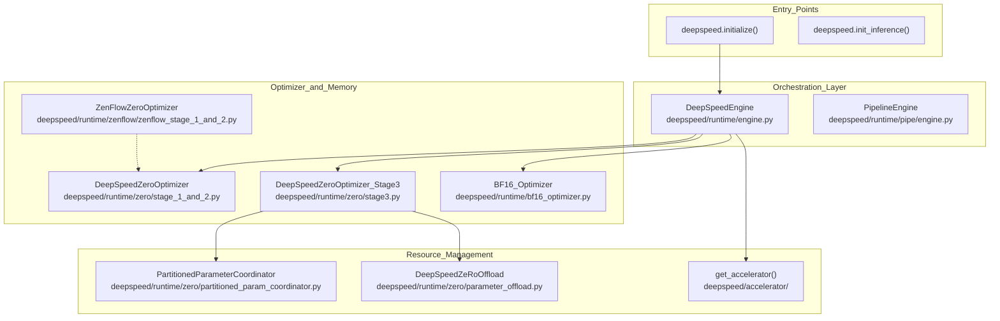
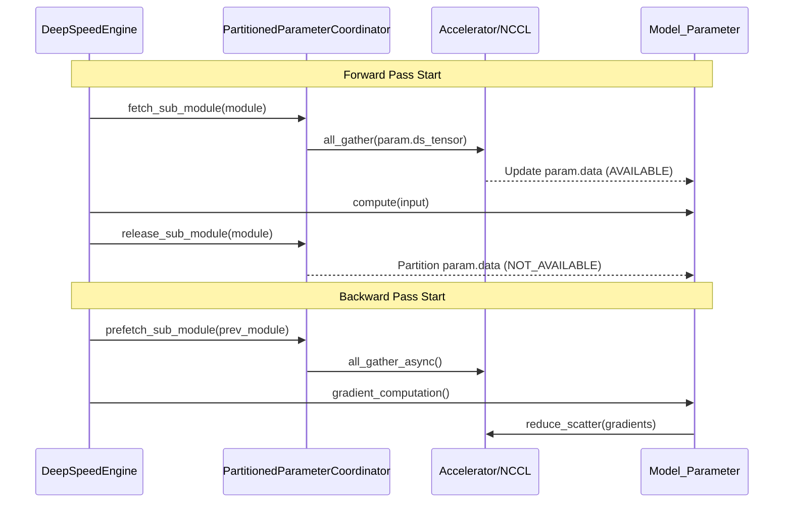

<!-- source: DeepWiki mcp.deepwiki.com · repo deepspeedai/DeepSpeed · page 1 Overview · fetched 2026-10-21 -->

# Overview

Relevant source files

The following files were used as context for generating this wiki page:

- [AGENTS.md](AGENTS.md)
- [CLAUDE.md](CLAUDE.md)
- [README.md](README.md)
- [azure/README.md](azure/README.md)
- [deepspeed/runtime/activation_checkpointing/checkpointing.py](deepspeed/runtime/activation_checkpointing/checkpointing.py)
- [deepspeed/runtime/base_optimizer.py](deepspeed/runtime/base_optimizer.py)
- [deepspeed/runtime/bf16_optimizer.py](deepspeed/runtime/bf16_optimizer.py)
- [deepspeed/runtime/config.py](deepspeed/runtime/config.py)
- [deepspeed/runtime/constants.py](deepspeed/runtime/constants.py)
- [deepspeed/runtime/engine.py](deepspeed/runtime/engine.py)
- [deepspeed/runtime/utils.py](deepspeed/runtime/utils.py)
- [deepspeed/runtime/zero/config.py](deepspeed/runtime/zero/config.py)
- [deepspeed/runtime/zero/mics.py](deepspeed/runtime/zero/mics.py)
- [deepspeed/runtime/zero/parameter_offload.py](deepspeed/runtime/zero/parameter_offload.py)
- [deepspeed/runtime/zero/partition_parameters.py](deepspeed/runtime/zero/partition_parameters.py)
- [deepspeed/runtime/zero/partitioned_param_coordinator.py](deepspeed/runtime/zero/partitioned_param_coordinator.py)
- [deepspeed/runtime/zero/stage3.py](deepspeed/runtime/zero/stage3.py)
- [deepspeed/runtime/zero/stage_1_and_2.py](deepspeed/runtime/zero/stage_1_and_2.py)
- [deepspeed/runtime/zero/utils.py](deepspeed/runtime/zero/utils.py)
- [docs/_config.yml](docs/_config.yml)
- [docs/_data/navigation.yml](docs/_data/navigation.yml)
- [docs/_pages/config-json.md](docs/_pages/config-json.md)
- [docs/_tutorials/azure.md](docs/_tutorials/azure.md)
- [docs/_tutorials/cifar-10.md](docs/_tutorials/cifar-10.md)
- [docs/_tutorials/getting-started.md](docs/_tutorials/getting-started.md)
- [docs/contributing.md](docs/contributing.md)
- [docs/index.md](docs/index.md)

This document provides a high-level overview of the DeepSpeed library, its architecture, major subsystems, and key entry points. It is intended to orient new developers and users to the codebase structure and design principles.

## What is DeepSpeed?

DeepSpeed is a deep learning optimization library that has enabled training of some of the world's most powerful language models, including Megatron-Turing NLG 530B and BLOOM 176B [README.md:67-69](). The library provides system-level innovations that make large-scale distributed training effective, efficient, and accessible.

### Core Innovations

DeepSpeed's key innovations address the fundamental challenges of training and serving large models:

*   **Memory Optimization**:
    *   **ZeRO (Zero Redundancy Optimizer)**: Eliminates memory redundancy by partitioning optimizer states (Stage 1), gradients (Stage 2), and parameters (Stage 3) across data-parallel processes [deepspeed/runtime/zero/stage_1_and_2.py:128-132](), [deepspeed/runtime/zero/stage3.py:138-142]().
    *   **ZeRO-Offload**: Offloads optimizer states and gradients to CPU memory or NVMe storage to enable training models with billions or trillions of parameters on limited GPU memory [deepspeed/runtime/zero/stage3.py:169-171]().
    *   **SuperOffload**: Advanced offloading engine optimized for modern "superchip" architectures [README.md:31-31]().
    *   **ZenFlow**: Stall-free offloading engine for LLM training that hides offloading overhead [README.md:43-43]().

*   **Parallelism Strategies**:
    *   **Pipeline Parallelism**: Layer-wise model partitioning via `PipelineModule` and `PipelineEngine` [deepspeed/runtime/engine.py:109-109]().
    *   **Tensor Parallelism (AutoTP)**: Automatic model partitioning across GPUs for both training and inference [deepspeed/runtime/engine.py:45-45]().
    *   **Sequence Parallelism**: DeepSpeed-Ulysses for long-context training, including Arctic Long Sequence Training (ALST) for multi-million token sequences [README.md:45-45]().

*   **Inference Optimization**:
    *   **Module Injection**: Replaces standard PyTorch layers with hand-optimized CUDA kernels [deepspeed/runtime/engine.py:45-45]().
    *   **FastGen (V2)**: High-performance inference engine with ragged batching and KV-cache management.

*   **Hardware & Portability**:
    *   **Accelerator Abstraction**: Unified API supporting NVIDIA, AMD, Intel Gaudi, Intel XPU, Huawei Ascend, and more [deepspeed/runtime/engine.py:121-121]().

**Sources**: [README.md:67-69](), [deepspeed/runtime/zero/stage3.py:138-142](), [deepspeed/runtime/engine.py:109-130]().

## High-Level Architecture

DeepSpeed's architecture centers around the `DeepSpeedEngine`, which orchestrates the interaction between the model, the distributed communication backend, and the memory-optimized optimizers.

### System Architecture and Code Mapping

The following diagram bridges the high-level concepts to the specific classes and files in the codebase.

**Sources**: [deepspeed/runtime/engine.py:24-130](), [deepspeed/runtime/zero/stage3.py:136-150](), [deepspeed/runtime/zero/parameter_offload.py:112-120]().

## Core Components

### 1. Training Engine (`DeepSpeedEngine`)
The `DeepSpeedEngine` is the central class that wraps a `torch.nn.Module` [deepspeed/runtime/engine.py:15-16](). It manages the training lifecycle, including:
*   **Forward/Backward Passes**: Handling gradient accumulation and micro-batching [docs/_pages/config-json.md:25-29]().
*   **Optimizer Integration**: Wrapping standard optimizers with ZeRO or mixed-precision logic [deepspeed/runtime/engine.py:29-42]().
*   **Checkpointing**: Managing model and optimizer state persistence [deepspeed/runtime/engine.py:100-100]().

### 2. ZeRO Memory Optimizers
DeepSpeed provides different stages of ZeRO to trade off communication for memory savings:
*   **Stage 1 & 2**: Implemented in `DeepSpeedZeroOptimizer`. Partitions optimizer states and gradients [deepspeed/runtime/zero/stage_1_and_2.py:126-138]().
*   **Stage 3**: Implemented in `DeepSpeedZeroOptimizer_Stage3`. Partitions model parameters and dynamically gathers them during the forward and backward passes [deepspeed/runtime/zero/stage3.py:136-148]().

### 3. Parameter Management (`PartitionedParameterCoordinator`)
For ZeRO Stage 3, the `PartitionedParameterCoordinator` tracks the status of parameters (e.g., `AVAILABLE`, `NOT_AVAILABLE`, `INFLIGHT`) and manages prefetching to hide communication latency [deepspeed/runtime/zero/partitioned_param_coordinator.py:64-74]().

**Sources**: [deepspeed/runtime/engine.py:15-42](), [deepspeed/runtime/zero/stage3.py:136-148](), [deepspeed/runtime/zero/partitioned_param_coordinator.py:64-74]().

## Data and Control Flow

The following diagram illustrates the lifecycle of a parameter in ZeRO-3 during a training step, showing the interaction between the Engine, Coordinator, and Accelerator.

**Sources**: [deepspeed/runtime/zero/partitioned_param_coordinator.py:64-150](), [deepspeed/runtime/zero/stage3.py:81-112]().

## Configuration System

DeepSpeed is driven by a JSON configuration that defines the optimization strategy. Key parameters include:

| Parameter | Type | Description |
| :--- | :--- | :--- |
| `train_batch_size` | int | Effective batch size (micro_batch * accumulation * GPUs) [docs/_pages/config-json.md:12-16]() |
| `optimizer` | dict | Optimizer type (Adam, AdamW, Muon, etc.) and its parameters [docs/_pages/config-json.md:35-42]() |
| `zero_optimization` | dict | Configuration for ZeRO stages and offloading [deepspeed/runtime/zero/config.py:22-22]() |
| `fp16` / `bf16` | dict | Mixed precision settings [deepspeed/runtime/config.py:27-27]() |

**Sources**: [docs/_pages/config-json.md:7-42](), [deepspeed/runtime/config.py:16-30]().

## Ecosystem and Integrations

DeepSpeed is integrated into major AI frameworks and used for large-scale model training:
*   **Frameworks**: Hugging Face Transformers, PyTorch Lightning, MosaicML, and Ray [README.md:93-95]().
*   **Adoption**: Used to train models like Megatron-Turing NLG (530B), BLOOM (176B), and GPT-NeoX (20B) [README.md:82-88]().
*   **Multi-Platform**: Native support for NVIDIA (CUDA), AMD (ROCm), Intel (Gaudi/XPU), and more [deepspeed/runtime/engine.py:121-121]().

**Sources**: [README.md:73-95](), [deepspeed/runtime/engine.py:121-121]().

---

