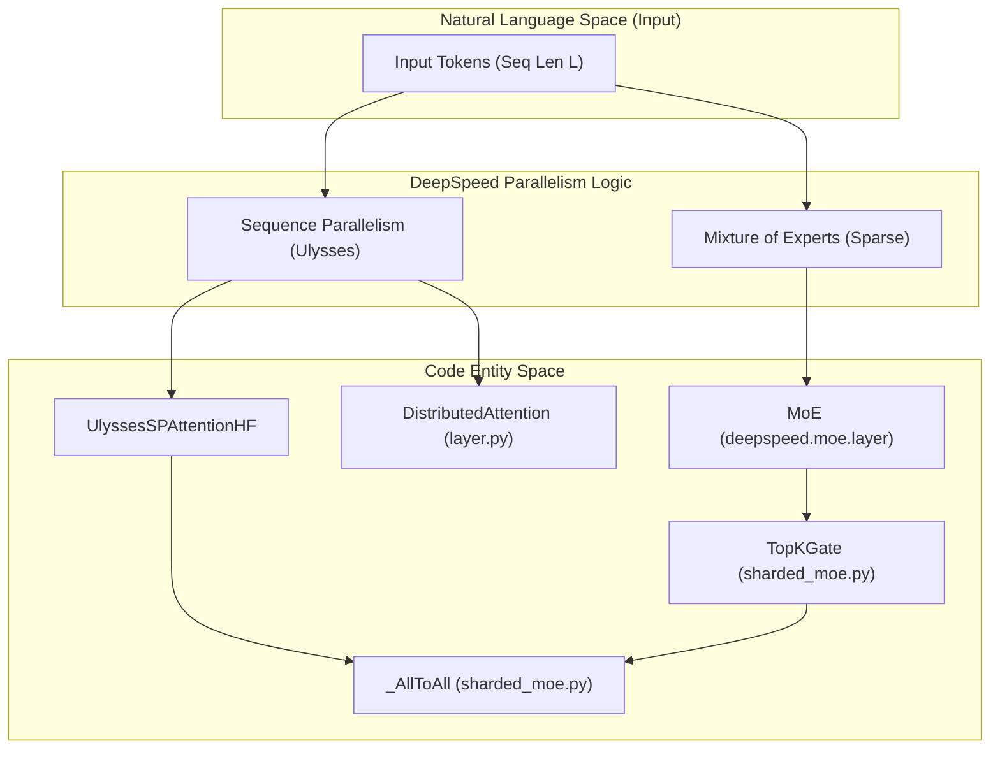
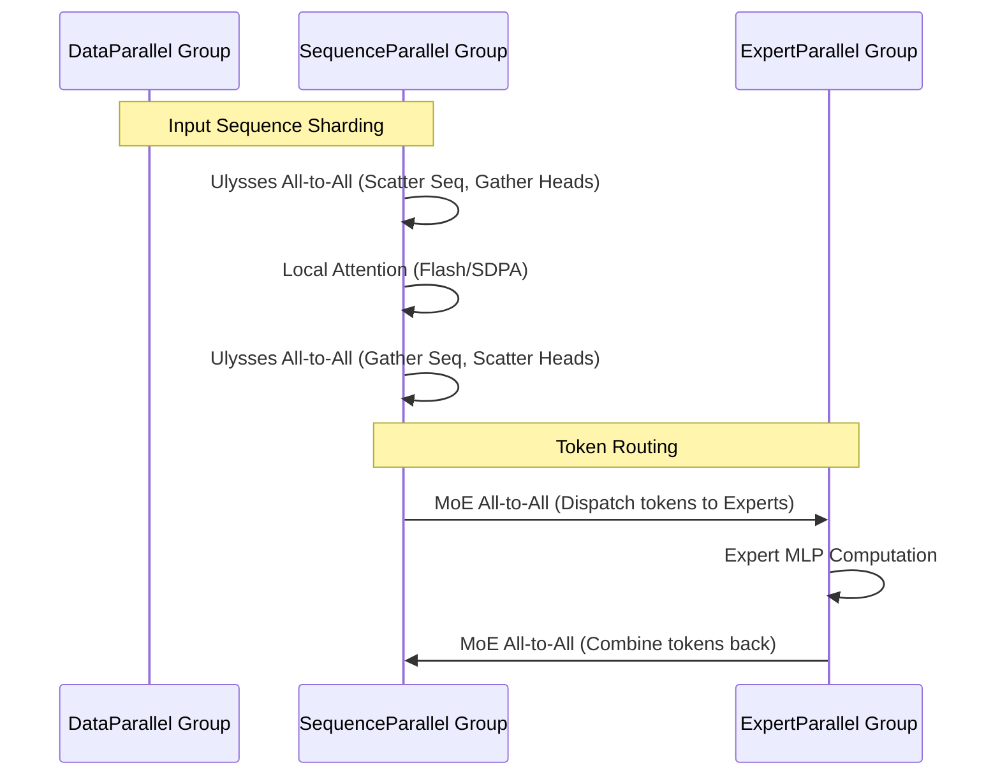

<!-- source: DeepWiki mcp.deepwiki.com · repo deepspeedai/DeepSpeed · page 10 Sequence Parallelism and Mixture of Experts · fetched 2026-10-21 -->

# Sequence Parallelism and Mixture of Experts

Relevant source files

The following files were used as context for generating this wiki page:

- [deepspeed/moe/layer.py](deepspeed/moe/layer.py)
- [deepspeed/moe/mappings.py](deepspeed/moe/mappings.py)
- [deepspeed/moe/sharded_moe.py](deepspeed/moe/sharded_moe.py)
- [deepspeed/ops/transformer/inference/moe_inference.py](deepspeed/ops/transformer/inference/moe_inference.py)
- [deepspeed/runtime/sequence_parallel/ulysses_sp.py](deepspeed/runtime/sequence_parallel/ulysses_sp.py)
- [deepspeed/sequence/layer.py](deepspeed/sequence/layer.py)
- [deepspeed/utils/groups.py](deepspeed/utils/groups.py)
- [docs/_tutorials/ds-sequence.md](docs/_tutorials/ds-sequence.md)
- [docs/_tutorials/ulysses-alst-sequence-parallelism.md](docs/_tutorials/ulysses-alst-sequence-parallelism.md)
- [tests/unit/moe/test_moe.py](tests/unit/moe/test_moe.py)
- [tests/unit/sequence_parallelism/test_ulysses.py](tests/unit/sequence_parallelism/test_ulysses.py)
- [tests/unit/simple_model.py](tests/unit/simple_model.py)
- [tests/unit/ulysses_alst/test_tiled_compute.py](tests/unit/ulysses_alst/test_tiled_compute.py)
- [tests/unit/ulysses_alst/test_ulysses_sp_hf.py](tests/unit/ulysses_alst/test_ulysses_sp_hf.py)
- [tests/unit/v1/multimodal/__init__.py](tests/unit/v1/multimodal/__init__.py)
- [tests/unit/v1/multimodal/test_gemma4_config.py](tests/unit/v1/multimodal/test_gemma4_config.py)

DeepSpeed provides advanced parallelism strategies to scale models beyond the memory and compute limits of a single accelerator. This section covers **DeepSpeed-Ulysses** for handling extremely long sequence lengths and **Mixture of Experts (MoE)** for scaling model capacity through sparsity.

## High-Level Architecture

The following diagram illustrates how Sequence Parallelism (SP) and Mixture of Experts (MoE) partition data and parameters across a distributed system.

### Parallelism Space Mapping
This diagram maps the conceptual parallelism strategies to their primary implementation classes and communication primitives in the codebase.

**Sources:** [deepspeed/runtime/sequence_parallel/ulysses_sp.py:50-104](), [deepspeed/moe/layer.py:17-53](), [deepspeed/moe/sharded_moe.py:97-110](), [deepspeed/sequence/layer.py:111-141]()

---

## Ulysses Sequence Parallelism

**DeepSpeed-Ulysses** is designed for training Transformer models with massive sequence lengths (e.g., millions of tokens). It partitions the input tensor along the sequence dimension across a dedicated sequence parallel group.

Key features include:
- **Distributed Attention:** Instead of partitioning heads (as in Tensor Parallelism), Ulysses partitions the sequence. It uses `All-to-All` communication to transform sequence-parallel distributions into head-parallel distributions for local attention computation [deepspeed/runtime/sequence_parallel/ulysses_sp.py:8-13]().
- **Arctic Long Sequence Training (ALST):** An evolution of Ulysses that incorporates activation checkpoint offloading, tiled MLP compute, and kernel optimizations to enable multi-million token training [deepspeed/runtime/sequence_parallel/ulysses_sp.py:15-23]().
- **Integration:** The `UlyssesSPAttentionHF` class provides a seamless way to inject these capabilities into Hugging Face Transformers [deepspeed/runtime/sequence_parallel/ulysses_sp.py:50-89]().

For details, see [Ulysses Sequence Parallelism](#10.1).

**Sources:** [deepspeed/runtime/sequence_parallel/ulysses_sp.py:5-30](), [docs/_tutorials/ulysses-alst-sequence-parallelism.md:6-15]()

---

## Mixture of Experts (MoE)

**Mixture of Experts** enables scaling model parameters to trillions while keeping the computational cost per token constant. It replaces dense MLP layers with sparse MoE layers where only a subset of "experts" are activated for each token.

Key components include:
- **MoE Layer:** The `MoE` class in `deepspeed.moe.layer` wraps expert modules and handles the routing logic [deepspeed/moe/layer.py:17-36]().
- **Routing (Gating):** The `TopKGate` (supporting $k=1$ or $k=2$) determines which experts receive which tokens [deepspeed/moe/sharded_moe.py:184-210]().
- **Expert Parallelism:** Experts are distributed across GPUs using expert parallel groups, managed via `deepspeed.utils.groups` [deepspeed/utils/groups.py:34-41]().
- **Communication:** Token routing and gathering are implemented using high-performance `All-to-All` primitives to move tokens to their assigned expert ranks [deepspeed/moe/sharded_moe.py:97-110]().

For details, see [Mixture of Experts (MoE)](#10.2).

**Sources:** [deepspeed/moe/layer.py:17-80](), [deepspeed/moe/sharded_moe.py:193-210](), [deepspeed/utils/groups.py:34-51]()

---

## Interaction and Comparison

| Feature | Ulysses Sequence Parallelism | Mixture of Experts (MoE) |
| :--- | :--- | :--- |
| **Primary Goal** | Context Length Scaling | Parameter Count Scaling (Sparsity) |
| **Partitioning Dim** | Sequence Dimension | Expert/Model Dimension |
| **Comm. Primitive** | `All-to-All` (Sequence <-> Head) | `All-to-All` (Token Dispatch/Combine) |
| **Key Class** | `UlyssesSPAttentionHF` | `MoE` |
| **Optimization** | Tiled Compute, ALST | Tutel, Top-K Routing |

### System Flow: Token Life Cycle
The following diagram shows how a token moves through these systems during a forward pass.

**Sources:** [deepspeed/runtime/sequence_parallel/ulysses_sp.py:51-89](), [deepspeed/moe/sharded_moe.py:97-110](), [deepspeed/sequence/layer.py:111-141]()

---

