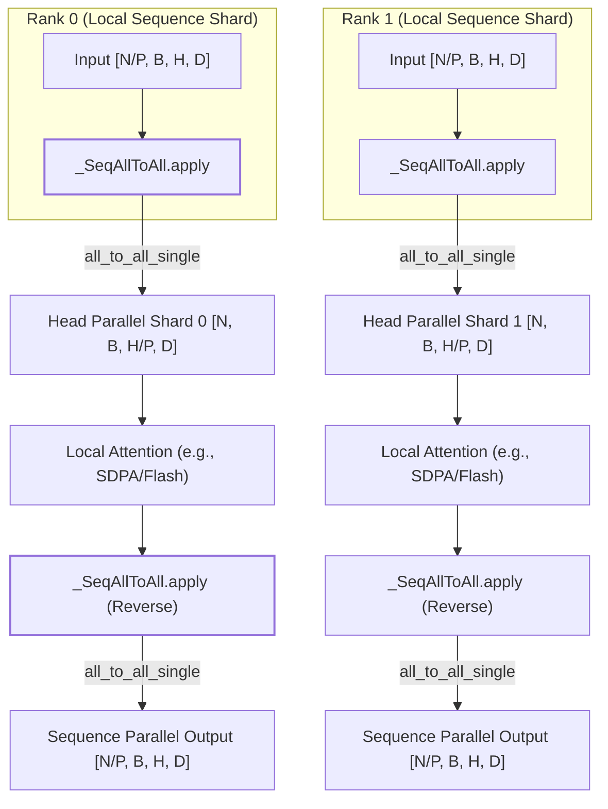
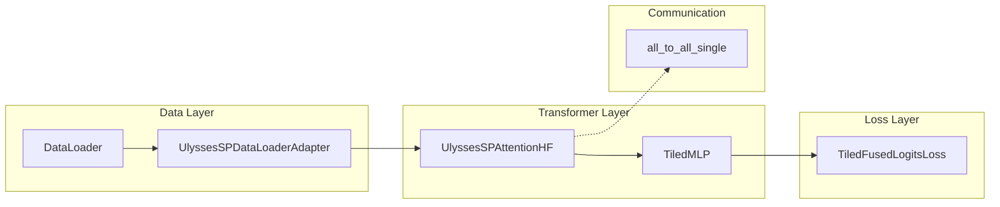

<!-- source: DeepWiki mcp.deepwiki.com · repo deepspeedai/DeepSpeed · page 10.1 Ulysses Sequence Parallelism · fetched 2026-10-21 -->

# Ulysses Sequence Parallelism

<details>
<summary>Relevant source files</summary>

The following files were used as context for generating this wiki page:

- [benchmarks/autosp/bench_multimodal_sp.py](benchmarks/autosp/bench_multimodal_sp.py)
- [blogs/assets/images/triton-bert-base-latency.png](blogs/assets/images/triton-bert-base-latency.png)
- [blogs/assets/images/triton-bert-large-latency.png](blogs/assets/images/triton-bert-large-latency.png)
- [blogs/comm-opt/README.md](blogs/comm-opt/README.md)
- [blogs/comm-opt/assets/images/e+d.png](blogs/comm-opt/assets/images/e+d.png)
- [blogs/comm-opt/assets/images/sp+fp.png](blogs/comm-opt/assets/images/sp+fp.png)
- [blogs/comm-opt/assets/images/sp-conv.png](blogs/comm-opt/assets/images/sp-conv.png)
- [blogs/deepspeed-offloadpp/README.md](blogs/deepspeed-offloadpp/README.md)
- [blogs/deepspeed-triton/README.md](blogs/deepspeed-triton/README.md)
- [blogs/deepspeed-ulysses/README.md](blogs/deepspeed-ulysses/README.md)
- [blogs/deepspeed-visualchat/10-03-2023/README-Chinese.md](blogs/deepspeed-visualchat/10-03-2023/README-Chinese.md)
- [blogs/deepspeed-visualchat/10-03-2023/README-Japanese.md](blogs/deepspeed-visualchat/10-03-2023/README-Japanese.md)
- [blogs/deepspeed-visualchat/10-03-2023/README.md](blogs/deepspeed-visualchat/10-03-2023/README.md)
- [deepspeed/runtime/sequence_parallel/ulysses_sp.py](deepspeed/runtime/sequence_parallel/ulysses_sp.py)
- [deepspeed/sequence/__init__.py](deepspeed/sequence/__init__.py)
- [deepspeed/sequence/auto_sp.py](deepspeed/sequence/auto_sp.py)
- [deepspeed/sequence/autosp_detector.py](deepspeed/sequence/autosp_detector.py)
- [deepspeed/sequence/autosp_fusion.py](deepspeed/sequence/autosp_fusion.py)
- [deepspeed/sequence/autosp_vit.py](deepspeed/sequence/autosp_vit.py)
- [deepspeed/sequence/layer.py](deepspeed/sequence/layer.py)
- [deepspeed/sequence/test_autosp.py](deepspeed/sequence/test_autosp.py)
- [docs/_posts/2023-10-04-deepspeed-visualchat-chinese.md](docs/_posts/2023-10-04-deepspeed-visualchat-chinese.md)
- [docs/_posts/2023-10-04-deepspeed-visualchat-japanese.md](docs/_posts/2023-10-04-deepspeed-visualchat-japanese.md)
- [docs/_posts/2023-10-04-deepspeed-visualchat.md](docs/_posts/2023-10-04-deepspeed-visualchat.md)
- [docs/_tutorials/ds-sequence.md](docs/_tutorials/ds-sequence.md)
- [docs/_tutorials/ulysses-alst-sequence-parallelism.md](docs/_tutorials/ulysses-alst-sequence-parallelism.md)
- [tests/unit/sequence_parallelism/test_autosp_equivalence.py](tests/unit/sequence_parallelism/test_autosp_equivalence.py)
- [tests/unit/sequence_parallelism/test_autosp_integration.py](tests/unit/sequence_parallelism/test_autosp_integration.py)
- [tests/unit/sequence_parallelism/test_ulysses.py](tests/unit/sequence_parallelism/test_ulysses.py)
- [tests/unit/ulysses_alst/test_tiled_compute.py](tests/unit/ulysses_alst/test_tiled_compute.py)
- [tests/unit/ulysses_alst/test_ulysses_sp_hf.py](tests/unit/ulysses_alst/test_ulysses_sp_hf.py)
- [tests/unit/v1/multimodal/__init__.py](tests/unit/v1/multimodal/__init__.py)
- [tests/unit/v1/multimodal/test_gemma4_config.py](tests/unit/v1/multimodal/test_gemma4_config.py)

</details>


DeepSpeed-Ulysses is a system optimization framework designed to enable the training of Transformer models with extreme sequence lengths. It partitions individual samples along the sequence dimension across a group of GPUs. By utilizing efficient all-to-all communication collectives, it transforms sequence-parallel distributions into head-parallel distributions specifically for the attention computation, allowing for massive scaling of context length while maintaining high hardware efficiency.

## Core Architecture and Data Flow

DeepSpeed-Ulysses operates by partitioning the sequence dimension $N$ across $P$ devices in a sequence-parallel group. Each device holds a local shard of the sequence $N/P$.

1.  **Local Projection**: Each GPU computes the Query (Q), Key (K), and Value (V) projections for its local sequence shard [blogs/deepspeed-ulysses/README.md:111-114]().
2.  **Sequence-to-Head All-to-All**: Before attention, an `all-to-all` collective is performed. This redistributes the data such that each GPU receives the full sequence $N$ but only for a subset of the attention heads $H/P$ [blogs/deepspeed-ulysses/README.md:65-70]().
3.  **Local Attention**: Attention is computed locally on each GPU for its assigned heads using the full sequence length [blogs/deepspeed-ulysses/README.md:117-120]().
4.  **Head-to-Sequence All-to-All**: After attention, a second `all-to-all` is performed to gather the results across attention heads and re-partition the data back to the sequence dimension $N/P$ for subsequent layers like the MLP [blogs/deepspeed-ulysses/README.md:71-73]().

### Communication Complexity
Ulysses reduces communication volume significantly compared to other sequence parallelism methods (like Megatron-LM). The aggregate communication volume per link is $4Nh/P$, where $h$ is the hidden size. This results in a complexity of $O(N/P)$, which remains constant if the sequence length $N$ and parallelism degree $P$ are scaled proportionally [blogs/deepspeed-ulysses/README.md:132-145]().

### Code-to-System Mapping: All-to-All Logic
The following diagram maps the mathematical data flow to the internal communication classes in `deepspeed/sequence/layer.py`.

**Sequence Parallel Communication Flow**

Sources: [deepspeed/sequence/layer.py:111-130](), [blogs/deepspeed-ulysses/README.md:102-125]()

## Distributed Attention Implementation

The primary entry point for Ulysses is the `DistributedAttention` class (or its Hugging Face specific variant `UlyssesSPAttentionHF`).

### UlyssesSPAttentionHF
`UlyssesSPAttentionHF` is a specialized implementation designed for seamless integration with Hugging Face Transformers [deepspeed/runtime/sequence_parallel/ulysses_sp.py:50-89](). It handles variations in attention head counts, including Grouped Query Attention (GQA), by calculating a `kv_replication_factor` when the number of KV heads is not evenly divisible by the sequence parallel world size [deepspeed/runtime/sequence_parallel/ulysses_sp.py:131-136]().

Key methods:
*   `register_with_transformers`: Injects the Ulysses adapter into existing HF model architectures [docs/_tutorials/ulysses-alst-sequence-parallelism.md:145-158]().
*   `forward`: Orchestrates the `all-to-all` communication before and after the core attention function [deepspeed/runtime/sequence_parallel/ulysses_sp.py:228-265]().

### Communication Utilities
The module `deepspeed.sequence.layer` provides the underlying autograd functions for the transfers:
*   `_SeqAllToAll`: A standard autograd wrapper for `dist.all_to_all_single` that handles the necessary `permute` and `reshape` operations to transition between sequence and head dimensions [tests/unit/sequence_parallelism/test_ulysses.py:68-74]().
*   `_DimZeroAllToAll`: Specifically handles communication when the sequence dimension is at index 0 [deepspeed/runtime/sequence_parallel/ulysses_sp.py:34]().

Sources: [deepspeed/runtime/sequence_parallel/ulysses_sp.py:50-151](), [deepspeed/sequence/layer.py:19-56]()

## Arctic Long Sequence Training (ALST)

ALST extends Ulysses with additional optimizations to support multi-million token sequences on limited hardware [deepspeed/runtime/sequence_parallel/ulysses_sp.py:6-23]().

### Tiled Computation
To avoid memory exhaustion during the MLP and Loss phases of long sequences, DeepSpeed provides tiled computation wrappers:
*   **`TiledMLP`**: An autograd function that performs MLP computation by splitting the sequence dimension into smaller shards (tiles). It computes the forward and backward passes tile-by-tile, significantly reducing peak activation memory [deepspeed/runtime/sequence_parallel/ulysses_sp.py:20-21]().
*   **`TiledFusedLogitsLoss`**: Computes cross-entropy loss without manifesting the full logits tensor. It calculates loss on shards of logits and aggregates the result [deepspeed/runtime/sequence_parallel/ulysses_sp.py:21-21]().
*   **`SequenceTiledCompute`**: A generic version of the tiling logic that can be applied to any sequence-parallel operation [deepspeed/runtime/sequence_parallel/ulysses_sp.py:19-19]().

### ALST Data Adapter
`UlyssesSPDataLoaderAdapter` is used to shard standard DataLoader batches. It ensures that each rank in the sequence parallel group receives the correct sub-segment of the global sequence for every micro-batch [deepspeed/runtime/sequence_parallel/ulysses_sp.py:18-18](), [docs/_tutorials/ulysses-alst-sequence-parallelism.md:94-100]().

**ALST Component Interaction**

Sources: [deepspeed/runtime/sequence_parallel/ulysses_sp.py:6-30](), [tests/unit/ulysses_alst/test_tiled_compute.py:62-97]()

## AutoSP for Multimodal Models

DeepSpeed includes an **AutoSP** (Automatic Sequence Parallelism) system to simplify the application of sequence parallelism to complex multimodal models (e.g., Llava, Qwen2-VL).

*   **`auto_wrap_model_for_sp`**: Automatically identifies and wraps attention layers within a model to use Ulysses [deepspeed/sequence/__init__.py:10]().
*   **Modality Fusion Adapters**: Handles the transition between different modalities (e.g., Vision Transformer to Language Model) where sequence lengths and hidden dimensions may change. Classes like `LlavaFusionAdapter` and `Qwen2VLFusionAdapter` manage these boundaries [deepspeed/sequence/__init__.py:8-9]().
*   **`UlyssesSPViTAttention`**: A specialized implementation for Vision Transformers that supports sequence parallelism during the image encoding phase [deepspeed/sequence/__init__.py:7]().

Sources: [deepspeed/sequence/__init__.py:6-10](), [blogs/deepspeed-visualchat/10-03-2023/README.md:34-40]()

## Integration and Usage

To enable Ulysses in a training script, the `UlyssesSPAttentionHF` must be registered before the model is instantiated.

### Registration Example
```python
from deepspeed.runtime.sequence_parallel.ulysses_sp import UlyssesSPAttentionHF

mpu = UlyssesSPAttentionHF.register_with_transformers(
    model_name_or_path="path/to/model",
    core_attn_implementation="sdpa",
    sequence_parallel_size=8,
    micro_batch_size=1,
    seq_length_is_variable=True
)
```
[docs/_tutorials/ulysses-alst-sequence-parallelism.md:150-158]()

### Configuration
Ulysses is typically configured via the DeepSpeed configuration JSON by setting the `sequence_parallel_size` [tests/unit/ulysses_alst/test_ulysses_sp_hf.py:47-59]().

| Parameter | Description |
| :--- | :--- |
| `sequence_parallel_size` | The number of GPUs across which a single sequence is partitioned. |
| `seq_length_is_variable` | Set to `True` if input batches have different sequence lengths. |
| `local_seq_length` | The fixed sequence length per GPU (if not variable). |

Sources: [docs/_tutorials/ulysses-alst-sequence-parallelism.md:43-55](), [tests/unit/ulysses_alst/test_ulysses_sp_hf.py:106-113]()

---

