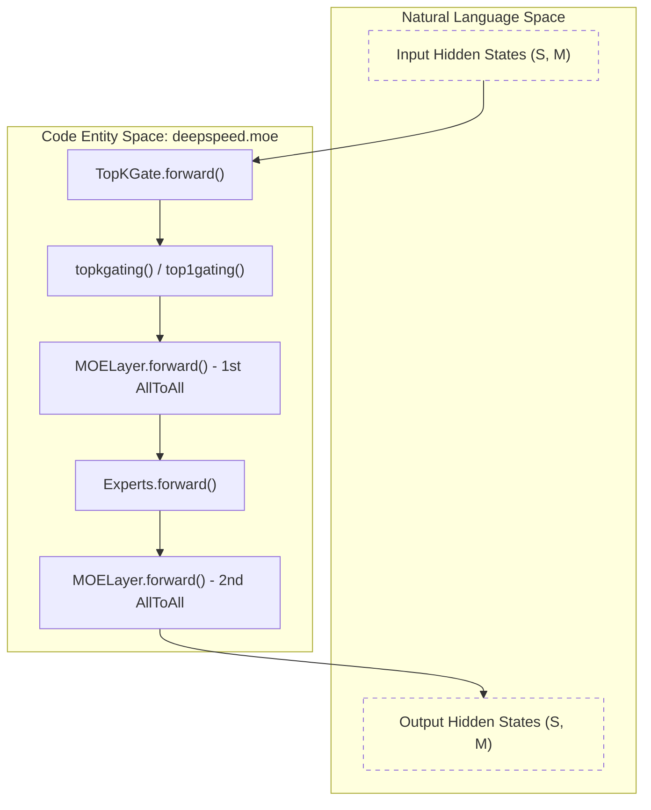
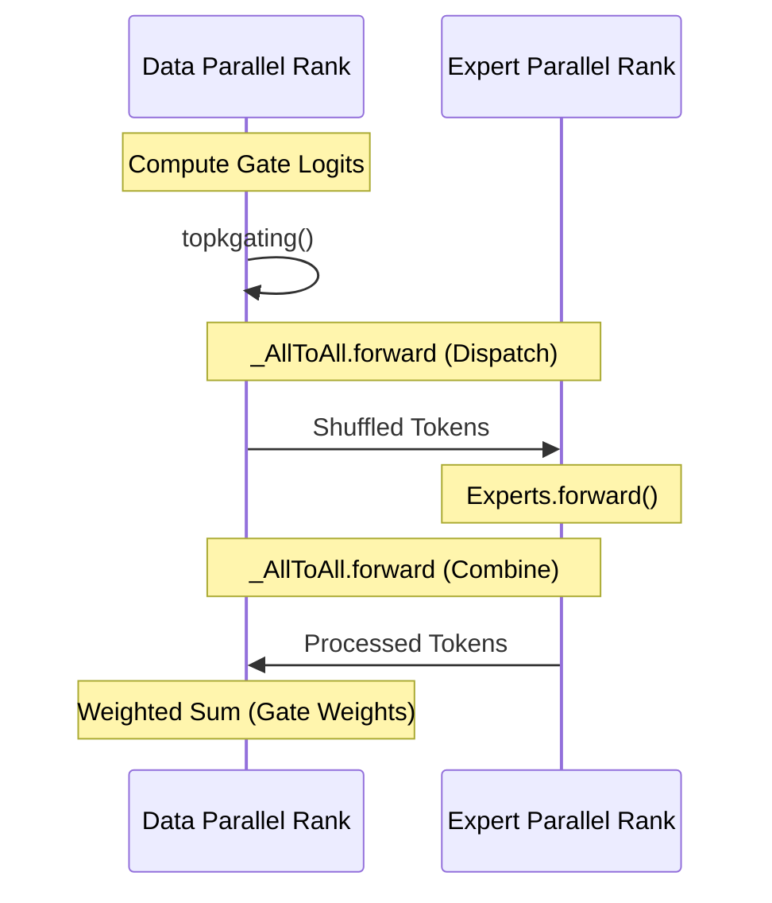

<!-- source: DeepWiki mcp.deepwiki.com · repo deepspeedai/DeepSpeed · page 10.2 Mixture of Experts (MoE) · fetched 2026-10-21 -->

# Mixture of Experts (MoE)

Relevant source files

The following files were used as context for generating this wiki page:

- [deepspeed/moe/experts.py](deepspeed/moe/experts.py)
- [deepspeed/moe/layer.py](deepspeed/moe/layer.py)
- [deepspeed/moe/mappings.py](deepspeed/moe/mappings.py)
- [deepspeed/moe/sharded_moe.py](deepspeed/moe/sharded_moe.py)
- [deepspeed/moe/utils.py](deepspeed/moe/utils.py)
- [deepspeed/ops/transformer/inference/moe_inference.py](deepspeed/ops/transformer/inference/moe_inference.py)
- [deepspeed/utils/groups.py](deepspeed/utils/groups.py)
- [docs/_pages/training.md](docs/_pages/training.md)
- [docs/_posts/2021-12-09-deepspeed-moe-nlg.md](docs/_posts/2021-12-09-deepspeed-moe-nlg.md)
- [docs/_tutorials/large-models-w-deepspeed.md](docs/_tutorials/large-models-w-deepspeed.md)
- [docs/_tutorials/mixture-of-experts-inference.md](docs/_tutorials/mixture-of-experts-inference.md)
- [docs/_tutorials/mixture-of-experts-nlg.md](docs/_tutorials/mixture-of-experts-nlg.md)
- [docs/_tutorials/mixture-of-experts.md](docs/_tutorials/mixture-of-experts.md)
- [docs/assets/images/moe-nlg.png](docs/assets/images/moe-nlg.png)
- [tests/unit/moe/test_moe.py](tests/unit/moe/test_moe.py)
- [tests/unit/simple_model.py](tests/unit/simple_model.py)

DeepSpeed MoE provides a high-performance system for training and inferencing sparsely activated models. MoE models enable scaling model parameters sublinearly with respect to compute costs, allowing for massive model capacities (e.g., trillions of parameters) with the compute budget of much smaller dense models [docs/_tutorials/mixture-of-experts.md:6-8]().

## Architecture Overview

The MoE implementation in DeepSpeed consists of a top-level `MoE` module that wraps a gating mechanism and a set of experts. It supports multiple forms of parallelism, including Expert Parallelism (EP), Data Parallelism (DP), and ZeRO-powered data parallelism [deepspeed/moe/layer.py:17-80]().

### Key Components

| Component | Class/Function | Description |
| :--- | :--- | :--- |
| **MoE Layer** | `MoE` | The main entry point for users to integrate MoE into their models [deepspeed/moe/layer.py:17](). |
| **Gating** | `TopKGate` | Determines token routing to experts (supports $k=1$ or $k=2$) [deepspeed/moe/sharded_moe.py:381](). |
| **Experts** | `Experts` | Container for local expert modules assigned to a specific rank [deepspeed/moe/experts.py:12](). |
| **Sharded Layer** | `MOELayer` | Handles the internal data flow, including token routing and All-to-All communication [deepspeed/moe/sharded_moe.py:539](). |

### MoE Layer Data Flow
The following diagram illustrates the lifecycle of a tensor passing through a DeepSpeed MoE layer.

Sources: [deepspeed/moe/layer.py:105-132](), [deepspeed/moe/sharded_moe.py:539-635]()

## Routing and Gating Mechanisms

DeepSpeed supports $k=1$ and $k=2$ routing. The gating logic includes noise injection to improve load balancing and resilience to rounding errors.

### Gating Functions
- **`top1gating`**: Routes each token to exactly one expert. It includes `multiplicative_jitter` and optional Gumbel noise [deepspeed/moe/sharded_moe.py:184-245]().
- **`top2gating`**: Routes tokens to the two best experts. It implements capacity-based dropping if an expert exceeds its allocated buffer [deepspeed/moe/sharded_moe.py:248-378]().

### Load Balancing
To prevent expert "collapse" (where only a few experts are used), DeepSpeed implements:
1. **Auxiliary Loss**: Calculated in the gating stage to encourage uniform token distribution across experts [deepspeed/moe/sharded_moe.py:489-514]().
2. **Random Token Selection (RTS)**: When tokens exceed expert capacity, RTS ensures a random subset is processed rather than just the first $N$ tokens [deepspeed/moe/sharded_moe.py:214-220]().

Sources: [deepspeed/moe/sharded_moe.py:56-78](), [deepspeed/moe/sharded_moe.py:184-378]()

## Parallelism and Communication

MoE layers use **Expert Parallelism (EP)**, where different experts are hosted on different GPUs. This requires significant data movement via `AllToAll` collectives.

### Process Group Management
DeepSpeed manages MoE parallelism using specialized process groups defined in `deepspeed/utils/groups.py`.
- **Expert Parallel Group**: Ranks that share the same set of experts [deepspeed/utils/groups.py:35]().
- **Expert Data Parallel Group**: Ranks that hold the same expert but process different data [deepspeed/utils/groups.py:39]().

### All-to-All Communication
The `MOELayer` uses two `AllToAll` operations per forward pass:
1. **Dispatch**: Sends tokens from data-parallel ranks to the ranks hosting the assigned experts [deepspeed/moe/sharded_moe.py:605-609]().
2. **Combine**: Returns processed tokens from expert ranks back to their original data-parallel ranks [deepspeed/moe/sharded_moe.py:627-631]().

Sources: [deepspeed/moe/sharded_moe.py:97-111](), [deepspeed/moe/sharded_moe.py:590-635](), [deepspeed/utils/groups.py:250-320]()

## Optimizer Integration

MoE parameters (experts) must be handled differently than shared (dense) parameters during optimization, especially when using ZeRO.

### Parameter Splitting
The utility `split_params_into_different_moe_groups_for_optimizer` is used to create separate parameter groups for MoE and non-MoE weights [deepspeed/moe/utils.py:72-148]().
- **MoE Parameters**: Identified by the `allreduce` attribute being set to `False` [deepspeed/moe/utils.py:27-30]().
- **ZeRO Compatibility**: MoE parameters are averaged across the `expert_dp_process_group` instead of the global `dp_process_group` [tests/unit/moe/test_moe.py:111-114]().

Sources: [deepspeed/moe/utils.py:15-69](), [deepspeed/moe/utils.py:155-183]()

## MoE Inference

For inference, DeepSpeed provides optimized kernels and specialized configurations via `DeepSpeedMoEInferenceConfig` [deepspeed/ops/transformer/inference/moe_inference.py:22-93]().

### Optimizations
1. **Expert Slicing**: If the number of GPUs exceeds the number of experts, DeepSpeed can slice individual experts across multiple GPUs to leverage aggregate memory bandwidth [docs/_tutorials/mixture-of-experts-inference.md:24-27]().
2. **Fused Kernels**: The inference engine replaces standard MLP layers with `DeepSpeedMoEMLP`, which uses optimized `GELUGemmOp` and `VectorMatMulOp` bindings [deepspeed/ops/transformer/inference/moe_inference.py:131-151]().
3. **PR-MoE and MoS**: Supports Pyramid-Residual MoE (varying expert counts per layer) and Mixture-of-Students (distillation) to reduce model size [docs/_tutorials/mixture-of-experts-nlg.md:32-70]().

Sources: [deepspeed/ops/transformer/inference/moe_inference.py:109-123](), [docs/_tutorials/mixture-of-experts-inference.md:41-50]()

---

