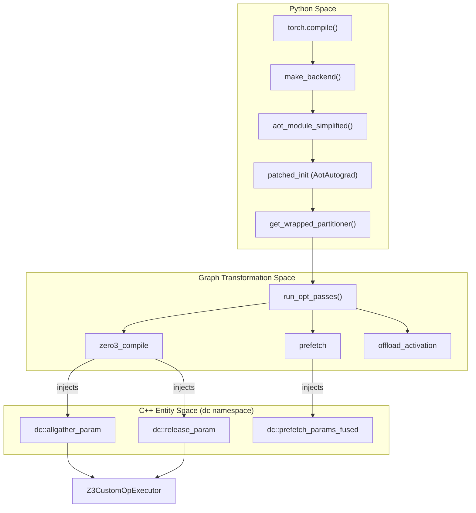
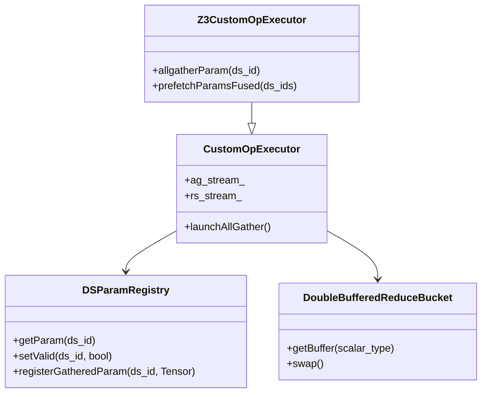

<!-- source: DeepWiki mcp.deepwiki.com · repo deepspeedai/DeepSpeed · page 11 DeepCompile: Compiler-Level Optimization · fetched 2026-10-21 -->

# DeepCompile: Compiler-Level Optimization

Relevant source files

The following files were used as context for generating this wiki page:

- [csrc/compile/deepcompile.cpp](csrc/compile/deepcompile.cpp)
- [csrc/compile/init.cpp](csrc/compile/init.cpp)
- [csrc/compile/z1.cpp](csrc/compile/z1.cpp)
- [csrc/compile/z1.h](csrc/compile/z1.h)
- [csrc/compile/z2.cpp](csrc/compile/z2.cpp)
- [csrc/compile/z3.cpp](csrc/compile/z3.cpp)
- [csrc/compile/z3.h](csrc/compile/z3.h)
- [csrc/includes/deepcompile.h](csrc/includes/deepcompile.h)
- [deepspeed/compile/backend.py](deepspeed/compile/backend.py)
- [deepspeed/compile/config.py](deepspeed/compile/config.py)
- [deepspeed/compile/constants.py](deepspeed/compile/constants.py)
- [deepspeed/compile/custom_ops/__init__.py](deepspeed/compile/custom_ops/__init__.py)
- [deepspeed/compile/custom_ops/all_to_all.py](deepspeed/compile/custom_ops/all_to_all.py)
- [deepspeed/compile/custom_ops/sp_compat.py](deepspeed/compile/custom_ops/sp_compat.py)
- [deepspeed/compile/custom_ops/sp_dp_registry.py](deepspeed/compile/custom_ops/sp_dp_registry.py)
- [deepspeed/compile/fx.py](deepspeed/compile/fx.py)
- [deepspeed/compile/graph_param.py](deepspeed/compile/graph_param.py)
- [deepspeed/compile/inductor.py](deepspeed/compile/inductor.py)
- [deepspeed/compile/init_sp.py](deepspeed/compile/init_sp.py)
- [deepspeed/compile/init_z1.py](deepspeed/compile/init_z1.py)
- [deepspeed/compile/init_z3.py](deepspeed/compile/init_z3.py)
- [deepspeed/compile/partitioner.py](deepspeed/compile/partitioner.py)
- [deepspeed/compile/passes/long_context_checkpointing.py](deepspeed/compile/passes/long_context_checkpointing.py)
- [deepspeed/compile/passes/offload_activation.py](deepspeed/compile/passes/offload_activation.py)
- [deepspeed/compile/passes/offload_adam_states.py](deepspeed/compile/passes/offload_adam_states.py)
- [deepspeed/compile/passes/offload_parameters.py](deepspeed/compile/passes/offload_parameters.py)
- [deepspeed/compile/passes/prefetch.py](deepspeed/compile/passes/prefetch.py)
- [deepspeed/compile/passes/selective_gather.py](deepspeed/compile/passes/selective_gather.py)
- [deepspeed/compile/passes/sp_compile.py](deepspeed/compile/passes/sp_compile.py)
- [deepspeed/compile/passes/zero1_compile.py](deepspeed/compile/passes/zero1_compile.py)
- [deepspeed/compile/passes/zero3_compile.py](deepspeed/compile/passes/zero3_compile.py)
- [deepspeed/compile/patch_fake_tensor.py](deepspeed/compile/patch_fake_tensor.py)
- [deepspeed/compile/profilers/graph_profile.py](deepspeed/compile/profilers/graph_profile.py)
- [deepspeed/compile/util.py](deepspeed/compile/util.py)
- [tests/torch_compile/test_deepcompile_z3_release.py](tests/torch_compile/test_deepcompile_z3_release.py)
- [tests/unit/compile/test_inductor_aot_kwargs.py](tests/unit/compile/test_inductor_aot_kwargs.py)
- [tests/unit/compile/test_zero3_grad_dtype.py](tests/unit/compile/test_zero3_grad_dtype.py)
- [tests/unit/ops/test_op_builder.py](tests/unit/ops/test_op_builder.py)
- [tests/unit/v1/compile/test_compile_fx.py](tests/unit/v1/compile/test_compile_fx.py)
- [tests/unit/v1/compile/test_compile_zero.py](tests/unit/v1/compile/test_compile_zero.py)

DeepCompile is a system within DeepSpeed that applies compiler-level optimizations to distributed training by leveraging `torch.fx` and AOT Autograd. It transforms the model's execution graph to integrate communication and memory optimizations—such as ZeRO parameter gathering, prefetching, and activation offloading—directly into the compiled kernels and execution schedule.

By moving these optimizations from high-level Python hooks into the compiler's graph representation, DeepCompile reduces Python overhead, improves communication-computation overlap, and enables more aggressive memory management strategies.

### System Overview

DeepCompile operates by intercepting the model compilation process and applying a series of graph transformation passes. It utilizes a C++ backend (`dc`) to manage the low-level synchronization and communication primitives required for distributed training.

#### Key Code Entities
| Entity | Role |
| :--- | :--- |
| `CompileConfig` | Configuration class for DeepCompile features. [[deepspeed/compile/config.py:1-1]]() |
| `make_backend` | Entry point for creating the DeepCompile AOT Autograd backend. [[deepspeed/compile/backend.py:228-228]]() |
| `DeepCompileBuilder` | JIT builder for the C++ extension. [[deepspeed/ops/op_builder/dc.py:1-1]]() |
| `DSGraphParamManager` | Tracks parameters and their metadata within a specific FX graph. [[deepspeed/compile/graph_param.py:12-12]]() |
| `dc` (C++ namespace) | The core C++ engine for ZeRO and communication ops. [[csrc/includes/deepcompile.h:30-30]]() |

### Integration with ZeRO

DeepCompile provides specialized initialization routines for different ZeRO stages, replacing standard ZeRO hooks with graph-integrated operations.

*   **ZeRO-1/2 Integration**: Initialized via `init_z1`, which sets up gradient buffer management and registers parameters with the C++ backend. [[deepspeed/compile/init_z1.py:90-90]]()
*   **ZeRO-3 Integration**: Initialized via `init_z3`, which unsets standard ZeRO-3 module hooks and transitions to graph-based `allgather_param` and `release_param` operations. [[deepspeed/compile/init_z3.py:35-35]]()

### DeepCompile Architecture and Backend

The architecture centers around the interaction between the Python-based FX graph transformations and the high-performance C++ backend. DeepCompile patches the AOT Autograd dispatcher to inject its own graph partitioning and compilation logic.

The system uses a `schedule` system to apply different sets of optimization passes at specific training steps (e.g., during warmup vs. steady state). [[deepspeed/compile/backend.py:83-83]]()

#### Compilation Flow
The following diagram illustrates how DeepCompile intercepts the compilation process to inject distributed optimizations.

**DeepCompile Backend Dispatch**

Sources: [[deepspeed/compile/backend.py:228-240]](), [[deepspeed/compile/inductor.py:136-151]](), [[deepspeed/compile/partitioner.py:30-30]](), [[csrc/compile/z3.cpp:15-27]]()

For details, see [DeepCompile Architecture and Backend](#11.1).

### Compiler Passes and Graph Transforms

DeepCompile's power comes from its ability to rewrite the `torch.fx.Graph` to optimize communication and memory. These passes analyze the graph to determine the optimal timing for parameter fetches and memory releases.

#### Core Optimization Passes
*   **ZeRO-3 Pass**: Replaces standard parameter access with `dc.allgather_param` and `dc.release_param` nodes. [[deepspeed/compile/passes/zero3_compile.py:25-52]]()
*   **Prefetching**: Analyzes the execution order to launch parameter all-gathers ahead of their actual use in computation. [[deepspeed/compile/passes/prefetch.py:1-1]]()
*   **Activation Offloading**: Identifies activation tensors to be moved to CPU memory and reloaded just-in-time for the backward pass. [[deepspeed/compile/passes/offload_activation.py:1-1]]()
*   **Selective Gather**: Optimizes ZeRO-3 by only gathering parameters that are not already present, reducing redundant communication. [[deepspeed/compile/passes/selective_gather.py:1-1]]()

#### C++ Backend Integration
The C++ backend provides the high-performance implementations of the operations injected by the passes.

**C++ Backend Component Map**

Sources: [[csrc/includes/deepcompile.h:179-182]](), [[csrc/compile/z3.cpp:15-48]](), [[csrc/compile/z3.h:19-24]]()

For details, see [Compiler Passes and Graph Transforms](#11.2).

### Technical Requirements
*   **PyTorch**: DeepCompile requires PyTorch 2.6 or later for full `torch.fx` and AOT Autograd compatibility. [[deepspeed/compile/util.py:32-32]]()
*   **Hardware**: Currently optimized for NVIDIA CUDA environments. [[deepspeed/compile/util.py:32-32]]()

Sources:
- [[deepspeed/compile/backend.py:1-100]]()
- [[deepspeed/compile/init_z3.py:35-85]]()
- [[deepspeed/compile/init_z1.py:90-120]]()
- [[deepspeed/compile/util.py:31-55]]()
- [[csrc/includes/deepcompile.h:1-180]]()
- [[csrc/compile/z3.cpp:15-165]]()

---

