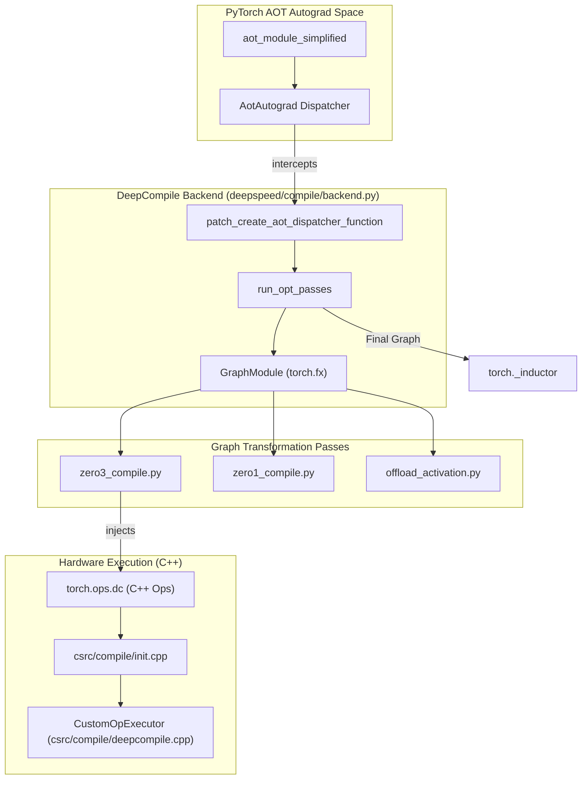
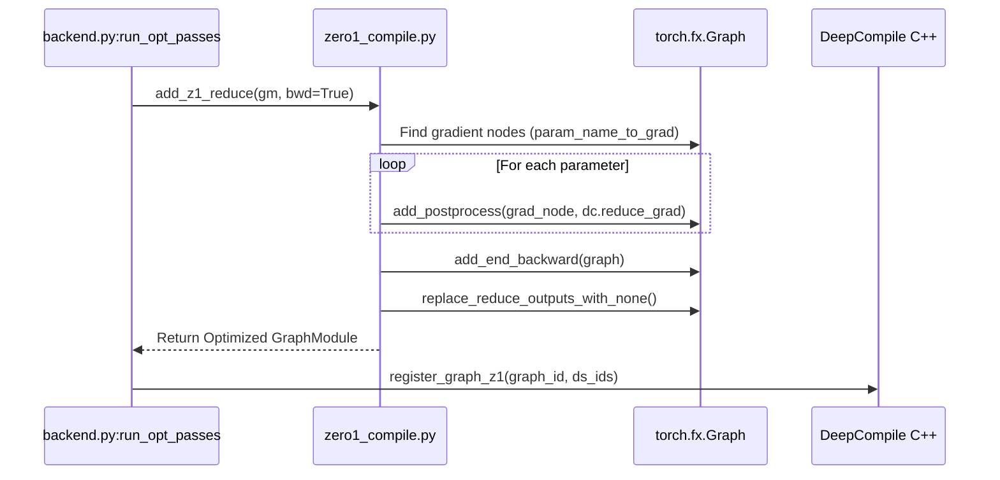

<!-- source: DeepWiki mcp.deepwiki.com · repo deepspeedai/DeepSpeed · page 11.1 DeepCompile Architecture and Backend · fetched 2026-10-21 -->

# DeepCompile Architecture and Backend

Relevant source files

The following files were used as context for generating this wiki page:

- [csrc/compile/deepcompile.cpp](csrc/compile/deepcompile.cpp)
- [csrc/compile/init.cpp](csrc/compile/init.cpp)
- [csrc/compile/z3.h](csrc/compile/z3.h)
- [deepspeed/compile/backend.py](deepspeed/compile/backend.py)
- [deepspeed/compile/fx.py](deepspeed/compile/fx.py)
- [deepspeed/compile/graph_param.py](deepspeed/compile/graph_param.py)
- [deepspeed/compile/inductor.py](deepspeed/compile/inductor.py)
- [deepspeed/compile/partitioner.py](deepspeed/compile/partitioner.py)
- [deepspeed/compile/passes/offload_activation.py](deepspeed/compile/passes/offload_activation.py)
- [deepspeed/compile/passes/offload_adam_states.py](deepspeed/compile/passes/offload_adam_states.py)
- [deepspeed/compile/passes/offload_parameters.py](deepspeed/compile/passes/offload_parameters.py)
- [deepspeed/compile/passes/prefetch.py](deepspeed/compile/passes/prefetch.py)
- [deepspeed/compile/passes/selective_gather.py](deepspeed/compile/passes/selective_gather.py)
- [deepspeed/compile/passes/zero1_compile.py](deepspeed/compile/passes/zero1_compile.py)
- [deepspeed/compile/passes/zero3_compile.py](deepspeed/compile/passes/zero3_compile.py)
- [deepspeed/compile/patch_fake_tensor.py](deepspeed/compile/patch_fake_tensor.py)
- [deepspeed/compile/profilers/graph_profile.py](deepspeed/compile/profilers/graph_profile.py)
- [deepspeed/compile/util.py](deepspeed/compile/util.py)
- [tests/unit/compile/test_inductor_aot_kwargs.py](tests/unit/compile/test_inductor_aot_kwargs.py)
- [tests/unit/v1/compile/test_compile_fx.py](tests/unit/v1/compile/test_compile_fx.py)
- [tests/unit/v1/compile/test_compile_zero.py](tests/unit/v1/compile/test_compile_zero.py)

DeepCompile is a compiler-level optimization system within DeepSpeed that leverages `torch.fx` and AOT Autograd to apply distributed training optimizations (such as ZeRO-1/2/3 graph passes, activation offloading, and parameter prefetching) directly to the model graph [deepspeed/compile/backend.py:31-35](). It bridges the gap between high-level PyTorch model definitions and low-level DeepSpeed runtime optimizations by transforming the execution graph before it is handed off to a backend compiler like Torch Inductor.

## System Architecture

DeepCompile operates as a custom backend for `torch.compile`. It intercepts the graph during the AOT Autograd tracing phase, performs graph-level transformations (passes), and then forwards the optimized graph to the final JIT compiler [deepspeed/compile/inductor.py:25-32]().

### Data Flow and Integration

The integration follows a specific sequence:
1.  **Tracing**: `torch.compile` uses Dynamo to capture the model and AOT Autograd to produce a joint forward-backward graph.
2.  **Intercepting**: DeepCompile patches the AOT Autograd dispatcher to inject its own partitioning and compilation logic [deepspeed/compile/inductor.py:122-123]().
3.  **Graph Transformation**: Custom passes (e.g., `zero3_compile`) modify the `torch.fx.Graph` to include DeepSpeed-specific operations like `allgather_param` and `reduce_grad` [deepspeed/compile/passes/zero3_compile.py:25-32]().
4.  **Backend Dispatch**: The transformed graph is sent to Inductor for kernel generation [deepspeed/compile/inductor.py:60]().

### Code Entity Map: AOT Autograd to DeepCompile

The following diagram illustrates how DeepCompile entities interface with the standard PyTorch compilation flow.

| System Component | Code Entity | File Reference |
| :--- | :--- | :--- |
| **AOT Dispatcher Patch** | `patch_create_aot_dispatcher_function` | [deepspeed/compile/inductor.py:122]() |
| **Custom Compiler Wrapper** | `wrapped_compiler` | [deepspeed/compile/inductor.py:27]() |
| **Graph Interceptor** | `aot_module_simplified` | [deepspeed/compile/backend.py:17]() |
| **Parameter Manager** | `DSGraphParamManager` | [deepspeed/compile/graph_param.py:1]() |
| **C++ Extension Builder** | `DeepCompileBuilder` | [deepspeed/compile/util.py:25]() |

Sources: [deepspeed/compile/backend.py:17-33](), [deepspeed/compile/inductor.py:122-155](), [csrc/compile/init.cpp:11-30]()

## Backend Implementation

The core of the DeepCompile backend resides in `backend.py`. It manages the lifecycle of compilation, including graph profiling, scheduling, and the execution of optimization passes.

### CompileConfig and Scheduling

DeepCompile uses a schedule-based execution system. Users can define when specific passes are applied during training via `init_schedule` [deepspeed/compile/backend.py:83-92]().

*   **`init_schedule(schedule)`**: Accepts a list of tuples `(step, [passes])` to determine which optimizations activate at which training step [deepspeed/compile/backend.py:83-90]().
*   **`launch_compile_passes(global_steps)`**: Monitors the current training step and triggers a `torch._dynamo.reset()` when a new compilation phase begins, forcing the model to be re-compiled with new passes [deepspeed/compile/backend.py:95-102]().

### Graph Partitioning

For distributed strategies like ZeRO-3, DeepCompile must correctly partition the graph into forward and backward segments while maintaining parameter visibility.
*   **`get_wrapped_partitioner`**: Wraps the standard min-cut partitioner to ensure DeepSpeed parameters are handled as specialized inputs rather than generic constants [deepspeed/compile/partitioner.py:1](), [deepspeed/compile/inductor.py:70-75]().
*   **`DSGraphParamManager`**: Tracks parameter IDs (`ds_id`) and their corresponding nodes in the FX graph to facilitate automatic injection of communication ops [deepspeed/compile/backend.py:27](), [deepspeed/compile/graph_param.py:1]().

### Profiling and Memory Estimation

Before applying passes, DeepCompile often runs a `ProfilingInterpreter` to gather metadata about node execution time and memory consumption [deepspeed/compile/profilers/graph_profile.py:78-81]().
*   **`ProfilingInterpreter.run(*args)`**: Executes the graph using real tensors to measure `device_time`, `wall_time`, and `alloc_mem` for every node [deepspeed/compile/profilers/graph_profile.py:96-110]().
*   **`set_time_and_tensor_size`**: Annotates the FX graph nodes with collected profiling data in the `.meta` field [deepspeed/compile/backend.py:110-128]().

Sources: [deepspeed/compile/backend.py:83-109](), [deepspeed/compile/inductor.py:65-91](), [deepspeed/compile/profilers/graph_profile.py:78-118]()

## Pass Execution System

The system applies a sequence of `Callable` functions to the `GraphModule`. Each pass typically identifies specific patterns in the graph and replaces them with optimized DeepCompile custom operators.

### Custom Operator Injection

DeepCompile defines a suite of ATen-compatible operations in C++ (under the `dc` namespace) that are injected into the FX graph:

| Operator | Purpose |
| :--- | :--- |
| `dc.allgather_param` | Initiates an asynchronous all-gather for ZeRO-3 parameters [csrc/compile/init.cpp:13](). |
| `dc.wait_allgather` | Blocks until the parameter gathering is complete [csrc/compile/init.cpp:17](). |
| `dc.release_param` | Frees the gathered parameter memory after its last use [csrc/compile/init.cpp:18](). |
| `dc.reduce_grad` | Performs gradient reduction (ZeRO-1/2) into buckets [csrc/compile/init.cpp:19](). |
| `dc.end_backward` | Flushes pending reductions and cleans up resources [csrc/compile/init.cpp:27](). |

### Sequence of a Transformation Pass (e.g., ZeRO-1)

Sources: [deepspeed/compile/passes/zero1_compile.py:18-58](), [deepspeed/compile/backend.py:188-210]()

## C++ Backend Orchestration

The C++ component (`csrc/compile/deepcompile.cpp`) provides the high-performance implementation for the operators injected during graph passes.

### Key Components:
1.  **`CustomOpExecutor`**: Manages the execution state for a specific graph ID, including tracking which parameters are currently gathered [csrc/compile/deepcompile.cpp:13]().
2.  **`DoubleBufferedReduceBucket`**: Implements the gradient reduction logic, supporting double buffering to overlap communication with computation [csrc/compile/deepcompile.cpp:155-157]().
3.  **Symmetric Memory**: Optionally uses `c10d::symmetric_memory` for low-latency P2P parameter transfers [csrc/compile/deepcompile.cpp:51-61]().
4.  **`end_backward`**: A critical synchronization point that ensures all asynchronous reductions are finished before the optimizer step [csrc/compile/deepcompile.cpp:182-191]().

Sources: [csrc/compile/deepcompile.cpp:10-21](), [csrc/compile/deepcompile.cpp:130-164](), [csrc/compile/init.cpp:11-49]()

---

