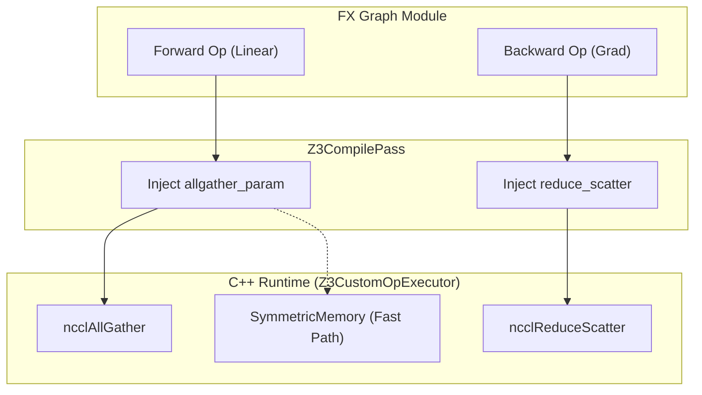

<!-- source: DeepWiki mcp.deepwiki.com · repo deepspeedai/DeepSpeed · page 11.2 Compiler Passes and Graph Transforms · fetched 2026-10-21 -->

# Compiler Passes and Graph Transforms

Relevant source files

The following files were used as context for generating this wiki page:

- [.github/workflows/amd-mi200.yml](.github/workflows/amd-mi200.yml)
- [.github/workflows/aws-accelerate.yml](.github/workflows/aws-accelerate.yml)
- [.github/workflows/aws-torch-latest.yml](.github/workflows/aws-torch-latest.yml)
- [.github/workflows/cpu-torch-latest.yml](.github/workflows/cpu-torch-latest.yml)
- [.github/workflows/formatting.yml](.github/workflows/formatting.yml)
- [.github/workflows/hpu-gaudi2-nightly.yml](.github/workflows/hpu-gaudi2-nightly.yml)
- [.github/workflows/hpu-gaudi2.yml](.github/workflows/hpu-gaudi2.yml)
- [.github/workflows/modal-accelerate.yml](.github/workflows/modal-accelerate.yml)
- [.github/workflows/modal-torch-latest.yml](.github/workflows/modal-torch-latest.yml)
- [.github/workflows/no-torch.yml](.github/workflows/no-torch.yml)
- [.github/workflows/nv-a6000.yml](.github/workflows/nv-a6000.yml)
- [.github/workflows/nv-flash-attn.yml](.github/workflows/nv-flash-attn.yml)
- [.github/workflows/nv-pre-compile-ops.yml](.github/workflows/nv-pre-compile-ops.yml)
- [.github/workflows/nv-sd.yml](.github/workflows/nv-sd.yml)
- [.github/workflows/python.yml](.github/workflows/python.yml)
- [csrc/compile/deepcompile.cpp](csrc/compile/deepcompile.cpp)
- [csrc/compile/init.cpp](csrc/compile/init.cpp)
- [csrc/compile/z1.cpp](csrc/compile/z1.cpp)
- [csrc/compile/z1.h](csrc/compile/z1.h)
- [csrc/compile/z2.cpp](csrc/compile/z2.cpp)
- [csrc/compile/z3.cpp](csrc/compile/z3.cpp)
- [csrc/compile/z3.h](csrc/compile/z3.h)
- [csrc/includes/deepcompile.h](csrc/includes/deepcompile.h)
- [deepspeed/compile/config.py](deepspeed/compile/config.py)
- [deepspeed/compile/constants.py](deepspeed/compile/constants.py)
- [deepspeed/compile/custom_ops/__init__.py](deepspeed/compile/custom_ops/__init__.py)
- [deepspeed/compile/custom_ops/all_to_all.py](deepspeed/compile/custom_ops/all_to_all.py)
- [deepspeed/compile/custom_ops/sp_compat.py](deepspeed/compile/custom_ops/sp_compat.py)
- [deepspeed/compile/custom_ops/sp_dp_registry.py](deepspeed/compile/custom_ops/sp_dp_registry.py)
- [deepspeed/compile/fx.py](deepspeed/compile/fx.py)
- [deepspeed/compile/init_sp.py](deepspeed/compile/init_sp.py)
- [deepspeed/compile/init_z1.py](deepspeed/compile/init_z1.py)
- [deepspeed/compile/init_z3.py](deepspeed/compile/init_z3.py)
- [deepspeed/compile/passes/long_context_checkpointing.py](deepspeed/compile/passes/long_context_checkpointing.py)
- [deepspeed/compile/passes/selective_gather.py](deepspeed/compile/passes/selective_gather.py)
- [deepspeed/compile/passes/sp_compile.py](deepspeed/compile/passes/sp_compile.py)
- [deepspeed/compile/passes/zero1_compile.py](deepspeed/compile/passes/zero1_compile.py)
- [deepspeed/compile/passes/zero3_compile.py](deepspeed/compile/passes/zero3_compile.py)
- [deepspeed/compile/patch_fake_tensor.py](deepspeed/compile/patch_fake_tensor.py)
- [deepspeed/compile/util.py](deepspeed/compile/util.py)
- [tests/torch_compile/test_deepcompile_z3_release.py](tests/torch_compile/test_deepcompile_z3_release.py)
- [tests/unit/compile/test_zero3_grad_dtype.py](tests/unit/compile/test_zero3_grad_dtype.py)
- [tests/unit/ops/test_op_builder.py](tests/unit/ops/test_op_builder.py)
- [tests/unit/v1/compile/test_compile_autosp.py](tests/unit/v1/compile/test_compile_autosp.py)
- [tests/unit/v1/compile/test_compile_fx.py](tests/unit/v1/compile/test_compile_fx.py)
- [tests/unit/v1/compile/test_compile_zero.py](tests/unit/v1/compile/test_compile_zero.py)

DeepCompile utilizes `torch.fx` and AOT Autograd to perform graph-level transformations that optimize distributed training patterns. These compiler passes automate complex tasks such as ZeRO parameter gathering, gradient reduction, and sequence parallelism communication, which are traditionally handled by manual hooks or module wrappers.

## ZeRO-3 Compile Pass

The ZeRO-3 compile pass transforms a standard compute graph into one that is aware of partitioned parameters. It identifies parameter usage within the graph and injects `allgather` and `reduce_scatter` operations to manage the parameter lifecycle dynamically.

### Implementation and Data Flow
The transformation is primarily managed by the `ZeRO3CompilePass` which operates on the `torch.fx.GraphModule` [deepspeed/compile/passes/zero3_compile.py:1-20](). It performs the following key transformations:

1.  **Parameter Tracking**: Identifies `torch.nn.Parameter` objects that are partitioned across ranks.
2.  **Gather Injection**: Before an operation that uses a partitioned parameter, it injects a call to `allgather_param`. This is often executed on a dedicated `ag_stream` to overlap communication with computation [csrc/compile/z3.cpp:36-38]().
3.  **Release Injection**: After the parameter is used, it marks the gathered buffer for release to reclaim GPU memory.
4.  **Gradient Reduction**: In the backward pass, it replaces standard gradient updates with `reduce_scatter` operations using the `Z3CustomOpExecutor` [csrc/compile/z3.cpp:15-27]().

### Key Entities: Z3CustomOpExecutor
The `Z3CustomOpExecutor` is a C++ backend component that manages the low-level NCCL communication and synchronization for ZeRO-3.

| Function | Role |
| :--- | :--- |
| `launchAllGather` | Executes the actual NCCL `allGather` or symmetric memory copy [csrc/compile/z3.cpp:68-71](). |
| `allgatherParam` | High-level entry point that checks parameter validity and triggers gathering [csrc/compile/z3.cpp:119-122](). |
| `prefetchParamsFused` | Allows for batching multiple parameter gathers into a single operation to reduce overhead [csrc/compile/z3.cpp:166-168](). |

**ZeRO-3 Graph Transformation Flow**

Sources: [csrc/compile/z3.cpp:15-117](), [deepspeed/compile/passes/zero3_compile.py:1-50](), [csrc/includes/deepcompile.h:15-30]()

## ZeRO-1 and ZeRO-2 Compile Passes

ZeRO-1 and ZeRO-2 focus on optimizer state and gradient partitioning. Unlike ZeRO-3, parameters are generally available on all ranks, so the compiler passes focus on the backward pass and gradient management.

*   **ZeRO-1 Pass**: Focuses on partitioning optimizer states. The compiler pass ensures that gradients are correctly routed to the rank owning the corresponding optimizer state [deepspeed/compile/passes/zero1_compile.py:1-15]().
*   **ZeRO-2 Pass**: Extends this by partitioning gradients. The pass injects `reduce` or `reduce_scatter` operations immediately after a gradient is produced in the backward graph [csrc/compile/z2.cpp:1-10]().

### Reduce Bucketing
To prevent small, inefficient NCCL calls, DeepCompile uses a `DoubleBufferedReduceBucket` [csrc/includes/deepcompile.h:179-181](). This component aggregates gradients until a size threshold is met before launching a collective operation.

Sources: [deepspeed/compile/passes/zero1_compile.py:1-20](), [csrc/compile/z1.cpp:1-50](), [csrc/includes/deepcompile.h:135-177]()

## Sequence Parallelism (Ulysses) Pass

The Sequence Parallelism pass (specifically for DeepSpeed-Ulysses) transforms the attention mechanism to support long-sequence training by partitioning the sequence dimension across GPUs.

### SP Transformation Logic
The `SPCompilePass` identifies attention layers and modifies the data flow to include `all_to_all` communication [deepspeed/compile/passes/sp_compile.py:1-15]().

1.  **Sequence Splitting**: The input sequence is split across the degree of parallelism.
2.  **All-to-All Dispatch**: Before the attention computation, an `all_to_all` operation rearranges data so each rank has all sequence parts for a subset of attention heads [deepspeed/compile/custom_ops/all_to_all.py:1-10]().
3.  **Local Attention**: Standard attention is performed on the local shards.
4.  **All-to-All Combine**: A second `all_to_all` restores the original sequence partitioning.

**Ulysses Sequence Parallelism Code Mapping**

Sources: [deepspeed/compile/passes/sp_compile.py:1-30](), [deepspeed/compile/custom_ops/all_to_all.py:1-20](), [deepspeed/compile/custom_ops/sp_compat.py:1-15]()

## Selective Gather and Offloading Passes

DeepCompile provides specialized passes to manage memory pressure through selective gathering and offloading.

### Selective Gather
The `SelectiveGatherPass` optimizes ZeRO-3 by identifying parameters that do not need to be gathered for every forward pass (e.g., parameters used in conditional branches or specific iterations) [deepspeed/compile/passes/selective_gather.py:1-25](). It modifies the graph to only trigger `allgather_param` when specific conditions are met, reducing communication overhead.

### Activation and Parameter Offloading
DeepCompile integrates with ZeRO-Infinity style offloading via graph transforms:
*   **Parameter Offloading**: Injects `reload_stream` and `offload_stream` operations to move parameters between CPU/NVMe and GPU memory during the graph execution [csrc/compile/z3.cpp:25-26]().
*   **Activation Offloading**: Identifies tensors in the forward pass that are only needed much later in the backward pass and injects copy operations to move them to host memory [csrc/compile/z3.cpp:37-38]().

### Implementation Detail: CUDA Events and Streams
To ensure asynchronous execution and overlap, the compiler passes use several dedicated streams defined in the C++ `Z3CustomOpExecutor`:
*   `ag_stream_`: For AllGather operations [csrc/compile/z3.cpp:36]().
*   `rs_stream_`: For ReduceScatter operations [csrc/compile/z3.cpp:33]().
*   `copy_stream_`: For H2D/D2H transfers [csrc/compile/z3.cpp:34]().
*   `offload_stream_` / `reload_stream_`: For managing offloaded state [csrc/compile/z3.cpp:37-38]().

Synchronization is handled via `CUDAEvent` objects recorded and waited upon within the graph nodes [csrc/compile/z3.cpp:41-44]().

Sources: [csrc/compile/z3.cpp:15-60](), [deepspeed/compile/passes/selective_gather.py:1-40](), [csrc/includes/deepcompile.h:111-130]()

---

