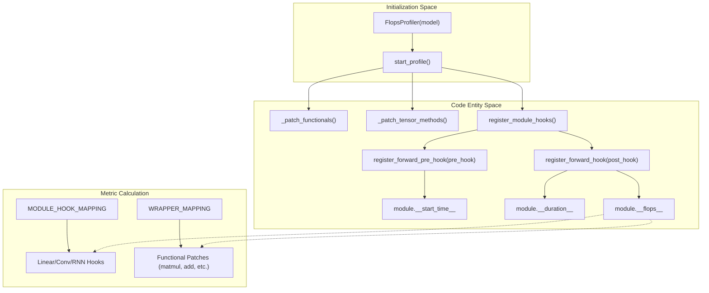
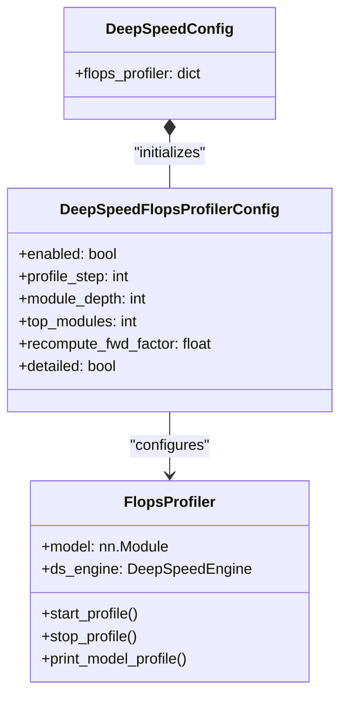

<!-- source: DeepWiki mcp.deepwiki.com · repo deepspeedai/DeepSpeed · page 12.1 Flops Profiler · fetched 2026-10-21 -->

# Flops Profiler

<details>
<summary>Relevant source files</summary>

The following files were used as context for generating this wiki page:

- [.clang-format](.clang-format)
- [csrc/includes/Timer.h](csrc/includes/Timer.h)
- [deepspeed/profiling/config.py](deepspeed/profiling/config.py)
- [deepspeed/profiling/constants.py](deepspeed/profiling/constants.py)
- [deepspeed/profiling/flops_profiler/README.md](deepspeed/profiling/flops_profiler/README.md)
- [deepspeed/profiling/flops_profiler/profiler.py](deepspeed/profiling/flops_profiler/profiler.py)
- [deepspeed/runtime/activation_checkpointing/config.py](deepspeed/runtime/activation_checkpointing/config.py)
- [docs/_tutorials/flops-profiler.md](docs/_tutorials/flops-profiler.md)

</details>


The DeepSpeed Flops Profiler is a diagnostic tool designed to measure the computational efficiency and resource consumption of PyTorch models. It provides detailed metrics for latency, floating-point operations (FLOPs), multiply-accumulate operations (MACs), and parameter counts at a per-module level [deepspeed/profiling/flops_profiler/profiler.py:30-35]().

The profiler helps identify performance bottlenecks by attributing hardware utilization to specific submodules, supporting both training and inference contexts. It can be used as a standalone package or integrated directly into the DeepSpeed runtime via configuration [deepspeed/profiling/flops_profiler/README.md:9-12]().

## System Architecture and Code Entities

The Flops Profiler operates by intercepting the model's forward pass through a combination of PyTorch forward hooks and monkey-patching of functional operations.

### Core Logic Flow

The following diagram illustrates how the `FlopsProfiler` interacts with a `torch.nn.Module` to capture metrics.

**Flops Profiler Execution Logic**

**Sources:** [deepspeed/profiling/flops_profiler/profiler.py:30-132]()

### Configuration Entity Mapping

The profiler is configured via the `flops_profiler` block in the DeepSpeed configuration JSON. The `DeepSpeedFlopsProfilerConfig` class parses these parameters to control the profiling behavior.

**Configuration to Entity Mapping**

**Sources:** [deepspeed/profiling/config.py:10-47](), [deepspeed/profiling/constants.py:11-47]()

## Key Implementation Details

### Profiling Mechanism
The profiler employs two primary strategies to track operations:
1.  **Module Hooks:** For standard layers (e.g., `nn.Linear`, `nn.Conv2d`), the profiler uses `register_forward_hook` to calculate FLOPs based on input/output shapes and layer parameters [deepspeed/profiling/flops_profiler/profiler.py:93-96]().
2.  **Monkey Patching:** For functional operations that do not reside in a standard module (e.g., `torch.matmul`, `torch.add`), the profiler replaces the original functions in the `torch.nn.functional` and `torch` namespaces with wrappers that increment a global counter [deepspeed/profiling/flops_profiler/profiler.py:84-87]().

### Latency Measurement
Latency is measured by wrapping the module execution with synchronization calls. The `start_time_hook` and `end_time_hook` utilize `get_accelerator().synchronize()` to ensure accurate timing on asynchronous devices like GPUs [deepspeed/profiling/flops_profiler/profiler.py:116-128]().

### Parameter and FLOPs Calculation
The profiler distinguishes between standard parameters and those in Mixture-of-Experts (MoE) layers. It accounts for Expert Parallelism (EP) by checking for the `ep_size` attribute on parameters [deepspeed/profiling/flops_profiler/profiler.py:170-185]().

| Metric | Calculation Method | Code Reference |
| :--- | :--- | :--- |
| **FLOPs** | Based on operation type (e.g., $2 \times M \times N \times K$ for GEMM) | [deepspeed/profiling/flops_profiler/profiler.py:456-465]() |
| **MACs** | Typically half of FLOPs for fused multiply-add operations | [deepspeed/profiling/flops_profiler/profiler.py:24]() |
| **Parameters** | `numel()` of module parameters, adjusted for MoE | [deepspeed/profiling/flops_profiler/profiler.py:170-195]() |

## Usage Modes

### 1. Integrated Usage (DeepSpeed Runtime)
When enabled in the `ds_config.json`, the profiler automatically triggers at the specified `profile_step`. No manual code changes are required beyond the configuration file [deepspeed/profiling/constants.py:11-24]().

```json
{
  "flops_profiler": {
    "enabled": true,
    "profile_step": 10,
    "module_depth": -1,
    "top_modules": 3,
    "detailed": true
  }
}
```

### 2. Standalone Usage
The `FlopsProfiler` class can be used independently of the DeepSpeed training engine [deepspeed/profiling/flops_profiler/profiler.py:37-40]().

```python
from deepspeed.profiling.flops_profiler import FlopsProfiler

prof = FlopsProfiler(model)
prof.start_profile()

# Forward pass
output = model(input)

prof.print_model_profile(profile_step=1)
prof.end_profile()
```

## Output Summary
The profiler generates a comprehensive report including:
*   **Global Stats:** Total parameters, MACs, FLOPs, and aggregate latency across the world size [deepspeed/profiling/flops_profiler/README.md:16-46]().
*   **Aggregated Profile:** Top $k$ modules at specified depths contributing to compute and latency [deepspeed/profiling/flops_profiler/README.md:48-73]().
*   **Detailed Profile:** A hierarchical view of the model tree with metrics attached to every submodule [deepspeed/profiling/flops_profiler/README.md:74-121]().

**Sources:**
* [deepspeed/profiling/flops_profiler/profiler.py:30-195]()
* [deepspeed/profiling/config.py:10-47]()
* [deepspeed/profiling/constants.py:11-47]()
* [deepspeed/profiling/flops_profiler/README.md:9-121]()

---

