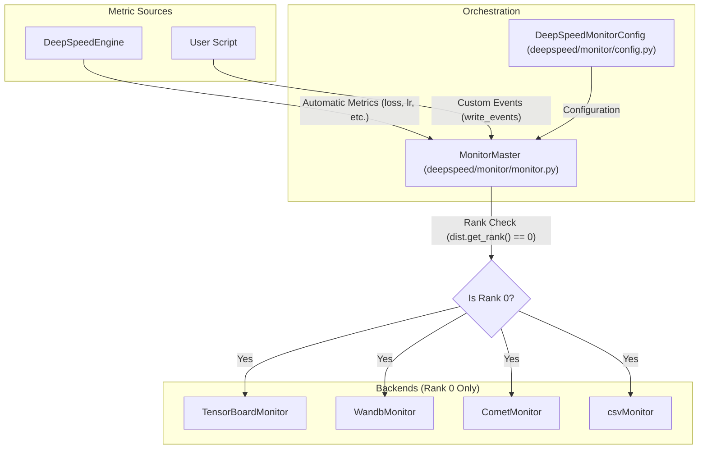
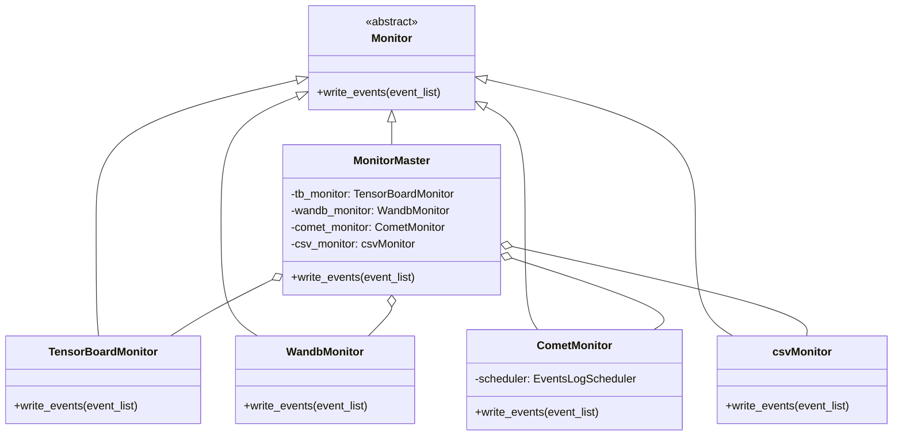

<!-- source: DeepWiki mcp.deepwiki.com · repo deepspeedai/DeepSpeed · page 12.2 Training Monitor · fetched 2026-10-21 -->

# Training Monitor

<details>
<summary>Relevant source files</summary>

The following files were used as context for generating this wiki page:

- [deepspeed/comm/config.py](deepspeed/comm/config.py)
- [deepspeed/monitor/comet.py](deepspeed/monitor/comet.py)
- [deepspeed/monitor/config.py](deepspeed/monitor/config.py)
- [deepspeed/monitor/monitor.py](deepspeed/monitor/monitor.py)
- [deepspeed/monitor/utils.py](deepspeed/monitor/utils.py)
- [deepspeed/runtime/lr_schedules.py](deepspeed/runtime/lr_schedules.py)
- [docs/_tutorials/monitor.md](docs/_tutorials/monitor.md)
- [docs/assets/images/comet_monitor.png](docs/assets/images/comet_monitor.png)
- [docs/code-docs/source/monitor.rst](docs/code-docs/source/monitor.rst)
- [tests/unit/monitor/test_monitor.py](tests/unit/monitor/test_monitor.py)
- [tests/unit/runtime/pipe/test_topology.py](tests/unit/runtime/pipe/test_topology.py)
- [tests/unit/runtime/test_ds_config_model.py](tests/unit/runtime/test_ds_config_model.py)
- [tests/unit/runtime/test_lr_schedulers.py](tests/unit/runtime/test_lr_schedulers.py)

</details>


The DeepSpeed Training Monitor provides a unified interface for logging training metrics to multiple backends simultaneously. It automates the tracking of critical performance and convergence data, such as loss, learning rate, and system-level timings (e.g., forward/backward pass durations), while allowing users to inject custom metrics from their training scripts.

## Overview and Integration

The monitoring system is orchestrated by the `MonitorMaster` class [deepspeed/monitor/monitor.py:30-31](), which acts as a dispatcher for various backend implementations. DeepSpeed supports four primary backends:
*   **TensorBoard**: Logs to standard event files [deepspeed/monitor/tensorboard.py]().
*   **WandB (Weights & Biases)**: Cloud-based experiment tracking [deepspeed/monitor/wandb.py]().
*   **Comet**: Cloud-based experiment management [deepspeed/monitor/comet.py]().
*   **CSV**: Local filesystem logging in CSV format [deepspeed/monitor/csv_monitor.py]().

### Data Flow Architecture

The following diagram illustrates the data flow from the DeepSpeed Engine and user scripts through the `MonitorMaster` to the specific backends.

**DeepSpeed Monitoring Data Flow**

**Sources:** [deepspeed/monitor/monitor.py:30-60](), [docs/_tutorials/monitor.md:69-82]()

## Configuration System

Monitoring is configured via the `monitor` field in the DeepSpeed JSON configuration. The configuration is parsed into a `DeepSpeedMonitorConfig` object [deepspeed/monitor/config.py:125-145]().

### Backend Configuration Classes
Each backend has a dedicated configuration class inheriting from `DeepSpeedConfigModel`:

| Backend | Configuration Class | Key Parameters |
| :--- | :--- | :--- |
| **TensorBoard** | `TensorBoardConfig` [deepspeed/monitor/config.py:17]() | `enabled`, `output_path`, `job_name` |
| **WandB** | `WandbConfig` [deepspeed/monitor/config.py:33]() | `enabled`, `project`, `team`, `group` |
| **Comet** | `CometConfig` [deepspeed/monitor/config.py:65]() | `enabled`, `project`, `api_key`, `samples_log_interval` |
| **CSV** | `CSVConfig` [deepspeed/monitor/config.py:49]() | `enabled`, `output_path`, `job_name` |

**Sources:** [deepspeed/monitor/config.py:17-124]()

## Implementation Details

### MonitorMaster
The `MonitorMaster` is the primary entry point. During initialization, it checks the global rank and only instantiates backends on **Rank 0** [deepspeed/monitor/monitor.py:40-48](). This ensures that logs are not duplicated across multiple distributed processes.

Key methods:
*   `__init__(monitor_config)`: Conditionally initializes `tb_monitor`, `wandb_monitor`, `csv_monitor`, and `comet_monitor` based on the provided configuration [deepspeed/monitor/monitor.py:32-48]().
*   `write_events(event_list)`: Iterates through all initialized backends and calls their respective `write_events` methods [deepspeed/monitor/monitor.py:50-59]().

### Metric Logging Logic
Metrics are passed as a list of 3-tuples: `(name, value, global_samples)` [deepspeed/monitor/comet.py:20](). 

The `CometMonitor` implementation introduces an `EventsLogScheduler` [deepspeed/monitor/comet.py:74]() to manage the frequency of logging. It uses `samples_log_interval` to prevent overwhelming the backend with every training step [deepspeed/monitor/comet.py:80-92]().

**Backend Initialization Hierarchy**

**Sources:** [deepspeed/monitor/monitor.py:13-60](), [deepspeed/monitor/comet.py:23-47]()

## Automatically Logged Data

When the monitor is enabled, DeepSpeed automatically captures several fields:

| Field | Description | Requirement |
| :--- | :--- | :--- |
| `Train/Samples/train_loss` | Current training loss | Always |
| `Train/Samples/lr` | Learning rate | Always |
| `Train/Samples/loss_scale` | FP16 loss scale | `fp16` enabled |
| `Train/Samples/elapsed_time_ms_forward` | Forward pass duration | `flops_profiler` or `wall_clock_breakdown` |
| `Train/Samples/elapsed_time_ms_backward` | Backward pass duration | `flops_profiler` or `wall_clock_breakdown` |
| `Train/Samples/elapsed_time_ms_step` | Optimizer step duration | `flops_profiler` or `wall_clock_breakdown` |

**Sources:** [docs/code-docs/source/monitor.rst:8-21]()

## Custom Monitoring Usage

Users can manually log metrics by initializing a `MonitorMaster` and passing a list of events.

### Implementation Example
```python
from deepspeed.monitor.monitor import MonitorMaster
from deepspeed.runtime.config import DeepSpeedConfig

# Initialize using the monitor_config from the main DeepSpeed configuration
ds_config = DeepSpeedConfig("ds_config.json")
monitor = MonitorMaster(ds_config.monitor_config)

# Log custom metric
# Format: (label, value, engine.global_samples)
events = [("Custom_Metric/Accuracy", 0.95, model_engine.global_samples)]
monitor.write_events(events)
```
**Sources:** [docs/_tutorials/monitor.md:87-114]()

## Availability Checks
The system includes utility functions to verify that required third-party packages are installed before attempting to initialize backends:
*   `check_tb_availability()`: Checks for `tensorboard` [deepspeed/monitor/utils.py:9-16]().
*   `check_wandb_availability()`: Checks for `wandb` [deepspeed/monitor/utils.py:19-27]().
*   `check_comet_availability()`: Checks for `comet_ml >= 3.41.0` [deepspeed/monitor/utils.py:29-38]().

**Sources:** [deepspeed/monitor/utils.py:9-38]()

---

