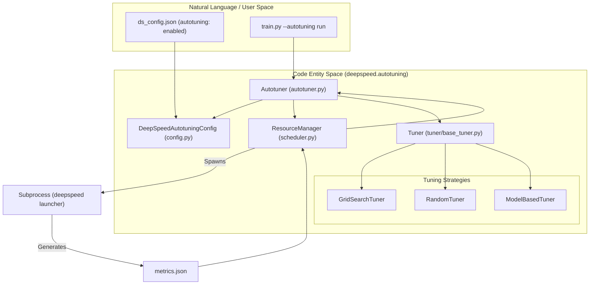
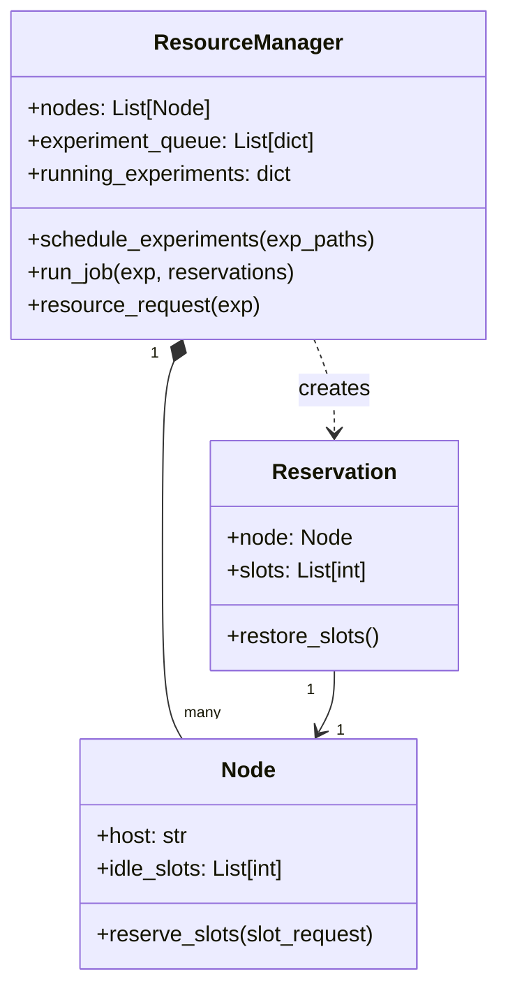

<!-- source: DeepWiki mcp.deepwiki.com · repo deepspeedai/DeepSpeed · page 12.3 Autotuning System · fetched 2026-10-21 -->

# Autotuning System

Relevant source files

The following files were used as context for generating this wiki page:

- [blogs/assets/images/hero-figure-black-ja.png](blogs/assets/images/hero-figure-black-ja.png)
- [blogs/deepspeed-chat/README.md](blogs/deepspeed-chat/README.md)
- [blogs/deepspeed-chat/chinese/README.md](blogs/deepspeed-chat/chinese/README.md)
- [blogs/deepspeed-chat/japanese/README.md](blogs/deepspeed-chat/japanese/README.md)
- [deepspeed/autotuning/README.md](deepspeed/autotuning/README.md)
- [deepspeed/autotuning/autotuner.py](deepspeed/autotuning/autotuner.py)
- [deepspeed/autotuning/config.py](deepspeed/autotuning/config.py)
- [deepspeed/autotuning/constants.py](deepspeed/autotuning/constants.py)
- [deepspeed/autotuning/scheduler.py](deepspeed/autotuning/scheduler.py)
- [deepspeed/autotuning/tuner/README.md](deepspeed/autotuning/tuner/README.md)
- [deepspeed/autotuning/tuner/base_tuner.py](deepspeed/autotuning/tuner/base_tuner.py)
- [deepspeed/autotuning/tuner/model_based_tuner.py](deepspeed/autotuning/tuner/model_based_tuner.py)
- [deepspeed/autotuning/utils.py](deepspeed/autotuning/utils.py)
- [docs/_posts/2021-11-15-autotuning.md](docs/_posts/2021-11-15-autotuning.md)
- [docs/_tutorials/MoQ-tutorial.md](docs/_tutorials/MoQ-tutorial.md)
- [docs/_tutorials/autotuning.md](docs/_tutorials/autotuning.md)
- [docs/code-docs/source/autotuning.rst](docs/code-docs/source/autotuning.rst)

The DeepSpeed Autotuner is an automated framework designed to discover the optimal DeepSpeed configuration for a given model and hardware setup. It mitigates the manual effort required to tune performance-critical hyperparameters such as ZeRO stages, micro-batch sizes, and memory optimization flags [deepspeed/autotuning/README.md:4-9]().

The system operates by executing a series of profiling experiments, using heuristics and search algorithms (Grid Search, Random, or Model-Based) to navigate the configuration space and return the setup that yields the highest throughput or lowest latency [deepspeed/autotuning/autotuner.py:42-45]().

## System Architecture and Data Flow

The Autotuning system is composed of three primary layers: the **Autotuner** (orchestrator), the **Tuner** (search strategy), and the **ResourceManager** (execution and scheduling).

### High-Level Components

| Component | Code Entity | Responsibility |
|-----------|-------------|----------------|
| **Orchestrator** | `Autotuner` | Manages the overall workflow, initialization, and final result reporting [deepspeed/autotuning/autotuner.py:42](). |
| **Scheduler** | `ResourceManager` | Manages hardware slots (GPUs/Nodes), dispatches experiments to threads, and monitors process completion [deepspeed/autotuning/scheduler.py:32](). |
| **Tuner** | `BaseTuner` subclasses | Implements search logic (e.g., `GridSearchTuner`, `ModelBasedTuner`) to select the next set of hyperparameters [deepspeed/autotuning/tuner/base_tuner.py:13](). |
| **Configuration** | `DeepSpeedAutotuningConfig` | Parses and validates autotuning-specific settings from the DeepSpeed JSON config [deepspeed/autotuning/config.py:22](). |

### Logical Flow Diagram
The following diagram illustrates the interaction between the Autotuner, the Tuner strategies, and the physical execution environment.

**DeepSpeed Autotuning Component Interaction**

**Sources:** [deepspeed/autotuning/autotuner.py:42-107](), [deepspeed/autotuning/scheduler.py:32-109](), [deepspeed/autotuning/tuner/base_tuner.py:38-72]()

## Core Implementation Details

### Autotuner Initialization and Workflow
The `Autotuner` class serves as the entry point. It initializes the `ResourceManager` with available hosts and GPU counts [deepspeed/autotuning/autotuner.py:91-92](). The workflow generally follows these steps:
1. **Model Profiling**: Runs an initial experiment to capture model parameters and activation memory if not provided [deepspeed/autotuning/README.md:79-80]().
2. **Space Exploration**: Iterates through ZeRO stages (0-3). For each stage, it determines if the model fits in memory [deepspeed/autotuning/README.md:81-82]().
3. **Hyperparameter Selection**: Uses a `BaseTuner` to sample configurations (e.g., `reduce_bucket_size`, `allgather_bucket_size`) [deepspeed/autotuning/tuner/base_tuner.py:43-48]().
4. **Execution**: The `ResourceManager` schedules these as independent DeepSpeed jobs [deepspeed/autotuning/scheduler.py:58-88]().

### The Resource Manager and Scheduling
The `ResourceManager` handles the complexity of distributed execution. It maintains a queue of experiments and maps them to available `Node` and `Slot` (GPU) objects [deepspeed/autotuning/scheduler.py:38-46]().

**Resource Scheduling Entity Map**

**Sources:** [deepspeed/autotuning/scheduler.py:32-46](), [deepspeed/autotuning/scheduler.py:132-151]()

### Tuning Strategies
DeepSpeed supports three main tuning algorithms:
*   **Grid Search**: Exhaustively searches the defined space [deepspeed/autotuning/autotuner.py:21]().
*   **Random Search**: Samples configurations randomly [deepspeed/autotuning/autotuner.py:21]().
*   **Model-Based**: Uses a surrogate model (e.g., XGBoost) to predict performance and focus on promising areas of the search space [deepspeed/autotuning/autotuner.py:21]().

The `BaseTuner.tune()` method implements the main loop, calling `next_batch()` to get new experiments and `update()` to feed results back into the strategy [deepspeed/autotuning/tuner/base_tuner.py:38-69]().

## Configuration and Search Space

The Autotuner uses default templates for each ZeRO stage, defining ranges for bucket sizes and boolean flags for optimizations like `overlap_comm` or `contiguous_gradients` [deepspeed/autotuning/constants.py:152-181]().

### Default Tuning Space Examples

| ZeRO Stage | Parameters Tuned | Default Ranges/Values |
|------------|------------------|-----------------------|
| **ZeRO-1** | `reduce_bucket_size`, `allgather_bucket_size` | `[5e7, 5e8, 1e9]` [deepspeed/autotuning/constants.py:155-156]() |
| **ZeRO-2** | `overlap_comm`, `reduce_scatter`, `contiguous_gradients` | `[True, False]` [deepspeed/autotuning/constants.py:163-167]() |
| **ZeRO-3** | `allgather_partitions`, `reduce_bucket_size`, etc. | `[True, False]`, `[5e7, 5e8, 1e9]` [deepspeed/autotuning/constants.py:174-179]() |

### Argument Mapping
Because training scripts often use custom CLI arguments for batch sizes (e.g., `--per_device_train_batch_size`), the Autotuner requires an `arg_mappings` dictionary to inject tuned values back into the user script [deepspeed/autotuning/README.md:17-28]().

## Execution Flow: `tune` vs `run`

The system supports two modes via the `--autotuning` flag:
1.  **`tune`**: Performs the search, writes the optimal configuration to the results directory, and exits [deepspeed/autotuning/README.md:35]().
2.  **`run`**: Performs the search, then automatically re-launches the training script using the discovered optimal configuration [deepspeed/autotuning/README.md:35]().

**Sources:**
- `deepspeed/autotuning/autotuner.py`
- `deepspeed/autotuning/scheduler.py`
- `deepspeed/autotuning/tuner/base_tuner.py`
- `deepspeed/autotuning/config.py`
- `deepspeed/autotuning/constants.py`
- `deepspeed/autotuning/README.md`

---

