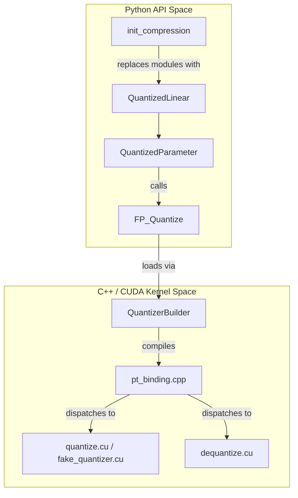
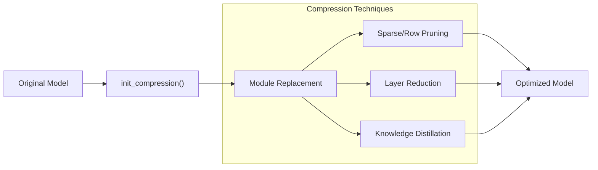

<!-- source: DeepWiki mcp.deepwiki.com · repo deepspeedai/DeepSpeed · page 13 Quantization and Compression · fetched 2026-10-21 -->

# Quantization and Compression

Relevant source files

The following files were used as context for generating this wiki page:

- [csrc/fp_quantizer/fp_quantize.cpp](csrc/fp_quantizer/fp_quantize.cpp)
- [csrc/includes/dequantization_utils.h](csrc/includes/dequantization_utils.h)
- [csrc/includes/quantization.h](csrc/includes/quantization.h)
- [csrc/includes/quantization_utils.h](csrc/includes/quantization_utils.h)
- [csrc/quantization/dequantize.cu](csrc/quantization/dequantize.cu)
- [csrc/quantization/pt_binding.cpp](csrc/quantization/pt_binding.cpp)
- [csrc/quantization/quantize.cu](csrc/quantization/quantize.cu)
- [csrc/quantization/quantize_intX.cu](csrc/quantization/quantize_intX.cu)
- [deepspeed/compression/__init__.py](deepspeed/compression/__init__.py)
- [deepspeed/compression/basic_layer.py](deepspeed/compression/basic_layer.py)
- [deepspeed/compression/compress.py](deepspeed/compression/compress.py)
- [deepspeed/compression/config.py](deepspeed/compression/config.py)
- [deepspeed/compression/constants.py](deepspeed/compression/constants.py)
- [deepspeed/compression/helper.py](deepspeed/compression/helper.py)
- [deepspeed/compression/scheduler.py](deepspeed/compression/scheduler.py)
- [deepspeed/compression/utils.py](deepspeed/compression/utils.py)
- [deepspeed/inference/quantization/utils.py](deepspeed/inference/quantization/utils.py)
- [deepspeed/linear/__init__.py](deepspeed/linear/__init__.py)
- [deepspeed/linear/config.py](deepspeed/linear/config.py)
- [deepspeed/linear/context_manager.py](deepspeed/linear/context_manager.py)
- [deepspeed/linear/optimized_linear.py](deepspeed/linear/optimized_linear.py)
- [deepspeed/linear/quantization.py](deepspeed/linear/quantization.py)
- [deepspeed/ops/fp_quantizer/__init__.py](deepspeed/ops/fp_quantizer/__init__.py)
- [deepspeed/ops/fp_quantizer/fp8_gemm.py](deepspeed/ops/fp_quantizer/fp8_gemm.py)
- [deepspeed/ops/fp_quantizer/fp8_gemm_triton.py](deepspeed/ops/fp_quantizer/fp8_gemm_triton.py)
- [deepspeed/ops/fp_quantizer/quantize.py](deepspeed/ops/fp_quantizer/quantize.py)
- [docs/_tutorials/model-compression.md](docs/_tutorials/model-compression.md)
- [op_builder/hpu/fp_quantizer.py](op_builder/hpu/fp_quantizer.py)
- [op_builder/quantizer.py](op_builder/quantizer.py)
- [requirements/requirements-sparse_pruning.txt](requirements/requirements-sparse_pruning.txt)
- [tests/unit/linear/test_ctx.py](tests/unit/linear/test_ctx.py)
- [tests/unit/linear/test_linear.py](tests/unit/linear/test_linear.py)
- [tests/unit/linear/test_quant_param.py](tests/unit/linear/test_quant_param.py)
- [tests/unit/ops/fp_quantizer/test_fp8_gemm.py](tests/unit/ops/fp_quantizer/test_fp8_gemm.py)
- [tests/unit/ops/quantizer/test_quantize.py](tests/unit/ops/quantizer/test_quantize.py)

DeepSpeed provides a comprehensive suite of model compression techniques designed to reduce model size and increase inference throughput while maintaining model quality. These techniques include high-performance quantization (FP8, INT8, INT4), structured pruning, knowledge distillation, and layer reduction.

The system is split into two primary areas: the **FP Quantization** subsystem (focused on low-precision floating point and integer kernels) and the **Model Compression Framework** (focused on structural changes like pruning and distillation).

## System Architecture Overview

The following diagram illustrates the relationship between the high-level Python APIs and the underlying CUDA/C++ implementations for quantization.

### Quantization Component Mapping

**Sources:** [deepspeed/linear/quantization.py:129-148](), [deepspeed/ops/fp_quantizer/quantize.py:43-57](), [op_builder/quantizer.py:9-29](), [csrc/quantization/pt_binding.cpp:68-104]()

---

## FP Quantization

DeepSpeed supports various low-precision formats including FP8, FP6, and FP4, as well as INT8 and INT4. This is facilitated by the `FP_Quantize` class and specialized linear layers.

### Key Components
- **QuantizedParameter**: A subclass of `torch.nn.Parameter` that automatically quantizes data when moved to an accelerator device [deepspeed/linear/quantization.py:18-56]().
- **QuantizedLinear**: A drop-in replacement for `torch.nn.Linear` that stores weights in a quantized format and dequantizes them on-the-fly during the forward pass [deepspeed/linear/quantization.py:129-147]().
- **FP_Quantize**: The primary Python interface for floating-point quantization, supporting stochastic rounding and group-wise quantization [deepspeed/ops/fp_quantizer/quantize.py:43-63]().

### Low-Precision Kernels
The system utilizes specialized CUDA kernels for quantization and dequantization, supporting both symmetric and asymmetric modes [csrc/includes/quantization_utils.h:28-49]().

| Feature | Description | Code Pointer |
| :--- | :--- | :--- |
| **FP8 GEMM** | High-performance matrix multiplication for FP8. | [deepspeed/ops/fp_quantizer/fp8_gemm.py:7-8]() |
| **Symmetric** | Quantization based on absolute maximum. | [csrc/includes/quantization_utils.h:51-93]() |
| **Asymmetric** | Quantization using min/max range and offsets. | [csrc/includes/quantization_utils.h:95-143]() |
| **Stochastic** | Probabilistic rounding to maintain precision. | [csrc/quantization/pt_binding.cpp:27-38]() |

For details on low-precision implementations and LoRA support, see [FP Quantization](#13.1).

**Sources:** [deepspeed/linear/quantization.py:18-148](), [csrc/includes/quantization_utils.h:17-143](), [deepspeed/ops/fp_quantizer/quantize.py:17-132]()

---

## Model Compression Framework

The compression framework provides a composable pipeline for reducing model complexity through structured pruning, layer reduction, and distillation.

### Compression Pipeline
The framework operates by inspecting a model and replacing standard layers with compression-aware modules via `init_compression` [deepspeed/compression/compress.py:100-145]().

**Sources:** [deepspeed/compression/compress.py:100-145](), [deepspeed/compression/helper.py:51-140]()

### Key Techniques
- **Layer Reduction**: Reducing the number of hidden layers while keeping width intact. This is often combined with Knowledge Distillation (KD) to maintain accuracy [docs/_tutorials/model-compression.md:15-26]().
- **Structured Pruning**: Supports sparse pruning, row pruning, head pruning, and channel pruning [docs/_tutorials/model-compression.md:12-13]().
- **Knowledge Distillation**: Allows a "teacher" model to guide the training of a smaller "student" model during the compression process [deepspeed/compression/compress.py:118-120]().

For details on pruning schedules and distillation configurations, see [Model Compression Framework](#13.2).

**Sources:** [deepspeed/compression/compress.py:50-145](), [deepspeed/compression/helper.py:51-140](), [docs/_tutorials/model-compression.md:6-68]()

---

