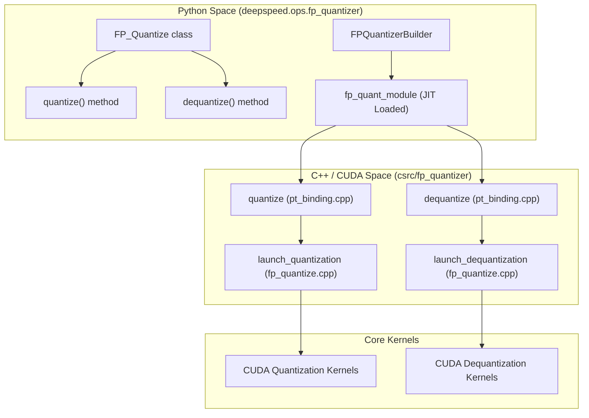
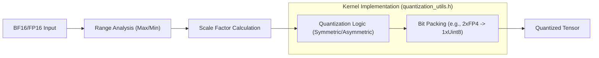

<!-- source: DeepWiki mcp.deepwiki.com · repo deepspeedai/DeepSpeed · page 13.1 FP Quantization · fetched 2026-10-21 -->

# FP Quantization

Relevant source files

The following files were used as context for generating this wiki page:

- [csrc/fp_quantizer/fp_quantize.cpp](csrc/fp_quantizer/fp_quantize.cpp)
- [csrc/fp_quantizer/includes/fp_context.h](csrc/fp_quantizer/includes/fp_context.h)
- [csrc/fp_quantizer/includes/fp_quantize.h](csrc/fp_quantizer/includes/fp_quantize.h)
- [csrc/includes/conversion_utils.h](csrc/includes/conversion_utils.h)
- [csrc/includes/dequantization_utils.h](csrc/includes/dequantization_utils.h)
- [csrc/includes/ds_kernel_utils.h](csrc/includes/ds_kernel_utils.h)
- [csrc/includes/memory_access_utils.h](csrc/includes/memory_access_utils.h)
- [csrc/includes/quantization.h](csrc/includes/quantization.h)
- [csrc/includes/quantization_utils.h](csrc/includes/quantization_utils.h)
- [csrc/includes/reduction_utils.h](csrc/includes/reduction_utils.h)
- [csrc/quantization/dequantize.cu](csrc/quantization/dequantize.cu)
- [csrc/quantization/pt_binding.cpp](csrc/quantization/pt_binding.cpp)
- [csrc/quantization/quantize.cu](csrc/quantization/quantize.cu)
- [csrc/quantization/quantize_intX.cu](csrc/quantization/quantize_intX.cu)
- [deepspeed/inference/quantization/utils.py](deepspeed/inference/quantization/utils.py)
- [deepspeed/linear/__init__.py](deepspeed/linear/__init__.py)
- [deepspeed/linear/config.py](deepspeed/linear/config.py)
- [deepspeed/linear/context_manager.py](deepspeed/linear/context_manager.py)
- [deepspeed/linear/optimized_linear.py](deepspeed/linear/optimized_linear.py)
- [deepspeed/linear/quantization.py](deepspeed/linear/quantization.py)
- [deepspeed/ops/fp_quantizer/__init__.py](deepspeed/ops/fp_quantizer/__init__.py)
- [deepspeed/ops/fp_quantizer/fp8_gemm.py](deepspeed/ops/fp_quantizer/fp8_gemm.py)
- [deepspeed/ops/fp_quantizer/fp8_gemm_triton.py](deepspeed/ops/fp_quantizer/fp8_gemm_triton.py)
- [deepspeed/ops/fp_quantizer/quantize.py](deepspeed/ops/fp_quantizer/quantize.py)
- [op_builder/hpu/fp_quantizer.py](op_builder/hpu/fp_quantizer.py)
- [op_builder/quantizer.py](op_builder/quantizer.py)
- [tests/unit/linear/test_ctx.py](tests/unit/linear/test_ctx.py)
- [tests/unit/linear/test_linear.py](tests/unit/linear/test_linear.py)
- [tests/unit/linear/test_quant_param.py](tests/unit/linear/test_quant_param.py)
- [tests/unit/ops/fp_quantizer/test_fp8_gemm.py](tests/unit/ops/fp_quantizer/test_fp8_gemm.py)
- [tests/unit/ops/fp_quantizer/test_fp_quant.py](tests/unit/ops/fp_quantizer/test_fp_quant.py)
- [tests/unit/ops/quantizer/test_quantize.py](tests/unit/ops/quantizer/test_quantize.py)

The DeepSpeed FP Quantization suite provides high-performance kernels and Python interfaces for compressing model weights and activations into low-precision floating-point formats (FP8, FP6, FP4) and integer formats (INT8, INT4). The system is built around the `FPQuantizer` for flexible floating-point precision, optimized CUDA/Triton GEMM kernels, and a `QuantizedLinear` layer that integrates seamlessly with training and inference workflows, including LoRA support.

## Architecture and Data Flow

The quantization system bridges high-level PyTorch modules with optimized C++/CUDA and Triton kernels. The `FP_Quantize` class acts as the primary orchestrator for floating-point quantization, while the `QuantizerBuilder` manages the compilation of core quantization operators.

### Quantization System Overview
The following diagram illustrates the relationship between the Python API and the underlying C++ implementation.

**Diagram: Python to C++ Entity Mapping**

**Sources:** [deepspeed/ops/fp_quantizer/quantize.py:43-57](), [csrc/fp_quantizer/fp_quantize.cpp:25-46](), [csrc/fp_quantizer/fp_quantize.cpp:118-124]()

## Core Components

### 1. FP_Quantize Class
The `FP_Quantize` class provides a high-level API for performing group-wise quantization. It supports various bit-widths and mantissa configurations, allowing for formats like E4M3 or E5M2 (FP8).

*   **Group-wise Quantization:** Values are grouped (default `group_size=512`) to calculate local scales, improving accuracy compared to per-tensor quantization [deepspeed/ops/fp_quantizer/quantize.py:26-28]().
*   **Stochastic Rounding:** Supports stochastic rounding to reduce quantization bias during training [deepspeed/ops/fp_quantizer/quantize.py:62-63]().
*   **Metadata Management:** Can return meta-tensors containing both quantized data and scaling factors [deepspeed/ops/fp_quantizer/quantize.py:88-96]().

**Key Functions:**
| Function | Description |
| :--- | :--- |
| `quantize` | Converts BF16/FP16 tensors to low-bit FP formats. [deepspeed/ops/fp_quantizer/quantize.py:58-98]() |
| `dequantize` | Reverts quantized tensors back to the original dtype using stored scales. [deepspeed/ops/fp_quantizer/quantize.py:110-132]() |
| `selective_dequantize` | Dequantizes only specific indices, optimized for sparse access or MoE routing. [deepspeed/ops/fp_quantizer/quantize.py:134-167]() |

### 2. CUDA Quantization Kernels
The backend implementation in `csrc/quantization` and `csrc/fp_quantizer` handles the bit-level manipulation and hardware-accelerated reductions.

*   **Reduction Utilities:** Uses `reduction_utils.h` to perform fast block-level and warp-level min/max/sum reductions for scale calculation [csrc/includes/reduction_utils.h:58-80]().
*   **Memory Access:** Highly optimized global and shared memory access patterns using PTX instructions (e.g., `ld.global.v4.u32`) [csrc/includes/memory_access_utils.h:95-106]().
*   **Asymmetric/Symmetric Support:** Logic for both symmetric (absmax-based) and asymmetric (min-max range-based) quantization [csrc/includes/quantization_utils.h:51-143]().

**Sources:** [csrc/includes/quantization_utils.h:17-49](), [csrc/includes/reduction_utils.h:18-29](), [csrc/includes/memory_access_utils.h:12-24]()

## Implementation Detail: Floating Point Bit Packing

DeepSpeed uses custom packing logic to store low-bit floating point numbers within standard container types. For example, FP4 and FP6 values are packed into `uint8` or `int8` buffers.

**Diagram: Bit Manipulation Flow**

**Sources:** [csrc/includes/quantization_utils.h:65-81](), [csrc/includes/quantization_utils.h:111-127]()

## Linear Layer Integration

DeepSpeed provides `QuantizedLinear` and `OptimizedLinear` to replace standard `torch.nn.Linear` layers.

*   **QuantizedLinear:** A drop-in replacement that maintains weights in a quantized state and performs dequantization on-the-fly or uses optimized GEMM kernels.
*   **LoRA Support:** Integration with Low-Rank Adaptation (LoRA) allows training small adapter matrices while the base model weights remain quantized (e.g., QLoRA).
*   **FP8 GEMM:** Uses Triton-based kernels for FP8 matrix multiplication, leveraging hardware acceleration on Hopper (H100) and newer architectures.

**Sources:** [deepspeed/ops/fp_quantizer/fp8_gemm_triton.py:1-20](), [deepspeed/linear/quantization.py:1-30]()

## OpBuilder and Compilation

The `QuantizerBuilder` and `FPQuantizerBuilder` classes in `op_builder/` manage the compilation of the C++/CUDA extensions.

*   **Sources:** Includes `pt_binding.cpp`, `quantize.cu`, `dequantize.cu`, and `swizzled_quantize.cu` [op_builder/quantizer.py:20-29]().
*   **Library Dependencies:** Links against `curand` for stochastic rounding support [op_builder/quantizer.py:34-38]().

**Sources:** [op_builder/quantizer.py:9-19](), [csrc/quantization/pt_binding.cpp:1-10]()

## Summary of Quantization Types

DeepSpeed distinguishes between "Fake Quantization" (used for Quantization-Aware Training) and "True Quantization" (used for memory savings).

| Type | Bits | Group Size | Header / Kernel |
| :--- | :--- | :--- | :--- |
| FP8 | 8 | 512+ | `fp_quantize.cpp` |
| FP6 | 6 | 512+ | `fp_quantize.cpp` |
| FP4 | 4 | 512+ | `fp_quantize.cpp` |
| INT8 | 8 | Configurable | `quantize_intX.cu` |
| INT4 | 4 | Configurable | `quantize_intX.cu` |

**Sources:** [csrc/fp_quantizer/fp_quantize.cpp:32-37](), [csrc/quantization/pt_binding.cpp:68-72]()

---

