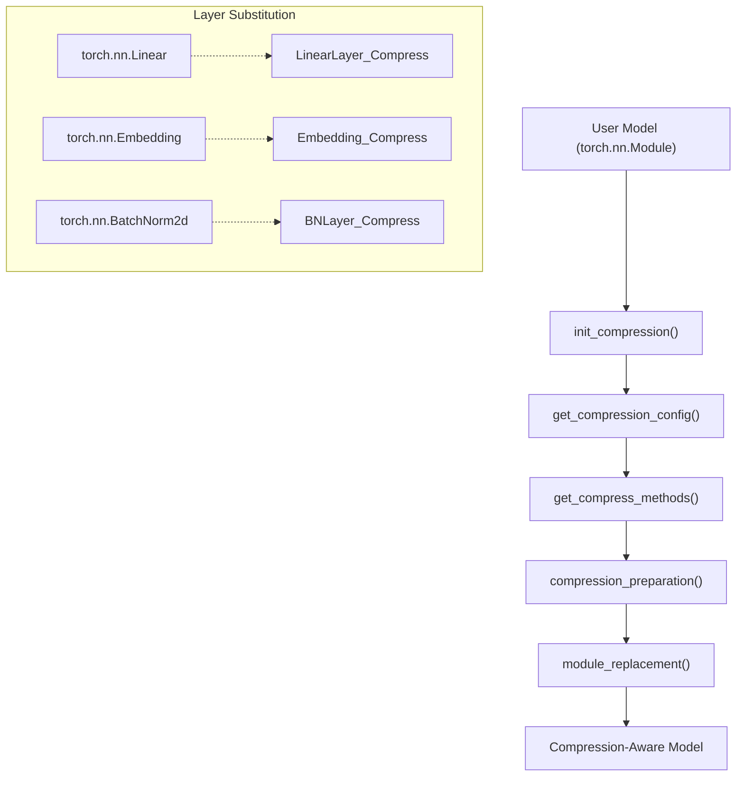
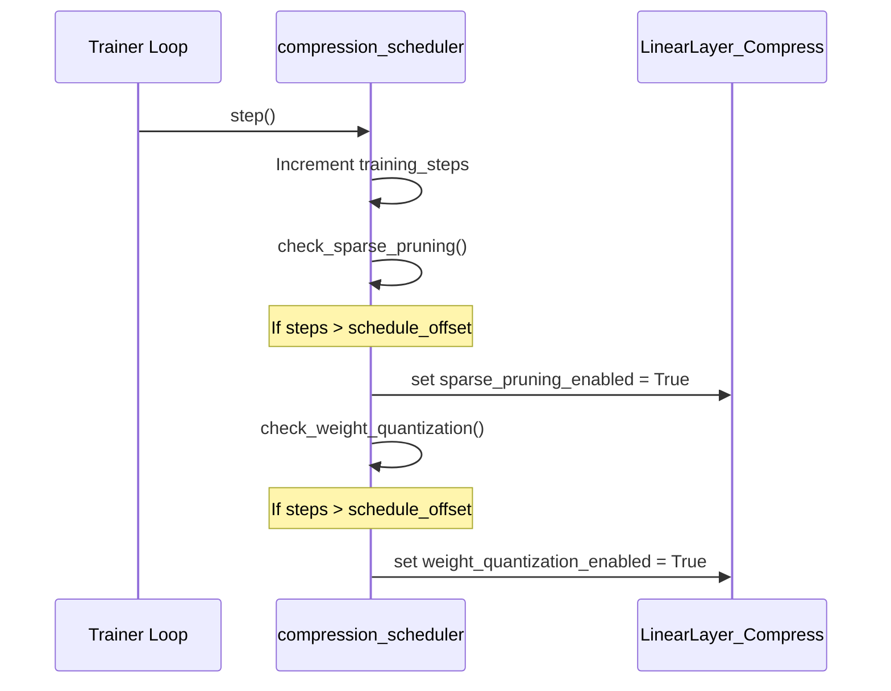

<!-- source: DeepWiki mcp.deepwiki.com · repo deepspeedai/DeepSpeed · page 13.2 Model Compression Framework · fetched 2026-10-21 -->

# Model Compression Framework

<details>
<summary>Relevant source files</summary>

The following files were used as context for generating this wiki page:

- [deepspeed/compression/__init__.py](deepspeed/compression/__init__.py)
- [deepspeed/compression/basic_layer.py](deepspeed/compression/basic_layer.py)
- [deepspeed/compression/compress.py](deepspeed/compression/compress.py)
- [deepspeed/compression/config.py](deepspeed/compression/config.py)
- [deepspeed/compression/constants.py](deepspeed/compression/constants.py)
- [deepspeed/compression/helper.py](deepspeed/compression/helper.py)
- [deepspeed/compression/scheduler.py](deepspeed/compression/scheduler.py)
- [deepspeed/compression/utils.py](deepspeed/compression/utils.py)
- [docs/_tutorials/model-compression.md](docs/_tutorials/model-compression.md)
- [requirements/requirements-sparse_pruning.txt](requirements/requirements-sparse_pruning.txt)

</details>


The DeepSpeed Model Compression Framework is a composable library designed to reduce model size and inference latency through structured pruning, knowledge distillation (KD), and quantization. It provides a unified interface to apply multiple compression techniques simultaneously while maintaining model quality and reducing the computational cost of the compression process itself.

## Architecture and Core Components

The framework operates by intercepting the model initialization process and replacing standard PyTorch layers with compression-aware modules. It manages the lifecycle of these modules through a dedicated scheduler that triggers compression events (like pruning or bit-width reduction) based on training steps.

### Key Modules and Files
- `deepspeed/compression/compress.py`: The main entry point for initializing compression and managing module replacement logic [deepspeed/compression/compress.py:100-145]().
- `deepspeed/compression/basic_layer.py`: Contains compression-aware wrappers for standard layers like `Linear`, `Conv2d`, and `Embedding` [deepspeed/compression/basic_layer.py:7-12]().
- `deepspeed/compression/scheduler.py`: Orchestrates the timing of compression techniques (e.g., when to start pruning or quantization) during the training loop [deepspeed/compression/scheduler.py:12-32]().
- `deepspeed/compression/helper.py`: Utility functions for recursive module manipulation and replacement [deepspeed/compression/helper.py:17-50]().

### Data Flow: Initialization to Compression
The following diagram illustrates how a standard model is transformed into a compressed model using the `init_compression` workflow.

**Model Transformation Flow**

**Sources:** [deepspeed/compression/compress.py:100-145](), [deepspeed/compression/helper.py:51-140]()

## Compression Techniques

The framework supports seven primary methods that can be composed via the DeepSpeed configuration JSON.

### 1. Layer Reduction
Reduces the number of hidden layers in a deep model while keeping the width intact. This is typically combined with Knowledge Distillation (KD) where a "teacher" model guides the smaller "student" model [docs/_tutorials/model-compression.md:15-26]().
- **Implementation**: Managed via `student_initialization` which maps teacher layers to student layers based on the `teacher_layer` config [deepspeed/compression/compress.py:118-120]().

### 2. Structured Pruning (Row, Head, Channel)
Unlike sparse pruning, structured pruning removes entire components (rows of weights, attention heads, or convolutional channels) to ensure hardware-friendly speedups.
- **Row Pruning**: Targets the output dimension of linear layers [deepspeed/compression/basic_layer.py:138-139]().
- **Head Pruning**: Specifically for Transformer attention heads, requiring `related_modules` configuration to maintain consistency across the QKV and output projections [deepspeed/compression/compress.py:63-79]().

### 3. Sparse Pruning
Supports fine-grained sparsity using techniques like L1-norm pruning, Top-K, or the `snip_momentum` method from the Intel Neural Compressor [deepspeed/compression/compress.py:126-143]().
- **TopKBinarizer**: A custom autograd function that computes a binary mask where only the top $k\%$ highest values are retained [deepspeed/compression/utils.py:11-51]().

### 4. Quantization (Weight & Activation)
Provides symmetric and asymmetric quantization for both weights and activations.
- **MoQ (Mixture-of-Quantization)**: Supports dynamic bit-width reduction during training [deepspeed/compression/basic_layer.py:79-102]().
- **Quantizers**: Implements `SymQuantizer`, `AsymQuantizer`, `TernaryQuantizer`, and `BinaryQuantizer` as autograd functions to support Straight-Through Estimators (STE) [deepspeed/compression/utils.py:62-200]().

## Implementation Details: `LinearLayer_Compress`

The `LinearLayer_Compress` class is the primary workhorse for compressing dense layers. It inherits from `nn.Linear` and adds state flags for every supported compression technique.

| Feature | Logic Location | Mechanism |
| :--- | :--- | :--- |
| **Sparse Pruning** | `enable_sparse_pruning` | L1 norm or Top-K mask generation [deepspeed/compression/basic_layer.py:147-160]() |
| **Quantization** | `forward` | Calls `weight_quantizer` if enabled [deepspeed/compression/basic_layer.py:257-265]() |
| **Row/Head Pruning** | `forward` | Applies `TopKBinarizer` to weight norms [deepspeed/compression/basic_layer.py:270-280]() |

**Sources:** [deepspeed/compression/basic_layer.py:121-300]()

## Execution Logic: The Compression Scheduler

The `compression_scheduler` manages the "when" of compression. Many techniques, such as quantization or pruning, should not start at step 0 to allow the model to stabilize.

**Scheduling Logic**

**Sources:** [deepspeed/compression/scheduler.py:12-111]()

### Configuration Parameters
The scheduler relies on `shared_parameters` defined in the DeepSpeed config:
- `schedule_offset`: The step at which a technique is activated [deepspeed/compression/constants.py:14]().
- `schedule_offset_end`: The step at which a technique (like sparse pruning) stops evolving its mask [deepspeed/compression/constants.py:15]().

## Integration Example

To use the framework, the model must be initialized with the compressed architecture before being passed to the DeepSpeed engine.

1. **Config Definition**: Define `compression_training` in the JSON config [deepspeed/compression/constants.py:10]().
2. **Model Initialization**:
   ```python
   from deepspeed.compression.compress import init_compression
   # Student model must match 'keep_number_layer'
   model = MyModel(config) 
   model = init_compression(model, ds_config, teacher_model=teacher)
   ```
3. **Training**: The `DeepSpeedEngine` automatically interacts with the `compression_scheduler` if it is present in the configuration [deepspeed/compression/compress.py:100-120]().

**Sources:** [docs/_tutorials/model-compression.md:28-35](), [deepspeed/compression/compress.py:100-145]()

---

