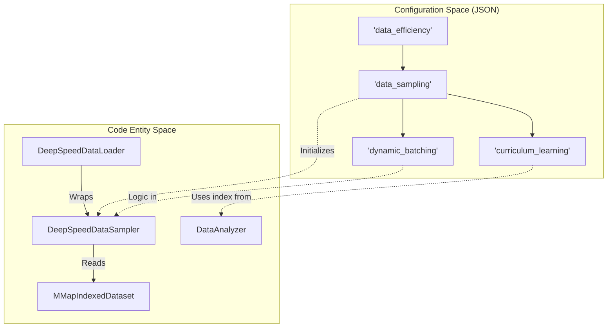
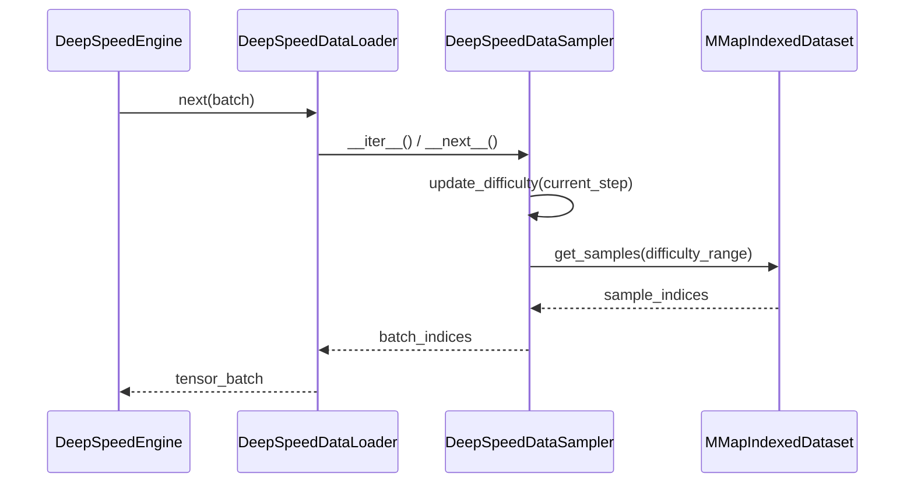

<!-- source: DeepWiki mcp.deepwiki.com · repo deepspeedai/DeepSpeed · page 14 Data Pipeline and Curriculum Learning · fetched 2026-10-21 -->

# Data Pipeline and Curriculum Learning

Relevant source files

The following files were used as context for generating this wiki page:

- [deepspeed/runtime/data_pipeline/config.py](deepspeed/runtime/data_pipeline/config.py)
- [deepspeed/runtime/data_pipeline/constants.py](deepspeed/runtime/data_pipeline/constants.py)
- [deepspeed/runtime/data_pipeline/data_sampling/data_analyzer.py](deepspeed/runtime/data_pipeline/data_sampling/data_analyzer.py)
- [deepspeed/runtime/data_pipeline/data_sampling/indexed_dataset.py](deepspeed/runtime/data_pipeline/data_sampling/indexed_dataset.py)
- [deepspeed/runtime/data_pipeline/data_sampling/variable_batch_size_and_lr.py](deepspeed/runtime/data_pipeline/data_sampling/variable_batch_size_and_lr.py)
- [deepspeed/runtime/dataloader.py](deepspeed/runtime/dataloader.py)
- [docs/_posts/2022-12-12-data-efficiency.md](docs/_posts/2022-12-12-data-efficiency.md)
- [docs/_tutorials/curriculum-learning.md](docs/_tutorials/curriculum-learning.md)
- [docs/_tutorials/data-efficiency.md](docs/_tutorials/data-efficiency.md)
- [tests/unit/runtime/test_data_efficiency.py](tests/unit/runtime/test_data_efficiency.py)

The DeepSpeed Data Efficiency library is designed to improve model quality and training efficiency by making better use of training data. It provides a composable framework for efficient data sampling (Curriculum Learning) and data routing (Random Layerwise Token Dropping), allowing users to achieve similar model quality with significantly less data or time [docs/_tutorials/data-efficiency.md:6-10]().

The core of this system is the `DeepSpeedDataLoader`, which integrates directly with the DeepSpeed engine to handle complex sampling strategies, variable batch sizes, and curriculum schedules [deepspeed/runtime/dataloader.py:41-45]().

## System Architecture

The data pipeline architecture bridges high-level training configurations with low-level data access through a Map-Reduce style analysis and a specialized sampling engine.

### Data Efficiency Workflow
| Component | Responsibility | Code Entity |
| :--- | :--- | :--- |
| **Data Analyzer** | Offline indexing of datasets based on difficulty metrics. | `DataAnalyzer` [deepspeed/runtime/data_pipeline/data_sampling/data_analyzer.py:23]() |
| **Indexed Dataset** | High-performance memory-mapped storage for large-scale data. | `MMapIndexedDataset` [deepspeed/runtime/data_pipeline/data_sampling/indexed_dataset.py:341]() |
| **Curriculum Scheduler** | Manages the progression of data difficulty over time. | `CurriculumScheduler` (via `DeepSpeedDataSampler`) [deepspeed/runtime/data_pipeline/data_sampling/data_sampler.py:17]() |
| **Data Sampler** | Selects specific samples based on the current curriculum state. | `DeepSpeedDataSampler` [deepspeed/runtime/data_pipeline/data_sampling/data_sampler.py:17]() |

### Data Pipeline Entity Mapping
The following diagram illustrates how the "Data Efficiency" configuration keys map to the internal classes that execute the data pipeline.

**Sources:** [deepspeed/runtime/dataloader.py:59-72](), [deepspeed/runtime/data_pipeline/config.py:14-49](), [deepspeed/runtime/data_pipeline/data_sampling/data_sampler.py:17-40]()

## Curriculum Learning and Data Sampling

Curriculum learning improves convergence by presenting "easier" samples (e.g., shorter sequences or simpler vocabulary) early in training [docs/_tutorials/data-efficiency.md:14-18](). The system supports a variety of pacing functions, including linear, root, and discrete schedules [docs/_tutorials/curriculum-learning.md:64-66]().

Key features include:
*   **Offline Data Analysis:** A Map-Reduce tool that calculates difficulty scores and builds a difficulty-to-sample index [deepspeed/runtime/data_pipeline/data_sampling/data_analyzer.py:23-43]().
*   **MMap Indexed Datasets:** Efficiently handles billion-scale datasets using memory mapping to minimize I/O overhead [deepspeed/runtime/data_pipeline/data_sampling/indexed_dataset.py:341-350]().
*   **Variable Batch Size:** Dynamically adjusts batch sizes and learning rates based on the current difficulty of the data to maintain stable training [deepspeed/runtime/data_pipeline/data_sampling/variable_batch_size_and_lr.py:23-58]().

For implementation details and configuration guides, see [Curriculum Learning and Data Sampling](#14.1).

**Sources:** [deepspeed/runtime/data_pipeline/data_sampling/data_analyzer.py:23-62](), [deepspeed/runtime/data_pipeline/data_sampling/indexed_dataset.py:341-360](), [docs/_tutorials/curriculum-learning.md:43-55]()

## Hybrid Engine for RLHF

DeepSpeed provides a specialized `HybridEngine` to optimize Reinforcement Learning from Human Feedback (RLHF) pipelines. This engine bridges the gap between training (for the policy model) and inference (for generating responses and reward modeling) within a single pipeline.

The `HybridEngine` enables:
*   **Memory Efficiency:** Seamlessly switching between training and inference kernels to optimize GPU memory during the generation phase of RLHF.
*   **LoRA Integration:** High-performance support for Low-Rank Adaptation (LoRA) during both generation and fine-tuning steps.

For architectural details on RLHF optimizations, see [Hybrid Engine for RLHF](#14.2).

## Data Sampling Logic

The `DeepSpeedDataSampler` acts as the orchestrator for curriculum-aware data retrieval. It uses the `MMapIndexedDataset` to fetch indices that match the current difficulty threshold provided by the scheduler.

**Sources:** [deepspeed/runtime/dataloader.py:108-125](), [deepspeed/runtime/data_pipeline/data_sampling/data_sampler.py:17-50](), [deepspeed/runtime/data_pipeline/data_sampling/indexed_dataset.py:341-370]()

## Configuration Summary

The data pipeline is configured within the `data_efficiency` block of the DeepSpeed JSON configuration.

| Parameter | Type | Description |
| :--- | :--- | :--- |
| `enabled` | bool | Enables the data efficiency library [deepspeed/runtime/data_pipeline/constants.py:10](). |
| `curriculum_learning` | dict | Configures metrics, paths, and pacing schedules [deepspeed/runtime/data_pipeline/constants.py:31](). |
| `dynamic_batching` | dict | Configures max tokens per batch and LR scaling methods [deepspeed/runtime/data_pipeline/constants.py:70](). |
| `num_workers` | int | Number of worker processes for data sampling [deepspeed/runtime/data_pipeline/constants.py:23](). |

**Sources:** [deepspeed/runtime/data_pipeline/config.py:14-112](), [deepspeed/runtime/data_pipeline/constants.py:9-83]()

---

