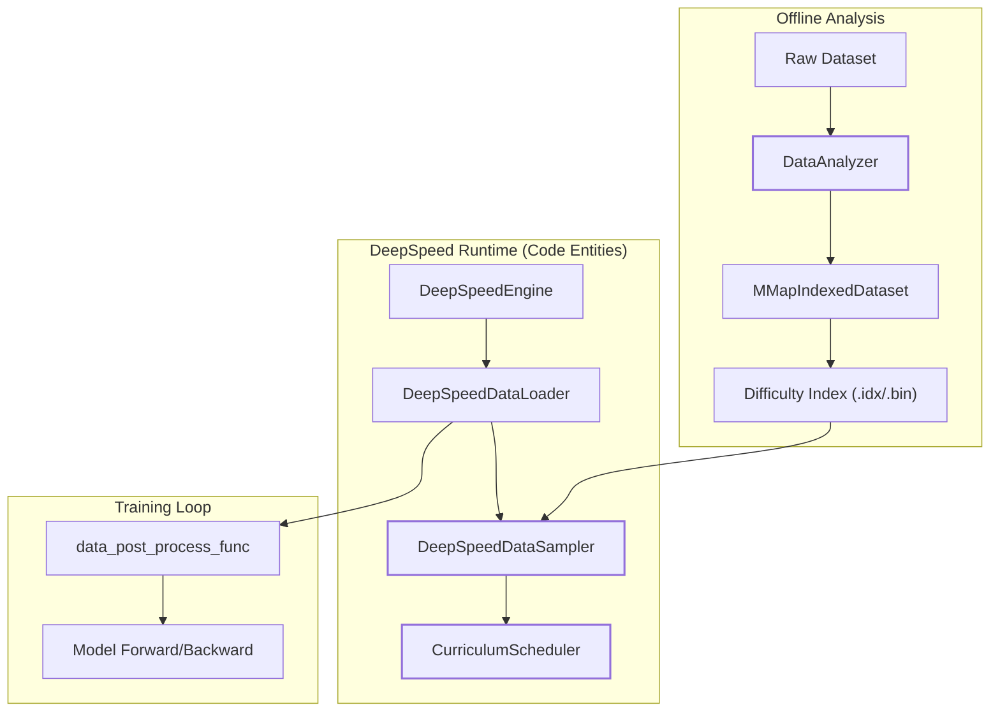
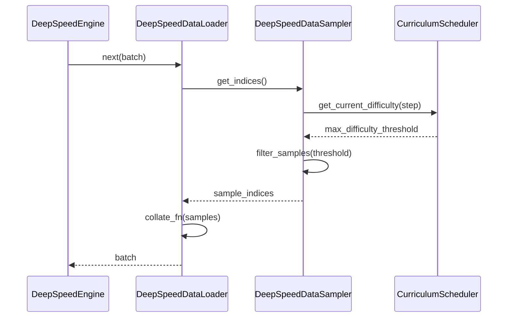

<!-- source: DeepWiki mcp.deepwiki.com · repo deepspeedai/DeepSpeed · page 14.1 Curriculum Learning and Data Sampling · fetched 2026-10-21 -->

# Curriculum Learning and Data Sampling

<details>
<summary>Relevant source files</summary>

The following files were used as context for generating this wiki page:

- [deepspeed/runtime/data_pipeline/config.py](deepspeed/runtime/data_pipeline/config.py)
- [deepspeed/runtime/data_pipeline/constants.py](deepspeed/runtime/data_pipeline/constants.py)
- [deepspeed/runtime/data_pipeline/data_sampling/data_analyzer.py](deepspeed/runtime/data_pipeline/data_sampling/data_analyzer.py)
- [deepspeed/runtime/data_pipeline/data_sampling/indexed_dataset.py](deepspeed/runtime/data_pipeline/data_sampling/indexed_dataset.py)
- [deepspeed/runtime/data_pipeline/data_sampling/variable_batch_size_and_lr.py](deepspeed/runtime/data_pipeline/data_sampling/variable_batch_size_and_lr.py)
- [deepspeed/runtime/dataloader.py](deepspeed/runtime/dataloader.py)
- [docs/_posts/2022-12-12-data-efficiency.md](docs/_posts/2022-12-12-data-efficiency.md)
- [docs/_tutorials/curriculum-learning.md](docs/_tutorials/curriculum-learning.md)
- [docs/_tutorials/data-efficiency.md](docs/_tutorials/data-efficiency.md)
- [tests/unit/runtime/test_data_efficiency.py](tests/unit/runtime/test_data_efficiency.py)

</details>


DeepSpeed provides a comprehensive **Data Efficiency Library** designed to improve model quality and training convergence speed through advanced data sampling and routing techniques. The core of this system is **Curriculum Learning (CL)**, which presents simpler examples early in training to stabilize the process and accelerate convergence.

## Overview

The DeepSpeed Data Efficiency framework consists of an offline data analysis phase and an online data sampling phase. It allows users to define custom difficulty metrics (e.g., sequence length, vocabulary rarity) and pacing functions (e.g., linear, root, or discrete schedules) to control the difficulty of data seen by the model over time [`docs/_posts/2022-12-12-data-efficiency.md:18-32`]().

### Key Components
- **DataAnalyzer**: An offline tool for scoring datasets based on difficulty metrics.
- **CurriculumScheduler**: An orchestrator that calculates the current difficulty threshold based on training progress.
- **DeepSpeedDataSampler**: A specialized sampler that retrieves samples matching the current difficulty level.
- **DeepSpeedDataLoader**: A wrapper around PyTorch's DataLoader that integrates curriculum sampling and data post-processing [`deepspeed/runtime/dataloader.py:41-55`]().

---

## Data Flow and Architecture

The following diagram illustrates the transition from raw dataset analysis to the runtime curriculum sampling logic.

### Natural Language to Code Entity Space: Data Pipeline

**Sources:** [`deepspeed/runtime/data_pipeline/data_sampling/data_analyzer.py:23-43`](), [`deepspeed/runtime/dataloader.py:41-75`](), [`docs/_tutorials/data-efficiency.md:25-30`]()

---

## Data Analysis and Indexing

Before training, the `DataAnalyzer` processes the dataset to compute difficulty scores. It uses a Map-Reduce scheme to scale across multiple CPU nodes and threads [`docs/_tutorials/data-efficiency.md:27-27`]().

### DataAnalyzer Implementation
The `DataAnalyzer` uses `MMapIndexedDataset` to store large-scale indices efficiently using memory-mapped files [`deepspeed/runtime/data_pipeline/data_sampling/data_analyzer.py:19-20`]().

- **Map Stage**: Computes the metric for each sample and writes to a `sample_to_metric` builder [`deepspeed/runtime/data_pipeline/data_sampling/data_analyzer.py:72-84`]().
- **Reduce Stage**: Merges fragmented index files into a unified dataset.

### Indexed Datasets
DeepSpeed implements several versions of indexed datasets in `indexed_dataset.py`:
- `IndexedDataset`: Basic loader for `.idx` and `.bin` formats [`deepspeed/runtime/data_pipeline/data_sampling/indexed_dataset.py:139-148`]().
- `MMapIndexedDataset`: Uses `numpy.memmap` for low-latency access to multi-gigabyte datasets without loading them entirely into RAM [`deepspeed/runtime/data_pipeline/data_sampling/indexed_dataset.py:255-265`]().

**Sources:** [`deepspeed/runtime/data_pipeline/data_sampling/data_analyzer.py:23-89`](), [`deepspeed/runtime/data_pipeline/data_sampling/indexed_dataset.py:40-81`]()

---

## Curriculum Scheduling and Sampling

During training, the `CurriculumScheduler` (managed within the data sampling logic) updates the `current_difficulty` based on the global training step [`deepspeed/runtime/data_pipeline/constants.py:57-62`]().

### Pacing Functions
DeepSpeed supports several built-in pacing functions:
| Schedule Type | Logic | Configuration Key |
| :--- | :--- | :--- |
| **Fixed Linear** | Difficulty increases linearly from `min` to `max` over $N$ steps. | `fixed_linear` |
| **Fixed Root** | Difficulty follows a root function: $diff = (step/total)^{1/degree}$. | `fixed_root` |
| **Fixed Discrete** | Difficulty changes at specific step intervals. | `fixed_discrete` |

**Sources:** [`docs/_tutorials/curriculum-learning.md:64-96`](), [`deepspeed/runtime/data_pipeline/constants.py:46-56`]()

### Variable Batch Size and LR Scaling
To handle samples of varying difficulty (e.g., different sequence lengths), DeepSpeed provides `batch_by_seqlens`. This utility groups sequences into mini-batches such that the total token count (difficulty sum) does not exceed `max_tokens`, effectively implementing dynamic batching [`deepspeed/runtime/data_pipeline/data_sampling/variable_batch_size_and_lr.py:23-58`]().

When batch sizes vary, the system can automatically scale the Learning Rate (LR) using "linear" or "sqrt" methods to maintain training stability [`deepspeed/runtime/data_pipeline/config.py:95-112`]().

---

## Implementation Details

### Data Sampler Logic
The `DeepSpeedDataSampler` coordinates with the curriculum configuration to provide indices to the `DeepSpeedDataLoader`.

### System Entity Interaction

**Sources:** [`deepspeed/runtime/dataloader.py:115-125`](), [`docs/_tutorials/data-efficiency.md:29-29`]()

### Configuration Example
The curriculum learning feature is enabled via the `data_efficiency` block in the DeepSpeed configuration JSON:

```json
{
  "data_efficiency": {
    "enabled": true,
    "data_sampling": {
      "enabled": true,
      "curriculum_learning": {
        "enabled": true,
        "curriculum_metrics": {
          "seqlen": {
            "difficulty_type": "value",
            "min_difficulty": 1,
            "max_difficulty": 1024,
            "schedule_type": "fixed_linear",
            "schedule_config": {
              "total_curriculum_step": 15000,
              "difficulty_step": 8
            }
          }
        }
      }
    }
  }
}
```
**Sources:** [`deepspeed/runtime/data_pipeline/config.py:81-92`](), [`docs/_tutorials/curriculum-learning.md:19-55`]()

## Legacy Curriculum Learning
A legacy version specifically for sequence length warmup exists. While still supported, it is recommended to use the `data_efficiency` library for general-purpose curriculum learning [`docs/_tutorials/curriculum-learning.md:6-14`](). The legacy implementation performs sequence truncation directly in the data pipeline before the forward pass [`docs/_tutorials/curriculum-learning.md:58-58`]().

**Sources:** [`deepspeed/runtime/data_pipeline/config.py:132-147`](), [`tests/unit/runtime/test_data_efficiency.py:135-166`]()

---

