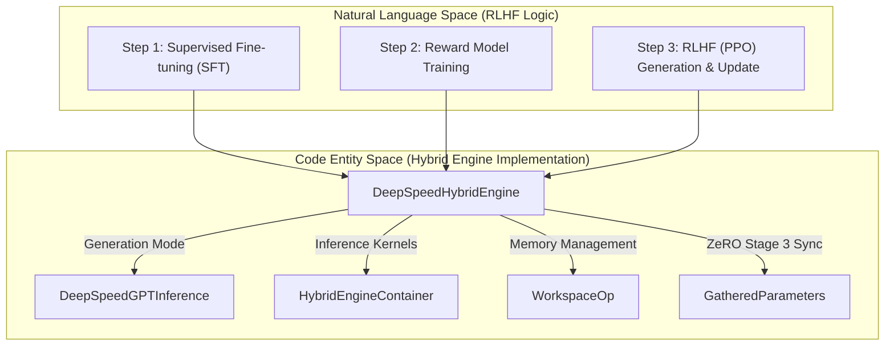
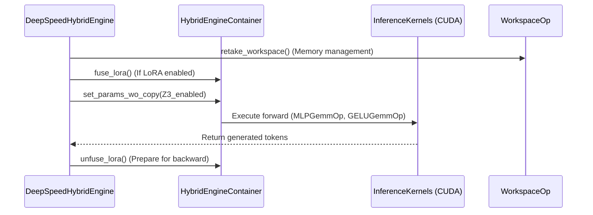

<!-- source: DeepWiki mcp.deepwiki.com · repo deepspeedai/DeepSpeed · page 14.2 Hybrid Engine for RLHF · fetched 2026-10-21 -->

# Hybrid Engine for RLHF

Relevant source files

The following files were used as context for generating this wiki page:

- [blogs/assets/images/hero-figure-black-ja.png](blogs/assets/images/hero-figure-black-ja.png)
- [blogs/deepspeed-chat/README.md](blogs/deepspeed-chat/README.md)
- [blogs/deepspeed-chat/chinese/README.md](blogs/deepspeed-chat/chinese/README.md)
- [blogs/deepspeed-chat/japanese/README.md](blogs/deepspeed-chat/japanese/README.md)
- [deepspeed/autotuning/README.md](deepspeed/autotuning/README.md)
- [deepspeed/autotuning/tuner/README.md](deepspeed/autotuning/tuner/README.md)
- [deepspeed/autotuning/tuner/model_based_tuner.py](deepspeed/autotuning/tuner/model_based_tuner.py)
- [deepspeed/module_inject/containers/features/gated_mlp.py](deepspeed/module_inject/containers/features/gated_mlp.py)
- [deepspeed/module_inject/containers/features/hybrid_engine.py](deepspeed/module_inject/containers/features/hybrid_engine.py)
- [deepspeed/module_inject/containers/features/split_qkv.py](deepspeed/module_inject/containers/features/split_qkv.py)
- [deepspeed/module_inject/containers/internlm.py](deepspeed/module_inject/containers/internlm.py)
- [deepspeed/module_inject/containers/llama.py](deepspeed/module_inject/containers/llama.py)
- [deepspeed/ops/transformer/inference/ds_mlp.py](deepspeed/ops/transformer/inference/ds_mlp.py)
- [deepspeed/ops/transformer/inference/op_binding/gelu_gemm.py](deepspeed/ops/transformer/inference/op_binding/gelu_gemm.py)
- [deepspeed/ops/transformer/inference/op_binding/mlp_gemm.py](deepspeed/ops/transformer/inference/op_binding/mlp_gemm.py)
- [deepspeed/ops/transformer/inference/op_binding/residual_add.py](deepspeed/ops/transformer/inference/op_binding/residual_add.py)
- [deepspeed/runtime/hybrid_engine.py](deepspeed/runtime/hybrid_engine.py)
- [docs/_posts/2021-11-15-autotuning.md](docs/_posts/2021-11-15-autotuning.md)
- [docs/_tutorials/autotuning.md](docs/_tutorials/autotuning.md)
- [docs/code-docs/source/autotuning.rst](docs/code-docs/source/autotuning.rst)
- [tests/unit/hybrid_engine/test_he_all.py](tests/unit/hybrid_engine/test_he_all.py)
- [tests/unit/hybrid_engine/test_he_llama.py](tests/unit/hybrid_engine/test_he_llama.py)
- [tests/unit/hybrid_engine/test_he_lora.py](tests/unit/hybrid_engine/test_he_lora.py)

The **DeepSpeed Hybrid Engine (DeepSpeed-HE)** is a unified infrastructure designed to bridge the gap between training and inference specifically for Reinforcement Learning from Human Feedback (RLHF) pipelines [blogs/deepspeed-chat/README.md:35-37](). In RLHF, models must frequently transition between generation (inference) and parameter updates (training). The Hybrid Engine enables this by allowing the model to leverage high-performance inference kernels and tensor parallelism during the generation phase, while seamlessly switching back to ZeRO-based memory optimizations and LoRA for the training phase [blogs/deepspeed-chat/README.md:35-37]().

## Architecture and Core Components

The `DeepSpeedHybridEngine` class extends `DeepSpeedEngine` to manage the dual-mode lifecycle [deepspeed/runtime/hybrid_engine.py:30-31](). It orchestrates the replacement of standard PyTorch modules with optimized inference containers and handles the synchronization of parameters between training states and inference-optimized formats.

### System-to-Code Entity Mapping

The following diagram illustrates how the logical RLHF phases map to specific code entities within the DeepSpeed runtime.

**RLHF Phase to Code Mapping**

Sources: [deepspeed/runtime/hybrid_engine.py:30-31](), [blogs/deepspeed-chat/README.md:34-37](), [deepspeed/module_inject/containers/llama.py:41-43]()

## Inference Integration and Data Flow

During the generation phase of RLHF, the Hybrid Engine injects optimized inference containers. It uses a policy-based system to map original model layers (e.g., `LlamaDecoderLayer`) to DeepSpeed containers (e.g., `DS_LLAMAContainer`) [deepspeed/module_inject/containers/llama.py:118-129]().

### Parameter Lifecycle
1.  **Creation**: `new_inference_container` initializes the inference-specific tensors and model configurations [deepspeed/runtime/hybrid_engine.py:78-114]().
2.  **Transposed Mode**: For maximum performance, the engine can convert linear layers to `TLinear` (Transposed Linear) to match the expectations of the inference kernels [deepspeed/runtime/hybrid_engine.py:65-76]().
3.  **ZeRO-3 Handling**: If ZeRO-Stage 3 is enabled, parameters are gathered using `GatheredParameters` before they are fed into the inference kernels to ensure all ranks have the necessary data [deepspeed/runtime/hybrid_engine.py:43-45](), [deepspeed/runtime/hybrid_engine.py:12-12]().

**Data Flow: Training to Inference Transition**

Sources: [deepspeed/runtime/hybrid_engine.py:155-167](), [deepspeed/runtime/hybrid_engine.py:132-145](), [deepspeed/ops/transformer/inference/ds_mlp.py:70-73](), [deepspeed/module_inject/containers/features/split_qkv.py:126-154]()

## LoRA Integration

LoRA (Low-Rank Adaptation) is a key feature of the Hybrid Engine, allowing for memory-efficient fine-tuning. The engine supports "fusing" LoRA weights into the main weights during the inference phase to eliminate the latency overhead of the low-rank branch [deepspeed/runtime/hybrid_engine.py:132-138]().

Key functions for LoRA management:
*   `_fuse_lora_layer(layer_id)`: Fuses the LoRA A and B matrices into the main weight matrix for a specific layer [deepspeed/runtime/hybrid_engine.py:132-133]().
*   `unfuse_lora_weight()`: Reverts the fusion so that gradients can be correctly calculated for the LoRA parameters during the training step [deepspeed/runtime/hybrid_engine.py:139-145]().
*   `unfuse_lora_weight_non_pinned()`: A specialized version for ZeRO-3 that uses `GatheredParameters` to unfuse weights that are not pinned in memory [deepspeed/runtime/hybrid_engine.py:146-154]().

Sources: [deepspeed/runtime/hybrid_engine.py:62-62](), [deepspeed/runtime/hybrid_engine.py:132-154](), [tests/unit/hybrid_engine/test_he_lora.py:58-103]()

## Specialized Inference Containers

The Hybrid Engine uses specific containers to handle different model architectures. For example, `DS_LLAMAContainer` manages Llama-specific logic, including Gated MLP structures and Rotary Positional Embeddings (RoPE) [deepspeed/module_inject/containers/llama.py:23-43]().

### Feature Containers
Hybrid Engine components are composed of feature-specific classes:
*   **`HybridSplitQKVContainer`**: Handles models where Q, K, and V weights are stored as separate tensors in the original model but need to be fused for the inference kernel [deepspeed/module_inject/containers/features/split_qkv.py:12-16]().
*   **`HybridGatedMLPContainer`**: Supports models with gated activation functions (like SiLU in Llama) where the first MLP layer is split into "up" and "gate" projections [deepspeed/module_inject/containers/features/gated_mlp.py:11-16]().

| Feature | Implementation Entity | Purpose |
| :--- | :--- | :--- |
| **Workspace Management** | `WorkspaceOp` | Manages GPU memory pool for inference kernels [deepspeed/runtime/hybrid_engine.py:63](). |
| **QKV Fusion** | `reset_qkv` | Concatenates separate Q, K, V tensors into a single buffer [deepspeed/module_inject/containers/features/split_qkv.py:64-74](). |
| **MLP Fusion** | `_merge_inter_w` | Merges "up" and "gate" weights for gated MLP kernels [deepspeed/ops/transformer/inference/ds_mlp.py:81-89](). |
| **Kernel Binding** | `MLPGemmOp` / `GELUGemmOp` | Binds the Python interface to high-performance C++/CUDA kernels [deepspeed/ops/transformer/inference/ds_mlp.py:70-73](). |

Sources: [deepspeed/module_inject/containers/features/split_qkv.py:12-16](), [deepspeed/module_inject/containers/features/gated_mlp.py:11-16](), [deepspeed/ops/transformer/inference/ds_mlp.py:81-89](), [deepspeed/runtime/hybrid_engine.py:63-63]()

---

