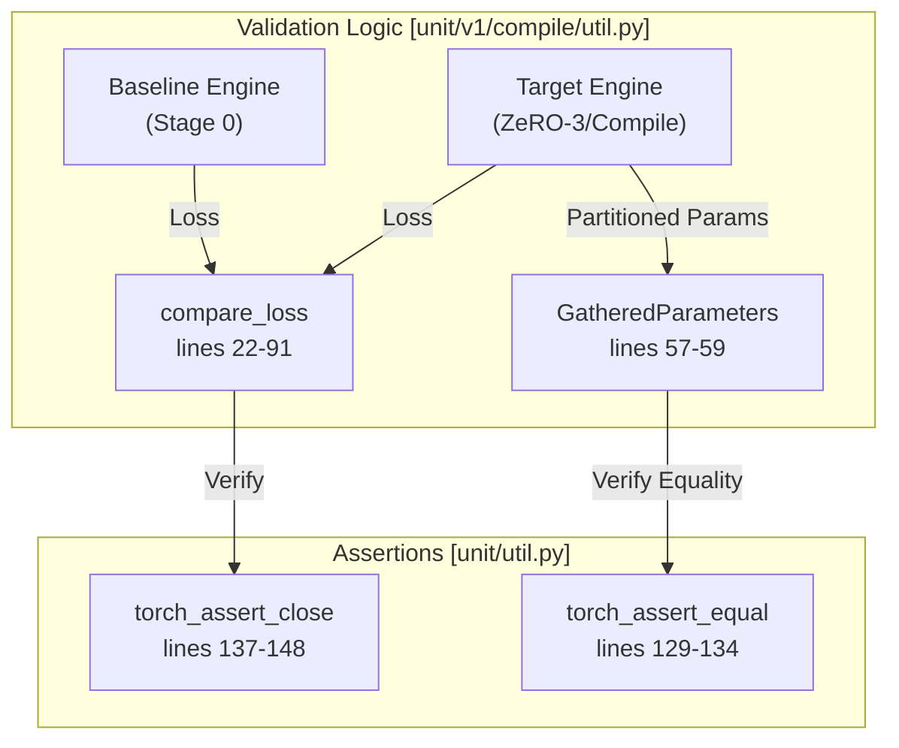

<!-- source: DeepWiki mcp.deepwiki.com · repo deepspeedai/DeepSpeed · page 15 Testing Infrastructure · fetched 2026-10-21 -->

# Testing Infrastructure

Relevant source files

The following files were used as context for generating this wiki page:

- [.flake8](.flake8)
- [CODEOWNERS](CODEOWNERS)
- [MANIFEST_win.in](MANIFEST_win.in)
- [accelerator/__init__.py](accelerator/__init__.py)
- [tests/small_model_debugging/test_model.py](tests/small_model_debugging/test_model.py)
- [tests/unit/alexnet_model.py](tests/unit/alexnet_model.py)
- [tests/unit/common.py](tests/unit/common.py)
- [tests/unit/inference/test_checkpoint_sharding.py](tests/unit/inference/test_checkpoint_sharding.py)
- [tests/unit/inference/test_model_profiling.py](tests/unit/inference/test_model_profiling.py)
- [tests/unit/pipe/test_pipe_module.py](tests/unit/pipe/test_pipe_module.py)
- [tests/unit/runtime/pipe/test_pipe.py](tests/unit/runtime/pipe/test_pipe.py)
- [tests/unit/runtime/sparse_tensor/test_averaging_sparse_gradients.py](tests/unit/runtime/sparse_tensor/test_averaging_sparse_gradients.py)
- [tests/unit/runtime/sparse_tensor/test_sparse_grads.py](tests/unit/runtime/sparse_tensor/test_sparse_grads.py)
- [tests/unit/runtime/test_data.py](tests/unit/runtime/test_data.py)
- [tests/unit/runtime/test_runtime_utils.py](tests/unit/runtime/test_runtime_utils.py)
- [tests/unit/util.py](tests/unit/util.py)
- [tests/unit/utils/test_init_on_device.py](tests/unit/utils/test_init_on_device.py)
- [tests/unit/v1/compile/util.py](tests/unit/v1/compile/util.py)

## Purpose and Scope

This document describes DeepSpeed's testing infrastructure, which provides test models, utilities, and custom optimizers designed specifically for validating distributed training and inference functionality. The infrastructure includes a hierarchy of synthetic models that exercise various DeepSpeed features, helper functions for creating test data and configurations, and specialized optimizers for testing state management.

The testing infrastructure is organized into three main components:
- **Test Model Hierarchy** ([Test Model Hierarchy](#15.1)): Synthetic PyTorch models for testing different DeepSpeed features.
- **Test Utilities and Fixtures** ([Test Utilities and Fixtures](#15.2)): Helper functions for data generation, configuration creation, and pytest integration.
- **Custom Optimizers for Testing** ([Custom Optimizers for Testing](#15.3)): Specialized optimizers for validating state management and checkpointing.

For details on the distributed execution framework and multi-platform testing, see [CI/CD Pipeline](#16).

---

## Testing Infrastructure Components

DeepSpeed's testing infrastructure is built around synthetic models, data utilities, and custom optimizers located primarily in `tests/unit/`. These components allow developers to isolate and verify specific engine behaviors without the overhead of full-scale model training.

**Testing Infrastructure Component Overview**

```mermaid
graph TB
    subgraph "Test Models [unit/simple_model.py]"
        SimpleModel["SimpleModel<br/>Basic linear layers"]
        SimpleMoEModel["SimpleMoEModel<br/>Mixture-of-Experts"]
        LinearStackPipe["LinearStackPipe<br/>Pipeline parallelism"]
        AlexNet["AlexNet<br/>Image classification tests"]
    end
    
    subgraph "Test Utilities [unit/common.py & unit/util.py]"
        DistTest["DistributedTest<br/>Multi-process runner"]
        DistFixture["DistributedFixture<br/>Setup/Teardown logic"]
        RandomDL["random_dataloader<br/>Generate test data"]
        ConfigCreator["create_config_from_dict<br/>JSON config creation"]
    end
    
    subgraph "Custom Optimizers"
        SimpleOptimizer["SimpleOptimizer<br/>Basic gradient descent"]
        HybridStateOptimizer["HybridStateOptimizer<br/>Mixed state types"]
    end
    
    subgraph "DeepSpeed Core"
        DSInitialize["deepspeed.initialize"]
        ZeRO["ZeRO Optimizer"]
        Pipeline["PipelineEngine"]
    end
    
    SimpleModel --> DSInitialize
    SimpleMoEModel --> DSInitialize
    LinearStackPipe --> Pipeline
    
    DistTest --> DSInitialize
    ConfigCreator --> DSInitialize
    
    SimpleOptimizer --> ZeRO
    HybridStateOptimizer --> ZeRO
```

Sources: [tests/unit/common.py:139-165](), [tests/unit/alexnet_model.py:20-46](), [tests/unit/runtime/test_runtime_utils.py:30-53]()

---

## Test Model Hierarchy

DeepSpeed provides a comprehensive hierarchy of test models designed to exercise different features of the training and inference systems. These models range from basic linear stacks to complex pipeline-parallel and MoE architectures.

- **SimpleModel**: A basic linear layer model used for core ZeRO and optimizer tests [tests/small_model_debugging/test_model.py:15-31]().
- **AlexNet & AlexNetPipe**: Standard CNN architectures adapted for DeepSpeed, including a `PipelineModule` variant for testing pipeline parallelism [tests/unit/alexnet_model.py:20-77]().
- **Inference Models**: Tests often leverage HuggingFace `AutoModel` types to verify checkpoint sharding and kernel injection [tests/unit/inference/test_checkpoint_sharding.py:78-81]().

For details, see [Test Model Hierarchy](#15.1).

Sources: [tests/unit/alexnet_model.py:49-77](), [tests/unit/inference/test_checkpoint_sharding.py:99-106]()

---

## Test Utilities and Fixtures

The testing framework provides specialized classes and functions to manage distributed environments, hardware-specific skips, and data generation.

### Distributed Execution Framework
The `DistributedExec` base class [tests/unit/common.py:139-158]() and its children, `DistributedTest` and `DistributedFixture`, manage the spawning of multiple processes to simulate multi-GPU environments. They handle:
- **Port Management**: Dynamically finding open ports for distributed initialization [tests/unit/common.py:47-64]().
- **Accelerator Visibility**: Rotating `CUDA_VISIBLE_DEVICES` across xdist workers to prevent resource contention [tests/unit/common.py:81-136]().
- **Hardware-Aware Skipping**: Utilities like `skip_on_arch` and `bf16_required_version_check` ensure tests only run on compatible hardware [tests/unit/util.py:18-39]().

### Data and Config Helpers
- **create_config_from_dict**: A utility to generate temporary JSON configuration files from Python dictionaries [tests/small_model_debugging/test_model.py:33-37]().
- **no_child_process_in_deepspeed_io**: A context manager to disable multiprocessing in the DeepSpeed IO layer during tests to avoid nested pool errors [tests/unit/util.py:110-127]().

For details, see [Test Utilities and Fixtures](#15.2).

Sources: [tests/unit/common.py:39-64](), [tests/unit/util.py:129-158]()

---

## Custom Optimizers for Testing

DeepSpeed uses custom optimizers to validate state management, especially for ZeRO-1/2/3 and checkpointing.

- **SimpleOptimizer**: A minimal implementation of SGD used to verify basic gradient flow without the complexity of momentum states.
- **HybridStateOptimizer**: Specifically designed to test how DeepSpeed handles mixed state types (e.g., Python scalars combined with PyTorch tensors) during checkpointing and ZeRO partitioning.
- **SparseAdam**: Used in tests like `TestSparseAdam` to verify the `sparse_gradients` engine feature and gradient averaging across ranks [tests/unit/runtime/sparse_tensor/test_averaging_sparse_gradients.py:59-89]().

For details, see [Custom Optimizers for Testing](#15.3).

Sources: [tests/unit/runtime/sparse_tensor/test_averaging_sparse_gradients.py:28-43](), [tests/unit/runtime/sparse_tensor/test_averaging_sparse_gradients.py:72-89]()

---

## Integration and Validation

The infrastructure includes utilities to compare model outputs and losses across different parallelism strategies.

**Loss and Parameter Validation Flow**

Sources: [tests/unit/v1/compile/util.py:22-91](), [tests/unit/util.py:129-148]()

---

