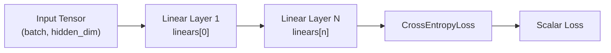
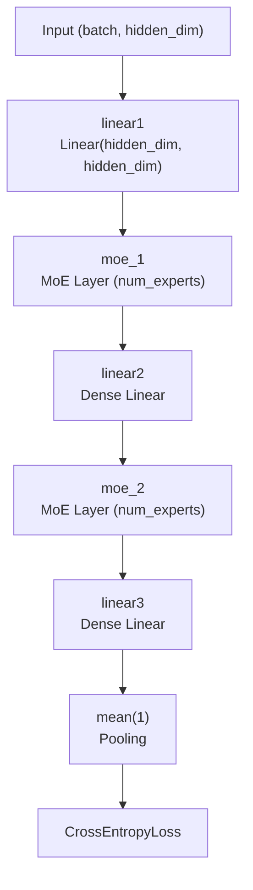
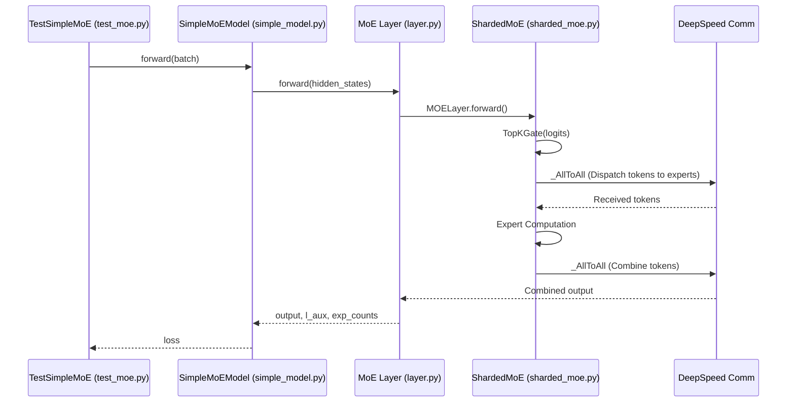

<!-- source: DeepWiki mcp.deepwiki.com · repo deepspeedai/DeepSpeed · page 15.1 Test Model Hierarchy · fetched 2026-10-21 -->

# Test Model Hierarchy

Relevant source files

The following files were used as context for generating this wiki page:

- [CODEOWNERS](CODEOWNERS)
- [MANIFEST_win.in](MANIFEST_win.in)
- [accelerator/__init__.py](accelerator/__init__.py)
- [deepspeed/moe/layer.py](deepspeed/moe/layer.py)
- [deepspeed/moe/mappings.py](deepspeed/moe/mappings.py)
- [deepspeed/moe/sharded_moe.py](deepspeed/moe/sharded_moe.py)
- [deepspeed/ops/transformer/inference/moe_inference.py](deepspeed/ops/transformer/inference/moe_inference.py)
- [deepspeed/utils/groups.py](deepspeed/utils/groups.py)
- [tests/small_model_debugging/test_model.py](tests/small_model_debugging/test_model.py)
- [tests/unit/alexnet_model.py](tests/unit/alexnet_model.py)
- [tests/unit/moe/test_moe.py](tests/unit/moe/test_moe.py)
- [tests/unit/pipe/test_pipe_module.py](tests/unit/pipe/test_pipe_module.py)
- [tests/unit/runtime/pipe/test_pipe.py](tests/unit/runtime/pipe/test_pipe.py)
- [tests/unit/runtime/sparse_tensor/test_averaging_sparse_gradients.py](tests/unit/runtime/sparse_tensor/test_averaging_sparse_gradients.py)
- [tests/unit/runtime/sparse_tensor/test_sparse_grads.py](tests/unit/runtime/sparse_tensor/test_sparse_grads.py)
- [tests/unit/runtime/test_data.py](tests/unit/runtime/test_data.py)
- [tests/unit/runtime/test_runtime_utils.py](tests/unit/runtime/test_runtime_utils.py)
- [tests/unit/simple_model.py](tests/unit/simple_model.py)
- [tests/unit/utils/test_init_on_device.py](tests/unit/utils/test_init_on_device.py)

## Overview

The Test Model Hierarchy provides a collection of lightweight PyTorch models designed specifically for DeepSpeed unit testing. These models enable systematic testing of:

- **ZeRO Optimizer Stages**: Memory partitioning strategies (Stages 1, 2, 3) [[tests/unit/simple_model.py:20-36]]().
- **Pipeline Parallelism**: Model partitioning across pipeline stages [[tests/unit/simple_model.py:182-197]]().
- **Mixed Precision Training**: FP16/BF16 optimizer behavior [[tests/unit/moe/test_moe.py:39-41]]().
- **Mixture of Experts (MoE)**: Expert parallelism and routing [[tests/unit/simple_model.py:80-115]]().
- **Gradient Management**: Gradient accumulation, clipping, and checkpointing [[tests/unit/runtime/test_runtime_utils.py:30-53]]().
- **Curriculum Learning**: Progressive training strategies [[tests/unit/simple_model.py:69-77]]().

All test models are defined in `tests/unit/simple_model.py` and provide consistent interfaces for loss computation and forward passes while exposing different architectural patterns.

**Sources:** [tests/unit/simple_model.py:1-314](), [tests/unit/moe/test_moe.py:22-60](), [tests/unit/runtime/test_runtime_utils.py:30-53]()

## Model Class Hierarchy

The test models are organized into several categories based on their testing purpose:

```mermaid
graph TB
    TorchModule["torch.nn.Module"]
    PipelineModuleBase["PipelineModule<br/>deepspeed.pipe"]
    OptimizerBase["torch.optim.Optimizer"]
    
    SimpleModel["SimpleModel<br/>simple_model.py:20-36"]
    SimpleFrozenModel["SimpleFrozenModel<br/>simple_model.py:39-66"]
    CurriculumModel["Curriculum_SimpleModel<br/>simple_model.py:69-77"]
    PLDModel["PLD_SimpleModel<br/>simple_model.py:256-265"]
    UnusedParamsModel["UnusedParametersModel<br/>simple_model.py:149-154"]
    
    SimpleMoEModel["SimpleMoEModel<br/>simple_model.py:80-115"]
    SimplePRMoEModel["SimplePRMoEModel<br/>simple_model.py:118-146"]
    
    LinearStack["LinearStack<br/>simple_model.py:157-179"]
    LinearStackPipe["LinearStackPipe<br/>simple_model.py:182-197"]
    AlexNetPipe["AlexNetPipe<br/>alexnet_model.py:49-53"]
    
    SimpleOptimizer["SimpleOptimizer<br/>simple_model.py:200-221"]
    HybridStateOptimizer["HybridStateOptimizer<br/>simple_model.py:224-253"]
    
    TorchModule --> SimpleModel
    TorchModule --> SimpleFrozenModel
    TorchModule --> SimpleMoEModel
    TorchModule --> SimplePRMoEModel
    TorchModule --> LinearStack
    
    SimpleModel --> CurriculumModel
    SimpleModel --> PLDModel
    SimpleModel --> UnusedParamsModel
    
    PipelineModuleBase --> LinearStackPipe
    PipelineModuleBase --> AlexNetPipe
    
    OptimizerBase --> SimpleOptimizer
    OptimizerBase --> HybridStateOptimizer
```

**Sources:** [tests/unit/simple_model.py:20-265](), [tests/unit/alexnet_model.py:49-53]()

## SimpleModel and Variants

### SimpleModel Architecture

`SimpleModel` is the foundational test model providing a minimal architecture for testing optimizer and memory management features:

**Sources:** [tests/unit/simple_model.py:20-36]()

### SimpleModel Implementation

| Parameter | Type | Default | Description |
|-----------|------|---------|-------------|
| `hidden_dim` | `int` | Required | Dimensionality of linear layers |
| `empty_grad` | `bool` | `False` | If True, adds unused `linear2` layer for gradient testing [[tests/unit/simple_model.py:25-26]]() |
| `nlayers` | `int` | `1` | Number of linear layers in sequence |

The forward pass at [tests/unit/simple_model.py:30-36]() implements either direct computation (`nlayers=1`) or residual connections (`nlayers>1`).

**Sources:** [tests/unit/simple_model.py:20-36]()

### SimpleFrozenModel

`SimpleFrozenModel` extends `SimpleModel` to test scenarios with frozen (non-trainable) parameters. It sets `requires_grad = False` for the first layer's weight and bias [[tests/unit/simple_model.py:49-50]]() and provides a custom `state_dict` that filters out these frozen parameters [[tests/unit/simple_model.py:52-58]]().

**Sources:** [tests/unit/simple_model.py:39-66]()

### Curriculum_SimpleModel

`Curriculum_SimpleModel` extends `SimpleModel` to support curriculum learning by returning the current `curriculum_seqlen` alongside the loss in the forward pass [[tests/unit/simple_model.py:74-77]]().

**Sources:** [tests/unit/simple_model.py:69-77]()

### UnusedParametersModel

`UnusedParametersModel` intentionally includes an `unused_linear` layer [[tests/unit/simple_model.py:154]](). This is used to validate ZeRO's handling of parameters that do not receive gradients during the backward pass.

**Sources:** [tests/unit/simple_model.py:149-154]()

## Mixture of Experts (MoE) Models

### SimpleMoEModel Architecture

`SimpleMoEModel` implements a multi-layer MoE architecture for testing expert parallelism and gradient reduction buckets:

**Sources:** [tests/unit/simple_model.py:80-115]()

### SimpleMoEModel Configuration

The model interleaves MoE modules with dense layers to create opportunities for gradient merging in ZeRO Stage 2 reduce buckets [[tests/unit/simple_model.py:94-95]](). It uses the `MoE` class from `deepspeed.moe.layer` [[tests/unit/simple_model.py:87-93]](), which internally manages expert distribution and routing via `MOELayer` and `TopKGate` [[deepspeed/moe/layer.py:73-80]]().

**Sources:** [tests/unit/simple_model.py:80-115](), [deepspeed/moe/layer.py:17-133]()

### SimplePRMoEModel

`SimplePRMoEModel` implements Pyramid-Residual MoE where different layers have different expert counts [[tests/unit/simple_model.py:131-136]](). Specifically, `linear3` uses `2 * num_experts` compared to `linear2`.

**Sources:** [tests/unit/simple_model.py:118-146]()

## Pipeline Parallelism Models

### LinearStack and LinearStackPipe

`LinearStack` is a standard sequential model [[tests/unit/simple_model.py:157-179]](), while `LinearStackPipe` is its pipeline-parallel counterpart using `PipelineModule` [[tests/unit/simple_model.py:182-197]]().

`LinearStackPipe` utilizes `LayerSpec` to define its architecture, allowing DeepSpeed to partition the layers across different pipeline stages [[tests/unit/simple_model.py:191-195]]().

**Sources:** [tests/unit/simple_model.py:157-197]()

### AlexNetPipe

`AlexNetPipe` is a specialized test model that adapts the standard AlexNet architecture for pipeline parallelism [[tests/unit/alexnet_model.py:49-53]](). It provides a `to_layers()` method to flatten the `nn.Sequential` features and classifier into a list of layers suitable for `PipelineModule` [[tests/unit/alexnet_model.py:51-53]]().

**Sources:** [tests/unit/alexnet_model.py:49-53]()

## Test Optimizers

### SimpleOptimizer

`SimpleOptimizer` is a minimal SGD-like optimizer with a hardcoded learning rate [[tests/unit/simple_model.py:200-221]](). It is used to verify that DeepSpeed can wrap custom optimizers without internal state requirements.

**Sources:** [tests/unit/simple_model.py:200-221]()

### HybridStateOptimizer

`HybridStateOptimizer` tests DeepSpeed's ability to handle optimizers with both Python scalars (`integer_step`) and PyTorch tensors (`tensor_step`) in their `state` dictionary [[tests/unit/simple_model.py:236-237]](). This is critical for validating ZeRO's state partitioning and checkpointing logic.

**Sources:** [tests/unit/simple_model.py:224-253]()

## Test Utility Functions

DeepSpeed provides several helper functions to streamline test data generation and configuration:

| Function | Source | Description |
|----------|--------|-------------|
| `random_dataloader` | [[tests/unit/simple_model.py:275-279]]() | Creates a `DataLoader` with random data based on the model's micro-batch size. |
| `sequence_dataloader` | [[tests/unit/simple_model.py:282-288]]() | Generates 3D sequence data for MoE or Transformer testing. |
| `create_config_from_dict` | [[tests/unit/simple_model.py:291-295]]() | Serializes a Python dict to a temporary JSON file for DeepSpeed initialization. |
| `args_from_dict` | [[tests/unit/simple_model.py:309-313]]() | Helper that creates both the config file and the `argparse.Namespace` required by `deepspeed.initialize`. |

**Sources:** [tests/unit/simple_model.py:268-313]()

## Data Flow in MoE Tests

The following diagram illustrates how MoE test models interact with DeepSpeed's sharded MoE logic during a test run.

**Sources:** [tests/unit/moe/test_moe.py:48-57](), [deepspeed/moe/layer.py:105-132](), [deepspeed/moe/sharded_moe.py:97-110]()

---

