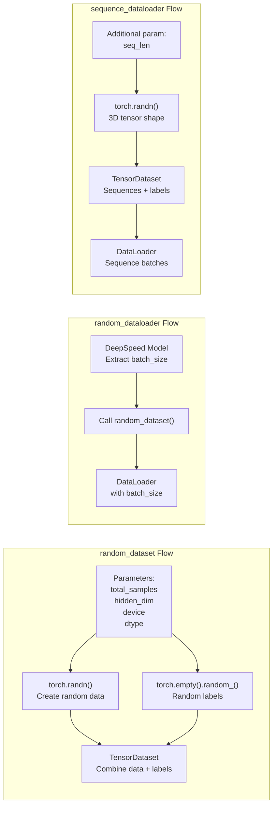
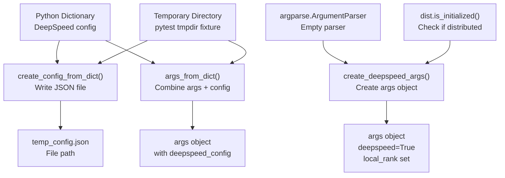
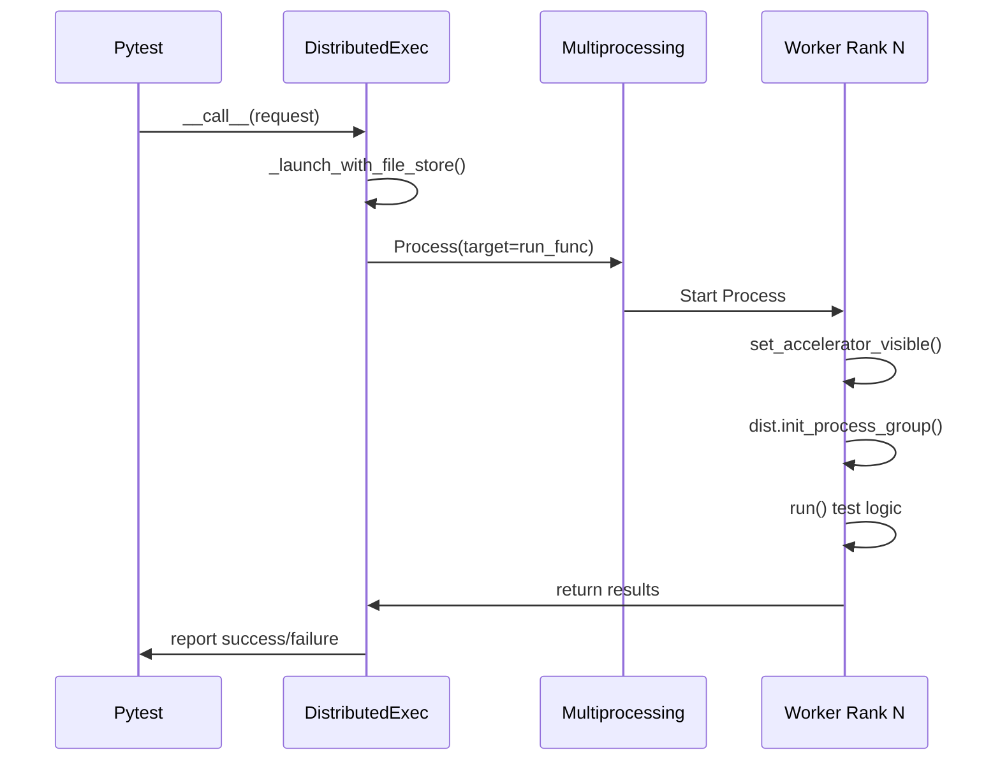

<!-- source: DeepWiki mcp.deepwiki.com · repo deepspeedai/DeepSpeed · page 15.2 Test Utilities and Fixtures · fetched 2026-10-21 -->

# Test Utilities and Fixtures

Relevant source files

The following files were used as context for generating this wiki page:

- [.flake8](.flake8)
- [.github/workflows/setup-venv/action.yml](.github/workflows/setup-venv/action.yml)
- [requirements/requirements-dev.txt](requirements/requirements-dev.txt)
- [requirements/requirements-inf.txt](requirements/requirements-inf.txt)
- [tests/conftest.py](tests/conftest.py)
- [tests/unit/common.py](tests/unit/common.py)
- [tests/unit/inference/quantization/test_intX_quantization.py](tests/unit/inference/quantization/test_intX_quantization.py)
- [tests/unit/inference/test_checkpoint_sharding.py](tests/unit/inference/test_checkpoint_sharding.py)
- [tests/unit/inference/test_model_profiling.py](tests/unit/inference/test_model_profiling.py)
- [tests/unit/runtime/zero/test_zero_dynamic_class.py](tests/unit/runtime/zero/test_zero_dynamic_class.py)
- [tests/unit/runtime/zero/test_zero_nesting_init.py](tests/unit/runtime/zero/test_zero_nesting_init.py)
- [tests/unit/util.py](tests/unit/util.py)
- [tests/unit/v1/compile/util.py](tests/unit/v1/compile/util.py)

## Purpose and Scope

This page documents the testing utilities and fixtures provided in DeepSpeed for unit and integration testing. These utilities simplify the creation of test models, data loaders, configurations, and specialized optimizers needed for comprehensive testing of DeepSpeed's distributed training features. The utilities are primarily located in [tests/unit/simple_model.py]() and [tests/unit/common.py](), designed to support testing of ZeRO optimization, pipeline parallelism, Mixture of Experts (MoE), and inference capabilities.

For information about the broader testing infrastructure and test categorization, see [Testing Infrastructure](#15). For details on specific test model architectures, see [Test Model Hierarchy](#15.1).

---

## Test Utility Architecture

The test utilities follow a layered design with three main categories: test models, data generation functions, and configuration helpers. These components work together to enable rapid test development with minimal boilerplate.

### Utility Component Relationships

```mermaid
graph TB
    subgraph "Test Model Classes"
        SimpleModel["SimpleModel<br/>Basic linear layers"]
        SimpleFrozenModel["SimpleFrozenModel<br/>Frozen parameters"]
        SimpleMoEModel["SimpleMoEModel<br/>MoE layers"]
        LinearStackPipe["LinearStackPipe<br/>PipelineModule"]
        CurriculumModel["Curriculum_SimpleModel<br/>Curriculum learning"]
    end
    
    subgraph "Data Generation"
        random_dataset["random_dataset()<br/>TensorDataset creation"]
        random_dataloader["random_dataloader()<br/>DataLoader with model config"]
        sequence_dataloader["sequence_dataloader()<br/>Sequence data support"]
    end
    
    subgraph "Configuration Helpers"
        create_config_from_dict["create_config_from_dict()<br/>Dict to JSON file"]
        create_deepspeed_args["create_deepspeed_args()<br/>Argparse args object"]
        args_from_dict["args_from_dict()<br/>Args + config file"]
    end
    
    subgraph "Custom Optimizers"
        SimpleOptimizer["SimpleOptimizer<br/>No optimizer state"]
        HybridStateOptimizer["HybridStateOptimizer<br/>Mixed state types"]
    end
    
    subgraph "Distributed Execution"
        DistributedTest["DistributedTest<br/>Unit test base class"]
        DistributedFixture["DistributedFixture<br/>Fixture base class"]
        DistributedExec["DistributedExec<br/>Core execution logic"]
    end
    
    create_config_from_dict --> args_from_dict
    create_deepspeed_args --> args_from_dict
    
    args_from_dict --> DistributedTest
    SimpleModel --> DistributedTest
    SimpleMoEModel --> DistributedTest
    LinearStackPipe --> DistributedTest
    SimpleOptimizer --> DistributedTest
    HybridStateOptimizer --> DistributedTest
    
    random_dataloader --> DistributedTest
    sequence_dataloader --> DistributedTest
    random_dataset --> random_dataloader
    random_dataset --> sequence_dataloader
    
    DistributedExec --> DistributedTest
    DistributedExec --> DistributedFixture
```

**Sources**: [tests/unit/common.py:139-165](), [tests/unit/simple_model.py:1-314]()

---

## Data Generation Utilities

DeepSpeed provides functions for generating synthetic training data. These utilities ensure consistent data creation across tests while allowing customization for different scenarios.

### Data Generation Functions

| Function | Purpose | Key Parameters | Return Type |
|----------|---------|----------------|-------------|
| `random_dataset()` | Creates random tensor dataset | `total_samples`, `hidden_dim`, `device`, `dtype` | `torch.utils.data.TensorDataset` |
| `random_dataloader()` | Creates dataloader from model config | `model`, `total_samples`, `hidden_dim`, `device`, `dtype` | `torch.utils.data.DataLoader` |
| `sequence_dataloader()` | Creates sequence-based dataloader | `model`, `total_samples`, `hidden_dim`, `device`, `seq_len`, `dtype` | `torch.utils.data.DataLoader` |

### Data Generation Workflow

**Sources**: [tests/unit/simple_model.py:268-289]()

### random_dataset Implementation

The `random_dataset()` function generates synthetic data and labels on the specified device. The data tensor has shape `[total_samples, hidden_dim]` with values sampled from a standard normal distribution [tests/unit/simple_model.py:270](). Labels are random integers in the range `[0, hidden_dim)` to match cross-entropy requirements [tests/unit/simple_model.py:271]().

### random_dataloader and sequence_dataloader

Both `random_dataloader()` and `sequence_dataloader()` automatically extract the micro batch size from the model using `model.train_micro_batch_size_per_gpu()` [tests/unit/simple_model.py:276](). The sequence variant creates 3D tensors with shape `[total_samples, seq_len, hidden_dim]` for testing sequence-based models [tests/unit/simple_model.py:285]().

---

## Configuration Helper Functions

Configuration helpers streamline the creation of DeepSpeed arguments and configuration files needed for test initialization.

### Configuration Helper Flow

**Sources**: [tests/unit/simple_model.py:291-314]()

### create_config_from_dict

This function writes a Python dictionary to a JSON file in the specified directory, typically a pytest `tmpdir` fixture [tests/unit/simple_model.py:291-295]().

### create_deepspeed_args

Creates an argument namespace compatible with DeepSpeed initialization. It sets `args.deepspeed = True` and configures `args.local_rank` from `dist.get_rank()` if the distributed environment is initialized [tests/unit/simple_model.py:298-306]().

### args_from_dict

Combines `create_deepspeed_args()` and `create_config_from_dict()` into a single convenience function. This is the primary configuration helper used in unit tests [tests/unit/simple_model.py:309-313]().

---

## Custom Test Optimizers

DeepSpeed provides specialized optimizer implementations for testing optimizer state management, checkpointing, and ZeRO optimization features.

### SimpleOptimizer

The `SimpleOptimizer` class implements a basic SGD-style update without maintaining any internal optimizer state [tests/unit/simple_model.py:200-221](). It uses a distinctive learning rate of `0.11072018` for easy identification during debugging [tests/unit/simple_model.py:202]().

### HybridStateOptimizer

The `HybridStateOptimizer` tests DeepSpeed's ability to handle diverse state types by adding both integer and tensor state per parameter [tests/unit/simple_model.py:224-253]().
- `state['integer_step']`: A Python integer [tests/unit/simple_model.py:241]().
- `state['tensor_step']`: A 1D tensor [tests/unit/simple_model.py:242]().

---

## Distributed Testing Fixtures

DeepSpeed utilizes `DistributedTest` and `DistributedFixture` to manage multi-process execution for unit tests.

### Execution Lifecycle

**Sources**: [tests/unit/common.py:139-165](), [tests/unit/common.py:81-137]()

### set_accelerator_visible

This utility ensures that each `xdist` worker or distributed process sees a unique set of accelerators to avoid resource contention. It discovers available devices (CUDA, ROCm, XPU, HPU, NPU, SUPA) and rotates `CUDA_VISIBLE_DEVICES` based on the worker ID [tests/unit/common.py:81-137]().

### torch_assert_close

DeepSpeed provides `torch_assert_close` as a wrapper around `torch.testing.assert_close` to validate tensor equality in tests with configurable relative and absolute tolerances [tests/unit/util.py:137-148]().

**Sources**:
- **Execution**: [tests/unit/common.py:139-165]()
- **Device Management**: [tests/unit/common.py:81-137]()
- **Assertions**: [tests/unit/util.py:137-148]()
- **Models & Optimizers**: [tests/unit/simple_model.py:1-314]()

---

