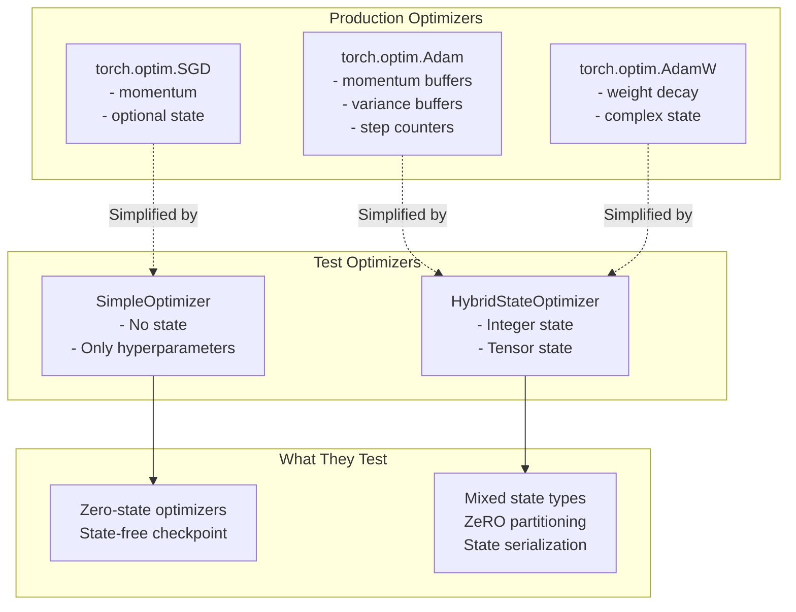
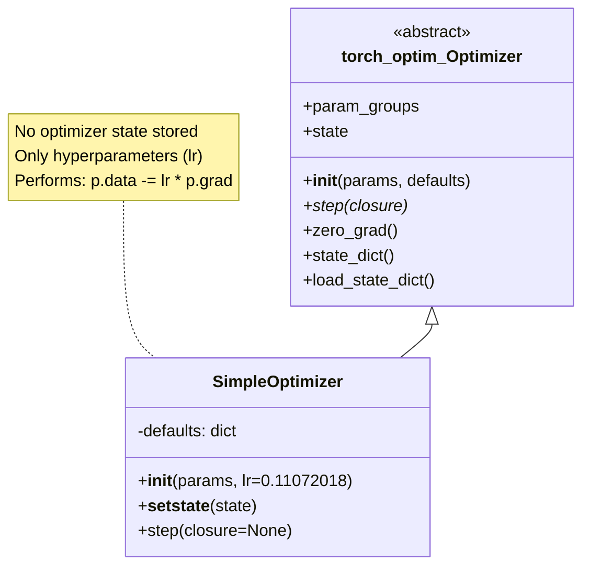
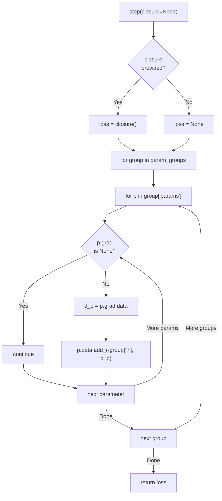
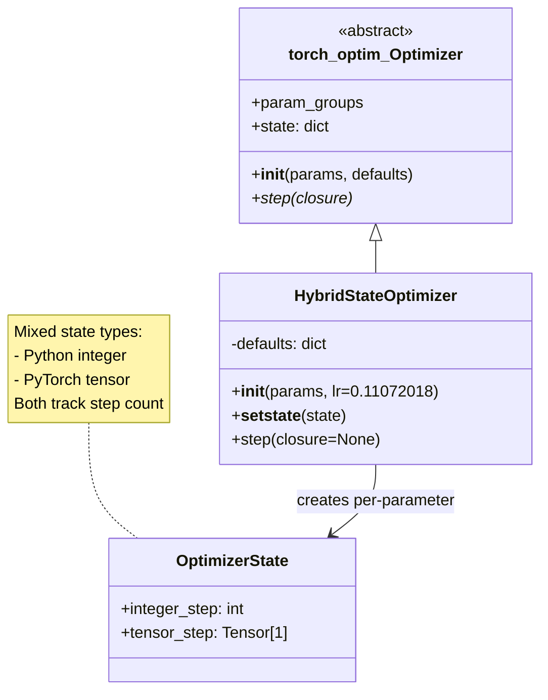
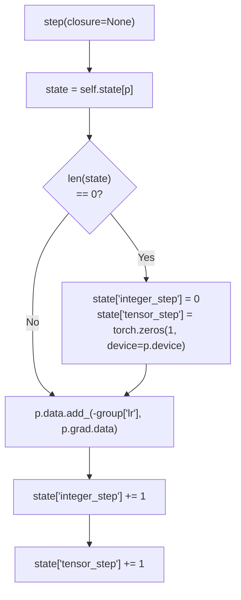
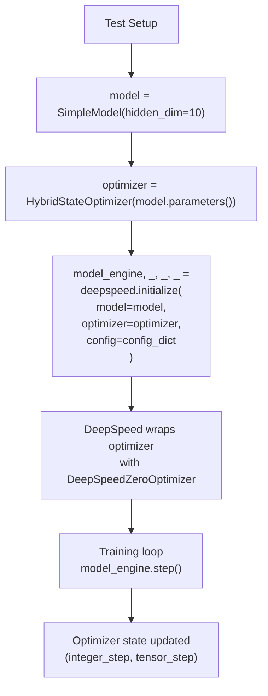

<!-- source: DeepWiki mcp.deepwiki.com · repo deepspeedai/DeepSpeed · page 15.3 Custom Optimizers for Testing · fetched 2026-10-21 -->

# Custom Optimizers for Testing

<details>
<summary>Relevant source files</summary>

The following files were used as context for generating this wiki page:

- [.flake8](.flake8)
- [tests/unit/checkpoint/common.py](tests/unit/checkpoint/common.py)
- [tests/unit/checkpoint/test_moe_checkpoint.py](tests/unit/checkpoint/test_moe_checkpoint.py)
- [tests/unit/checkpoint/test_zero_optimizer.py](tests/unit/checkpoint/test_zero_optimizer.py)
- [tests/unit/common.py](tests/unit/common.py)
- [tests/unit/compression/test_compression.py](tests/unit/compression/test_compression.py)
- [tests/unit/inference/test_checkpoint_sharding.py](tests/unit/inference/test_checkpoint_sharding.py)
- [tests/unit/inference/test_model_profiling.py](tests/unit/inference/test_model_profiling.py)
- [tests/unit/model_parallelism/test_configurable_parallel_mp.py](tests/unit/model_parallelism/test_configurable_parallel_mp.py)
- [tests/unit/model_parallelism/test_configurable_parallel_pp.py](tests/unit/model_parallelism/test_configurable_parallel_pp.py)
- [tests/unit/moe/test_moe_tp.py](tests/unit/moe/test_moe_tp.py)
- [tests/unit/profiling/flops_profiler/test_flops_profiler.py](tests/unit/profiling/flops_profiler/test_flops_profiler.py)
- [tests/unit/runtime/half_precision/onebit/test_onebit.py](tests/unit/runtime/half_precision/onebit/test_onebit.py)
- [tests/unit/util.py](tests/unit/util.py)
- [tests/unit/v1/compile/util.py](tests/unit/v1/compile/util.py)

</details>


## Purpose and Scope

This document describes the custom PyTorch optimizers defined in DeepSpeed's test infrastructure, specifically designed to validate optimizer state management and checkpoint/restore functionality. These minimal optimizers (`SimpleOptimizer` and `HybridStateOptimizer`) are not production-grade optimization algorithms but rather testing tools that expose different state management patterns to verify DeepSpeed's ZeRO optimizer wrapper behavior.

For information about the distributed test framework base classes, see [tests/unit/common.py:139-164](). For test models and data utilities, see [tests/unit/simple_model.py:20-197](). For the core ZeRO optimizer implementation being tested, see [deepspeed/runtime/zero/stage_1_and_2.py]().

---

## Overview: Test Optimizer Requirements

DeepSpeed's ZeRO optimizer wrappers must handle various optimizer state patterns correctly. Test optimizers expose these patterns in minimal implementations:

Title: Mapping Test Optimizers to Testing Goals


**Testing Goals:**
- **SimpleOptimizer**: Validates ZeRO behavior with stateless optimizers (only hyperparameters). [tests/unit/simple_model.py:200-221]()
- **HybridStateOptimizer**: Validates ZeRO's handling of mixed integer/tensor optimizer states, checkpoint serialization, and state partitioning. [tests/unit/simple_model.py:224-253]()

**Sources:** [tests/unit/simple_model.py:200-253]()

---

## SimpleOptimizer: Minimal Stateless Optimizer

### Class Definition and Architecture

The `SimpleOptimizer` class provides the simplest possible optimizer implementation with no per-parameter state:

Title: SimpleOptimizer Class Hierarchy


**Key Characteristics:**
- **No State**: The `self.state` dictionary remains empty for all parameters. [tests/unit/simple_model.py:200-207]()
- **Single Hyperparameter**: Only learning rate (`lr`) in `defaults` dict. [tests/unit/simple_model.py:202-202]()
- **Direct Gradient Update**: `p.data.add_(-group['lr'], d_p)` applies gradient directly. [tests/unit/simple_model.py:219-219]()
- **No Momentum**: No historical information maintained.

**Sources:** [tests/unit/simple_model.py:200-221]()

### Implementation Details

The `step()` method implements basic stochastic gradient descent without momentum:

Title: SimpleOptimizer Step Execution Flow


**Update Formula:**
```
p_new = p_old - lr * grad
```

**Sources:** [tests/unit/simple_model.py:209-221]()

---

## HybridStateOptimizer: Mixed State Type Optimizer

### Class Definition and State Management

The `HybridStateOptimizer` maintains both integer and tensor state for each parameter, testing ZeRO's ability to handle heterogeneous optimizer state:

Title: HybridStateOptimizer State Structure


**State Structure:**
```python
self.state[p] = {
    'integer_step': 0,           # Python int - step counter
    'tensor_step': torch.zeros(1, device=p.device)  # Tensor - step counter
}
```

**Sources:** [tests/unit/simple_model.py:224-253]()

### State Initialization and Update Logic

The optimizer lazily initializes state on first `step()` call. [tests/unit/simple_model.py:241-244]()

Title: HybridStateOptimizer Step Logic


**Sources:** [tests/unit/simple_model.py:233-253]()

---

## Optimizer State Characteristics Comparison

### State Dictionary Structure

The following table compares the state dictionary structures of both test optimizers:

| Aspect | SimpleOptimizer | HybridStateOptimizer |
|--------|-----------------|----------------------|
| **State per parameter** | Empty `{}` | `{'integer_step': int, 'tensor_step': Tensor}` |
| **State dict keys** | Only `param_groups` | `param_groups` + `state` |
| **State initialization** | Never (always empty) | Lazy (on first step) |
| **Update Formula** | `p.data.add_(-lr, grad)` | `p.data.add_(-lr, grad)` |
| **State types** | N/A | `int` and `torch.Tensor` |

**Sources:** [tests/unit/simple_model.py:200-253]()

---

## Integration with DeepSpeed Test Infrastructure

### Optimizer Registration in Tests

Test optimizers integrate with DeepSpeed's `deepspeed.initialize()` API. [tests/unit/checkpoint/test_zero_optimizer.py:147-154]()

Title: DeepSpeed Integration for Custom Optimizers


### Usage in Real Tests

From `tests/unit/checkpoint/test_zero_optimizer.py`:

**Hybrid State Checkpoint Verification:**
Tests that `HybridStateOptimizer` mixed-type state persists through checkpointing. [tests/unit/checkpoint/test_zero_optimizer.py:131-154]()

```python
# Create models and optimizers
models = [SimpleModel(hidden_dim=hidden_dim) for _ in range(2)]
optimizers = [HybridStateOptimizer(model.parameters()) for model in models]

# Verify via checkpoint correctness utility
checkpoint_correctness_verification(
    config_dict,
    models=models,
    base_optimizers=optimizers,
    hidden_dim=hidden_dim,
    tmpdir=tmpdir,
    load_optimizer_states=True
)
```

**State Comparison Logic:**
DeepSpeed tests use `compare_optimizer_states` and `compare_state_dicts` to verify that restored optimizer state exactly matches the saved state. [tests/unit/checkpoint/common.py:88-124]()

**Sources:** [tests/unit/checkpoint/test_zero_optimizer.py:131-154](), [tests/unit/checkpoint/common.py:88-124]()

---

## Design Rationale

The test optimizers serve specific purposes that production optimizers cannot easily fulfill:

1. **Isolation**: By using `SimpleOptimizer`, tests can isolate `DeepSpeedZeroOptimizer` logic from the complexity of Adam/AdamW math. [tests/unit/simple_model.py:200-221]()
2. **Type Validation**: `HybridStateOptimizer` explicitly uses both `int` and `Tensor` to ensure ZeRO's serialization logic handles native Python types alongside framework tensors. [tests/unit/simple_model.py:224-253]()
3. **Predictability**: Step counters in `HybridStateOptimizer` provide a deterministic value to check after checkpoint restoration. [tests/unit/checkpoint/test_zero_optimizer.py:131-154]()

**Sources:** [tests/unit/simple_model.py:200-253](), [tests/unit/checkpoint/test_zero_optimizer.py:131-154]()

---

